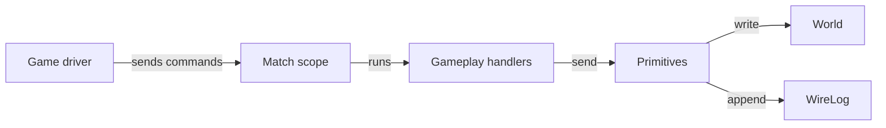

# Base docs

The base is a .NET stack in the VSA shape. One match scope owns one World, and gameplay changes the World only with primitive commands. Each accepted primitive goes to the `WireLog`, so a peer can apply the same entries to its own World.

| Page | Contents |
|---|---|
| [layout.md](layout.md) | Folders, projects, plugins and modules |
| [write-path.md](write-path.md) | Match scope, reader, primitives, log, bypass routes |
| [peers.md](peers.md) | Server and client peers, frames |

The rules for sessions that change the base are in [../CLAUDE.md](../CLAUDE.md).
