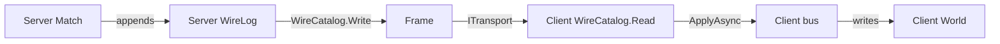

# Peers

[Back to the index](README.md)

Each peer has its own host, its own `Match` and its own World. The server sends its `WireLog` entries as frames, and a client applies them on its own bus, so the same Ecs handlers write each World.

## Frames

| Part | Size | Contents |
|---|---|---|
| Id | 1 byte | Catalog id of the entry type |
| Payload | Variable | MemoryPack bytes of the entry |

- Catalog ids sort on `WireCatalog.KeyOf`, a type name with no assembly. Two peers with the same keys get the same ids.
- `WireCatalog.ApplyAsync` sends a received primitive to the bus. It appends a received `GroupStart` or `GroupEnd` to the log.
- A client that applies an entry also records it in its own log. Its log is then equal to the server log.
- Ids come from `World.NextId()` and are not used again. Peers that apply the same entries make the same ids.

## Status

| Part | Phase | State |
|---|---|---|
| Log, catalog, client apply | P6 | Done; `Wire.Tests/PeerTests` |
| `Match`, gameplay modules | P7 | Done |
| Server and client roles, frames on `ITransport` | P8 | Planned |
| Test host: one server, N clients, loopback | P8 | Planned |
| Catalog hash in the handshake | P8 | Planned |

## Rules for P8

- Do not forward `WireLog.Appended` on a client. The client log holds applied entries, not new ones.
- Friflo is not thread-safe. Run the commands of one match one at a time.
