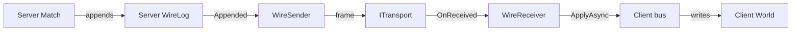

# Peers

[Back to the index](README.md)

Each peer has its own app host, its own `Match` and its own World. The server sends its `WireLog` entries as frames to each client, and a client applies them on its own bus, so the same Ecs handlers write each World.



## Roles

| Role | Registers | Transports | Does |
|---|---|---|---|
| Server | `WireSender`, scoped | One for each client | Sends the hello, then each log entry |
| Client | `WireReceiver`, scoped | One to the server | Applies each frame, in order |

The role flag is in the composition call. `Tests/Testing/Peer.Start(role, transports)` holds it:

```csharp
IHost host = VsaBuilder.Create().UseGenericHost().Services(s =>
{
    foreach (ITransport transport in transports) s.AddSingleton(transport);
    if (role == PeerRole.Server) s.AddScoped<WireSender>();
    else s.AddScoped<WireReceiver>();
}).Build();
Match match = new Match(host.Services);
match.Services.GetRequiredService<WireSender>();     // or WireReceiver: subscribes in its constructor
```

| Unity Framework | Base |
|---|---|
| `EngineInstaller(isServer, transport)` | Role flag in the composition call |
| `WireForwarder` | `WireSender` |
| `NetworkInboundBridge` | `WireReceiver` |
| `Dispatcher` and `NetworkChannel` | `WireCatalog.Write` and `Read` |
| `LoopbackTransport` | `InProcessTransport` |
| `MatchPair` | `PeerHost`: one server, N clients |

## Frames

| Part | Size | Contents |
|---|---|---|
| Id | 1 byte | Catalog id of the entry type |
| Payload | Variable | MemoryPack bytes of the entry |

- Ids 0 to 4 are fixed: `CreateEntity`, `DeleteEntity`, `GroupStart`, `GroupEnd`, `WireHello`. The key types follow, sorted on `WireCatalog.KeyOf`, a type name with no assembly.
- `WireCatalog.Hash` is FNV-1a 64 of the keys in id order. Two catalogs with the same keys have the same ids and the same hash.
- `WireHello(Hash)` is the first frame to each client. It never goes in a log.
- Ids come from `World.NextId()` and are not used again. Peers that apply the same entries make the same ids.

## Receiver

| Case | Result |
|---|---|
| `WireHello` with an equal hash | Later entries apply |
| `WireHello` with a different hash | `Idle` faults; no entry applies |
| Entry before `WireHello` | `Idle` faults |
| Entry gives an `Error` | `Idle` faults with the entry |
| After a fault | No more frames apply |

- `OnReceived` copies the borrowed bytes. The frames apply one at a time, in arrival order. `Idle` completes when each received frame is applied.
- A client that applies an entry also records it in its own log. Its log is then equal to the server log.
- A client registers no `WireSender`, so it does not forward its log.

## Rules

- Friflo is not thread-safe. Use one thread for each peer host.
- If a handler yields, the next frames continue on the thread pool, because a generic host has no `SynchronizationContext`. They still apply one at a time. A Unity client must apply on its main thread.
- `WireReceiver` starts each apply in the execution context of its constructor. A client envelope never has a server envelope as its parent.
- Start the clients before the server. `WireSender` sends the hello in its constructor.

## Non-goals

- No client commands to the server. Reason: no code uses them.
- No late join and no disconnect. Reason: no user yet.
