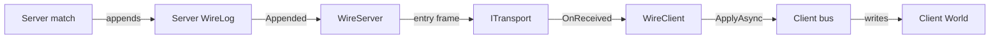
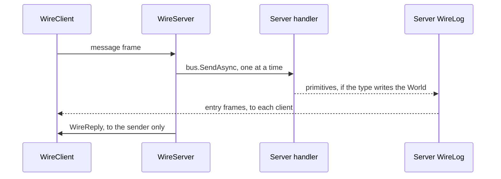

# Peers

[Back to the index](README.md)

Each peer has its own app host, its own match scope (`MatchFactory.Create()`) and its own World. The server sends its `WireLog` entries as frames to each client, and a client applies them on its own bus, so the same Ecs handlers write each World. A client sends client messages to the server and gets a direct reply.



## Roles

| Role | Registers | Transports | Does |
|---|---|---|---|
| Server | `WireServer`, scoped | One for each client | Sends the hello and each log entry; runs client messages; replies |
| Client | `WireClient`, scoped | One to the server | Applies each frame in order; sends client messages |

The role flag is in the composition call. `Tests/Testing/Peer.Start(role, transports)` holds it:

```csharp
IHost host = VsaBuilder.Create().UseGenericHost().Services(s =>
{
    foreach (ITransport transport in transports) s.AddSingleton(transport);
    if (role == PeerRole.Server) s.AddScoped<WireServer>();
    else s.AddScoped<WireClient>();
}).Build();
using IServiceScope match = host.Services.GetRequiredService<MatchFactory>().Create();
match.ServiceProvider.GetRequiredService<WireServer>();     // or WireClient: subscribes in its constructor
```

| Unity Framework | Base |
|---|---|
| `EngineInstaller(isServer, transport)` | Role flag in the composition call |
| `WireForwarder` | `WireServer` |
| `NetworkInboundBridge` | `WireClient` |
| `Dispatcher` and `NetworkChannel` | `WireCatalog.Write` and `Read` |
| `LoopbackTransport` | `InProcessTransport` |
| `MatchPair` | `PeerHost`: one server, N clients |

## Frames

```text
frame  = [id: varint][MemoryPack payload]
varint = 7 bits of the id in each byte, low bits first; a high bit of 1 means "one more byte"
```

| Id range | Header size (bytes) |
|---|---|
| 0 to 127 | 1 |
| 128 to 16,383 | 2 |
| 16,384 to 2,097,151 | 3 |
| Up to `int.MaxValue` | 5 maximum |

- Ids 0 to 5 are fixed: `CreateEntity`, `DeleteEntity`, `GroupStart`, `GroupEnd`, `WireHello`, `WireReply`. The key types and the client message types follow, sorted on `WireCatalog.KeyOf`, a type name with no assembly.
- `WireCatalog.Hash` is FNV-1a 64 of the keys in id order. Two catalogs with the same types have the same ids and the same hash.
- `WireHello(Hash)` is the first frame to each client. It never goes in a log.
- Ids come from `World.NextId()` and are not used again. Peers that apply the same entries make the same ids.

## Client messages



```csharp
[MemoryPackable]
public sealed partial record Ping(int Sequence) : IClientMessage<Pong>;      // built in, in Peers

Result<Pong> pong = await client.SendAsync(new Ping(1), ct);                 // client: WireClient of the match scope
```

- A client message is a command that implements `IClientMessage<TReply>`. `WirePlugin` puts each one of a closed command handler in the catalog. A message outside the module assemblies needs `WireTypes.Of(t => t.ClientMessage<TMessage, TReply>())`.
- The handler of the message type selects its path. Only primitives and group entries go in the `WireLog`. A chat handler returns a value, and a game action handler sends primitives.
- `WireReply` holds the error, or the MemoryPack bytes of the result. It never goes in a log.
- The transport keeps the order, and the server runs the messages of a client in order. Each reply completes the oldest open send. No request id is necessary.
- A rejected message gives its error. A handler that throws gives `PeerErrors.HandlerFailed`. The match continues.
- The client World changes only from the entry frames of the server.

## Disconnect

- `WireServer.Disconnect(transport)` stops the sends to that client and its received frames. The match continues for the other clients.
- The server disconnects a client that sends a frame that is not a client message: a primitive, an unknown id or a bad payload.
- `WireClient.Dispose` fails each open send with `ObjectDisposedException`, and each later send throws.
- A transport that throws on a send loses its client. The other clients still get the frame.
- `ITransport` has no close event. A transport adapter calls `Disconnect` when its connection ends.

## Order

| Case | Result |
|---|---|
| `WireHello` with an equal hash | Later entries apply |
| `WireHello` with a different hash | `Idle` faults; no entry applies |
| Entry before `WireHello` | `Idle` faults |
| Entry gives an `Error` | `Idle` faults; each open send fails |
| After a fault | No more frames apply |

- `WireServer` and `WireClient` copy the borrowed bytes, then run the frames of their match one at a time, in arrival order. On an empty queue, a frame runs inline on the thread of the transport. `Idle` completes when each received frame is applied.
- A client that applies an entry also records it in its own log. Its log is then equal to the server log.
- A client registers no `WireServer`, so it does not forward its log.
- Issue #248 moves the queue into a pipeline step that runs before validation.

## Rules

- Friflo is not thread-safe. Local driver code sends on the bus directly, not through the queue, so use one thread for each peer host.
- With `InProcessTransport`, a server handler runs on the thread of the client that sends. Do not send on the server bus while clients send messages from other threads.
- If a handler yields, the next frames continue on the thread pool, because a generic host has no `SynchronizationContext`. They still apply one at a time. A Unity client must apply on its main thread.
- Each frame runs in the execution context of the role service constructor. A client envelope never has a server envelope as its parent.
- Start the clients before the server. `WireServer` sends the hello in its constructor.

## Non-goals

- No late join, no reconnect and no player presence check. Reason: session management is a later phase (issue #249).
- No server request that a client answers, no stored async requests and no sender identity. Reason: later phases, in the order of issue #249.
- No close event on `ITransport`. Reason: the NGO adapter defines the close signal of a real transport.
