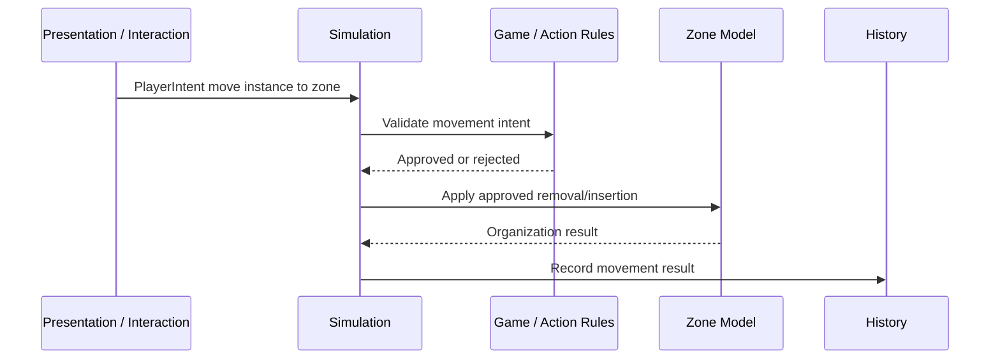

# Zone Model

This document outlines the conceptual model for zones after the decisions in [Zone Model Decisions](11-zone-model-decisions.md).

Related docs:

- [Core Glossary](09-core-glossary.md)
- [Entity, Definition, And Instance Model](10-entity-definition-instance-model.md)
- [Zone Model Decisions](11-zone-model-decisions.md)

## Model Summary

A zone is a simulation model that contains or groups instances and knows how to organize those contents.

The working model is:

> Zone = definition + zone instance + contents + organization behavior + visibility + change bookkeeping.

Zones are not only containers. They can represent structured game concepts like hands, decks, discard piles, battlefields, stacks, shops, card packs, production slots, and temporary areas.

Zones should not own broad gameplay legality. A larger game/action rules layer should decide whether an actor may move an instance into, out of, or within a zone. Once a move is approved, the zone owns how its contents are arranged and what bookkeeping happens.

## Zone Definitions And Zone Instances

Like other entities, zones should have definitions and instances.

### Zone Definition

The authored base data for a kind of zone.

Examples:

- Player hand zone definition.
- Draw pile zone definition.
- Discard pile zone definition.
- MTG stack zone definition.
- Stacklands physical stack zone definition.
- Shop row zone definition.
- Card pack zone definition.

### Zone Instance

The runtime zone in a session.

Examples:

- Player 1 hand.
- Player 2 hand.
- Current encounter draw pile.
- Shared battlefield.
- Active rules stack.
- This specific physical stack on a board.

## Core Responsibilities

Zones should be described by responsibilities, not a fixed trait checklist.

| Responsibility     | Meaning                                                                                            |
| ------------------ | -------------------------------------------------------------------------------------------------- |
| Contents           | Which instances are in the zone.                                                                   |
| Arrangement        | How contents are ordered, grouped, stacked, slotted, or otherwise addressed.                       |
| Capacity / Size    | Default size limits, count limits, slot limits, or similar organizational constraints.             |
| Insertion Behavior | Where an approved incoming instance goes: top, bottom, next slot, chosen index, grouped pile, etc. |
| Removal Behavior   | How contents close gaps, reorder, unstack, or update after an instance leaves.                     |
| Visibility         | What each actor/viewer can know about membership and details.                                      |
| Change Bookkeeping | What state changes or history facts are emitted when contents change.                              |

This avoids forcing all zones into a universal boolean trait list while keeping legality outside the zone.

## Legality Boundary

The zone should not answer broad questions like:

- Can this card type go here?
- Is this actor allowed to move this card here?
- Can this card be played from this source zone?
- Does this effect ignore the normal maximum hand size?
- Is this target valid?

Those are game/action rules questions.

The zone may answer narrower organization questions like:

- How many instances are currently here?
- What is the default capacity?
- Where should an approved instance be inserted?
- If this zone is full, what is the default organizational result?
- Can the requested index/slot exist?
- What changed when an instance was added or removed?

Capacity should be treated as an overridable/default organizational constraint, not an absolute law. A game rule or effect may force a move, ignore a limit, replace a limit, or choose a special insertion mode.

This means a zone can provide a default "this is full" answer, but that answer is data for the action rules to interpret. It should not prevent a higher-priority game effect from force-pushing an instance into the zone.

## Contents And Arrangement

A zone must be able to answer what it contains.

Arrangement can vary by game:

- Ordered list.
- Unordered set.
- Indexed slots.
- Top/bottom pile.
- Stack order.
- Grouped piles.
- Hidden sequence.
- Game-specific structure.

Spatial coordinates are not required by the core zone model. If a game needs spatial placement as rules data, that should be added by a spatial preset or game-specific model. If spatial placement is only visual, it belongs to presentation/layout.

## Stack Zones

Stacks should be modeled as zones with custom organization.

### MTG-Style Rules Stack

An MTG-style stack zone may define:

- Ordered contents.
- Top/bottom insertion behavior.
- How contents are addressed for later resolution.
- Who may see stack contents.

Priority, legal actions, and resolution are scheduler/action rules. The stack zone can organize pending spell/ability instances, but it should not own the full priority system.

### Stacklands-Style Physical Stack

A Stacklands-style physical stack zone may define:

- Which instances are stacked together.
- Which instance is top/bottom.
- How new approved instances are inserted.
- How instances are removed or unstacked.

Recipe matching, timers, production, automatic combat, and work are game systems that may observe or query the stack zone. The visual pile can be handled by presentation, but the fact that those instances are grouped together belongs to simulation.

## Visibility Model

Visibility should not be a single boolean.

The early model should separate two channels:

| Channel               | Question It Answers                                                                | Example                                                                        |
| --------------------- | ---------------------------------------------------------------------------------- | ------------------------------------------------------------------------------ |
| Membership Visibility | Can this actor know which instance IDs are in this zone and how they are arranged? | A player sees the exact cards in their hand; an opponent may only see a count. |
| Detail Visibility     | Given a known instance ID, can this actor see its definition and variable data?    | A face-down card may be visible as an instance but hide its definition.        |

Later, visibility may include more channels:

- Count visibility.
- Order visibility.
- Group visibility.
- Definition visibility.
- Variable visibility.
- Modifier visibility.
- Relationship visibility.
- History visibility.

Actor/player/ownership semantics are not finalized yet, so this doc only establishes the need for per-viewer visibility.

## Zone Movement

Zone movement is a simulation-driven game action.

The zone model should not assume presentation can directly move cards. A drag/drop interaction can request movement, but the simulation decides whether it is allowed.

Expected flow:

The exact names for request, command, task, event, and history are still pending. The important rule is that movement is approved by simulation/game rules, while zones organize approved content changes.

## What Zones Should Not Own Yet

Zones should not own these concerns by default:

- Visual layout.
- Screen-space or world-space coordinates.
- Pointer interactions.
- Animation.
- Broad gameplay legality.
- Card type legality.
- Actor permission rules.
- Generated reward choices.
- Draft choice semantics.
- Networking transport.
- Final actor/player ownership rules.

Some game-specific zone types may incorporate spatial or reward behavior later, but the base zone model should stay focused on contents, organization, visibility, capacity defaults, and change bookkeeping.

## Zone Examples

| Zone           | Contents                         | Organization                                         | Visibility Direction                               | External Game Systems                             |
| -------------- | -------------------------------- | ---------------------------------------------------- | -------------------------------------------------- | ------------------------------------------------- |
| Hand           | Card instances                   | Ordered or player-arranged list; optional size limit | Owner sees details; others may see count only      | Playability, discard rules, maximum hand effects. |
| Deck           | Card instances                   | Ordered hidden pile                                  | Owner/opponent may see count but not order/details | Draw, shuffle, search, mill.                      |
| Discard        | Card instances                   | Ordered or unordered pile                            | Usually public details                             | Search, recycle, graveyard effects.               |
| Battlefield    | Card/unit instances              | Slots, rows, groups, or unordered presence           | Usually public details                             | Combat, presence, auras, targeting.               |
| Rules Stack    | Pending spell/ability instances  | Ordered stack, usually top-insertion                 | Usually public details                             | Priority, legal additions, resolution.            |
| Physical Stack | Card/resource instances          | Stack order/group                                    | Depends on game                                    | Recipes, timers, work, combat.                    |
| Shop Row       | Offer instances                  | Indexed list                                         | Usually public details                             | Purchase rules, refresh rules, pricing.           |
| Card Pack      | Generated or contained instances | Hidden bundle or reveal sequence                     | May hide contents until opened                     | Pack opening and generation rules.                |

## Open Questions Left For Later

- Are zones always entity instances, or can some zones be lightweight session records?
- Is zone membership best represented as a variable, relationship, Store slice, or zone-owned collection?
- How do actor, player, owner, controller, and viewer differ?
- How do game/action rules query zone organization without delegating legality to the zone?
- What does a forced/override insertion API look like?
- What is the exact visibility query API?
- How should history record hidden movement?
- How should generated rewards and choices relate to zones?
- How should spatial rule systems attach to zone content?

## Useful Invariants

- Zones are simulation models.
- Zones can be instances with definitions.
- Zones own contents, organization, capacity defaults, and change bookkeeping.
- Zones do not own broad gameplay legality.
- Zone membership does not replace an instance.
- Stack concepts can be modeled as zones with custom organization.
- Spatial placement is not required in the base zone model.
- Visibility needs separate membership and detail channels.
- Movement between zones is approved by game/action rules and organized by zones.

