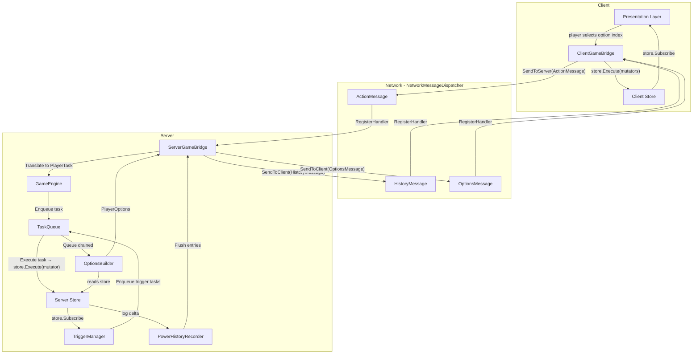

# Card Game Base Architecture Plan

## Core Philosophy

**Server-authoritative, dumb-client** (SabberStone/Hearthstone pattern).  
The server runs the entire game engine. Clients are passive receivers that replay `PowerHistory` entries onto their local `Store`. No client-side prediction.

---

## Folder Layout

```
Assets/Scripts/Game/
├── Engine/
│   ├── Entities/        GameEntity, GameTag (enum), EntityZone (enum)
│   ├── Tasks/           ITask, PlayerTask subtypes, TaskQueue, TaskProcessor
│   ├── Triggers/        ITrigger, TriggerManager
│   ├── Options/         PlayerOptions, PlayerOption, OptionsBuilder
│   ├── History/         IPowerHistoryEntry subtypes, PowerHistoryRecorder
│   ├── States/          GameState, EntityState, TurnState (extend Scaffold.States.State)
│   └── GameEngine.cs
├── Bridge/
│   ├── IGameBridge.cs   (interface — decouples engine from networking)
│   ├── Server/          ServerGameBridge.cs
│   └── Client/          ClientGameBridge.cs
├── Messages/            Unmanaged structs for NetworkMessageDispatcher
│   ├── HistoryMessage.cs
│   ├── OptionsMessage.cs
│   └── ActionMessage.cs
└── State/               (existing — Store, Mutator, State)
```

---

## Data Flow Diagram




---

## 1. How the Client Receives Data

`ClientGameBridge` registers two handlers on startup via `INetworkMessageDispatcher`:

```csharp
dispatcher.RegisterHandler<HistoryMessage>(OnHistoryReceived);
dispatcher.RegisterHandler<OptionsMessage>(OnOptionsReceived);
```

The server calls `dispatcher.SendToClient<HistoryMessage>(packed, clientId)` after each action resolves.

---

## 2. What the Client Does with the Data

`OnHistoryReceived` unpacks the `HistoryMessage` and applies each `IPowerHistoryEntry` to the **client-side Store** via Mutators:

- `PowerHistoryTagChange` → `store.Execute(new TagChangeMutator(entityId, tag, value))`
- `PowerHistoryFullEntity` → `store.Execute(new AddEntityMutator(...))`
- `PowerHistoryShowEntity` → `store.Execute(new RevealEntityMutator(...))`
- `PowerHistoryHideEntity` → `store.Execute(new HideEntityMutator(...))`

Presentation layer is decoupled: it only `store.Subscribe<TState>()` and reacts to state changes.

---

## 3. How the Client Knows an Action Is Required

When the server sends `OptionsMessage`, `OnOptionsReceived` applies it to the Store:

```csharp
store.Execute(new SetPlayerOptionsStateMutator(options));
```

If `PlayerOptionsState.Options` is non-empty and belongs to the local player → the player has priority. Presentation layer subscribes to `PlayerOptionsState` and surfaces the UI.

---

## 4. How the Client Sends an Action

Player selects an option by **index** (never raw entity commands). `ClientGameBridge` constructs:

```csharp
// unmanaged struct — works with NetworkMessageDispatcher directly
public struct ActionMessage {
    public int OptionIndex;
    public int TargetEntityId;
    public int SubOption;
}
dispatcher.SendToServer(new ActionMessage { OptionIndex = i, TargetEntityId = targetId });
```

---

## 5. How the Server Receives Client Actions

`ServerGameBridge` registered on startup:

```csharp
dispatcher.RegisterHandler<ActionMessage>(OnActionReceived);
// signature: void OnActionReceived(ulong senderClientId, ActionMessage message)
```

---

## 6. What the Server Does with Client Actions

`OnActionReceived` performs two steps before touching the engine:

1. **Priority check** — verify `senderClientId` matches the current priority player in the Store.
2. **Option translation** — look up `_serverOptions[senderClientId][message.OptionIndex]` to get the authoritative `PlayerTask`. The client only ever sends an index; it cannot forge a task.

Then: `gameEngine.Submit(playerTask)`.

---

## 7. How the Server Moves Game State

`TaskQueue` is a sequential processor. `TaskProcessor` pops the head task:

```csharp
// Inside a task, e.g. PlayCardTask
store.Execute(new MoveCardToZoneMutator(cardId, Zone.Play));
store.Execute(new DeductManaTask(cost));
powerHistoryRecorder.Log(new PowerHistoryTagChange(...));
```

`TaskQueue` supports **pending tasks**: mid-execution, new tasks enqueued by triggers land in a "pending" bucket. After the current task completes, the pending bucket is promoted and processed next. This handles cascades without recursion.

---

## 8. How the Server Handles Cascading Effects

`TriggerManager` subscribes to the Server `Store` at setup:

```csharp
store.Subscribe<EntityState>(OnEntityStateChanged);
```

When `EntityState` changes match a trigger condition (e.g., `Health <= 0` → death, `Zone` change → summon trigger), `TriggerManager` enqueues a `TriggerTask` into `TaskQueue.Pending`. `PowerHistoryRecorder` wraps these in `BlockStart(TRIGGER) / BlockEnd` pairs automatically, producing correct nesting.

---

## 9. How the Server Decides What a Player Can Do

After `TaskQueue` fully drains (no pending tasks remain), `OptionsBuilder.Build(store, playerId)` runs:

- Reads `TurnState` (phase, active player, mana available)
- Reads `EntityState` for all cards in the player's hand → filters by cost, zone legality, targeting rules
- Reads board state for valid attack pairings
- Returns `PlayerOptions` — a list of `PlayerOption { OptionType, EntityId, ValidTargetIds[] }`

Options are stored server-side in `_serverOptions` (keyed by `clientId`) and never sent raw — only a **packed index-addressable** version goes to the client.

---

## 10. How the Server Sends Data to the Client

After `TaskQueue` drains and options are built:

```csharp
// 1. Flush history and send (filtered per-player for hidden info)
var entries = powerHistoryRecorder.Flush();
var historyPacked = PackHistory(entries, clientId); // filters opponent hand
dispatcher.SendToClient(historyPacked, clientId);

// 2. Send options for priority player only
var optionsPacked = PackOptions(options);
dispatcher.SendToClient(optionsPacked, priorityClientId);
```

**Hidden information**: `PackHistory` filters `PowerHistoryFullEntity` / `ShowEntity` for cards in the opponent's hand zone, sending `PowerHistoryHideEntity` instead.

---

## 11. Decoupling Game Logic from Networking

`IGameBridge` is the seam:

```csharp
public interface IGameBridge
{
    void SendHistoryToClient(ulong clientId, IReadOnlyList<IPowerHistoryEntry> entries);
    void SendOptionsToClient(ulong clientId, PlayerOptions options);
    event Action<ulong, PlayerTask> OnPlayerTaskSubmitted;
}
```

- `GameEngine` depends only on `IGameBridge` — zero Unity Netcode imports.
- `ServerGameBridge : IGameBridge` wires `INetworkMessageDispatcher` to the bridge interface.
- `GameEngine` is fully unit-testable with a mock `IGameBridge` and an in-memory Store.

---

## Serialization Strategy

- `**ActionMessage**`: Simple fixed-size unmanaged struct → works with `INetworkMessageDispatcher` directly, no generator needed.
- `**HistoryMessage` / `OptionsMessage**`: Use `[AutoPack]` (the AutoPacker source generator) to produce a packed unmanaged struct from the managed DTOs. Fields that are managed types (e.g., `int[]` for target lists) use `[Packed(typeof(FixedList32Bytes<int>))]` or similar unmanaged equivalents. The generator enforces all fields are unmanaged at compile time (CSG002 diagnostic).
- Server-side `Store` state is `record` types with `{ get; init; }` properties — mutators use `with` expressions per game-state-guidelines.

---

## Key Types Summary


| Layer    | Type                         | Responsibility                                              |
| -------- | ---------------------------- | ----------------------------------------------------------- |
| Engine   | `GameEngine`                 | Orchestrates TaskQueue, TriggerManager, OptionsBuilder, PHR |
| Engine   | `TaskQueue`                  | Sequential + pending cascade resolution                     |
| Engine   | `TriggerManager`             | Subscribes to Store, enqueues trigger tasks                 |
| Engine   | `OptionsBuilder`             | Reads Store, emits valid `PlayerOptions`                    |
| Engine   | `PowerHistoryRecorder`       | Logs `IPowerHistoryEntry` per task                          |
| Bridge   | `IGameBridge`                | Decouples engine from transport                             |
| Bridge   | `ServerGameBridge`           | Wires `INetworkMessageDispatcher` to engine                 |
| Bridge   | `ClientGameBridge`           | Receives messages, applies to client Store                  |
| Messages | `ActionMessage`              | Client → Server: option index + target                      |
| Messages | `HistoryMessage`             | Server → Client: packed history entries                     |
| Messages | `OptionsMessage`             | Server → Client: packed valid options                       |
| State    | `EntityState : State`        | Per-entity tag dictionary in Store                          |
| State    | `TurnState : State`          | Phase, active player, mana, step                            |
| State    | `PlayerOptionsState : State` | Current valid options for local player                      |


