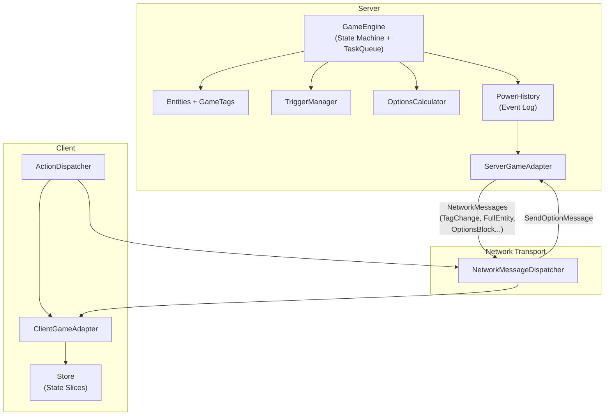
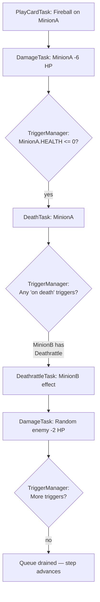
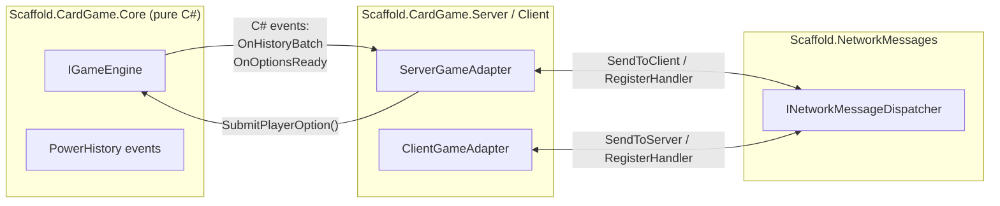

# Card Game Base Architecture Plan

## Guiding Principles

- **Server-authoritative**: The server owns all game logic. The client is a "dumb terminal" that renders state it receives.
- **Pure C# core engine**: The rules engine (`Scaffold.CardGame.Core`) has zero Unity or networking dependencies. It is a standalone library testable without Unity.
- **SabberStone-inspired**: Entity/Tag system, Step-based state machine, TaskQueue for effect resolution, PowerHistory for event logging.
- **Scaffold-integrated**: Client state lives in `Store` with `Mutator`s. Messages flow through `NetworkMessageDispatcher`. Complex DTOs use `[AutoPack]`.

---

## Architecture Overview




---

## Assembly / Module Layout

- `**Scaffold.CardGame.Core**` — Pure C# library. No Unity refs. Contains: `Entity`, `GameTag`, `Game`, `TaskQueue`, `Task`, `TriggerManager`, `PowerHistory`, `OptionsCalculator`.
- `**Scaffold.CardGame.Messages**` — `unmanaged` struct message types (`TagChangeMessage`, `OptionsBlockMessage`, etc.). References `Scaffold.NetworkMessages` contracts and optionally `AutoPackerContracts`.
- `**Scaffold.CardGame.Server**` — `ServerGameAdapter`. Bridges Core engine to NetworkMessageDispatcher. Runs on host.
- `**Scaffold.CardGame.Client**` — `ClientGameAdapter`, Store state records, Mutators. Receives messages and updates Store. Runs on all clients.

---

## Answering the 11 Questions

### 1. How does the client receive data?

The `ClientGameAdapter` registers typed handlers on `INetworkMessageDispatcher` during initialization:

```csharp
dispatcher.RegisterHandler<TagChangeMessage>(OnTagChange);
dispatcher.RegisterHandler<FullEntityMessage>(OnFullEntity);
dispatcher.RegisterHandler<ShowEntityMessage>(OnShowEntity);
dispatcher.RegisterHandler<HideEntityMessage>(OnHideEntity);
dispatcher.RegisterHandler<BlockStartMessage>(OnBlockStart);
dispatcher.RegisterHandler<BlockEndMessage>(OnBlockEnd);
dispatcher.RegisterHandler<OptionsBlockMessage>(OnOptionsBlock);
```

The server sends these messages via `dispatcher.SendToClient<T>(msg, clientId)`. Unity Netcode handles transport. Messages arrive as deserialized `unmanaged` structs directly into the handler callbacks.

### 2. What the client does with the data?

Each handler applies the received event to the client's `Store` via Mutators:

```csharp
void OnTagChange(ulong sender, TagChangeMessage msg)
{
    var entityRef = entityRegistry.GetReference(msg.EntityId);
    store.Execute(entityRef, new SetTagMutator(msg.Tag, msg.Value));
}
```

The `Store` holds per-entity state slices keyed by `IReference`. A single `EntityTagState` record per entity contains its tag dictionary. Mutators produce new immutable state, and subscribers (presentation layer, later) react to changes.

**Client state records** (in `Assets/Scripts/Game/State` or a new `CardGame.Client` area):

```csharp
public record EntityTagState(ImmutableDictionary<GameTag, int> Tags) : State;
public record GamePhaseState(Step CurrentStep, int Turn) : State;
public record OptionsState(ImmutableList<PlayerOption> Options) : State;
```

### 3. How the client knows if an action is required?

The server sends an `OptionsBlockMessage` when it needs player input. This message contains an array of valid option descriptors. On the client:

```csharp
void OnOptionsBlock(ulong sender, OptionsBlockMessage msg)
{
    store.Execute(new SetOptionsMutator(msg.Options));
    // Presentation layer subscribes to OptionsState and enables UI
}
```

When `OptionsState` is empty / null, no action is possible. When populated, the presentation layer knows to unlock interaction. The client never independently decides what is legal -- it is told.

### 4. How the client sends an action to the server?

The client constructs a `SendOptionMessage` referencing the server-provided option index and optional target:

```csharp
public struct SendOptionMessage  // unmanaged
{
    public int OptionIndex;
    public int SubOptionIndex;
    public int TargetEntityId;
}
```

An `ActionDispatcher` service exposes a method the presentation layer calls:

```csharp
public void SubmitOption(int optionIndex, int subOption, int targetId)
{
    var msg = new SendOptionMessage { OptionIndex = optionIndex, SubOptionIndex = subOption, TargetEntityId = targetId };
    networkDispatcher.SendToServer(msg);
    store.Execute(new ClearOptionsMutator()); // lock UI
}
```

The client sends only integer indices. It never describes what happens -- only which pre-approved option it chose.

### 5. How the server receives client actions?

The `ServerGameAdapter` registers a handler for `SendOptionMessage`:

```csharp
dispatcher.RegisterHandler<SendOptionMessage>(OnClientOption);

void OnClientOption(ulong clientId, SendOptionMessage msg)
{
    var player = playerRegistry.GetPlayer(clientId);
    gameEngine.SubmitPlayerOption(player, msg.OptionIndex, msg.SubOptionIndex, msg.TargetEntityId);
}
```

The adapter translates the network client ID to the core engine's player reference, then forwards into the pure game engine.

### 6. What the server does with client actions?

Inside `GameEngine.SubmitPlayerOption`:

1. **Validate**: Look up the cached `OptionsBlock` for this player. Confirm `OptionIndex` is in bounds and the player currently has priority.
2. **Translate**: Map the abstract option to a concrete `PlayerTask` (e.g., `PlayCardTask`, `AttackTask`, `EndTurnTask`). The option entry already knows its task type; the target entity ID is resolved against the authoritative entity registry.
3. **Enqueue**: Push the `PlayerTask` into the `TaskQueue`.
4. **Process**: Call `game.Process()` to advance the state machine, which drains the TaskQueue.

```csharp
public void SubmitPlayerOption(Player player, int optionIdx, int subOption, int targetId)
{
    var option = cachedOptions[player][optionIdx];
    var task = option.ToPlayerTask(player, entityLookup, targetId, subOption);
    taskQueue.Enqueue(task);
    Process();
}
```

### 7. How the server moves game state?

The `Game` class is a step-based state machine. The `Step` enum defines phases:

```csharp
public enum Step
{
    BeginFirst, BeginShuffle, BeginDraw, BeginMulligan,
    MainReady, MainStartTriggers, MainResource, MainDraw,
    MainAction, MainEnd, MainCleanup, MainNext,
    FinalWrapup, FinalGameOver
}
```

`Game.Process()` advances through steps. At each step, the `GameEventManager` (observer) calls the corresponding method:

```csharp
void OnStepChanged(Step newStep)
{
    switch (newStep)
    {
        case Step.MainReady:    game.MainReady(); break;
        case Step.MainAction:   game.MainAction(); break; // waits for input
        case Step.MainEnd:      game.MainEnd(); break;
        // ...
    }
}
```

State changes happen exclusively by mutating `GameTag` values on entities. The `TaskQueue` processes tasks sequentially; each task modifies tags, which the `PowerHistory` logger records as `TagChange` entries.

### 8. How the server handles cascading effects?

The `TriggerManager` + `TaskQueue` combo handles this (SabberStone's core pattern):

1. A `Task` executes (e.g., `DamageTask` reduces a minion's `HEALTH` tag).
2. If health reaches 0, a `DeathProcessingTask` is enqueued.
3. The `TriggerManager` listens for tag-change events. Active entities with matching triggers (e.g., "Whenever a minion takes damage") get their effects enqueued as new tasks.
4. The `TaskQueue` processes these new tasks in order. Each may trigger further effects.
5. **Block nesting** in `PowerHistory` tracks depth: each task that begins logs a `BlockStart`; when it completes, `BlockEnd`. Nested triggers create nested blocks.




The queue is flat (not recursive call-stack), so deeply nested chains resolve without stack overflow risk.

### 9. How the server decides what the player can do?

An `OptionsCalculator` queries the authoritative game state during the `MainAction` step:

```csharp
public List<PlayerOption> CalculateOptions(Game game, Player player)
{
    var options = new List<PlayerOption>();
    
    // Cards in hand that can be played (check cost, targets, zone)
    foreach (var card in player.HandZone)
    {
        if (card[GameTag.Cost] <= player[GameTag.Resources] 
            && !card.HasTag(GameTag.Exhausted))
        {
            var targets = GetValidTargets(game, card);
            options.Add(new PlayerOption(OptionType.PlayCard, card, targets));
        }
    }
    
    // Minions that can attack
    foreach (var minion in player.BoardZone)
    {
        if (minion.CanAttack())
        {
            var targets = GetAttackTargets(game, minion);
            options.Add(new PlayerOption(OptionType.Attack, minion, targets));
        }
    }
    
    // Hero power, hero attack, end turn...
    options.Add(new PlayerOption(OptionType.EndTurn));
    return options;
}
```

These options are cached server-side (for validation) and serialized into an `OptionsBlockMessage` sent to the client.

### 10. How the server sends data to the client?

As the `TaskQueue` processes, the `PowerHistory` logger accumulates entries:

```csharp
public interface IPowerHistoryEntry { }
public record PowerBlockStart(BlockType Type, int SourceEntityId) : IPowerHistoryEntry;
public record PowerBlockEnd() : IPowerHistoryEntry;
public record PowerTagChange(int EntityId, GameTag Tag, int Value) : IPowerHistoryEntry;
public record PowerFullEntity(int EntityId, Dictionary<GameTag, int> Tags) : IPowerHistoryEntry;
public record PowerShowEntity(int EntityId, int CardId, Dictionary<GameTag, int> Tags) : IPowerHistoryEntry;
public record PowerHideEntity(int EntityId) : IPowerHistoryEntry;
```

The `ServerGameAdapter` subscribes to the engine's `OnHistoryBatchReady` event. When a complete logical sequence resolves:

```csharp
void OnHistoryBatchReady(Player targetPlayer, List<IPowerHistoryEntry> entries)
{
    var clientId = playerRegistry.GetClientId(targetPlayer);
    foreach (var entry in entries)
    {
        switch (entry)
        {
            case PowerTagChange tc:
                dispatcher.SendToClient(new TagChangeMessage 
                    { EntityId = tc.EntityId, Tag = (int)tc.Tag, Value = tc.Value }, clientId);
                break;
            case PowerFullEntity fe:
                // send FullEntityMessage with packed tags
                break;
            // ... other entry types
        }
    }
}
```

**Information hiding**: The engine produces separate history logs per player (opponent hand cards are `HideEntity`, not `FullEntity`). Each client only receives what they are allowed to see.

### 11. How to decouple game-logic from networking?

Three-layer boundary with a pure interface contract:




`**IGameEngine**` — the contract the adapter depends on:

```csharp
public interface IGameEngine
{
    event Action<Player, IReadOnlyList<IPowerHistoryEntry>> OnHistoryBatchReady;
    event Action<Player, IReadOnlyList<PlayerOption>> OnOptionsReady;
    
    void StartGame(GameConfig config);
    void SubmitPlayerOption(Player player, int optionIndex, int subOption, int targetId);
}
```

- The Core engine references nothing outside itself.
- The Adapter references Core (for `IGameEngine`) and NetworkMessages (for `INetworkMessageDispatcher`).
- The NetworkMessages module references only Unity Netcode.
- Swapping transport (e.g., from Unity Netcode to raw TCP or a test harness) only requires providing a different `INetworkMessageDispatcher` implementation -- the engine and adapter logic remain untouched.

---

## Network Message Structs

Defined as `unmanaged` structs in `Scaffold.CardGame.Messages`, compatible with the existing `NetworkMessageDispatcher`:


| Message               | Direction        | Key Fields                                            |
| --------------------- | ---------------- | ----------------------------------------------------- |
| `TagChangeMessage`    | Server to Client | `EntityId`, `Tag`, `Value`                            |
| `FullEntityMessage`   | Server to Client | `EntityId`, `CardId`, packed tag array (fixed buffer) |
| `ShowEntityMessage`   | Server to Client | `EntityId`, `CardId`, packed tag array                |
| `HideEntityMessage`   | Server to Client | `EntityId`, `Zone`                                    |
| `BlockStartMessage`   | Server to Client | `BlockType`, `SourceEntityId`                         |
| `BlockEndMessage`     | Server to Client | (empty)                                               |
| `OptionsBlockMessage` | Server to Client | Packed option array (indices, types, target lists)    |
| `SendOptionMessage`   | Client to Server | `OptionIndex`, `SubOptionIndex`, `TargetEntityId`     |


For messages with variable-length data (tag arrays, option lists), either use fixed-size buffers (`unsafe fixed int Tags[32]`) or split into multiple messages with a sequence protocol. If richer serialization is needed, the `[AutoPack]` generator can be used to create managed wrapper classes that pack/unpack to these structs.

---

## Client Store State Design

Using existing `Assets/Scripts/Game/State` patterns:

- `**EntityTagState**` — per-entity (keyed by entity `IReference`): holds `ImmutableDictionary<GameTag, int>`
- `**GamePhaseState**` — global: `CurrentStep`, `Turn`, `ActivePlayerId`
- `**OptionsState**` — per-player: list of `PlayerOption` descriptors (or empty if no action needed)
- `**EntityRegistryState**` — global: maps `int EntityId` to `IReference` for Store lookups

Mutators: `SetTagMutator`, `CreateEntityMutator`, `RevealEntityMutator`, `HideEntityMutator`, `SetOptionsMutator`, `ClearOptionsMutator`, `SetGamePhaseMutator`.

---

## Key Design Decisions

1. **GameTag dictionary vs typed state records**: The Core engine uses `Dictionary<GameTag, int>` on entities (flexible, data-driven, SabberStone-style). The client Store mirrors this with `EntityTagState` records. Specific typed records (`GamePhaseState`) are only for macro-level game flow.
2. **TaskQueue is server-only**: The client never runs tasks. It only applies pre-resolved state diffs.
3. **Options as integer indices**: The client sends only index references to server-approved options. No game logic leaks to the client.
4. **PowerHistory as the single source of truth for communication**: All server-to-client data flows through PowerHistory entries. This is the canonical diff format.
5. **Information hiding at the engine level**: The Core engine is responsible for filtering what each player can see. The adapter trusts the engine's per-player history batches.

