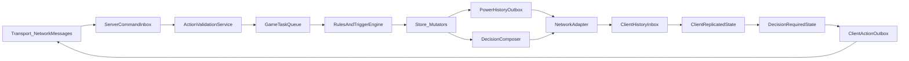

# Base Card Game Architecture Plan (C# Logic Only)

## Scope & Guiding Choices

- Prefer a **SabberStone-style authoritative server**: step/state machine + task queue + trigger/cascade resolution.
- Treat the client as a **state consumer + decision sender** (no rule authority, no prediction in this phase).
- Reuse existing primitives:
  - Store/Mutator state core: [Assets/Scripts/Game/State/Runtime/Store.cs](Assets/Scripts/Game/State/Runtime/Store.cs), [Assets/Scripts/Game/State/Runtime/Mutators/Mutator.cs](Assets/Scripts/Game/State/Runtime/Mutators/Mutator.cs)
  - Transport edge: [Assets/Scripts/Infra/NetworkMessages/Runtime/Contracts/INetworkMessageDispatcher.cs](Assets/Scripts/Infra/NetworkMessages/Runtime/Contracts/INetworkMessageDispatcher.cs), [Assets/Scripts/Infra/NetworkMessages/Runtime/Implementation/NetworkMessageDispatcher.cs](Assets/Scripts/Infra/NetworkMessages/Runtime/Implementation/NetworkMessageDispatcher.cs)
  - Serialization generator (current path): [Generators/AutoPacker/src/AutoPackerGenerator/AutoPackerGenerator.cs](Generators/AutoPacker/src/AutoPackerGenerator/AutoPackerGenerator.cs)
- Follow the existing decoupling direction in [Docs/Architecture/ReactiveNetworkQueue.md](Docs/Architecture/ReactiveNetworkQueue.md).

## Target Runtime Topology

## End-to-End Answers for the 11 Focus Points

1. **How client receives data**
  Server sends typed wire envelopes (`HistoryChunk`, `DecisionRequest`, `Snapshot`) through adapter -> `INetworkMessageDispatcher`; client adapter deserializes and pushes into inbox.
2. **What client does with data**
  Client applies incoming authoritative events to a replicated state model (Store slices on client), then emits domain events for presentation layer (kept outside this plan).
3. **How client knows action is required**
  Server emits explicit `DecisionRequest` containing `requestId`, `actor`, and prevalidated legal options. Presence of active request in client state means action is required.
4. **How client sends action to server**
  Client returns `DecisionResponse` (`requestId`, `optionId`, `targetRefs/payload`) via outbox -> network adapter -> dispatcher.
5. **How server receives client actions**
  Server adapter validates envelope/session, converts wire DTO to `PlayerActionCommand`, and enqueues to `ServerCommandInbox`.
6. **What server does with client actions**
  Server checks correlation (`requestId` still active), ownership (correct player), and legality against current authoritative option set; reject invalid/outdated decisions.
7. **How server moves game state**
  Valid commands are translated into domain tasks, executed sequentially in `GameTaskQueue`; only tasks may mutate state via Store mutators.
8. **How server handles cascading effects**
  Task execution emits domain events; trigger registry subscribes and enqueues follow-up tasks until queue drains. Wrap each root command in block boundaries for deterministic history.
9. **How server decides what player can do**
  `DecisionComposer` runs after queue drain and on priority windows, computes legal options from current state + rules validators, stores them as `PendingDecisionState`, and emits `DecisionRequest`.
10. **How server sends data to client**
  State changes are captured as ordered history entries (`BlockStart`, `TagChange`, `EntityCreate/Reveal`, `BlockEnd`), batched into outbound messages, then dispatched to relevant client(s).
11. **How to decouple game logic from networking**
  Enforce adapter boundary: domain depends on inbox/outbox interfaces only; networking depends on DTO/envelope + dispatcher. No direct reference from rules engine to `NetworkManager` or message transport.

## Module Boundaries (Business Logic)

- **Domain/Core (`Scaffold.Game.Logic`)**
  - `GameSession`, `StepStateMachine`, `GameTaskQueue`, `TriggerEngine`, `DecisionComposer`, validators, mutators.
  - Uses Store APIs only for state reads/writes.
- **Protocol (`Scaffold.Game.Protocol`)**
  - AutoPack-annotated wire DTOs/envelopes for command, decision, and history messages.
- **Adapter (`Scaffold.Game.Adapter`)**
  - `ServerNetworkAdapter`, `ClientNetworkAdapter`, mapping domain <-> protocol, session routing.
- **Application (`Scaffold.Game.Application`)**
  - Orchestrates tick/command loop, composes services, handles retries/timeouts.

## Reuse vs New Build

- **Reuse now**
  - Store/Mutator and subscription model from [Assets/Scripts/Game/State/Runtime](Assets/Scripts/Game/State/Runtime)
  - Network dispatcher contract from [Assets/Scripts/Infra/NetworkMessages/Runtime/Contracts/INetworkMessageDispatcher.cs](Assets/Scripts/Infra/NetworkMessages/Runtime/Contracts/INetworkMessageDispatcher.cs)
- **Implement next**
  - Command inbox/outbox interfaces + envelope registry
  - Deterministic task queue and trigger pipeline (filling current stubs in stack/effects paths)
  - Decision request/response lifecycle and correlation state
  - History/event stream model inspired by SabberStone power blocks

## Serialization Strategy (AutoPacker + NetworkMessages)

- Define wire DTO structs/classes with `[AutoPack]` and `[Packed]` constraints for unmanaged-safe transport representations.
- Keep domain commands/effects separate from wire DTOs; adapter maps both directions.
- Maintain generated type registry as canonical serialization lookup to avoid manual handler-per-type branching.

## Validation & Determinism Rules

- Single-threaded logical execution per match (`GameTaskQueue`) for deterministic outcomes.
- Immutable state slice updates through mutators only.
- Every inbound action must pass: session, ownership, correlation, legal option, and state-version checks.
- History stream is append-only per match tick/command, with monotonic sequence numbers.

## Delivery Phases

1. **Foundation**: Domain contracts (inbox/outbox/envelopes), session model, step machine skeleton.
2. **Authoritative loop**: Command validation -> task queue -> mutator commits -> history outbox.
3. **Cascades & options**: Trigger engine, decision composer, legal-options calculator.
4. **Protocol integration**: AutoPacker DTO generation + adapter mapping + dispatcher wiring.
5. **Hardening**: Replay/determinism tests, invalid-action/security tests, disconnect/rejoin snapshot flow.

## Key Existing Anchors

- State mutation and notifications already align with plan:
  - [Assets/Scripts/Game/State/Runtime/Store.cs](Assets/Scripts/Game/State/Runtime/Store.cs)
  - [Assets/Scripts/Game/State/Runtime/Events/StateEventHandler.cs](Assets/Scripts/Game/State/Runtime/Events/StateEventHandler.cs)
- Transport abstraction exists but still Unity-coupled under implementation:
  - [Assets/Scripts/Infra/NetworkMessages/Runtime/Implementation/NetworkMessageDispatcher.cs](Assets/Scripts/Infra/NetworkMessages/Runtime/Implementation/NetworkMessageDispatcher.cs)
- Existing architectural intent is compatible:
  - [Docs/Architecture/ReactiveNetworkQueue.md](Docs/Architecture/ReactiveNetworkQueue.md)
  - [Docs/SabberStone-Architecture-Analysis.md](Docs/SabberStone-Architecture-Analysis.md)

