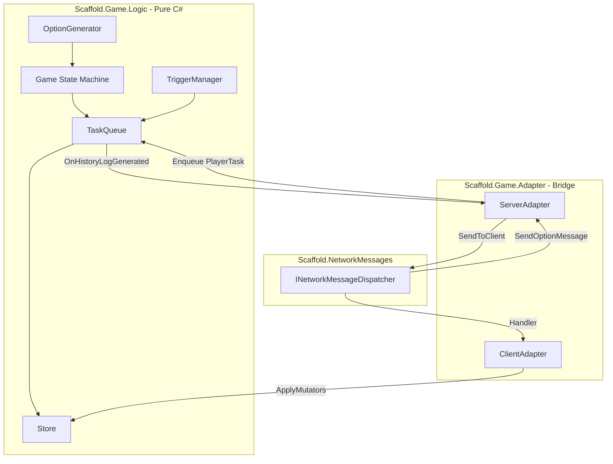

# Card Game Base Architecture Plan

This plan defines the C# business-logic architecture for a multiplayer card game, drawing from [SabberStone-Architecture-Analysis.md](Docs/SabberStone-Architecture-Analysis.md) (primary), [Fireplace-Architecture-Analysis.md](Docs/Fireplace-Architecture-Analysis.md), [Brimstone-Architecture-Analysis.md](Docs/Brimstone-Architecture-Analysis.md), and [Card Game Architecture Research.md](Docs/Research/Card%20Game%20Architecture%20Research.md). It integrates with [Store](Assets/Scripts/Game/State/Runtime/Store.cs), [NetworkMessageDispatcher](Assets/Scripts/Infra/NetworkMessages/Runtime/Implementation/NetworkMessageDispatcher.cs), and the [ReactiveNetworkQueue](Docs/Architecture/ReactiveNetworkQueue.md) / [BlackBoxSimulation](Docs/Architecture/BlackBoxSimulation.md) patterns.

---

## 1. How does the client receive the data?

**Flow:** Server → Transport → `INetworkMessageDispatcher` → Handler → **Inbox** → Client logic

- The server sends **unmanaged struct** messages (or packed DTOs) via `INetworkMessageDispatcher.SendToClient<T>()` / `SendToClients<T>()`.
- The client registers handlers with `dispatcher.RegisterHandler<T>(OnMessageReceived)`.
- On receive, the handler pushes the decoded message into a **CommandInbox** (or equivalent sink) that the game logic consumes.
- Messages are strongly typed DTOs such as `PowerHistoryBlockStart`, `PowerHistoryTagChange`, `PowerHistoryFullEntity`, `OptionsBlockMessage`, etc.

**Serialization:** Use `unmanaged` structs for simple DTOs (compatible with current [NetworkMessageDispatcher](Assets/Scripts/Infra/NetworkMessages/Runtime/Implementation/NetworkMessageDispatcher.cs)). For richer types, use [AutoPacker](Generators/AutoPacker) (`IPackable`/`IPackedStruct`) or a CustomSerializable generator to produce wire types; the adapter maps domain events to these wire types before sending.

---

## 2. What the client does with the data?

**Flow:** Inbox → **ClientStateApplier** → Store mutations → (optional) Visual queue

1. **Deserialize:** The network layer delivers decoded DTOs to the Inbox.
2. **Apply to Store:** A `ClientStateApplier` (or equivalent) consumes Inbox messages and applies them to the local [Store](Assets/Scripts/Game/State/Runtime/Store.cs) via `store.Execute(reference, mutator)`. Each message type maps to a specific Mutator (e.g., `TagChangeMessage` → `ApplyTagChangeMutator`).
3. **State updates:** Mutators produce new immutable State; the Store notifies subscribers via [StateEventHandler](Assets/Scripts/Game/State/Runtime/Events/StateEventHandler.cs).
4. **Visual queue (out of scope):** Presentation can subscribe to Store changes and enqueue visual actions; this plan focuses only on business logic.

---

## 3. How the client knows if an action is required?

**Flow:** Server sends `OptionsBlockMessage` when the game enters a priority phase.

- The server computes all legal options at the start of `MAIN_ACTION` (or equivalent) and sends an `OptionsBlockMessage` containing:
  - `OptionIndex` (0..N) for each valid play
  - Option metadata (e.g., card entity ID, target entity ID, option type: `END_TURN`, `PLAY`, `ATTACK`, etc.)
- The client stores this in a **RequestStore** (or `ActiveOptionsState` slice) and exposes it via `store.Get<ActiveOptionsState>()`.
- Controllers/UI read `store.Get<ActiveOptionsState>()` to know:
  - Whether an action is required (`HasActiveRequest`)
  - What options are valid (list of option indices and metadata)
- No action is required when the server is in non-interactive steps (e.g., `MAIN_END`, `BEGIN_MULLIGAN` resolved).

---

## 4. How the client sends an action to the server?

**Flow:** User selection → **ResponseOutbox** → Adapter → `SendToServer<T>()`

- The client never sends domain commands (e.g., "Deal 3 damage"). It sends **index-based references** to pre-approved options.
- When the user selects an option, the client writes a `SendOptionMessage` to a **ResponseOutbox** (or equivalent sink):
  - `OptionIndex` (int) — index into the server’s options list
  - `TargetEntityId` (int, optional) — for targeted plays
- The **Network Adapter** subscribes to the Outbox, maps the domain selection to `SendOptionMessage`, and calls `dispatcher.SendToServer(sendOptionMessage)`.
- The message is an `unmanaged` struct for compatibility with [INetworkMessageDispatcher](Assets/Scripts/Infra/NetworkMessages/Runtime/Contracts/INetworkMessageDispatcher.cs).

---

## 5. How the server receives client actions?

**Flow:** Transport → `INetworkMessageDispatcher` → Handler → **Inbox** → Adapter

- The server registers `dispatcher.RegisterHandler<SendOptionMessage>(OnSendOption)`.
- On receive, the handler pushes the message into a **ServerInbox** (or command queue).
- A **ServerAdapter** (or `KettleAdapter`-style component) consumes the Inbox, validates the message, and translates it into a domain `PlayerTask` before passing it to the game engine. The adapter does **not** execute game logic; it only maps network DTOs to engine API calls.

---

## 6. What the server does with client actions?

**Flow:** Inbox → Adapter → **OptionIndex → PlayerTask** → TaskQueue

1. **Validate:** The adapter checks that the `OptionIndex` is within the current valid options for the requesting player.
2. **Translate:** Using a `KettleOptionToPlayerTask`-style utility, the adapter maps `(OptionIndex, TargetEntityId)` to a concrete `PlayerTask` (e.g., `PlayCardTask`, `HeroAttackTask`, `EndTurnTask`).
3. **Inject:** The adapter passes the `PlayerTask` to the game engine’s `TaskProcessor` (or equivalent). The engine enqueues it and processes it in the next `Process()` tick.
4. **Security:** The client cannot inject arbitrary logic; only pre-approved options are executable.

---

## 7. How the server moves the game state?

**Flow:** TaskQueue → Task execution → Mutators → Store

- The core engine uses a **TaskQueue** (SabberStone-style). Each `Task` is a discrete operation (e.g., `DamageTask`, `DrawTask`, `PlayCardTask`).
- Tasks execute by **mutating state via Mutators**: `store.Execute(reference, mutator)`. For example:
  - `DamageTask` → `ApplyDamageMutator` (reduces `HEALTH` tag)
  - `PlayCardTask` → sequence of mutators (move zone, apply cost, etc.)
- State is stored in [Store](Assets/Scripts/Game/State/Runtime/Store.cs) slices; entities use a **tag-based** model (GameTags) rather than hardcoded properties.
- The game advances through a **Step enum** (e.g., `BEGIN_FIRST`, `MAIN_ACTION`, `MAIN_END`). A `GameEventManager`-style observer reacts to `NEXT_STEP` and invokes phase-specific logic.

---

## 8. How the server handles cascading effects?

**Flow:** Tag change → TriggerManager → New Tasks enqueued → TaskQueue

- When a Mutator changes a tag (e.g., `HEALTH` → 0, `ZONE` → `GRAVEYARD`), the Store notifies subscribers.
- A **TriggerManager** listens for these events and checks which entities have matching triggers (e.g., "Whenever a minion dies", "Deathrattle").
- For each matching trigger, the TriggerManager **enqueues a new Task** into the TaskQueue. Tasks run sequentially; nested effects resolve without recursion.
- **Blocks** (PowerHistory-style) group related operations: when a Task starts, log `BlockStart`; when it ends, log `BlockEnd`. This supports correct ordering and client replay.

---

## 9. How the server decides what the player can do?

**Flow:** At priority phase → OptionGenerator → Options list → OptionsBlockMessage

- At the start of `MAIN_ACTION` (or when priority passes to a player), the engine runs an **OptionGenerator**:
  - Iterate over the active player’s hand, board, hero power, etc.
  - For each entity, check tags: `COST` vs available mana, `EXHAUSTED`, `FROZEN`, targeting rules.
  - Build a list of legal `Option` objects (each with an index, entity ID, target IDs, option type).
- This list is cached server-side and sent to the client as `OptionsBlockMessage`.
- The same list is used to validate incoming `SendOptionMessage`: the adapter maps `OptionIndex` to the cached `Option` and constructs the corresponding `PlayerTask`.

---

## 10. How the server sends data to the client?

**Flow:** Task execution → History log → Adapter → NetworkMessages

- As the TaskQueue processes Tasks, it appends entries to a **PowerHistory** (or equivalent) log: `BlockStart`, `TagChange`, `FullEntity`, `ShowEntity`, `BlockEnd`, etc.
- The **ServerAdapter** subscribes to this log (e.g., `OnHistoryLogGenerated` event). When a logical chunk completes, it:
  - Maps log entries to wire DTOs (`PowerHistoryTagChange`, etc.)
  - Serializes them (as `unmanaged` structs or via AutoPacker/CustomSerializable)
  - Sends via `dispatcher.SendToClient<T>()` or `SendToClients<T>()`
- The client receives the same sequence and applies it to its local Store, maintaining consistency.

---

## 11. How to decouple game logic from networking?

**Strict boundary via Adapter pattern:**

| Layer                        | Responsibility                                                           | Dependencies                                 |
| ---------------------------- | ------------------------------------------------------------------------ | -------------------------------------------- |
| **Scaffold.Game.Logic**      | Entities, Tags, Tasks, Triggers, Store, Mutators                         | None on Unity, NetworkMessages, or transport |
| **Scaffold.Game.Adapter**    | Map domain ↔ wire DTOs; subscribe to engine events; push to Inbox/Outbox | Logic + NetworkMessages                      |
| **Scaffold.NetworkMessages** | Transport, serialization, routing                                        | Unity Netcode only                           |

- **Logic** emits domain events (e.g., `HistoryLogGenerated`, `OptionsReady`) and accepts `PlayerTask` enqueue requests. It has no knowledge of packets or client IDs.
- **Adapter** is the only component that knows both the game API and the network DTOs. It translates in both directions.
- **Aligned with** [ReactiveNetworkQueue](Docs/Architecture/ReactiveNetworkQueue.md): Inbox/Outbox pipes keep the Queue/Engine transport-agnostic.

---

## Key Files and Patterns

| Concern       | Location / Pattern                                                                                                                                                                                                                    |
| ------------- | ------------------------------------------------------------------------------------------------------------------------------------------------------------------------------------------------------------------------------------- |
| State storage | [Store](Assets/Scripts/Game/State/Runtime/Store.cs), [Mutator](Assets/Scripts/Game/State/Runtime/Mutators/Mutator.cs), [State](Assets/Scripts/Game/State/Runtime/State/State.cs)                                                      |
| Transport     | [INetworkMessageDispatcher](Assets/Scripts/Infra/NetworkMessages/Runtime/Contracts/INetworkMessageDispatcher.cs), [NetworkMessageDispatcher](Assets/Scripts/Infra/NetworkMessages/Runtime/Implementation/NetworkMessageDispatcher.cs) |
| Serialization | `unmanaged` structs for DTOs; [AutoPacker](Generators/AutoPacker) or CustomSerializable for complex types                                                                                                                             |
| Inbox/Outbox  | Define in Adapter layer; subscribe/push pattern per [ReactiveNetworkQueue](Docs/Architecture/ReactiveNetworkQueue.md)                                                                                                                 |
| Game state    | Entity + GameTags (ECS-lite); TaskQueue; Step enum; TriggerManager                                                                                                                                                                    |

---

## Implementation Order (Suggested)

1. Define core domain types: Entity, GameTags, PlayerTask, Task, Step enum.
2. Implement TaskQueue and basic Tasks (e.g., DamageTask, DrawTask).
3. Integrate Store/Mutators for state; add TriggerManager for cascading effects.
4. Implement OptionGenerator and OptionsBlockMessage.
5. Define wire DTOs (unmanaged structs) and Server/Client Adapters.
6. Wire Adapters to INetworkMessageDispatcher and Inbox/Outbox.
7. Add PowerHistory logging and BlockStart/BlockEnd for client sync.

