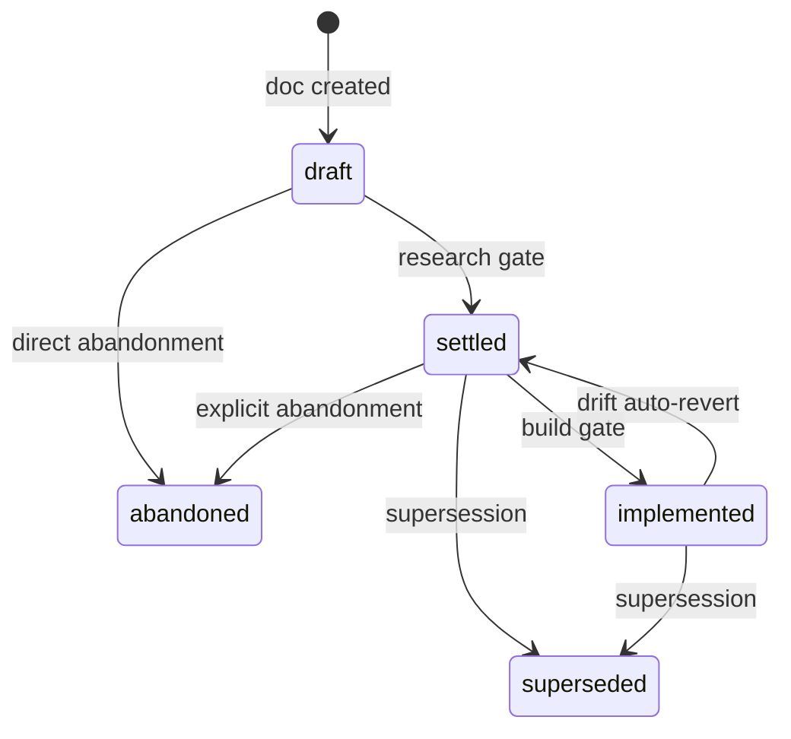
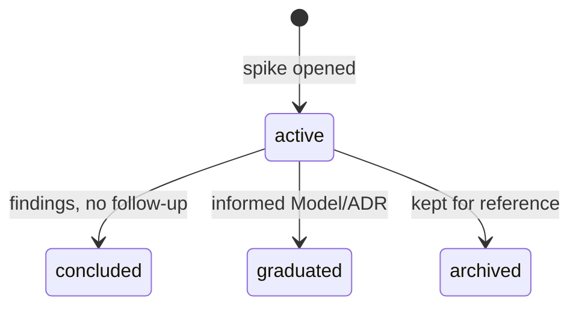

# Product Builder

The routing hub for the AI-first product workflow. Every doc-creation, audit, or review touches this file first. It tells you which doc type you're dealing with and where the type's full rulebook lives. Per-type rules and skeletons live under `Product/_docs/<type>.md`.

If you are an agent, **read this file first**. Then read the per-type rulebook your task involves. Don't infer rules; the rulebooks are canonical.

---

## Folder layout

```
Product/
  _docs/             — per-type rulebooks + skeletons (model.md, feature.md, adr.md, ...)
  _workflow/         — this file (PRODUCT-BUILDER.md)
  _archive/          — historical retired files (read-only)
  _drafts/           — in-flight content (drafts, per _docs/draft.md)
  decisions/         — project-wide ADRs (per _docs/adr.md)
  features/<feature>/
    <feature>.md     — feature root (per _docs/feature.md)
    models/          — feature models (per _docs/model.md)
    archive/         — retired models within this feature (see §Archive)
  ledgers/           — registries (FEATURE-MAP, OPEN-ITEMS, GLOSSARY) per _docs/ledger.md
  research/          — captured external knowledge (per _docs/research.md)
  sessions/          — opt-in checkpoint snapshots (per _docs/checkpoint.md)
  spikes/            — time-boxed investigations (per _docs/spike.md)
  support/samples/   — concrete reference instances (per _docs/sample.md)
  general/           — vision, architecture, roadmap (free-form)
  SESSION-CHECKPOINT.md — live operational spine (per _docs/checkpoint.md)
  PLANS/             — implementation plans (project-shaped, no rulebook)
```

**Numbering.** Models inside a feature use `01-`, `02-`, ... ADRs use a project-wide counter (`0001-`, `0002-`, ...). Other doc types use descriptive filenames.

**Feature names** are project-specific. The framework provides the convention; the project picks the names.

---

## Classification — what kind of doc is this?

Given a candidate doc (existing or new), identify its type before applying any rules. Read the matching `_docs/<type>.md` for the full rulebook.

| Doc captures... | Type | Rulebook |
|---|---|---|
| One C# type explained in depth | **Model** | `Product/_docs/model.md` |
| A capability with multiple models or external integration | **Feature** | `Product/_docs/feature.md` |
| A decision spanning ≥2 features | **ADR** | `Product/_docs/adr.md` |
| Time-boxed investigation with a planned outcome | **Spike** | `Product/_docs/spike.md` |
| External knowledge for later consultation | **Research** | `Product/_docs/research.md` |
| Concrete reference instance projecting onto the design | **Sample** | `Product/_docs/sample.md` |
| Live operational spine ("where we are") | **Checkpoint** | `Product/_docs/checkpoint.md` |
| Registry / index pointing at content elsewhere | **Ledger** | `Product/_docs/ledger.md` |
| In-flight content that would churn its target home | **Draft** | `Product/_docs/draft.md` |

**Decision flow:**

1. **Does it explain one C# type?** Yes → Model. Continue to `_docs/model.md` for the gates.
2. **Is it a capability with multiple models?** Yes → Feature.
3. **Does it record a decision spanning ≥2 features?** Yes → ADR. Single-feature decision → folds into the affected model's provenance.
4. **Is it an investigation with a planned outcome?** Yes → Spike. No planned outcome → Research.
5. **Is it a concrete projection onto the design?** Yes → Sample.
6. **Is it the live "where we are"?** Yes → Checkpoint.
7. **Is it a registry pointing at content elsewhere?** Yes → Ledger.
8. **Is it in-flight content that would churn its target?** Yes → Draft.

If none match, you may be conflating doc types — re-read the candidate.

---

## Cross-cutting frontmatter

Every doc carries frontmatter. Per-type fields live in the type's rulebook; these apply across types.

| Field | Required | Notes |
|---|---|---|
| `type:` | yes | One of `model`, `feature`, `adr`, `spike`, `research`, `sample`, `checkpoint`, `ledger`, `draft`, `workflow`, `doc-rules`. |
| `status:` | type-dependent | Per-type rulebook; some types have no status (research, checkpoint). |
| `references:` | when there are upstream deps | Comma-separated list in `[brackets]`; `Product/`-rooted absolute paths. |
| `tags:` | yes (may be empty `[]`) | Topic tags. |

**No `last-updated:` field.** Git is the source of truth for recency (`git log -1 --format=%cs <path>`).

---

## Cross-references

Every cross-doc reference is a **`Product/`-rooted absolute path** — no leading slash, forward slashes only. This applies to `references:` entries, markdown link targets, and bare path mentions in prose. Relative paths (`../`, `./`, `/`-prefixed) and URL-encoded paths (`%20`, `%28`) are not used.

**Why one rule.** A single canonical form per target means: `grep -rn 'features/engine/models/01-game-engine.md' Product/` finds every reference; renames are a single global `sed`; the linter does no path resolution. The cost is non-clickable links in standard markdown renderers — for an AI-agent + path-aware-linter workflow, that trade is worth it.

**Format by use case:**

```yaml
# references: front-matter — comma-separated absolute paths in brackets
references: [features/engine/models/01-game-engine.md, features/actions/models/05-available-actions-snapshot.md]

# Top-level docs use the literal `root`
references: root

# Workflow refs use absolute path from Product/
references: [_workflow/PRODUCT-BUILDER.md]
```

```markdown
# Markdown links — absolute path, anchors append unencoded after #
See [game engine §3](features/engine/models/01-game-engine.md#section-3) for the drain logic.

# Bare path mentions in prose — same absolute form, no link wrapper, must resolve
The trigger fold is defined in features/triggers/models/01-trigger.md §2.

# Illustrative or example paths — wrap in inline backticks, linter exempt
A new model would live at `features/<feature>/models/<NN>-<slug>.md`.
```

**Section anchors:** append `#section-<n>` for numbered sections, or `#<lowercase-kebab-heading>` for named sections. No URL encoding — if a heading would require encoding, rename the heading.

**Filename hygiene:** ASCII letters, digits, hyphens, underscores, dots only. No spaces, parens, brackets, percents, or non-ASCII. Lowercase preferred. Numbered prefixes (`01-`, `02-`) for ordered Models and ADRs.

**Linter enforcement** (`/builder:lint`): paths in links and `references:` resolve to existing files; no relative paths; no encoded filenames.

---

## When... (workflow triggers)

The agent's hot path. Each trigger states the action.

### When bootstrapping a project (once-per-project)

Output: working `Product/` skeleton with enough orientation to start session 02 with a real question.

1. **Create the skeleton.** Folders per the layout above. Drop this file at `_workflow/PRODUCT-BUILDER.md` and the per-type rulebooks at `_docs/<type>.md`. Seed `_workflow/retired-tokens.json` as `[]`. Initialize empty `ledgers/OPEN-ITEMS.md`, `ledgers/FEATURE-MAP.md` (stub with empty mermaid block), `ledgers/GLOSSARY.md` (with empty changelog). Create `SESSION-CHECKPOINT.md` from `_docs/checkpoint.md`'s skeleton.
2. **Write `general/VISION.md` first.** What is this project? Non-goals. Principles. One paragraph each. The only doc with no upstream.
3. **Identify candidate features.** Don't write feature docs yet — just commit to names. Create empty `features/<feature>/` folders. Cheap to add or rename later; expensive to thrash on once Models nest.
4. **Seed `ledgers/FEATURE-MAP.md`** with one row per candidate feature, status `considered`.
5. **Write `general/ARCHITECTURE.md` and `general/ROADMAP.md`.** Direction and sequencing. Stay terse — they'll be revised as feature design lands.
6. **Seed `ledgers/OPEN-ITEMS.md`** with the durable questions you can already name from day one.
7. **Seed `SESSION-CHECKPOINT.md`** with active focus *"what is this project?"* and pointers at the orientation work above.
8. **Don't write feature design yet.** Bootstrap is purely orientation.

A bootstrap session usually fits one sitting. If it sprawls, the project is too big or the vision isn't clear yet — pause and split.

### When starting a session

`/builder:start-session` — read-only briefing. Reads `SESSION-CHECKPOINT.md` + ledgers, prints "where we are / suggested threads," waits for direction. Creates no artifact.

### During a session

Branch freely. Address inline if small; spawn a doc (Spike / Model / Sample) if it deserves one; promote durable opens to `ledgers/OPEN-ITEMS.md`; ephemeral mid-conversation questions live in `SESSION-CHECKPOINT.md`'s `## Scratch` section. When a Model edit cascades, run the linter and fix in place. When a major decision settles, write an ADR (per `_docs/adr.md` two-feature rule). New vocabulary patches `ledgers/GLOSSARY.md`. Feature scope shifts refresh `ledgers/FEATURE-MAP.md`.

### When ending a session

`/builder:end-session` — interactive triage. Runs the linter, freshness check (CHECKPOINT vs touched files), chat-log scan for unsaved sketches. Surfaces findings as prompts (fix / defer to OPEN-ITEMS / ignore). Creates no artifact.

### When creating a new doc

1. **Classify** using the table above. Read the matching `_docs/<type>.md`.
2. **Pass the gates.** The rulebook lists non-negotiable gates. If any gate fails, the doc is misclassified or shouldn't exist as that type — re-classify.
3. **Instantiate the skeleton** at the bottom of the rulebook.
4. **Run `/builder:lint`** before considering the doc landed.

`/builder:new` automates the mechanical bits (folder, frontmatter, skeleton instantiation), but rule application is your responsibility.

### When adding a new feature

Recurring entry to the cycle. Parallel in shape to bootstrapping but at per-feature cadence.

1. **Create the feature folder.** `features/<feature>/` with a `models/` subfolder. (No `decisions/` — feature-internal decisions live in Model provenance.)
2. **Write the feature root stub** at `features/<feature>/<feature>.md` per `_docs/feature.md`. Status `draft`. Even Purpose + Boundaries alone is enough — it thickens as Models land.
3. **Declare dependencies.** First Model written under this feature carries `references:` pointing at upstream Models (or `root` if foundational).
4. **Update orientation.** Patch `ledgers/FEATURE-MAP.md` — promote the corresponding `considered` row, or add a new row + dependency edges. Patch `general/ROADMAP.md` if scheduling shifts.
5. **Record in `SESSION-CHECKPOINT.md`.** Note the new feature in "Where we stopped" or active focus.
6. **Begin design.** From here, the feature's evolution follows the standard per-session flow.

### When the contract changes (cascade)

Cascade is detected, not tracked. When you edit a Model whose contract surface changes, run `/builder:lint` (or `/builder:deps <path>` for a focused walk). The linter reports affected dependents via the `references:` graph and the retired-tokens registry. **Fix in place.** No ledger entry, no threshold, no scheduled pass.

If a cascade target requires *design judgment* rather than a mechanical edit, open an entry in `ledgers/OPEN-ITEMS.md` so the thread isn't lost.

### When reopening a settled decision

**ADR.** Don't edit the old ADR. Write a new ADR (`NNNN supersedes MMMM`); set the old ADR's status to `superseded by NNNN`; note the reason in `SESSION-CHECKPOINT.md` (and an OPEN-ITEMS entry if the supersession leaves loose ends).

**Model.** Don't edit the old Model. Either write a new Model that replaces the contract, or extend a later-numbered Model that already covers the same surface. Set the old Model's status to `superseded by NN-<slug>` and apply the supersede header (one-line header, body kept for record). Note the reason in `SESSION-CHECKPOINT.md`.

In both cases, run the linter to surface affected dependents.

### When advancing through status gates

Two gates govern the lifecycle: `draft → settled` (research gate) and `settled → implemented` (build gate). Each is a deliberate transition — a commitment, not a default.

**Research gate (`draft → settled`)** — a Feature or Model can flip when **all** are true:
- Linter passes against this doc (no broken references, no structure violations).
- Stable for ≥ 2 sessions with no edits to its contract surface.
- All glossary terms it uses appear in `ledgers/GLOSSARY.md`.

Once `settled`, the doc **is** the canonical contract. Edits to a `settled` doc are deliberate events: run the linter and fix dependents.

**Build gate (`settled → implemented`)** — a Feature or Model can flip when **all** are true:
- Status is currently `settled`.
- Code in the implementation directory satisfies the contract (manual confirmation; mechanical drift check via `/builder:lint`).
- No open drift entries.

The flip is a deliberate user action: *"yes, the code matches the contract."* This is the steady state — most of a project's lifetime, mature features sit in `implemented`.

**Drift is signal.** Any edit to an `implemented` doc's contract surface creates drift against the code. Resolution: code updates to match, or status reverts to `settled`.

**Feature ↔ Model status sync.** A Feature's status is bounded above by its qualifying Models (status `settled` or `implemented`). Drafts, abandoneds, supersededs don't count. Forward flips are deliberate user actions; backward reverts are automatic when a qualifying Model drops a tier.

### When archiving (superseded or cancelled)

Superseded and cancelled docs move into a sibling `archive/` folder inside the feature directory — co-located with active docs but visually demoted out of the active reading path.

```
features/<feature>/
  <feature>.md
  models/
  archive/         # retired docs only; same depth as models/
```

**Move trigger** (explicit, not vibes). A doc moves into `archive/` when **exactly one** is true — and only as part of the same commit that flips the status:

| Trigger | Status |
|---|---|
| Successor exists; this doc's contract is replaced | `Superseded` |
| Work was dropped with no successor | `Cancelled` |

**Archived-doc front matter** (mandatory):

```yaml
status: Superseded | Cancelled
superseded_by: <relative path to successor>   # required iff status=Superseded
archived_on: YYYY-MM-DD
reason: <one-line why>
```

No `supersedes:` field on the active doc — the back-reference is derived on demand by `/builder:lint`. Single source: the archived doc owns the pointer.

**Pre-merge carve-out.** The archive convention applies to docs that have been merged to `main`. Decisions still in an open PR may be edited or rewritten in place during the same iteration — that's normal review, not a reversal.

`/builder:archive` automates the mechanical move (status flip, frontmatter fields, `git mv`, lint, single-commit PR).

### When detecting drift post-merge

Drift — divergence between code and contracts in `Product/` — is the failure mode the workflow exists to prevent. Detection is **event-driven post-merge automation**.

Flow: PR merges → AI agent identifies changed files → maps to features (AI judgment from feature roots, not mandatory code-side linkage) → schedules drift check → at check time, reads contract + changed code, compares semantically → if divergence: opens a **PR with proposed contract updates** describing each divergence → human/AI session reviews and merges, edits, or rejects.

**Why propose-PR.** Canonical contracts are too important for silent edits. PR review is the human-in-the-loop checkpoint.

---

## Status state machines

### Feature & Model



`abandoned` and `superseded` are quasi-terminal — docs stay as historical record. `settled → draft` is not a valid transition. Reopening a settled decision goes through supersession or abandonment.

### Spike



Spikes are static once resolved. Downstream Model supersession doesn't propagate back.

---

## Linter (`/builder:lint`)

The single on-demand consistency tool. Six responsibilities:

1. **Structure check** — every Model has the canonical sections in canonical order (per `_docs/model.md`'s skeleton). Variable size is fine; variable structure is not.
2. **References resolve** — every `references:` path exists; every inline path-shaped link in the body resolves.
3. **Header–body consistency** — auto-populate `references:` from path-shaped tokens in the body; flag mismatches.
4. **Retired-tokens check** — grep for tokens in `_workflow/retired-tokens.json`; report hits with their replacement.
5. **Reverse graph** — compute "who references this" from the union of all `references:` fields. Exposed via `/builder:deps <path>`.
6. **Archive integrity** — forward-pointer integrity, no stale inbound links, status/location agreement, successor presence.

Findings are reported, not tracked. The linter writes a stdout report; it does not append entries to any ledger. **Fix in place.**

`/builder:deps <path>` answers two questions about a single doc: forward (what does this reference?) and reverse (who references this?). Use before editing a Model when you want to know its blast radius.

---

## Cross-cutting infrastructure

| File | Role | Cadence |
|---|---|---|
| `SESSION-CHECKPOINT.md` | Live operational spine; references OPEN-ITEMS by id+link | Continuously updated as work happens |
| `_workflow/PRODUCT-BUILDER.md` | This file (routing + workflow) | When workflow conventions change |
| `_docs/<type>.md` | Per-type rulebooks + skeletons | When a doc-type rule changes (triggers audit pass) |
| `ledgers/GLOSSARY.md` | Canonical vocabulary + changelog | When a term lands or renames |
| `ledgers/OPEN-ITEMS.md` | Durable ledger of loose ends. Resolution = delete the entry | Append on durable open; delete on resolution |
| `ledgers/FEATURE-MAP.md` | Bird's-eye view: feature index, dependency graph, model breakdown | When a Model lands, a Feature ships, or dependencies shift |
| `sessions/<slug>.md` | Opt-in milestone snapshot — frozen copy of CHECKPOINT | When `/builder:snapshot` is invoked |
| `decisions/NNNN-*.md` | Project-wide ADRs — cross-feature decisions | When a project-scoped decision settles |

### Two homes for questions

| Kind | Lifetime | Home |
|---|---|---|
| **Durable** open item — questions, deferred tasks, known TODOs | Project lifetime, until resolved (then deleted) | `ledgers/OPEN-ITEMS.md` |
| **Active + ephemeral** — current focus, mid-conversation scratch | Current session(s) | `SESSION-CHECKPOINT.md` (focus + `## Scratch` for ephemerals) |

Ephemerals stay in CHECKPOINT until they get answered (delete), promote to OPEN-ITEMS (worth tracking durably), or get left for next session.

### Ledger entry shapes

`OPEN-ITEMS.md` entries are self-contained paragraphs:

```markdown
- id: <oq-* | bl-* | optional> | kind: question | task | defer | **Title** — paragraph framing the loose end. What's known, what's open, why it matters. Two or three sentences.
  Trigger: `<condition that makes this actionable>` (optional, for tasks/defers).
  References: `<paths or links to related docs>`.
```

No strikethrough archive. When an entry resolves, **delete it** — the resolving doc owns the answer. Git keeps deletion history if ever needed.

**Single-source rule.** Each piece of state lives in exactly one place. The checkpoint *links to* OPEN-ITEMS by id; it does not duplicate. Models do not duplicate cascade information inline (cascade is detected by the linter on demand).

---

## When automations run

| Trigger | Automations |
|---|---|
| **Project start (once)** | `/builder:bootstrap` |
| **Every session start** | `/builder:start-session` |
| **Mid-session, on demand** | `/builder:new` (scaffold a doc), `/builder:promote-glossary` (add or rename a term), `/builder:design-pass` (Q-by-Q design walk), `/builder:archive` (retire a doc), `/builder:deps` (forward + reverse refs) |
| **Periodic / on demand** | `/builder:lint` |
| **Every session end** | `/builder:end-session` |
| **Milestone snapshot (opt-in)** | `/builder:snapshot` |
| **PR merge to main** | drift detection (CI mode — see `OPEN-ITEMS.md` `bl-drift-detection`) |

---

## Audit obligation

Rules apply at creation **and** retroactively. When a rule in any `_docs/<type>.md` changes, every existing doc of that type is re-checked against the new wording. Promoting a rule to `accepted` triggers a mandatory audit pass. Catching drift retroactively is the only thing that keeps the corpus honest.
