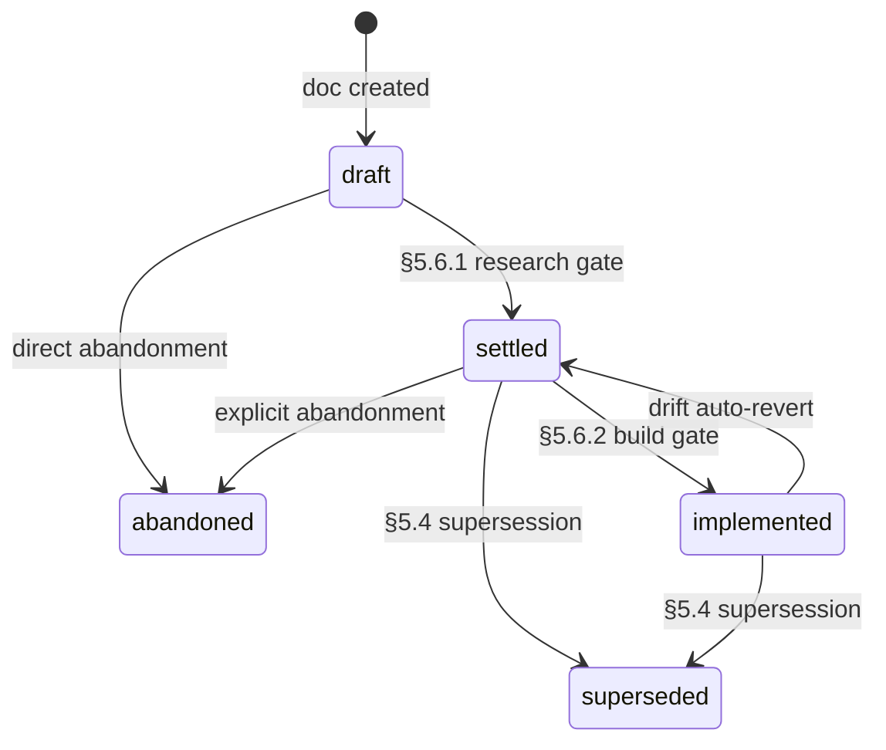
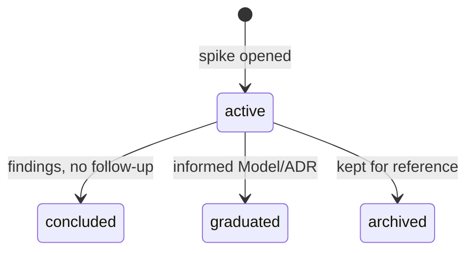

# Product Builder

**Purpose.** Codify the product-building workflow we've been running, plug the gaps we noticed (no doc-type templates, no per-decision log, no session log, no glossary changelog, no alignment-debt tracker, no place for exploratory work), and lock the patterns into shared conventions so new sessions inherit the method, not just the artifacts.

**Scope.** End-to-end workflow: design → contract → implementation → drift handling. The workflow covers `Product/` (canonical knowledge layer, status governs role) and `PLANS/` (ephemeral implementation slices, minimal touchpoints — internals not workflow-specified). Implementation lives in the project's code directory (e.g., `Assets/` for a Unity project). No separate `DOCS/` layer — `settled` features in `Product/` *are* the contract.

---

## 1. Folder layout

Top-level folders, in two groups:

**Workflow-shaped** — structure defined by this spec:
- **`_workflow/`** — workflow definition itself (this doc + doc-type templates). Rarely opened in normal operation.
- **`ledgers/`** — workflow-defined files whose content is project-specific: the three ledgers (`OPEN-QUESTIONS`, `ALIGNMENT-DEBT`, `BACKLOG`), the glossary, the feature map. Opened daily.
- **`decisions/`** — project-wide ADRs (cross-feature decisions, workflow choices).

**Project-shaped** — content is the project itself:
- **Operational** — live "what's happening right now" files (`README.md`, `SESSION-CHECKPOINT.md`) and the session log (`sessions/`).
- **`general/`** — project orientation: vision, capability map, architecture direction, roadmap, recommendations. The thinking *about* what this product is.
- **`features/`** — one folder per system being designed, each self-contained with its own Models, ADRs, and local numbering.
- **`spikes/`** — ideation and exploration. Time-boxed investigations that may graduate into feature design, get archived, or stay as reference.
- **`support/`** — material that supports the design but isn't the design: stress-test samples and frozen prior art.

```
Product/
  README.md                  # operating manual — agent reads this first
  SESSION-CHECKPOINT.md      # replaceable spine — live operational state

  _workflow/                 # workflow definition (rarely opened)
    PRODUCT-BUILDER.md       # this doc
    _templates/              # 7 doc-type templates
      spike.md
      feature.md
      model.md
      sample.md
      adr.md
      session.md
      checkpoint.md

  ledgers/                   # workflow-shaped, project-content (opened daily)
    GLOSSARY.md              # canonical vocabulary
    OPEN-QUESTIONS.md        # durable open design questions
    ALIGNMENT-DEBT.md        # open cascade entries — single source of truth for debt
    BACKLOG.md               # deferred concrete work; trigger conditions for revisit
    FEATURE-MAP.md           # bird's-eye view: features, models, dep graph (mermaid)

  decisions/                 # project-wide ADRs (NNNN-<slug>.md, project-wide counter)

  general/                   # project orientation
    VISION.md                # project goal, non-goals, principles
    ARCHITECTURE.md          # high-level architecture direction
    ROADMAP.md               # phases and sequencing
    RECOMMENDATIONS.md       # current synthesis
    # other orientation docs as the project surfaces them

  sessions/                  # per-session narrative (append-only)

  features/                  # per-system design work; each feature has a root <feature>.md
    <feature-a>/
      <feature-a>.md         # feature root — top-level summary, indexes Models + ADRs
      models/                # Models (NN-<slug>.md, per-feature counter)
      decisions/             # ADRs (NNNN-<slug>.md, per-feature counter)
    <feature-b>/
      <feature-b>.md
      models/
      decisions/
    ...                      # one folder per major system in the project

  spikes/                    # flat — most spikes are single docs

  support/
    samples/                 # whole-system stress tests
    prior-art/               # frozen external reference
```

`PLANS/` sits outside `Product/` as the home for ephemeral implementation slices (internals not workflow-specified). Implementation lives in the project's code directory (e.g., `Assets/` for a Unity project). No separate `DOCS/` directory — `settled` features in `Product/` *are* the canonical contract; status governs role (see §5.6 Status gates).

### Numbering

**Per-feature counters.** Each feature's `models/` and `decisions/` restart at `01`. Filenames look like `features/actions/models/03-action-definition.md` and `features/actions/decisions/0002-async-layer-hierarchy.md`. The path is the domain prefix; no need to bake it into filenames.

**Project-wide ADRs** live in `decisions/` with their own counter (`decisions/0001-adopt-workflow.md`). Used for decisions that span features or shape the whole project — workflow adoption, migration choices, cross-feature naming conventions.

**Feature roots** use the feature name (no counter): `features/engine/engine.md`. One per feature folder. Sits at the top, summarizes what's beneath. See §4.2.

**Sessions** stay globally monotonic (`sessions/session-01.md`, `session-02.md`, …). Sessions are the chronological spine — they cross features by nature.

**Spikes** stay flat with descriptive filenames (`spikes/scaffold-state-fit.md`, `spikes/sabberstone-patterns.md`). No counter — spikes don't have natural ordering and most are single-doc.

**Cross-references.** Use the path: `features/actions/models/03` or `features/actions/03` shorthand. The `features/` and `spikes/` prefixes are non-negotiable in references — keeps grep precise and globs clean.

### Where cross-cutting docs live

When a doc spans multiple systems (e.g., a terminology discussion touching naming hygiene broadly): it lives in the feature that triggered it and gets `tags: [#cross-cutting]` in front matter so it's findable. Genuinely global references go to their canonical home: glossary / open questions / alignment debt / feature map → `ledgers/`; the workflow doc → `_workflow/`; project orientation → `general/`.

### Feature names are project-specific

Each project applying this workflow picks its own feature names — one folder per major system, sized so it can host a meaningful local discussion without overflowing into adjacents. The workflow only mandates the structure (`features/<name>/models/`, `features/<name>/decisions/`), not any particular set of names.

A rule of thumb: if a feature folder has fewer than ~3 docs after several sessions, it might belong as a tag inside a sibling. If it grows past ~15 docs without natural sub-clusters, consider splitting.

---

## 2. Doc types

| Type | Purpose | Lives in | Status values |
|------|---------|----------|---------------|
| **Spike** | Time-boxed investigation; pre-design exploration | `spikes/` | `active`, `concluded`, `graduated`, `archived` |
| **Feature** | Top-level summary of a feature; indexes its Models, ADRs, opens — source of truth for the subsystem | `features/<feature>/<feature>.md` | `draft`, `settled`, `implemented`, `superseded`, `abandoned` |
| **Model** | Durable description of a sub-system within a feature, with decision provenance baked in | `features/<feature>/models/` | `draft`, `settled`, `implemented`, `superseded`, `abandoned` |
| **Sample** | Concrete reference instance projected onto the design — floor or ceiling | `support/samples/` | `draft`, `locked` |
| **ADR** | One atomic decision per file | `features/<feature>/decisions/` | `proposed`, `accepted`, `superseded by NNNN` |
| **Session note** | What happened in one session (append-only) | `sessions/` | n/a (immutable) |
| **Checkpoint** | Replaceable handoff for next session | `Product/` root | n/a (replaceable) |
| **Plan** | Implementation slice | `PLANS/` | `drafting`, `active`, `done`, `abandoned` |

A Model is the unified design artifact: it describes a system **and** records the decisions baked into it (options weighed, rationale, consequences). The descriptive content sits at the top; provenance sits below a divider as track record.

Major decisions that warrant searchability also get an **ADR** — one-page summary, dated and indexed. The ADR links back to the Model; the Model links forward to the ADR.

---

## 3. Front matter

Every doc starts with:

```yaml
---
type: spike | feature | model | sample | adr | session | checkpoint | plan
status: <one of the type's status values>
last-updated: 2026-04-29
builds-on: [features/actions/03, features/triggers/02]    # mandatory for Models; list of paths or literal `root`
tags: [#async, #triggers]                                 # optional
---
```

Reader knows in 2 seconds what they're holding.

**`builds-on:` is mandatory for Models** (and ADRs that have meaningful upstream context). Either a list of paths to upstream Models/ADRs, or the literal string `root` when the doc has no upstream. Empty list (`[]`) is not allowed — `root` is the explicit signal for "this is a foundation, no deps." This convention powers cascade-walking on supersession (§5.9) and FEATURE-MAP dependency rendering.

Feature roots derive their `Dependencies` section from the union of contained Models' `builds-on:`, so they don't need to repeat it in front matter.

**Supersession** is recorded in two places only: the old doc's `status: superseded by NNNN` string (where NNNN is the new ADR's identifier), and the new doc's `## Consequences > Reverts/replaces` field. No `superseded-by:` front-matter field — would be a third locus for the same fact, with the same drift risk Q3 eliminated for cascade implications.

---

## 4. Templates

**Source of truth.** Each fenced `markdown` block in §4.1–§4.7 is the canonical content for the corresponding file in `_workflow/_templates/` (7 templates: Spike, Feature, Model, Sample, ADR, Session, Checkpoint). Migration Phase 1 extracts these blocks into the templates directory; future workflow edits land here, then are re-extracted on next regen. Single source — no parallel content store. §4.8 (Plan) is descriptive prose only — no template file.

### 4.1 Spike

A spike is a time-boxed investigation — pre-design exploration. Read prior art, probe a technical question, sketch a possible direction. Spikes are *not* decisions; they produce material that informs decisions.

**Spike vs. Model.** A spike is *investigation* (open-ended; we don't yet know what we're committing to). A Model commits to a design — a problem with a chosen approach. Spike often produces the framing for a Model. Sequence: spike → model → ADR. Or spike → model directly when exploration makes the choice clear.

*Vocabulary note: spikes open with `## Premise` rather than `## Problem` because the framing is open — we're testing a hypothesis, not yet responding to a defined problem. Models use `## Problem` because by that stage the question is named.*

```markdown
# <name> — spike

<front matter: type=spike, status=active>

## Premise
What we're exploring and why. One paragraph.

## What I tried
Investigation steps, code read, prior art consulted, prototypes sketched.

## Findings
What we learned.

## Outcome
One paragraph. If graduated, include a forward link to the Model / ADR it informed.
```

**Status transitions.** When a spike informs subsequent work, set its status to `graduated` and add a forward link to the Model / ADR it informed. The spike doc stays put — preserves the trail. `concluded` means findings recorded with no immediate follow-up. `archived` means it didn't go anywhere; kept for future reference.

**History doesn't update.** A Spike's status reflects only its own resolution. If the Model it graduated into is later superseded or abandoned, the Spike stays `graduated` — the supersession chain on the destination tells the rest of the story. Spikes are static once resolved; they're not re-edited as downstream evolves.

### 4.2 Feature

A **Feature** doc is the root description of a feature folder. It says what the feature *is*, what Models compose it, what's settled vs. open, and what other features it depends on. It's the source of truth that Models, ADRs, and spikes underneath it support — and **the canonical contract once `settled`** (see §5.6 Status gates).

A feature root lives at `features/<feature>/<feature>.md` (e.g., `features/engine/engine.md`). One per feature folder. No counter; the name matches the folder.

**Feature vs. Model.** A Feature is the *container* — its scope is the whole feature. A Model is a *sub-system* within the feature (engine has Models for the evaluation loop, the GameRules contract, the snapshot pipeline). The Feature doc summarizes composition and public surface; the Models carry the design content.

```markdown
# <feature> — feature

<front matter: type=feature, status=draft>

## Purpose
What this feature is and why it exists. One paragraph.

## Boundaries
What this feature owns — and what it explicitly doesn't. Demarcation against neighboring features.

## Composition
Models that make up this feature.
- features/<feature>/models/01-<slug> — short purpose
- features/<feature>/models/02-<slug> — short purpose

## Public surface
What a consumer of this feature sees. Contracts, services, types — the outer boundary that other features touch.

## Dependencies
- **Upstream:** features/X — consumed
- **Downstream:** features/Y — consumes this

## Settled decisions
Pointers to load-bearing ADRs in this feature's `decisions/`.

## Open
Pointers to `ledgers/OPEN-QUESTIONS.md` items relevant to this feature.
```

A Feature doc starts as a stub when the folder is first created — sometimes only Purpose + Boundaries, with everything else empty. It thickens as Models land beneath it. When the Feature clears the §5.6.1 research gate, status flips `draft → settled` and it becomes the canonical contract for that feature. When code lands in the implementation directory that satisfies the contract, status flips `settled → implemented` (§5.6.2 build gate).

**Cascade implications** (when this doc's edits affect downstream docs) are not captured inline — they live as entries in `ledgers/ALIGNMENT-DEBT.md`. See §5.7.

**`implemented` status convention.** A Feature flips to `implemented` (via §5.6.2 build gate) when code lands that satisfies its contract. While `implemented`, edits to the contract surface open **drift entries** against the implementation — either code updates to match, or the Feature reverts to `settled` (signaling "code is no longer guaranteed to match"). Most of a project's lifetime, mature features sit in `implemented` — that's the steady state.

**`abandoned` status convention.** A Feature that's decided against keeps its folder as historical record. The root receives a one-line header: *"Status: abandoned YYYY-MM-DD — `<reason>`. Folder kept for record."* All nested Models cascade to `abandoned`. ADRs in the feature's `decisions/` stay in place (they record decisions that *were* made; they don't become wrong just because the feature didn't survive). Cascade rules from §4.3 Model abandonment apply: docs whose `builds-on:` references this feature get ledger entries opened. Distinct from `superseded` (which means another Feature took over the role).

**Feature ↔ Model status sync.** A Feature's status is bounded above by its qualifying Models (settled or implemented). Drafts and abandoneds don't count, so adding a new draft Model to an implemented Feature doesn't drag it down. Forward flips are deliberate user actions; backward reverts are automatic when a qualifying Model drops a tier. Full rule and worked examples in §5.6.3.

### 4.3 Model

The unified design artifact. Top half describes the system; bottom half records the provenance (options weighed, rationale, consequences). A reader gets the model first; clicks down for the "why."

```markdown
# <subject> — model

<front matter: type=model, status=draft>

## Problem
What we're modeling and why this exists.

## Concepts
Types and entities in this system, glossary-style.

## Contracts
Interfaces, methods, return shapes, forbidden behaviors.

## Invariants
What must always be true.

## Examples
At minimum, walked through against the floor sample.

## Open follow-ups
Unresolved threads.

---

*Below: provenance — what was considered, why we chose this. Track record.*

## Options considered          # (omit if no real alternatives)
- **A** — rejected because ...
- **B** — rejected because ...
- **C** — chosen.

## Rationale                    # (omit if obvious)
Why the chosen approach.

## Consequences                 # (omit if obvious)
What this enables; what it constrains.

## ADR
Linked: features/<feature>/decisions/NNNN-<title>.md
```

A purely descriptive Model (e.g., a system that doesn't have meaningful alternatives) can omit the provenance sections entirely. A decision-heavy Model fills them all in. Section order is canonical so readers always know where to look.

**Cascade implications** (downstream docs affected by edits to this Model) are not captured inline — they live as entries in `ledgers/ALIGNMENT-DEBT.md`. See §5.7.

**`implemented` status convention.** A Model flips to `implemented` (via §5.6.2 build gate) when code in the implementation directory satisfies its contract. Edits to an `implemented` Model's contract surface open **drift entries** against the code — either code updates to match, or the Model reverts to `settled`.

**`abandoned` status convention.** A Model that gets partway through and is decided against keeps its body as historical record, but receives a one-line header at the top: *"Status: abandoned YYYY-MM-DD — <reason>. Original attempt below for record."* The `abandoned` status is distinct from `superseded` (which implies a replacement Model exists). Use `abandoned` when the line of inquiry was wrong, not when a better answer was found.

### 4.4 Sample

A **sample** is a concrete reference instance projected onto the abstractions being designed. It exists to stress-test the design against real cases — a floor (simplest case the design must support) or a ceiling (complex case that bounds expressiveness).

Examples of subjects: a card game's rules and how its elements map onto framework concepts; a client codebase using a library; a protocol implementation; a sample program for a language; an integration for an API — anything concrete enough to project the design onto.

A sample doc has two layers:

- **Subject** — the concrete thing being described. Usually stable once written.
- **Projection** — how the subject's elements map onto the design abstractions. Moves whenever the design moves. This is the load-bearing layer.

```markdown
# <sample name> — sample

<front matter: type=sample, status=draft>

## Subject
The concrete thing this sample describes, in plain language. No design-doc terminology.

## Why this sample
Floor / ceiling / stresses-which-feature.

## Projection
How the subject's elements map onto the design abstractions.

## What this does NOT exercise
Honest list — keeps us from over-claiming coverage.

## Open mappings
Ambiguous bits, unresolved projections.
```

**`draft` → `locked` transition.** A sample becomes `locked` when **all** are true:

1. **Subject finalized** — the concrete description is fully specified; we aren't still debating what the example is.
2. **Projection uses only `settled` abstractions** — every design concept the projection depends on is itself `settled`, not `draft` or `proposed`. (No locking onto sand.)
3. **No open implications against the sample** in `ledgers/ALIGNMENT-DEBT.md`.
4. **Stable ≥ 1 session** — at least one session has passed without **contract edits** to either the sample or its dependencies. Soft cooldown. Hygiene edits (typos, formatting, link fixes, glossary-rename mirrors) don't reset the cooldown; only changes to the Subject text, the Projection mapping, or the framing do. When committing, mark the edit explicitly: `contract edit — cooldown reset` or `hygiene edit — no cooldown reset`.

After locking, design changes that affect the sample create an explicit `ledgers/ALIGNMENT-DEBT.md` entry naming the locked sample. Resolving the entry is a deliberate decision: re-lock with the new shape, unlock back to `draft`, or accept the divergence (rare).

### 4.5 ADR

```markdown
# ADR-NNNN — <title>

<front matter: type=adr, status=proposed>

Date: 2026-04-29
Context-doc: features/<feature>/models/NN-<title>.md
Proposal: features/<feature>/models/NN-<title>.md

## Context
Two paragraphs max.

## Options considered
- A: ... — rejected because ...
- B: ... — rejected because ...
- C: ... — chosen.

## Decision
One paragraph.

## Consequences
- Enables: ...
- Constrains: ...
- Reverts/replaces: ADR-NNNN
```

### 4.6 Session note

Two parts, each capped at ~one screen (~50 lines). If either overflows, the content belongs in a numbered doc or an ADR, not the session note.

*Active question coming in* mirrors the active question in `SESSION-CHECKPOINT.md` at session start; *active question going out* is what the refreshed checkpoint will hold at session end.

```markdown
# Session NN — <date>

<front matter: type=session>

## Part 1 — Content (cap ~50 lines)

### Active question coming in
One line.

### Work done
- doc features/<feature>/models/NN written
- alignment debt opened on docs X/Y/Z
- ADR-NNNN landed

### Decisions settled
- ADR-NNNN: <one line>

### Active question going out
One line — what the next session opens with.

## Part 2 — Links & open threads (cap ~50 lines)

### Followups created
- alignment debt: ...
- new open question (promoted): ...

### Ephemeral questions (scratch, not promoted)
- Things we chewed on but answered in-session.
- Kept here for traceability; not a durable record.

### References
- Docs touched: ...
- Related sessions: ...
```

### 4.7 Checkpoint

Keep the current shape; add a rule.

```markdown
# Research Session Checkpoint

<front matter: type=checkpoint>

**Last updated:** YYYY-MM-DD (session NN)
**Replaceable.** History lives in `sessions/`. Never append here.

## Where we stopped
## The active open question (singular)
## Other still-open
## Suggested next steps
## Artifacts to read on resume
```

### 4.8 Plan

Plans are ephemeral implementation slices — schedules for moving from `settled` to `implemented`. Their internals are **not workflow-specified**: slice unit, lifecycle, format are the project's choice.

A minimal Plan entry typically lists:
- What's being built (link to the Feature/Model it implements).
- What it depends on (other Models or Features).
- What "done" means for this slice (exit criteria).

Status values: `drafting`, `active`, `done`, `abandoned`. Lives in `PLANS/`.

No fenced template here — Plans don't get a `_templates/` file. Projects shape Plans to fit their team's rhythm. The workflow only commits to *that they exist* and *roughly what role they serve*.

---

## 5. Global workflow

A session is a **branching unit**, not a linear one. It opens with an entry context, spawns sub-problems, sketches, and questions as work surfaces them, and lands somewhere. Doc types are tools you reach for mid-flight as branches demand them — not categories you commit to up front.

### 5.0 Bootstrapping a project

Once-per-project phase before §5.1 applies. Output is a working `Product/` skeleton with enough orientation to start session 02 with a real question.

1. **Create the skeleton.** `_workflow/`, `ledgers/`, `decisions/`, `general/`, `features/`, `spikes/`, `support/{samples,prior-art}/`, `sessions/`. Drop the 7 doc-type templates into `_workflow/_templates/` (extracted from §4.1–§4.7). Drop this spec at `_workflow/PRODUCT-BUILDER.md`. Initialize empty ledgers: `ledgers/OPEN-QUESTIONS.md`, `ledgers/ALIGNMENT-DEBT.md`, `ledgers/BACKLOG.md`, `ledgers/FEATURE-MAP.md` (stub with empty mermaid block), `ledgers/GLOSSARY.md` (with empty changelog).
2. **Write `general/VISION.md` first.** What is this project? Non-goals. Principles. One paragraph each. This is the only doc that has no upstream — everything else builds on it.
3. **Identify candidate features.** Don't write Feature docs yet — just commit to the names. Create empty `features/<feature>/` folders for each. Cheap to add or rename later; expensive to thrash on once Models nest.
4. **Seed `ledgers/FEATURE-MAP.md`.** Add a row per candidate feature from step 3 with status `considered`. The map carries both pre-folder candidates and current state — it replaces a separate capability inventory.
5. **Write `general/ARCHITECTURE.md` and `general/ROADMAP.md`.** Direction and sequencing. Both stay terse — they'll be revised as feature design lands.
6. **Seed `ledgers/OPEN-QUESTIONS.md`.** The durable questions you can already name from day one (state ownership, async story, multiplayer, etc.). Don't try to be exhaustive.
7. **Open `sessions/session-01.md`.** This first session *is* the bootstrap. Active question coming in: *"what is this project?"* Active question going out: *"what's the first feature we model?"*
8. **Don't write feature design yet.** No Feature roots, Models, ADRs, or Samples. Bootstrap is purely orientation. Feature design starts in session 02.

A bootstrap session usually fits in one sitting. If it sprawls, the project is too big or the vision isn't clear yet — pause and split.

### 5.1 Starting a session

Open `SESSION-CHECKPOINT.md`. Take stock — note the entry context: the active question, alignment debt, PR feedback, or whatever brought you here. That's it. No commitment to a single direction.

### 5.2 During a session

Sessions branch. That's normal, not an exception. As work surfaces sub-problems, sketches, or new questions:

- **Address inline** if it's small and feeds the active thread.
- **Spawn a doc** if it deserves one. Pick the doc type from §2:
  - Open-ended exploration / prior-art survey → **Spike** (in `spikes/`).
  - System needs design (decisions, structure, or both) → **Model**.
  - New concrete reference instance → **Sample** (in `support/samples/`).
- **Capture for later** if it's out of scope: promote to `ledgers/OPEN-QUESTIONS.md` so it doesn't get lost.

When a major decision settles → write an ADR (in `features/<feature>/decisions/` for feature-scoped, `decisions/` for project-scoped).
When a Model edit cascades to other docs → append one entry per affected doc to `ledgers/ALIGNMENT-DEBT.md` (see §5.7).
When concrete work is deferred ("build this later" / "revisit when X") → append to `ledgers/BACKLOG.md` with a trigger condition.
When a spike concludes or graduates → update its status and add forward links.
New vocabulary → patch `ledgers/GLOSSARY.md` and append to its changelog.
When a feature gains/loses a Model or shifts dependencies → refresh `ledgers/FEATURE-MAP.md`.

Branch freely; the session log captures the trail. Returning to the original thread after a detour is normal — just record both in the session note.

### 5.3 Ending a session

The session note records the **trail**, not a linear narrative: what was created, what was touched, what branched, what was answered, what's still open.

1. Write `sessions/session-NN.md` (two parts, ~50 lines each cap).
2. Refresh `SESSION-CHECKPOINT.md` with the landing state (rewrite, don't append).
3. Update `ledgers/OPEN-QUESTIONS.md` — strikethrough resolved with link to resolving doc; add new opens.
4. Update `ledgers/GLOSSARY.md` changelog if vocabulary changed.
5. Commit + PR on `claude/<topic>` branch.

### 5.4 Reopening a settled decision

Don't edit the old ADR. Write a new ADR (`NNNN supersedes MMMM`), set the old ADR's status to `superseded by NNNN`, note the reason in the session log.

### 5.5 Alignment-debt discharge as a focus

A session can be entirely alignment-pass-shaped. Same flow — the entry context is "discharge entries from `ledgers/ALIGNMENT-DEBT.md`," and the work is mechanical updates. Listed separately because it's a recognizable session pattern, not a different workflow.

### 5.6 Status gates

Two status gates govern the lifecycle: `draft → settled` (research gate) and `settled → implemented` (build gate). Each is a deliberate transition — a *commitment*, not a default. There is no separate `DOCS/` directory; status governs the role of each Feature/Model.

#### 5.6.1 Research gate: `draft → settled`

A Feature or Model can flip to `settled` when **all** are true:
- No open ledger entries against it in `ledgers/ALIGNMENT-DEBT.md` (target=this path).
- Stable for ≥ 2 sessions with no edits to its contract surface (Problem / Concepts / Contracts / Invariants / Examples).
- All glossary terms it uses appear in `ledgers/GLOSSARY.md`.

Once `settled`, the Feature/Model **is** the canonical contract. Edits to a `settled` doc are deliberate events: each opens a debt entry per affected downstream doc (per §5.7).

**Feature roots are the typical settle target.** When a Feature settles, the Models it indexes typically settle along with it (they're the components of the contract). Models can settle independently if a Feature root isn't ready but a sub-Model is stable on its own — but the feature-shaped path is the default.

#### 5.6.2 Build gate: `settled → implemented`

A Feature or Model can flip to `implemented` when **all** are true:
- Status is currently `settled`.
- Code in the implementation directory satisfies the contract (manual confirmation; mechanical drift check via `/builder:lint` available — see §5.10).
- No open drift entries against this Feature/Model.

The `implemented` flip is a deliberate user action: *"yes, the code matches the contract."* This is the steady state — most of a project's lifetime, mature features sit in `implemented`.

**Drift is debt.** Any edit to an `implemented` Feature/Model's contract surface opens a drift entry against the code. Resolution: either code updates to match (entry closes), or status reverts to `settled` (signaling "code is no longer guaranteed to match"). Drift entries are normal alignment-debt entries with `source=` the contract path and `target=` the implementation directory.

#### 5.6.3 Feature ↔ Model status sync

A Feature has a status; its nested Models each have their own. The two are constrained but not mechanically coupled:

> **Feature.status is bounded above by the *qualifying* Models inside it.** Qualifying = Models with status `settled` or `implemented`. Drafts, abandoneds, and supersededs don't count.

**Forward (advancing).** A Feature can flip to status X when either:
- all qualifying Models are at X or higher, OR
- there are no qualifying Models at all (a small Feature might have zero Models — the Feature root *is* the contract).

The flip itself is a deliberate user action — Models reaching the target makes the Feature *eligible*; the user makes the commitment.

**Backward (reverting).** If a qualifying Model drops a tier (e.g., drift forces a Model from `implemented` back to `settled`), the Feature auto-reverts to match. Adding new `draft` Models, abandoning Models, or superseding Models does **not** trigger a revert — those are in-flight expansions or excisions, not regressions of the existing contract.

**Worked examples.**

- Engine has 3 `implemented` Models. User adds a new `draft` Model for save/load → Feature stays `implemented`.
- The save/load Model graduates to `settled` (contract written, code not yet) → Feature auto-reverts to `settled` (now there's a qualifying Model that's not implemented).
- User implements the save/load code and flips its Model to `implemented` → Feature is eligible to flip back to `implemented` (manual confirm).
- One of the 3 original Models drifts: `implemented → settled` → Feature auto-reverts to `settled`.
- A Model is abandoned → Feature stays at its current status.
- A tiny Feature has zero Models, just the root → user can flip the Feature freely; no Model constraint.

### 5.7 Debt notification

`ledgers/ALIGNMENT-DEBT.md` is the **single source of truth** for cascade implications. Models and Features do not carry inline `## Implications` sections — that information lives only in the ledger.

**On every Model edit, before commit:**

1. Identify downstream docs the edit affects (Models, Features, Samples, ADRs that build on this one).
2. Append **one ledger entry per affected doc**: source path, target path, one-line reason, status `open`, date.
3. In the session note's content section, record a one-line `debt: N opened` (or `debt: none` if the edit was self-contained). Empty is not allowed — `debt: none` is the explicit signal that cascade was considered.

The session-note assertion is the forcing function: it makes "I considered cascade and found nothing" *visibly distinct* from "I forgot to think about it."

**Granularity is per-affected-doc.** Each entry has one binary status (`open`/`resolved`). No partial-completion semantics. This makes the ledger count meaningful — N open entries means N obligations, not N cascade events.

### 5.8 Consistency-pass cadence

When `ledgers/ALIGNMENT-DEBT.md` crosses **5 open entries**, the next session is forced into pass-mode (§5.5 alignment-debt discharge). The threshold is the structural forcing function: scales with actual debt, doesn't burn sessions when the ledger is empty, doesn't rely on judgment we've shown we can fail at.

Threshold of 5 is calibration, not principle. Adjust if data shows otherwise — but pick a number and commit.

A consistency pass can also be invoked opportunistically (when the primary thread blocks), but the threshold is the *only* hard rule.

### 5.9 Backtracking on supersession

When an ADR is superseded (§5.4), the supersession is itself a debt-generating event:

1. Write the new ADR (`NNNN supersedes MMMM`), set old ADR `superseded by NNNN`.
2. Walk the `builds-on:` graph: find every doc whose `builds-on:` references the superseded ADR or its host Model.
3. For each, append a ledger entry: source = new ADR path, target = dependent doc, reason = "supersession of MMMM may invalidate framing."
4. The new ADR's `## Consequences > Reverts/replaces` field names the cascade scope.
5. Decide in-session: discharge debt now, or let it count toward the §5.8 threshold for next pass.

Without `builds-on:` mandatory in front matter (§3), this walk has holes. With it, the walk is exhaustive.

### 5.10 Reference-staleness linter

Automation, not a session shape. A linter (run as `/builder:lint` skill or CI step) checks:

- Every path reference in `Product/` resolves.
- Every term in a doc has a `ledgers/GLOSSARY.md` entry.
- No Model points at a `superseded` ADR without acknowledging.
- No `builds-on:` references missing or pointing at non-existent paths.

**Findings are reported, not blocked.** Each finding becomes a new entry in `ledgers/ALIGNMENT-DEBT.md` (source = `linter`, target = the affected doc). The linter is idempotent: re-runs check existing entries before opening duplicates. Closure happens through the normal debt-discharge flow, with the §5.8 threshold catching accumulation.

The linter doesn't enforce; the threshold does.

### 5.11 Adding a new feature

Post-v1, the workflow operates in interleaved mode: features get added over time, not just during the initial bootstrap. This subsection codifies the recurring entry to the cycle. Parallel in shape to §5.0 Bootstrapping, but at per-feature cadence rather than per-project.

When a new feature is requested or designed:

1. **Create the feature folder.** `features/<feature>/` with `models/` and `decisions/` subfolders.
2. **Write the feature root stub** at `features/<feature>/<feature>.md` per §4.2. Status `draft`. Even Purpose + Boundaries alone is enough to start — it thickens as Models land.
3. **Declare dependencies.** Identify upstream features this builds on. The first Model written under this feature carries `builds-on:` pointing at upstream Models (or `root` if genuinely foundational).
4. **Update orientation.** Patch `ledgers/FEATURE-MAP.md` — promote the corresponding `considered` row, or add a new row + dependency edges. Patch `general/ROADMAP.md` if scheduling shifts.
5. **Record in session note.** Content section: `feature: <name> created` — visible event in the trail.
6. **Begin design.** From this point, the feature's evolution follows the standard per-session flow (§5.1+).

These steps are mandatory in spirit, optional in tooling: a `/builder:new-feature <name>` skill (see [`AI-FIRST-AUTOMATION.md`](AI-FIRST-AUTOMATION.md) §3) automates 1–5 once built. Until then, follow the steps manually.

**Why this section exists.** Post-v1 work is *recurring* feature addition. Without a canonical shape, each new feature gets invented ad-hoc — different sessions do different subsets, orientation files lag, dependency edges go unnamed. Codifying the ceremony makes the recurring cycle reproducible.

### 5.12 Drift detection

Drift — divergence between code in the implementation directory and the contracts in `Product/` (`settled` and `implemented` Features/Models) — is the failure mode the workflow exists to prevent. The detection mechanism is **event-driven post-merge automation by AI agents**.

**The flow.**

1. A PR merges to main.
2. An AI agent identifies which files changed.
3. The agent maps changed files to the features they touch — via AI judgment from the feature roots, not via mandatory code-side linkage.
4. The agent schedules a drift check on each touched feature (de-duplicated; batched).
5. At check time, the agent reads the contract and the changed code, comparing semantically.
6. If divergence is found: the agent opens a **PR with proposed contract updates**, plus ledger entries in `ledgers/ALIGNMENT-DEBT.md` naming each divergence.
7. Human / AI session reviews the proposed PR — merges, edits, or rejects (accept-divergence with explicit ledger annotation).

**Why propose-PR rather than auto-update.** Canonical contracts are too important to let an AI agent edit silently. PR review is the human-in-the-loop checkpoint; same speed in practice (trivial accepts merge fast). Auto-merge can be considered later (hybrid model) once AI agents have a track record of low false-positive proposals.

**Why no code-side linkage convention.** Strict per-PR or per-file linkage (header comments, PR-description rules) was rejected: the maintenance overhead exceeds the value once AI agents can map files to features contextually. Workflow stays generic across project layouts; AI does the contextual matching.

**Specifics.** Skill specs in [`AI-FIRST-AUTOMATION.md`](AI-FIRST-AUTOMATION.md) (`builder-drift-detection`, plus session-time `/builder:check-drift <feature>`). Build target: `ledgers/BACKLOG.md` — trigger *"first feature reaches `implemented` status."*

### 5.13 Lifecycle reference

Visual / tabular summary of §5.0–§5.12. Reference for *"what happens when, in what order."*

#### Status state machine — Feature & Model



- `abandoned` and `superseded` are quasi-terminal — docs stay as historical record.
- `settled → draft` is not a valid transition. Reopening a settled decision goes through supersession or abandonment.
- Feature status is constrained by its qualifying Models per §5.6.3 — the Feature can't be at a higher tier than the lowest qualifying Model (where qualifying = `settled` or `implemented`).

#### Status state machine — Spike



Spikes are static once resolved (§4.1). Downstream Model supersession doesn't propagate back.

#### Feature lifecycle — phases

A feature progresses through these phases. Each phase corresponds to one or more §5.X subsections.

| # | Phase | What happens | Driving sections |
|---|-------|-------------|-----------------|
| 1 | **Initiated** | Feature folder created via §5.11 ceremony. Feature root stub written (Purpose + Boundaries). Status: `draft`. | §5.11 |
| 2 | **Designed** | Models drafted in `models/`. ADRs land in `decisions/` as decisions settle. Spikes feed Models. Cascade implications captured as ledger entries. | §5.2, §5.4, §5.7 |
| 3 | **Settled** | Each Model passes research gate (§5.6.1). When all qualifying Models settled, Feature is eligible — user commits with deliberate flip. | §5.6.1, §5.6.3 |
| 4 | **Implemented** | Code lands in implementation directory. Each Model passes build gate (§5.6.2). When all qualifying Models implemented, Feature is eligible — user commits. | §5.6.2, §5.6.3 |
| 5 | **Steady state** | Most of project lifetime. Drift detection runs post-merge (§5.12). Drift opens ledger entries / proposes contract updates via PR. Consistency passes (§5.5/§5.8) discharge accumulated debt. | §5.5, §5.8, §5.12 |
| 6 | **Expansion** | New Models added to extend scope. Drafts don't affect Feature status. When new Models settle, Feature may revert to `settled` until code catches up. | §5.6.3, §5.11 |
| 7 | **Retirement (rare)** | Feature abandoned (§4.2) or superseded. Folder kept as historical record; status flips signal end-of-life. | §4.2, §5.4 |

#### When automations run

| Trigger | Automations |
|---------|-------------|
| **Project start (once)** | `/builder:bootstrap` |
| **Every session start** | `/builder:start-session` |
| **Mid-session, on demand** | `/builder:new`, `/builder:new-feature`, `/builder:settle-decision`, `/builder:open-debt`, `/builder:close-debt`, `/builder:add-to-backlog`, `/builder:promote-glossary`, `/builder:abandon-model`, `/builder:supersede-cascade`, `/builder:check-drift` |
| **Status transitions** | `/builder:settle` (research gate), `/builder:implement` (build gate) |
| **Periodic / on demand** | `/builder:lint` (reference staleness), `/builder:rebuild-feature-map` |
| **Every session end** | `/builder:end-session` |
| **PR merge to main** | `builder-drift-detection` (CI mode) |
| **Threshold-driven session shape** | Consistency pass (§5.5/§5.8) when ledger crosses 5 open entries |

Full automation catalog: [`AI-FIRST-AUTOMATION.md`](AI-FIRST-AUTOMATION.md) §2.

---

## 6. Cross-cutting infrastructure

| File | Role | Cadence |
|------|------|---------|
| `SESSION-CHECKPOINT.md` | Current working surface; active focus + focus questions; references OPEN-QUESTIONS items by link with current context | End of every session |
| `_workflow/PRODUCT-BUILDER.md` | This doc, once accepted | When workflow conventions change |
| `ledgers/GLOSSARY.md` | Canonical vocabulary + changelog | When a term lands or renames |
| `ledgers/OPEN-QUESTIONS.md` | Durable ledger of all unresolved project questions; strikethrough + link on resolve | When questions open or resolve |
| `ledgers/ALIGNMENT-DEBT.md` | Single source of truth for cascade implications. One entry per (source-edit, affected-doc) pair. Drives §5.8 threshold | Append on Model edit; tick off on discharge |
| `ledgers/BACKLOG.md` | Deferred concrete work — known TODOs with trigger conditions for revisit. Distinct from open questions (deliberate deferrals, not unanswered questions) | Append when work is deferred; tick off when work begins |
| `ledgers/FEATURE-MAP.md` | Bird's-eye view: feature index table, mermaid dependency graph, model-level breakdown. Hand-maintained v1; auto-generated v2 | When a Model lands, a Feature ships, or dependencies shift |
| `decisions/NNNN-*.md` | Project-wide ADRs (cross-feature decisions, workflow choices, migration moves) | When a project-scoped decision settles |
| `sessions/session-NN.md` | Per-session narrative (append-only). Two parts, each capped ~one screen: (1) content — active question in/out, work done, decisions settled, debt opened/closed; (2) links + ephemeral/followup questions | End of every session |
| `features/<feature>/<feature>.md` | Feature root — top-level summary, indexes Models + ADRs, source of truth for the subsystem | When a Model lands, an ADR settles, or feature scope shifts |
| `features/<feature>/decisions/NNNN-*.md` | ADRs (per-feature counter) | When a decision settles |
| `spikes/<name>.md` | Time-boxed investigations | When new exploration starts; status updated on conclude/graduate/archive |

### Three lifetimes, three homes for questions

| Question kind | Lifetime | Home |
|---|---|---|
| **Durable** open question | Project lifetime, until resolved | `ledgers/OPEN-QUESTIONS.md` |
| **Active** focus question | Current session(s) | `SESSION-CHECKPOINT.md` (may link to an OPEN-QUESTIONS item with current context) |
| **Ephemeral** session question — "wait, do we mean X or Y?" | One conversation; dies on answer | Inline in the draft doc, or scratch in the session note. Promoted to OPEN-QUESTIONS only if it turns out to be durable. |

**Single-source rule still holds.** OPEN-QUESTIONS owns the canonical text. The checkpoint owns the current framing/context. Ephemeral questions never enter OPEN-QUESTIONS unless promoted.

### Three ledgers, three shapes

`ledgers/` carries three independent ledgers, each with a distinct shape and lifecycle:

| Ledger | Shape | Closure |
|--------|-------|---------|
| `OPEN-QUESTIONS.md` | Unanswered design questions | Strikethrough + link to resolving doc |
| `ALIGNMENT-DEBT.md` | Cascade implications from Model edits | Strikethrough + resolution date when affected doc reconciles |
| `BACKLOG.md` | Deferred concrete work (known TODOs) | Strikethrough + link to PR/commit when work begins |

These don't overlap. A question is "we don't know what to do." Debt is "this Model edit affected that doc." Backlog is "we know what to do; we're not doing it yet." Mixing shapes mixes lifecycles — keep them separate.

**Single-source rule.** Each piece of state lives in exactly one of these files. The checkpoint *links to* the others; it does not duplicate them. Models do not duplicate ledger entries inline (no `## Implications for prior docs` section — debt lives only in `ALIGNMENT-DEBT.md`).

### Ledger entry shapes

Canonical entry shape per ledger. Automations (`/builder:open-debt`, `/builder:lint`, `/builder:add-to-backlog`, etc.) write entries in this exact shape; humans writing entries by hand follow the same.

Unlike §4 doc templates (which become files in `_templates/`), ledger entry shapes are **spec-only** — they're appended to existing ledger files, not used to spawn new ones. Edits land here in §6; automations either hard-code the shape from this section or read it at build time. No template file extraction.

**`ALIGNMENT-DEBT.md` entry**

```markdown
- 2026-04-29 | source: features/engine/models/02-gamerules-contract.md | target: features/actions/models/01-command-pipeline.md | reason: validation responsibility shifted to handlers | open
```

Resolved entries get strikethrough plus resolution date and link to the resolving commit/PR:

```markdown
- ~~2026-04-29 | source: ... | target: ... | reason: ... | open~~ → resolved 2026-05-02 ([commit](link))
```

**`BACKLOG.md` entry**

```markdown
- **Title** — 2-line context describing what's deferred and why.
  Trigger: `<condition that makes this actionable>`.
  References: `<paths or links to related docs>`.
  Status: open
```

Done entries get strikethrough plus link to the PR/commit that closed them:

```markdown
- ~~**Title** — context. Trigger: ... References: ... Status: open~~ → done 2026-05-02 ([commit](link))
```

**`OPEN-QUESTIONS.md` entry**

```markdown
- **Title** — one-paragraph framing of the question. What's known, what's unknown, what's blocked on it.
  Linked context: `<paths to related docs>`.
  Status: open
```

Resolved entries get strikethrough + link to the resolving doc:

```markdown
- ~~**Title** — framing... Status: open~~ → resolved by [features/engine/models/03](path)
```

**`FEATURE-MAP.md` layout**

Three layers — see §6 cross-cutting infrastructure table for the canonical structure (feature index | mermaid graph | model-level breakdown). Hand-maintained at v1; auto-generated at v2 (per BACKLOG entry, trigger ~15 Models).

