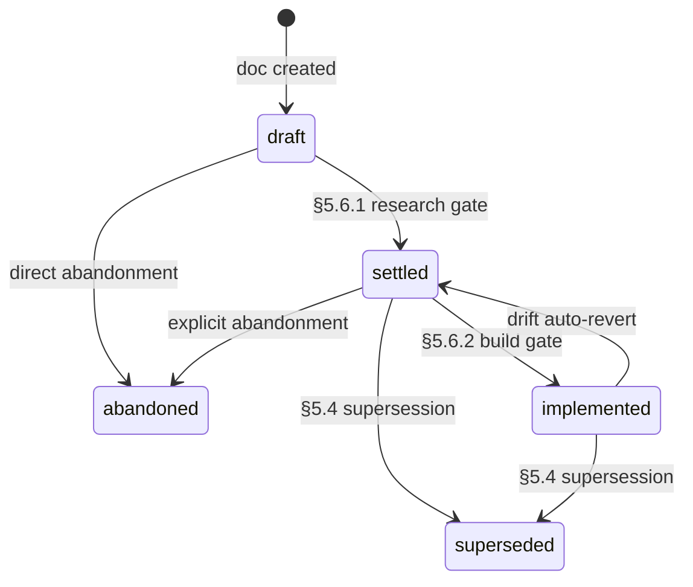
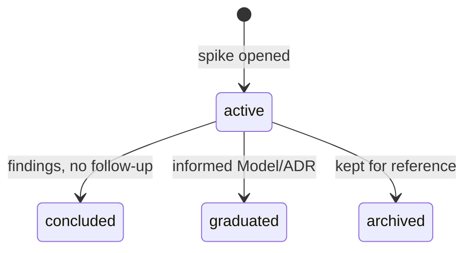

# Product Builder

**Purpose.** Codify the product-building workflow we've been running, plug the gaps we noticed (no doc-type templates, no per-decision log, no session log, no glossary changelog, no alignment-debt tracker, no place for exploratory work), and lock the patterns into shared conventions so new sessions inherit the method, not just the artifacts.

**Scope.** End-to-end workflow: design → contract → implementation → drift handling. The workflow covers `Product/` (canonical knowledge layer, status governs role) and `PLANS/` (ephemeral implementation slices, minimal touchpoints — internals not workflow-specified). Implementation lives in the project's code directory (e.g., `Assets/` for a Unity project). No separate `DOCS/` layer — `settled` features in `Product/` *are* the contract.

---

## 1. Folder layout

Top-level folders, in two groups:

**Workflow-shaped** — structure defined by this spec:
- **`_workflow/`** — workflow definition itself (this doc + doc-type templates). Rarely opened in normal operation.
- **`ledgers/`** — workflow-defined files whose content is project-specific: the open-items ledger (`OPEN-ITEMS.md`), the glossary, the feature map. Opened daily.
- **`decisions/`** — project-wide ADRs (cross-feature decisions, workflow choices).

**Project-shaped** — content is the project itself:
- **Operational** — live "what's happening right now" files (`README.md`, `SESSION-CHECKPOINT.md`) and opt-in milestone snapshots (`sessions/`, see §4.6).
- **`general/`** — project orientation: vision, capability map, architecture direction, roadmap, recommendations. The thinking *about* what this product is.
- **`features/`** — one folder per system being designed, each self-contained with its own Models, ADRs, and local numbering.
- **`spikes/`** — ideation and exploration. Time-boxed investigations that may graduate into feature design, get archived, or stay as reference.
- **`support/`** — material that supports the design but isn't the design: stress-test samples and frozen prior art.

```
Product/
  README.md                  # operating manual — agent reads this first
  SESSION-CHECKPOINT.md      # replaceable spine — live operational state

  _workflow/                 # workflow definition (rarely opened)
    PRODUCT-BUILDER.md       # this doc
    _templates/              # 7 doc-type templates
      spike.md
      feature.md
      model.md
      sample.md
      adr.md
      archive.md             # front-matter shape sourced from §5.14
      checkpoint.md
    retired-tokens.json      # registry consumed by /builder:lint T1

  ledgers/                   # workflow-shaped, project-content (opened daily)
    GLOSSARY.md              # canonical vocabulary
    OPEN-ITEMS.md            # loose ends — questions, deferred work, known TODOs
    FEATURE-MAP.md           # bird's-eye view: features, models, dep graph (mermaid)

  decisions/                 # project-wide ADRs (NNNN-<slug>.md, project-wide counter)

  general/                   # project orientation
    VISION.md                # project goal, non-goals, principles
    ARCHITECTURE.md          # high-level architecture direction
    ROADMAP.md               # phases and sequencing
    RECOMMENDATIONS.md       # current synthesis
    # other orientation docs as the project surfaces them

  sessions/                  # opt-in milestone snapshots (see §4.6)

  features/                  # per-system design work; each feature has a root <feature>.md
    <feature-a>/
      <feature-a>.md         # feature root — top-level summary, indexes Models
      models/                # Models (NN-<slug>.md, per-feature counter)
      archive/               # superseded and cancelled docs (see §5.14)
    <feature-b>/
      <feature-b>.md
      models/
      archive/
    ...                      # one folder per major system in the project
                             # (no per-feature decisions/ — see §4.5)

  spikes/                    # flat — most spikes are single docs

  support/
    samples/                 # whole-system stress tests
    prior-art/               # frozen external reference
```

`PLANS/` sits outside `Product/` as the home for ephemeral implementation slices (internals not workflow-specified). Implementation lives in the project's code directory (e.g., `Assets/` for a Unity project). No separate `DOCS/` directory — `settled` features in `Product/` *are* the canonical contract; status governs role (see §5.6 Status gates).

### Numbering

**Per-feature Model counters.** Each feature's `models/` restarts at `01`. Filenames look like `features/actions/models/03-action-definition.md`. The path is the domain prefix; no need to bake it into filenames. (Per §4.5, there is no `features/<feature>/decisions/` directory — feature-internal decisions live in Model provenance below the divider; project-wide ADRs use the `Product/decisions/NNNN-<slug>.md` counter.)

**Project-wide ADRs** live in `decisions/` with their own counter (`decisions/0001-adopt-workflow.md`). Used for decisions that span features or shape the whole project — workflow adoption, migration choices, cross-feature naming conventions.

**Feature roots** use the feature name (no counter): `features/engine/engine.md`. One per feature folder. Sits at the top, summarizes what's beneath. See §4.2.

**Snapshots** are timestamp-named (`sessions/<UTC-YYYYMMDD>-<HHMM>-<slug>.md`) and opt-in — produced only when `/builder:snapshot` is invoked to freeze a milestone (see §4.6). The chronological spine is `SESSION-CHECKPOINT.md`, kept current as work happens; snapshots are sparse references, not a per-session log.

**Spikes** stay flat with descriptive filenames (`spikes/scaffold-state-fit.md`, `spikes/sabberstone-patterns.md`). No counter — spikes don't have natural ordering and most are single-doc.

**Cross-references.** Use the path: `features/actions/models/03` or `features/actions/03` shorthand. The `features/` and `spikes/` prefixes are non-negotiable in references — keeps grep precise and globs clean.

### Where cross-cutting docs live

When a doc spans multiple systems (e.g., a terminology discussion touching naming hygiene broadly): it lives in the feature that triggered it and gets `tags: [#cross-cutting]` in front matter so it's findable. Genuinely global references go to their canonical home: glossary / open items / feature map → `ledgers/`; the workflow doc → `_workflow/`; project orientation → `general/`.

### Feature names are project-specific

Each project applying this workflow picks its own feature names — one folder per major system, sized so it can host a meaningful local discussion without overflowing into adjacents. The workflow only mandates the structure (`features/<name>/<name>.md` + `features/<name>/models/`), not any particular set of names. (Per §4.5, there is no `features/<feature>/decisions/` — feature-internal decisions live in Model provenance.)

A rule of thumb: if a feature folder has fewer than ~3 docs after several sessions, it might belong as a tag inside a sibling. If it grows past ~15 docs without natural sub-clusters, consider splitting.

---

## 2. Doc types

| Type | Purpose | Lives in | Status values |
|------|---------|----------|---------------|
| **Spike** | Time-boxed investigation; pre-design exploration | `spikes/` | `active`, `concluded`, `graduated`, `archived` |
| **Feature** | Top-level summary of a feature; indexes its Models, ADRs, opens — source of truth for the subsystem | `features/<feature>/<feature>.md` | `draft`, `settled`, `implemented`, `superseded`, `abandoned` |
| **Model** | Durable description of a sub-system within a feature, with decision provenance baked in | `features/<feature>/models/` | `draft`, `settled`, `implemented`, `superseded`, `abandoned` |
| **Sample** | Concrete reference instance projected onto the design — floor or ceiling | `support/samples/` | `draft`, `locked` |
| **ADR** | One atomic decision per file (project-wide cross-cutting only — see §4.5; feature-internal decisions live in Model provenance) | `Product/decisions/` | `proposed`, `accepted`, `superseded by NNNN` |
| **Snapshot** | Opt-in milestone freeze of `SESSION-CHECKPOINT.md` (see §4.6) | `sessions/` | n/a (frozen) |
| **Checkpoint** | Live operational spine; updated continuously | `Product/` root | n/a (replaceable) |
| **Plan** | Implementation slice | `PLANS/` | `drafting`, `active`, `done`, `abandoned` |

A Model is the atomic **build unit**: a single design artifact that can be handed to a developer for standalone implementation without requiring them to open neighboring Models in parallel. It describes a system **and** records the decisions baked into it (options weighed, rationale, consequences) — descriptive content above a divider, provenance below.

A Feature is the **navigation layer** over a set of Models: composition (which Models make up the feature), cross-Model architecture (how they fit), shared vocabulary, cross-Model invariants, and the boundaries against neighboring features. The Feature root is what a reader opens first to orient; the Models are what a developer opens to build.

Major decisions that warrant searchability also get an **ADR** — one-page summary, dated and indexed. The ADR links back to the Model; the Model links forward to the ADR.

---

## 3. Front matter

Every doc starts with:

```yaml
---
type: spike | feature | model | sample | adr | snapshot | checkpoint | plan
status: <one of the type's status values>
references: [features/actions/models/03-action-definition.md, features/triggers/models/02-trigger-shape.md]  # paths or `root`
tags: [#async, #triggers]                                                                                     # optional
---
```

Reader knows in 2 seconds what they're holding.

**Path convention.** All `references:` paths are **Product-root-relative** — written as they appear under `Product/`, with no leading `Product/` prefix and no `./` or `../` segments. Front-matter entries use full filenames (e.g., `features/actions/models/03-action-definition.md`) so `/builder:lint` can resolve them mechanically; shorthand forms (`features/actions/03`) are allowed in narrative prose only. The literal string `root` is the sole non-path value permitted, signalling "no upstream." Empty list (`[]`) is not allowed — use `root` for foundations.

**`references:` rules by doc type.**

| Doc type | Requirement |
|---|---|
| **Model** | **MUST** populate. List of upstream Model/Feature paths, or `root` when foundational. |
| **Feature root** | **SHOULD** populate with upstream Feature paths the feature depends on. Front-matter `references:` is the canonical machine-readable source; the body's `## Dependencies` section is the human-readable mirror (and carries the Downstream side, which front matter can't). Use `root` when the feature has no upstream. |
| **ADR** | **SHOULD** populate when the ADR has meaningful upstream context (the Models or Features it shapes). Optional otherwise. |
| **Spike, Sample, Snapshot, Checkpoint, Plan** | Optional. |

This convention powers cascade detection (§5.7) and FEATURE-MAP dependency rendering.

**No `last-updated:` field.** Git is the source of truth for modification dates — the linter computes `last-updated` per doc on demand from `git log -1 --format=%cs <path>` when needed. Front-matter dates always drift; the field is dropped.

**Supersession** is recorded in two places only: the old doc's `status: superseded by <ref>` string, and the new doc's `## Consequences > Reverts/replaces` field. The `<ref>` form depends on doc type — for ADRs it's the new ADR's project-wide identifier (`NNNN`); for Models it's the new Model's per-feature path or counter (`02-gamerules-contract` or `02`). No `superseded-by:` front-matter field — would be a third locus for the same fact, with the same drift risk Q3 eliminated for cascade implications.

---

## 4. Templates

**Source of truth.** Each fenced `markdown` block in §4.1–§4.5 and §4.7 is the canonical content for the corresponding file in `_workflow/_templates/` (6 templates with fenced blocks: Spike, Feature, Model, Sample, ADR, Checkpoint). The 7th template, `archive.md`, derives its front-matter shape from §5.14. Migration Phase 1 extracts these blocks into the templates directory; future workflow edits land here, then are re-extracted on next regen. Single source — no parallel content store. §4.6 (Snapshot) and §4.8 (Plan) are descriptive prose only — no template file.

### 4.1 Spike

A spike is a time-boxed investigation — pre-design exploration. Read prior art, probe a technical question, sketch a possible direction. Spikes are *not* decisions; they produce material that informs decisions.

**Spike vs. Model.** A spike is *investigation* (open-ended; we don't yet know what we're committing to). A Model commits to a design — a problem with a chosen approach. Spike often produces the framing for a Model. Sequence: spike → model → ADR. Or spike → model directly when exploration makes the choice clear.

*Vocabulary note: spikes open with `## Premise` rather than `## Problem` because the framing is open — we're testing a hypothesis, not yet responding to a defined problem. Models use `## Problem` because by that stage the question is named.*

```markdown
# <name> — spike

<front matter: type=spike, status=active>

## Premise
What we're exploring and why. One paragraph.

## What I tried
Investigation steps, code read, prior art consulted, prototypes sketched.

## Findings
What we learned.

## Outcome
One paragraph. If graduated, include a forward link to the Model / ADR it informed.
```

**Status transitions.** When a spike informs subsequent work, set its status to `graduated` and add a forward link to the Model / ADR it informed. The spike doc stays put — preserves the trail. `concluded` means findings recorded with no immediate follow-up. `archived` means it didn't go anywhere; kept for future reference.

**History doesn't update.** A Spike's status reflects only its own resolution. If the Model it graduated into is later superseded or abandoned, the Spike stays `graduated` — the supersession chain on the destination tells the rest of the story. Spikes are static once resolved; they're not re-edited as downstream evolves.

### 4.2 Feature

A **Feature** doc is the navigation root for a feature folder. It captures composition (which Models make up the feature), cross-Model architecture, shared vocabulary, and cross-Model invariants — the layer above the buildable Models. It says what the feature *is*, what Models compose it, what's settled vs. open, and what other features it depends on. The Models carry the build contracts; the Feature root carries the synthesis (and remains **the canonical contract-of-contracts once `settled`** — see §5.6 Status gates).

A feature root lives at `features/<feature>/<feature>.md` (e.g., `features/engine/engine.md`). One per feature folder. No counter; the name matches the folder.

**Feature vs. Model.** A Feature is the *navigation container* — its scope is the whole feature. A Model is a *buildable sub-system* within the feature (engine has Models for the evaluation loop, the GameRules contract, the snapshot pipeline). The Feature doc carries composition, cross-Model architecture, vocabulary, and cross-Model invariants; the Models carry the buildable contracts.

```markdown
# <feature> — feature

<front matter: type=feature, status=draft>

## What it is
High-level prose framing the feature in 30 seconds. SHOULD include a canonical artifact — a small visual or structural rendering that lets a reader grasp the shape without opening Models. Pick the form that fits:

| Feature shape | Artifact form |
|---|---|
| Sequential pipeline / phase order | Flow diagram or arrow chain |
| Component composition / orchestration | ASCII layout or component sketch |
| State machine / lifecycle | State diagram |

If no form fits cleanly, the stub `*n/a — descriptive only.*` is permitted.

## Vocabulary
**Feature-owned terms only.** Terms defined in another feature, in `ledgers/GLOSSARY.md`, or in upstream prior art do **not** belong here — link to their canonical home with a one-line pointer ("see `features/triggers/`", "see `GLOSSARY.md > Trigger`") instead of restating.

| Term | Meaning |
|---|---|
| `<term>` | <one-line definition> |

## Architecture
Cross-Model flow: how the Models in this feature fit together — phase order, interaction sequence, what calls what.

Size to the Model count:

| Model count | Architecture depth |
|---|---|
| **1** | Thin — often a single sentence pointing at the Model; the Model itself carries the structure. Stub `*n/a — see model 01.*` permitted. |
| **2–3** | Medium — a paragraph or short diagram showing how the Models compose. The load-bearing section that makes the feature legible without opening every Model. |
| **4+** | Deep — sub-headers per phase or sub-system; sequence diagram or component map. The reader needs the architecture to navigate. |

## Composition
Models that make up this feature (table form, always present regardless of count).

| Model | Role |
|---|---|
| `models/01-<slug>.md` | <one-line role> |
| `models/02-<slug>.md` | <one-line role> |

## Invariants
Cross-Model rules — properties that must hold across the feature's Models. Named, so individual Models can reference them by name rather than restating. Model-local invariants live in the Models themselves.

- **<Invariant name>.** <one-line rule>

## Boundaries
What this feature owns — and what it explicitly doesn't. Demarcation against neighboring features.

**Owns:** <list>

**Does not own:**
- <thing> → <feature that does>

## Dependencies
- **Upstream:** features/X — consumed
- **Downstream:** features/Y — consumes this

## Open
Pointers to `ledgers/OPEN-ITEMS.md` items relevant to this feature.
```

A Feature doc starts as a stub when the folder is first created — sometimes only Purpose + Boundaries, with everything else empty. It thickens as Models land beneath it. When the Feature clears the §5.6.1 research gate, status flips `draft → settled` and it becomes the canonical contract for that feature. When code lands in the implementation directory that satisfies the contract, status flips `settled → implemented` (§5.6.2 build gate).

**Cascade implications** (when this doc's edits affect downstream docs) are detected on demand by the linter — see §5.7.

**`implemented` status convention.** A Feature flips to `implemented` (via §5.6.2 build gate) when code lands that satisfies its contract. While `implemented`, edits to the contract surface open **drift entries** against the implementation — either code updates to match, or the Feature reverts to `settled` (signaling "code is no longer guaranteed to match"). Most of a project's lifetime, mature features sit in `implemented` — that's the steady state.

**`abandoned` status convention.** A Feature that's decided against keeps its folder as historical record. The root receives a one-line header: *"Status: abandoned YYYY-MM-DD — `<reason>`. Folder kept for record."* All nested Models cascade to `abandoned`. Project-wide ADRs that reference this feature stay in place (they record decisions that *were* made; they don't become wrong just because the feature didn't survive). Cascade rules from §4.3 Model abandonment apply: docs whose `references:` references this feature get ledger entries opened. Distinct from `superseded` (which means another Feature took over the role).

**Feature ↔ Model status sync.** A Feature's status is bounded above by its qualifying Models (settled or implemented). Drafts and abandoneds don't count, so adding a new draft Model to an implemented Feature doesn't drag it down. Forward flips are deliberate user actions; backward reverts are automatic when a qualifying Model drops a tier. Full rule and worked examples in §5.6.3.

### 4.3 Model

The unified design artifact. Top half describes the system; bottom half records the provenance (options weighed, rationale, consequences). A reader gets the model first; clicks down for the "why."

**Strict section order.** Every Model has the canonical sections in canonical order. Sections may be empty with a section-appropriate stub line — e.g., `*n/a — see Contracts.*` for `## Examples`, `*n/a — no elevated ADR.*` for `## Decisions`, `*n/a — purely descriptive Model.*` for the below-divider block — but cannot be reordered or omitted. The linter validates structure. Variable *size* is fine; variable *structure* is not.

```markdown
---
type: model
status: draft
references: [<upstream features or models, or the literal `root`>]
tags: []
---

# <subject> — model

## What it is
High-level orientation in 30 seconds. SHOULD include a canonical artifact that fits the Model's shape:

| Model shape | Artifact form |
|---|---|
| Class / interface / contract | Code snippet (signatures + types) |
| Algorithm | Pseudocode |
| State machine / lifecycle | State diagram |
| Data structure / schema | Shape sketch |
| Pipeline / pass / phase | Arrow chain |

If no form fits cleanly, the stub `*n/a — see Contracts.*` is permitted.

## Contracts
**Abstract surface only** — interfaces, method signatures, type shapes, return contracts, forbidden behaviors. What an implementer must satisfy. No worked-through realization here; that lives in `## Examples`.

## Invariants
Model-local rules (cross-Model rules live in the Feature root's `## Invariants`, referenced by name).

## Decisions
**Reserved for elevated ADRs.** Project-wide ADRs (per §4.5's two-feature rule) that shape this Model. Feature-internal decisions live below the divider, not here. If no ADR applies, stub `*n/a — no elevated ADR.*`.

Linked: `Product/decisions/NNNN-<title>.md`

## Examples
**Concrete realization + call-site framing.** A worked-through instance of the contract — typed-out concrete code (or pseudocode at the same fidelity) plus at least one call-site sketch showing how a consumer wires up. If no example fits the Model's shape (truly abstract surface), stub `*n/a — see Contracts.*`.

## Open follow-ups
Unresolved threads. (Promote durable items to `ledgers/OPEN-ITEMS.md`.)

---

*Below: provenance — what was considered, why we chose this, what it constrains. Feature-internal decisions live here; project-wide cross-cutting decisions get an ADR (§4.5).*

## Options considered
- **A** — rejected because ...
- **B** — rejected because ...
- **C** — chosen.

*Multi-decision Models: accumulate `### Q-N — <slug>` sub-sections in narrative order, each with its own options / lean / rationale.*

## Rationale
Why the chosen approach. Skip if obvious.

## Consequences
What this enables; what it constrains. Skip if obvious.
```

**Build-unit test.** A Model should be implementable standalone: a developer reading just this doc + the Feature root should be able to build it without opening neighboring Models in parallel. If implementation requires constant cross-referencing, the Model is either too thin (merge into a neighbor) or wrong-shaped (split along different lines).

**Below-divider modes.** The provenance block is filled in one of two modes:

- **Decision-bearing.** Populate `## Options considered`, `## Rationale`, `## Consequences`. Single-decision Models keep them flat. Multi-decision Models accumulate `### Q-N — <slug>` sub-sections under `## Options considered` in narrative order, each carrying its own options / lean / rationale; the closing `## Rationale` and `## Consequences` summarize the composite.
- **Descriptive.** No design choices, just structural framing. Stub once at the top of the provenance block (`*n/a — purely descriptive Model.*`); the three section headings remain per strict-section order without further content.

Section order is canonical regardless of mode — the linter enforces it.

**Cascade implications** (downstream docs affected by edits to this Model) are detected on demand by the linter — see §5.7.

**`implemented` status convention.** A Model flips to `implemented` (via §5.6.2 build gate) when code in the implementation directory satisfies its contract. Edits to an `implemented` Model's contract surface open **drift entries** against the code — either code updates to match, or the Model reverts to `settled`.

**`abandoned` status convention.** A Model that gets partway through and is decided against keeps its body as historical record, but receives a one-line header at the top: *"Status: abandoned YYYY-MM-DD — <reason>. Original attempt below for record."* The `abandoned` status is distinct from `superseded` (which implies a replacement Model exists). Use `abandoned` when the line of inquiry was wrong, not when a better answer was found.

**`superseded` status convention.** A Model whose contract has been replaced by a later Model in the same feature folder (the new one is now canonical) keeps its body as historical record. Front matter: `status: superseded by NN-<slug>` (per-feature numbered, matching ADR convention). Header at the top: *"Status: superseded YYYY-MM-DD by [NN-<slug>](path) — `<reason>`. Body below for record."* The new Model's `## Consequences > Reverts/replaces` field names this Model. Run the linter — every doc whose `references:` includes the old Model surfaces as a finding; fix in place. See §5.7 (Cascade detection).

**Detecting silent supersession.** When writing a new Model that introduces a contract surface (interface, type, method shape), check whether any older Model in the same feature folder defines or sketches the same surface differently. If so, the older Model is now superseded — apply this convention before writing further content. Skipping this check is the failure mode that produced `engine/02` silently superseding `engine/01`'s `GameRules` interface without flipping the status (S17 audit).

### 4.4 Sample

A **sample** is a concrete reference instance projected onto the abstractions being designed. It exists to stress-test the design against real cases — a floor (simplest case the design must support) or a ceiling (complex case that bounds expressiveness).

Examples of subjects: a card game's rules and how its elements map onto framework concepts; a client codebase using a library; a protocol implementation; a sample program for a language; an integration for an API — anything concrete enough to project the design onto.

A sample doc has two layers:

- **Subject** — the concrete thing being described. Usually stable once written.
- **Projection** — how the subject's elements map onto the design abstractions. Moves whenever the design moves. This is the load-bearing layer.

```markdown
# <sample name> — sample

<front matter: type=sample, status=draft>

## Subject
The concrete thing this sample describes, in plain language. No design-doc terminology.

## Why this sample
Floor / ceiling / stresses-which-feature.

## Projection
How the subject's elements map onto the design abstractions.

## What this does NOT exercise
Honest list — keeps us from over-claiming coverage.

## Open mappings
Ambiguous bits, unresolved projections.
```

**`draft` → `locked` transition.** A sample becomes `locked` when **all** are true:

1. **Subject finalized** — the concrete description is fully specified; we aren't still debating what the example is.
2. **Projection uses only `settled` abstractions** — every design concept the projection depends on is itself `settled`, not `draft` or `proposed`. (No locking onto sand.)
3. **Linter passes against the sample** (no broken references, no structure violations).
4. **Stable ≥ 1 session** — at least one session has passed without **contract edits** to either the sample or its dependencies. Soft cooldown. Hygiene edits (typos, formatting, link fixes, glossary-rename mirrors) don't reset the cooldown; only changes to the Subject text, the Projection mapping, or the framing do. When committing, mark the edit explicitly: `contract edit — cooldown reset` or `hygiene edit — no cooldown reset`.

After locking, design changes that affect the sample surface as linter findings against the locked sample. Resolving them is a deliberate decision: re-lock with the new shape, unlock back to `draft`, or accept the divergence (rare).

### 4.5 ADR

**Reserved for project-wide / cross-cutting decisions only.** Feature-internal decisions live in the affected Model's provenance section (§4.3 — `## Options considered`, `## Rationale`, `## Consequences`). The ADR was duplicating provenance that grep already finds; collapse into the Model.

**Hard scope rule: ADR requires ≥2 features in scope.** A decision that touches only one feature — even one cited from many Models inside that feature — lives in the affected Model's provenance, not as an ADR. ADRs apply only when the decision genuinely spans feature boundaries:

- Cross-feature principles or framework-wide naming.
- Project-shaping moves (workflow adoption, migration choices).
- Decisions cited from Models in two or more sibling features.

If you're tempted to open an ADR for a decision that only touches one feature, write it in the Model's provenance instead.

ADRs live at `Product/decisions/NNNN-<slug>.md` (project-wide counter). There is no `features/<feature>/decisions/` directory — feature-internal ADRs collapse into the Model.

```markdown
---
type: adr
status: proposed
references: [<related models or features>]
tags: []
---

# ADR-NNNN — <title>

Context-doc: `Product/features/<feature>/models/NN-<slug>.md` (or whichever Model surfaced the decision)

## Context
Two paragraphs max.

## Options considered
- A: ... — rejected because ...
- B: ... — rejected because ...
- C: ... — chosen.

## Decision
One paragraph.

## Consequences
- Enables: ...
- Constrains: ...
- Reverts/replaces: ADR-NNNN
```

#### Migration recipe — retiring `features/<feature>/decisions/`

For projects that accumulated feature-internal ADRs before the §4.5 reform, the migration is per-ADR. Each old ADR resolves into one of two outcomes — **elevate** (genuine cross-feature decision; ≥2 features in scope) or **fold** (feature-internal decision; collapse into the affected Model's provenance).

**Per-ADR steps.**

1. **Decide outcome.** Read the old ADR. Apply the §4.5 hard-scope rule: does the decision touch ≥2 features? If yes → **elevate** to `Product/decisions/NNNN-<slug>.md`. If no → **fold** into the affected Model's provenance below the divider.
2. **Preserve dates.** Both the original decision date and the migration date stay visible in the new home. The elevated ADR keeps its `Decided YYYY-MM-DD` line; the folded provenance gains a one-line *"Decided YYYY-MM-DD (originally `<old-path>`); folded YYYY-MM-DD."* note.
3. **Apply the move.** Elevate: copy content to the new ADR file under `Product/decisions/`, renumber to the next free counter. Fold: paste body content into the host Model's `## Options considered` / `## Rationale` / `## Consequences`, sub-sectioned as `### Q-N — <slug>` if the ADR carried multiple decisions.
4. **Inbound-ref sweep.** Run `/builder:deps <old-path>` to surface every doc that references the retired ADR. Update each reference to point at the new home (project-wide ADR or host Model). Same reverse-graph mechanism as §5.10a.
5. **Delete the old file.** Once references are redirected, remove the old `features/<feature>/decisions/<file>.md`. When all ADRs in a feature folder are migrated, delete the empty `decisions/` directory.

**Supersede-then-fold (special case).** When an old ADR's decision has since been overturned by later design work, fold the *superseded* body — preserving the supersession record — rather than the live one:

1. First record the supersession on the old ADR (apply the §4.3 superseded-status convention: header line, body kept for record).
2. Then fold the superseded body into the host Model's provenance, keeping the supersession header. The reader sees both the original reasoning and the fact that it was reversed.
3. The replacement decision lives wherever it currently sits — its location is independent of this migration step.

**Mechanical vs. full reshape (non-normative).** Useful to know up front so you batch-plan correctly:

| Category | Trigger | Cadence |
|---|---|---|
| **Mechanical** | The ADR's reasoning still holds; only its location is wrong. | Batch — fold or elevate several in one PR. |
| **Full reshape** | The ADR's framing or assumptions no longer match the current design (the host Model has moved on). | Per-Model design pass — open the Model, re-derive the decision in current vocabulary, then fold the result. |

A clean cue: if you can fold without re-reading the host Model, it's mechanical. If you have to re-read the Model to know how to fold, it's a reshape.

### 4.6 Snapshot (opt-in milestone)

Mandatory per-session notes were retired (see `PLANS/simplify-doc-workflow.md` decision #6). The live spine is `SESSION-CHECKPOINT.md` — updated continuously as work happens. When the user wants to freeze the current state as a referenceable milestone, `/builder:snapshot` copies the checkpoint into `Product/sessions/<UTC-YYYYMMDD>-<HHMM>-<slug>.md` with `type: snapshot` front matter and a *"Frozen — do not edit"* header. Snapshots are sparse and opt-in; most sessions produce none. Legacy per-session notes live in `Product/_archive/sessions/` as historical record.

### 4.7 Checkpoint

`SESSION-CHECKPOINT.md` is the **live operational spine** — kept current as work happens, not refreshed only at session boundaries. No open/close lifecycle, no schema. Sections are short; detail lives in feature docs and `OPEN-ITEMS.md` entries.

```markdown
---
type: checkpoint
tags: [#checkpoint]
---

# Session Checkpoint

**Live spine.** This is the single source of truth for "where we are." Updated continuously as work happens. No open/close lifecycle.

---

## Where we stopped

<one paragraph synthesizing the most recent design move and what just landed>

---

## 🎯 Active focus

`<oq-id or thread name>` — <one-sentence focus framing>

---

## ❓ Open items snapshot

See [`ledgers/OPEN-ITEMS.md`](ledgers/OPEN-ITEMS.md) for the full list. The three highest-leverage durable items right now:

- `<oq-id>` — <short framing>
- `<oq-id>` — <short framing>
- `<oq-id>` — <short framing>

---

## 📝 Scratch (ephemerals)

*Mid-conversation questions worth holding onto for the current session, but not yet promoted to OPEN-ITEMS. End of session: answer (delete), promote (move to OPEN-ITEMS), or leave for next session.*

<scratch entries, or empty>

---

## How to use this file

- **Update continuously as work happens** — agent keeps this current; not refreshed only at session end.
- **Keep it short** — if it grows past two screens, trim. Detail belongs in feature docs and OPEN-ITEMS entries.
- **`## Scratch`** is for ephemerals — things being chewed on right now. Promote to OPEN-ITEMS if they survive a session.
- **No artifact created at session end.** `/builder:snapshot` makes an opt-in milestone copy in `sessions/` when the user asks.
```

**No `last-updated:` field.** Git is the source of truth (§3). The "Where we stopped" paragraph carries enough recency context for a reader picking the file up cold.

### 4.8 Plan

Plans are ephemeral implementation slices — schedules for moving from `settled` to `implemented`. Their internals are **not workflow-specified**: slice unit, lifecycle, format are the project's choice.

A minimal Plan entry typically lists:
- What's being built (link to the Feature/Model it implements).
- What it depends on (other Models or Features).
- What "done" means for this slice (exit criteria).

Status values: `drafting`, `active`, `done`, `abandoned`. Lives in `PLANS/`.

No fenced template here — Plans don't get a `_templates/` file. Projects shape Plans to fit their team's rhythm. The workflow only commits to *that they exist* and *roughly what role they serve*.

---

## 5. Global workflow

A session is a **branching unit**, not a linear one. It opens with an entry context, spawns sub-problems, sketches, and questions as work surfaces them, and lands somewhere. Doc types are tools you reach for mid-flight as branches demand them — not categories you commit to up front.

### 5.0 Bootstrapping a project

Once-per-project phase before §5.1 applies. Output is a working `Product/` skeleton with enough orientation to start session 02 with a real question.

1. **Create the skeleton.** `_workflow/`, `ledgers/`, `decisions/`, `general/`, `features/`, `spikes/`, `support/{samples,prior-art}/`, `sessions/`. Drop the 7 doc-type templates into `_workflow/_templates/` (Spike, Feature, Model, Sample, ADR, Checkpoint extracted from §4.1–§4.5 + §4.7; Archive front-matter shape per §5.14). Seed `_workflow/retired-tokens.json` as `[]`. Drop this spec at `_workflow/PRODUCT-BUILDER.md`. Initialize empty ledger: `ledgers/OPEN-ITEMS.md`, plus `ledgers/FEATURE-MAP.md` (stub with empty mermaid block), `ledgers/GLOSSARY.md` (with empty changelog). Create `SESSION-CHECKPOINT.md` from the §4.7 template.
2. **Write `general/VISION.md` first.** What is this project? Non-goals. Principles. One paragraph each. This is the only doc that has no upstream — everything else builds on it.
3. **Identify candidate features.** Don't write Feature docs yet — just commit to the names. Create empty `features/<feature>/` folders for each. Cheap to add or rename later; expensive to thrash on once Models nest.
4. **Seed `ledgers/FEATURE-MAP.md`.** Add a row per candidate feature from step 3 with status `considered`. The map carries both pre-folder candidates and current state — it replaces a separate capability inventory.
5. **Write `general/ARCHITECTURE.md` and `general/ROADMAP.md`.** Direction and sequencing. Both stay terse — they'll be revised as feature design lands.
6. **Seed `ledgers/OPEN-ITEMS.md`.** The durable questions you can already name from day one (state ownership, async story, multiplayer, etc.). Don't try to be exhaustive.
7. **Seed `SESSION-CHECKPOINT.md`.** Active focus: *"what is this project?"* Suggested-threads section points at the orientation work above. The checkpoint becomes the live spine for subsequent sessions.
8. **Don't write feature design yet.** No Feature roots, Models, ADRs, or Samples. Bootstrap is purely orientation. Feature design starts in the next session.

A bootstrap session usually fits in one sitting. If it sprawls, the project is too big or the vision isn't clear yet — pause and split.

### 5.1–5.3 Sessions

**`SESSION-CHECKPOINT.md` is the only spine.** No open/close lifecycle, no per-session artifact, no schema. The agent keeps the checkpoint current as work happens — *during* the session, not just at its boundary.

- **`/builder:start-session`** — read-only briefing. Reads CHECKPOINT + ledgers, prints "where we are / suggested threads," waits for direction. Creates no artifact.
- **During** — branch freely. Address inline if small; spawn a doc (Spike / Model / Sample) if it deserves one; promote durable opens to `ledgers/OPEN-ITEMS.md`; ephemeral mid-conversation questions live in CHECKPOINT's `## Scratch` section. When a Model edit cascades, run the linter and fix in place (§5.7). When a major decision settles, write an ADR. New vocabulary patches `GLOSSARY.md`. Feature scope shifts refresh `FEATURE-MAP.md`.
- **`/builder:end-session`** — interactive triage routine. Runs the linter, freshness check (CHECKPOINT vs touched files), and chat-log scan for unsaved sketches. Surfaces findings as prompts (fix / defer to OPEN-ITEMS / ignore). Creates no artifact.
- **`/builder:snapshot`** — opt-in only. When the user wants to freeze the current state as a milestone, copies CHECKPOINT into `Product/sessions/<UTC-YYYYMMDD>-<HHMM>-<slug>.md`. Otherwise nothing lands there.

Legacy per-session notes (mandatory schema, in-progress / completed / merged / discarded states, parallel-session merge-pass machinery) were retired — see `PLANS/simplify-doc-workflow.md` decision #6 for the rationale. Old notes are preserved in `Product/_archive/sessions/`.

### 5.4 Reopening a settled decision

**ADR.** Don't edit the old ADR. Write a new ADR (`NNNN supersedes MMMM`), set the old ADR's status to `superseded by NNNN`, note the reason in `SESSION-CHECKPOINT.md` (and an OPEN-ITEMS entry if the supersession leaves loose ends).

**Model.** Don't edit the old Model. Either write a new Model that replaces the contract, or extend a later-numbered Model that already covers the same surface. Set the old Model's status to `superseded by NN-<slug>` and apply the §4.3 superseded-status convention (one-line header, body kept for record). Note the reason in `SESSION-CHECKPOINT.md` (and an OPEN-ITEMS entry if loose ends remain).

In both cases, run the linter to surface affected dependents (see §5.7).

### 5.6 Status gates

Two status gates govern the lifecycle: `draft → settled` (research gate) and `settled → implemented` (build gate). Each is a deliberate transition — a *commitment*, not a default. There is no separate `DOCS/` directory; status governs the role of each Feature/Model.

#### 5.6.1 Research gate: `draft → settled`

A Feature or Model can flip to `settled` when **all** are true:
- Linter passes against this doc (no broken references, no structure violations).
- Stable for ≥ 2 sessions with no edits to its contract surface (Problem / Concepts / Contracts / Invariants / Examples).
- All glossary terms it uses appear in `ledgers/GLOSSARY.md`.

Once `settled`, the Feature/Model **is** the canonical contract. Edits to a `settled` doc are deliberate events: run the linter to surface and fix affected dependents (per §5.7).

**Feature roots are the typical settle target.** When a Feature settles, the Models it indexes typically settle along with it (they're the components of the contract). Models can settle independently if a Feature root isn't ready but a sub-Model is stable on its own — but the feature-shaped path is the default.

#### 5.6.2 Build gate: `settled → implemented`

A Feature or Model can flip to `implemented` when **all** are true:
- Status is currently `settled`.
- Code in the implementation directory satisfies the contract (manual confirmation; mechanical drift check via `/builder:lint` available — see §5.10).
- No open drift entries against this Feature/Model.

The `implemented` flip is a deliberate user action: *"yes, the code matches the contract."* This is the steady state — most of a project's lifetime, mature features sit in `implemented`.

**Drift is signal.** Any edit to an `implemented` Feature/Model's contract surface creates drift against the code. Resolution: either code updates to match, or status reverts to `settled` (signaling "code is no longer guaranteed to match"). Drift is surfaced by the linter (and by post-merge drift detection in §5.12).

#### 5.6.3 Feature ↔ Model status sync

A Feature has a status; its nested Models each have their own. The two are constrained but not mechanically coupled:

> **Feature.status is bounded above by the *qualifying* Models inside it.** Qualifying = Models with status `settled` or `implemented`. Drafts, abandoneds, and supersededs don't count.

**Forward (advancing).** A Feature can flip to status X when either:
- all qualifying Models are at X or higher, OR
- there are no qualifying Models at all (a small Feature might have zero Models — the Feature root *is* the contract).

The flip itself is a deliberate user action — Models reaching the target makes the Feature *eligible*; the user makes the commitment.

**Backward (reverting).** If a qualifying Model drops a tier (e.g., drift forces a Model from `implemented` back to `settled`), the Feature auto-reverts to match. Adding new `draft` Models, abandoning Models, or superseding Models does **not** trigger a revert — those are in-flight expansions or excisions, not regressions of the existing contract.

**Worked examples.**

- Engine has 3 `implemented` Models. User adds a new `draft` Model for save/load → Feature stays `implemented`.
- The save/load Model graduates to `settled` (contract written, code not yet) → Feature auto-reverts to `settled` (now there's a qualifying Model that's not implemented).
- User implements the save/load code and flips its Model to `implemented` → Feature is eligible to flip back to `implemented` (manual confirm).
- One of the 3 original Models drifts: `implemented → settled` → Feature auto-reverts to `settled`.
- A Model is abandoned → Feature stays at its current status.
- A tiny Feature has zero Models, just the root → user can flip the Feature freely; no Model constraint.

### 5.7 Cascade detection

**Cascade is detected, not tracked.** When you edit a Model whose contract surface changes, run `/builder:lint` (or `/builder:deps <path>` for a focused walk). The linter reports affected dependents via the `references:` graph and the retired-tokens registry. **Fix in place.** No ledger entry, no threshold, no scheduled pass.

If a cascade target requires *design judgment* rather than a mechanical edit (e.g., the change opens a real question about how the dependent should behave), open an entry in `ledgers/OPEN-ITEMS.md` so the thread isn't lost.

ALIGNMENT-DEBT, the discharge threshold, and the auto-debt-pass workflow are retired (see `Product/_archive/ledgers/ALIGNMENT-DEBT.md` for historical record).

### 5.10 Reference-staleness linter

The single on-demand consistency tool (`/builder:lint`). Six responsibilities:

1. **Structure check** — every Model has the canonical sections in canonical order (§4.3). Variable size is fine; variable structure is not.
2. **References resolve** — every `references:` path exists; every inline path-shaped link in the body resolves.
3. **Header–body consistency** — auto-populate `references:` from path-shaped tokens in the body; flag mismatches.
4. **Retired-tokens check** — grep for tokens in `Product/_workflow/retired-tokens.json`; report hits with their replacement (e.g., *"`IGameStateProvider` was retired 2026-04-30; use `IStateScope` instead"*).
5. **Reverse graph** — compute "who references this" from the union of all `references:` fields. Exposed via `/builder:deps <path>` (§5.10a).
6. **Git-derived dates** — `last-updated` per doc on demand from `git log -1 --format=%cs <path>`. (Front-matter dates were retired in PR 1; git is the source of truth.)

**Findings are reported, not tracked.** The linter writes a stdout report; it does not append entries to any ledger. Fix in place.

**Hardening (PR 3+4 of the simplification rollout — see `PLANS/simplify-doc-workflow.md`).** The linter must:
- Exit non-zero on internal errors (file not found, parse failure).
- Emit a structured summary line (`lint: P passed, F failed, S skipped`) so absence-of-output = visible failure.
- Include a smoke-test fixture under `.claude/skills/builder/lint/fixtures/` validating that broken-reference + structure-violation cases are flagged.
- Distinguish *findings* (continue-on-error) from *infrastructure failures* (exit-on-error).

### 5.10a Reverse-graph query — `/builder:deps`

`/builder:deps <path>` answers two questions about a single doc:

- **Forward**: what does this doc reference? (read from front matter `references:`.)
- **Reverse**: who references this? (computed by the linter walking the full tree.)

Output is a stdout table. Use when you're about to edit a Model and want to know its blast radius without opening every dependent file.

### 5.11 Adding a new feature

Post-v1, the workflow operates in interleaved mode: features get added over time, not just during the initial bootstrap. This subsection codifies the recurring entry to the cycle. Parallel in shape to §5.0 Bootstrapping, but at per-feature cadence rather than per-project.

When a new feature is requested or designed:

1. **Create the feature folder.** `features/<feature>/` with a `models/` subfolder. (No `decisions/` — feature-internal decisions live in Model provenance per §4.5.)
2. **Write the feature root stub** at `features/<feature>/<feature>.md` per §4.2. Status `draft`. Even Purpose + Boundaries alone is enough to start — it thickens as Models land.
3. **Declare dependencies.** Identify upstream features this builds on. The first Model written under this feature carries `references:` pointing at upstream Models (or `root` if genuinely foundational).
4. **Update orientation.** Patch `ledgers/FEATURE-MAP.md` — promote the corresponding `considered` row, or add a new row + dependency edges. Patch `general/ROADMAP.md` if scheduling shifts.
5. **Record in `SESSION-CHECKPOINT.md`.** Note the new feature in the "Where we stopped" paragraph or the active-focus framing — visible event in the live spine.
6. **Begin design.** From this point, the feature's evolution follows the standard per-session flow (§5.1+).


**Why this section exists.** Post-v1 work is *recurring* feature addition. Without a canonical shape, each new feature gets invented ad-hoc — different sessions do different subsets, orientation files lag, dependency edges go unnamed. Codifying the ceremony makes the recurring cycle reproducible.

### 5.12 Drift detection

Drift — divergence between code in the implementation directory and the contracts in `Product/` (`settled` and `implemented` Features/Models) — is the failure mode the workflow exists to prevent. The detection mechanism is **event-driven post-merge automation by AI agents**.

**The flow.**

1. A PR merges to main.
2. An AI agent identifies which files changed.
3. The agent maps changed files to the features they touch — via AI judgment from the feature roots, not via mandatory code-side linkage.
4. The agent schedules a drift check on each touched feature (de-duplicated; batched).
5. At check time, the agent reads the contract and the changed code, comparing semantically.
6. If divergence is found: the agent opens a **PR with proposed contract updates** describing each divergence in the PR body.
7. Human / AI session reviews the proposed PR — merges, edits, or rejects.

**Why propose-PR rather than auto-update.** Canonical contracts are too important to let an AI agent edit silently. PR review is the human-in-the-loop checkpoint; same speed in practice (trivial accepts merge fast). Auto-merge can be considered later (hybrid model) once AI agents have a track record of low false-positive proposals.

**Why no code-side linkage convention.** Strict per-PR or per-file linkage (header comments, PR-description rules) was rejected: the maintenance overhead exceeds the value once AI agents can map files to features contextually. Workflow stays generic across project layouts; AI does the contextual matching.


### 5.13 Lifecycle reference

Visual / tabular summary of §5.0–§5.12. Reference for *"what happens when, in what order."*

#### Status state machine — Feature & Model



- `abandoned` and `superseded` are quasi-terminal — docs stay as historical record.
- `settled → draft` is not a valid transition. Reopening a settled decision goes through supersession or abandonment.
- Feature status is constrained by its qualifying Models per §5.6.3 — the Feature can't be at a higher tier than the lowest qualifying Model (where qualifying = `settled` or `implemented`).

#### Status state machine — Spike



Spikes are static once resolved (§4.1). Downstream Model supersession doesn't propagate back.

#### Feature lifecycle — phases

A feature progresses through these phases. Each phase corresponds to one or more §5.X subsections.

| # | Phase | What happens | Driving sections |
|---|-------|-------------|-----------------|
| 1 | **Initiated** | Feature folder created via §5.11 ceremony. Feature root stub written (Purpose + Boundaries). Status: `draft`. | §5.11 |
| 2 | **Designed** | Models drafted in `models/`. Project-wide ADRs land in `Product/decisions/` (per §4.5) when decisions span ≥2 features; feature-internal decisions live in Model provenance. Spikes feed Models. Cascade detected on demand by the linter. | §5.2, §5.4, §5.7 |
| 3 | **Settled** | Each Model passes research gate (§5.6.1). When all qualifying Models settled, Feature is eligible — user commits with deliberate flip. | §5.6.1, §5.6.3 |
| 4 | **Implemented** | Code lands in implementation directory. Each Model passes build gate (§5.6.2). When all qualifying Models implemented, Feature is eligible — user commits. | §5.6.2, §5.6.3 |
| 5 | **Steady state** | Most of project lifetime. Drift detection runs post-merge (§5.12); drift surfaces via PR with proposed contract updates. Run `/builder:lint` on demand for reference-staleness checks. | §5.10, §5.12 |
| 6 | **Expansion** | New Models added to extend scope. Drafts don't affect Feature status. When new Models settle, Feature may revert to `settled` until code catches up. | §5.6.3, §5.11 |
| 7 | **Retirement (rare)** | Feature abandoned (§4.2) or superseded. Folder kept as historical record; status flips signal end-of-life. | §4.2, §5.4 |

#### When automations run

| Trigger | Automations |
|---------|-------------|
| **Project start (once)** | `/builder:bootstrap` |
| **Every session start** | `/builder:start-session` |
| **Mid-session, on demand** | `/builder:new` (scaffold a doc from a template), `/builder:promote-glossary` (add or rename a glossary term), `/builder:design-pass` (structured Q-by-Q design walk), `/builder:archive` (retire a doc to `archive/`), `/builder:deps` (forward + reverse references for one doc) |
| **Periodic / on demand** | `/builder:lint` (reference staleness + archive integrity + retired-tokens) |
| **Every session end** | `/builder:end-session` |
| **Milestone snapshot** (opt-in) | `/builder:snapshot` — freeze CHECKPOINT into `Product/sessions/<UTC-YYYYMMDD>-<HHMM>-<slug>.md` |
| **PR merge to main** | `builder-drift-detection` (CI mode — see `OPEN-ITEMS.md` `bl-drift-detection`) |


### 5.14 Archive convention

Superseded and cancelled docs move into a sibling `archive/` folder inside the feature directory — co-located with the active docs so the old and new contracts sit beside each other, but visually demoted out of the active reading path.

**Target structure per feature:**

```
features/<feature>/
  <feature>.md
  models/
  archive/         # retired docs only; same depth as models/
```

#### Move trigger (explicit, not vibes)

A doc moves into `archive/` when **exactly one** of these is true — and only as part of the same commit that flips the status. Never move a doc just because it feels old.

| Trigger | Status value |
|---------|-------------|
| A successor doc exists and this doc's contract is replaced | `Superseded` |
| The work was dropped with no successor | `Cancelled` |

#### Front-matter on an archived doc

Four fields, all mandatory on archived docs:

```yaml
status: Superseded | Cancelled
superseded_by: <relative path to successor>   # required iff status=Superseded
archived_on: YYYY-MM-DD
reason: <one-line why>
```

No `supersedes:` field on the active doc. The back-reference is derived on demand by `/builder:lint` scanning `archive/*.md` for `superseded_by` pointing at the active doc. Single source of truth — the archived doc owns the pointer.

#### Lint rules (enforced by `/builder:lint`)

Four rules are checked on every lint run. Findings are surfaced in the linter report; fix in place.

1. **Forward-pointer integrity** — every `archive/*.md` with `status: Superseded` has a `superseded_by` that resolves to an existing non-archived file.
2. **No stale inbound links** — all non-archived docs are scanned for links into any `archive/` path. The only legitimate inbound link is from the successor doc named in `superseded_by`. Anything else is a stale reference to fix or remove.
3. **Status/location agreement** — a doc with `status: Superseded` or `status: Cancelled` must live in `archive/`; a doc *in* `archive/` must have one of those statuses. Disagreement is an error in both directions.
4. **Successor presence** — if doc A declares `superseded_by: B`, then B must exist and must not itself be archived.

#### Archive helper skill

`/builder:archive` automates the mechanical move: flips status, writes the four front-matter fields, `git mv`s the file into `archive/`, runs `/builder:lint`, and opens a single-commit PR. If `archive/` doesn't exist yet, it creates it with a `.gitkeep` before the move. See `.claude/commands/builder/archive.md` for the skill spec.

#### Pre-merge mutability carve-out

The archive convention applies to ADRs (and Models) that have been **merged to `main`**. Decisions still in an open PR — not yet landed in long-term project history — may be edited or rewritten in place during the same iteration. Reasons:

- A decision that's never reached `main` has not been published as a settled contract; reworking it within the PR is normal review-driven iteration, not a reversal.
- Strict archive on every PR-internal change would create archive churn during normal iteration and pollute `archive/` with WIP versions.
- PR commit history (and git's per-file timestamps) are sufficient signal for in-flight changes.

Once a decision lands on `main`, the archive convention applies in full: a later reversal requires marking the original `Superseded` and moving it to `archive/` with `superseded_by` pointing at the replacement.

---

## 6. Cross-cutting infrastructure

| File | Role | Cadence |
|------|------|---------|
| `SESSION-CHECKPOINT.md` | Live operational spine; active focus + focus questions; references OPEN-ITEMS entries by id+link | Continuously updated as work happens |
| `_workflow/PRODUCT-BUILDER.md` | This doc, once accepted | When workflow conventions change |
| `ledgers/GLOSSARY.md` | Canonical vocabulary + changelog | When a term lands or renames |
| `ledgers/OPEN-ITEMS.md` | Durable ledger of loose ends — questions, deferred work, known TODOs. Self-contained paragraph entries. Resolution = delete the entry (resolving doc owns the answer) | Append on durable open; delete on resolution |
| `ledgers/FEATURE-MAP.md` | Bird's-eye view: feature index table, mermaid dependency graph, model-level breakdown. Hand-maintained v1; auto-generated v2 | When a Model lands, a Feature ships, or dependencies shift |
| `decisions/NNNN-*.md` | Project-wide ADRs (cross-feature decisions, workflow choices, migration moves) | When a project-scoped decision settles |
| `sessions/<UTC-YYYYMMDD>-<HHMM>-<slug>.md` | Opt-in milestone snapshot — frozen copy of `SESSION-CHECKPOINT.md` at a referenceable point. `type: snapshot` front matter; *"Frozen — do not edit"* header. See §4.6. | When `/builder:snapshot` is invoked |
| `features/<feature>/<feature>.md` | Feature root — top-level summary, indexes Models + ADRs, source of truth for the subsystem | When a Model lands, an ADR settles, or feature scope shifts |
| `Product/decisions/NNNN-*.md` | Project-wide ADRs (cross-feature decisions per §4.5) | When a project-scoped decision settles |
| `features/<feature>/archive/*.md` | Retired docs (Superseded / Cancelled). Front matter: `status`, `superseded_by`, `archived_on`, `reason`. See §5.14. | When a doc is superseded or cancelled (same commit as the status flip) |
| `spikes/<name>.md` | Time-boxed investigations | When new exploration starts; status updated on conclude/graduate/archive |

### Two homes for questions

| Question kind | Lifetime | Home |
|---|---|---|
| **Durable** open item — questions, deferred tasks, known TODOs | Project lifetime, until resolved (then deleted) | `ledgers/OPEN-ITEMS.md` |
| **Active + ephemeral** — current focus, mid-conversation scratch | Current session(s) | `SESSION-CHECKPOINT.md` (focus + `## Scratch` for ephemerals) |

Ephemerals stay in CURRENT/SESSION-CHECKPOINT until they either get answered (delete), promote to OPEN-ITEMS (worth tracking durably), or get left for next session.

### Two ledgers, two shapes

`ledgers/` carries two independent ledgers, each with a distinct shape and lifecycle:

| Ledger | Shape | Closure |
|--------|-------|---------|
| `OPEN-ITEMS.md` | Loose ends (questions, tasks, deferrals) — self-contained paragraph entries with optional `kind:` tag | Delete on resolution; resolving doc owns the answer |
| `GLOSSARY.md` | Canonical vocabulary + changelog | Glossary terms persist; renames go through `/builder:promote-glossary` |

**Single-source rule.** Each piece of state lives in exactly one place. The checkpoint *links to* OPEN-ITEMS by id; it does not duplicate. Models do not duplicate cascade information inline (cascade is detected by the linter on demand, not tracked).

### Ledger entry shapes

`OPEN-ITEMS.md` entries are self-contained paragraphs. Each entry tells the full story without requiring outside context.

```markdown
- id: <oq-* | bl-* | optional> | kind: question | task | defer | **Title** — paragraph framing the loose end. What's known, what's open, why it matters. Two or three sentences.
  Trigger: `<condition that makes this actionable>` (optional, for tasks/defers).
  References: `<paths or links to related docs>`.
```

No strikethrough archive. When an entry resolves, **delete it** — the resolving doc (Model section, ADR, feature note saying "we're not doing this", etc.) owns the answer. Git keeps deletion history if ever needed: `git log --diff-filter=D ledgers/OPEN-ITEMS.md`.

**`FEATURE-MAP.md` layout**

Three layers — see §6 cross-cutting infrastructure table for the canonical structure (feature index | mermaid graph | model-level breakdown). Hand-maintained at v1; auto-generated at v2 (see `OPEN-ITEMS.md` entry `bl-feature-map-generator`).

