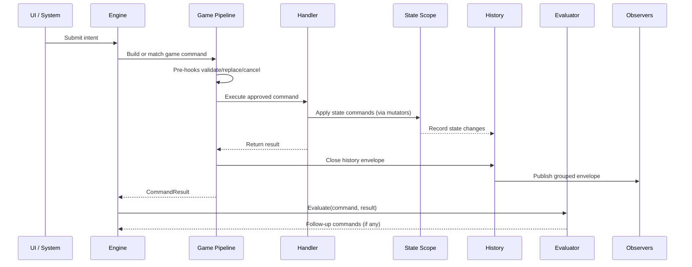

# Action, Intent, Command, And History Model

## What it is

The action-flow vocabulary and pipeline: how a `PlayerIntent` becomes a typed `GameCommand`, flows through validation and the trigger fold, executes via a handler that invokes mutators, and produces a `HistoryEnvelope` for observers.

```text
Interaction/System
  → PlayerIntent
  → IIntentMapper.Map(template, choice)
  → GameCommand
  → engine.Dispatch (lifecycle gate, handler.Validate, OnIncomingCommand, queue)
  → drain:
      → before-fold (OnBefore<T>: modify / cancel / replace)
      → handler.Handle (read state, invoke mutators, return CommandResult)
      → after-fold (OnAfter<T>: dispatch reactions)
      → envelope publishes
  → Evaluator (state-based follow-ups)
  → Presentation / network / debug observers
```

The framework provides the shape. Games and presets provide the rules.



## Contracts

### The six shapes

| Shape | Purpose | Example |
|---|---|---|
| `PlayerIntent` | Structured intent submitted from outside the rules layer (UI, AI, network, scripted, replay). Carries what the actor attempted, not the final state mutation. | `MoveAttempt(actor: P1, sourceInstance: cardA, fromZone: Hand, toZone: Battlefield)` |
| `ActionTemplate` (typed per command type) | Snapshot wire-form. Abstract base + typed subtypes per command. See [`02-availability-snapshot.md`](features/actions/models/02-availability-snapshot.md). | `MoveCardTemplate(card, destinations)`, `CastSpellTemplate(spell, targets, modes, xCost)` |
| `GameCommand` | Pipeline-dispatchable type. Subtypes (in `triggers/`): `GameAction` (executable, queued), `CompositeAction` (inline, no queue), `GameSignal` (no execution). | `MoveCardCommand`, `DealDamageCommand`, `DrawCardCommand` |
| `StateMutation` (mutator payload) | Low-level state change. Dedicated record types (not commands); one payload may fan out to N registered mutators. See [`engine/04-gamestate-slices.md`](features/engine/models/04-gamestate-slices.md). | `MoveCardPayload`, `LastMovePayload`, `AddModifierPayload` |
| `CommandResult` | Typed outcome from a handler. Subtypes per command. Populates `HistoryEnvelope.Result`. May carry cancellation flag, redirected target, damage amount, drawn instance, opened decision id. | `MoveCardResult(card, from, to)`, `DealDamageResult(target, amount, prevented)` |
| `HistoryEnvelope` | The grouping unit observers consume — one per `GameAction`, with cause metadata + entries. | See "Envelope shape" below. |

Names are settled: `Intent → ActionTemplate → GameCommand → StateMutation → CommandResult → HistoryEnvelope`. The historical "Request" terminology is retired (see Q5 below for the rename trail).

### `PlayerIntent` and `IntentGateway`

A `PlayerIntent` begins outside the rules engine. Sources:

- Player input (drag, click, target).
- AI choice.
- Network message.
- Scripted enemy behavior.
- Triggered system.
- Tutorial automation.
- Replay playback.

Examples: drag instance A from zone X to zone Y; play card A; activate ability on instance A; choose option 3; pass priority; buy item from shop.

The `IntentGateway` is the thin entry layer that translates `PlayerIntent` → dispatched `GameCommand`. Typically:

```csharp
public sealed class IntentGateway
{
    private readonly GameEngine engine;
    private readonly IIntentMapper mapper;
    private readonly IStateScope state;

    public IntentGateway(GameEngine engine, IIntentMapper mapper, IStateScope state) { ... }

    public IntentResult Submit(PlayerIntent intent, ActionTemplate template, PlayerChoice choice)
    {
        // Optional: gate against snapshot if game uses available-actions
        var snapshot = state.Get<AvailableActionsState>().Snapshot;
        if (!snapshot.Templates.Contains(template))
            return IntentResult.Rejected("not in snapshot");

        var command = mapper.Map(template, choice);
        var dispatched = engine.Dispatch(command);
        return dispatched.Accepted ? IntentResult.Ok : IntentResult.Rejected(dispatched.Reason);
    }
}
```

The gateway is **game-supplied** (each game ships its own); the framework provides the contract through `IIntentMapper`.

### `IIntentMapper`

```csharp
public interface IIntentMapper
{
    GameCommand Map(ActionTemplate template, PlayerChoice choice);
}
```

The mapper switches on the typed `ActionTemplate` subtype to produce a well-formed command. Each game ships its own implementation. **Decision-unaware** — produces the same command shape whether or not a decision is open. Per [`effects/04 §Uniform boundary`](features/effects/models/04-effect-flow.md), the engine's pre-pipeline awaiter check intercepts decision-matching commands before the normal pipeline runs.

### `GameCommand` and the type hierarchy

Defined in [`triggers/01-trigger-fold.md` §The type hierarchy](features/triggers/models/01-trigger-fold.md):

```csharp
abstract record GameCommand;                     // base — all pipeline-dispatchable types
abstract record GameAction      : GameCommand;   // executable, modifiable, queued through engine
abstract record CompositeAction : GameCommand;   // reusable StateMutation group, runs inline within a handler
abstract record GameSignal      : GameCommand;   // not executable — trigger surface only
```

| Type | Executed by | Modifiable in before fold | Goes through engine queue |
|---|---|---|---|
| `GameAction` | Handler, via engine queue | Yes | Yes |
| `CompositeAction` | Inline, within parent handler | No | No |
| `GameSignal` | Nothing — no execution step | No | No |

A handler should never dispatch another `GameAction` directly — that's an `Effect`'s responsibility (per [`effects/01-async-dispatch.md`](features/effects/models/01-async-dispatch.md)).

### Pipeline mechanics

Per `engine.Dispatch(command)`:

1. **Lifecycle gate** (framework). Reject pre-`Started` (except `StartMatchCommand` / `EndMatchCommand`) and post-`Ended`.
2. **`pipeline.Validate`** (framework). Resolves the handler from the registry and delegates to `handler.Validate(command, state, out reason)`. **This is the authoritative legality check** (per [ADR-0007](decisions/0007-five-validation-layers.md)).
3. **`GameRules.OnIncomingCommand(command, origin)`** (game). Flow gate / queue routing only — never reads command body.
4. **Enqueue** (framework). Command goes onto the intake queue.
5. **Drain** (framework, when queue is non-empty and no drain is in progress):
   1. Dequeue.
   2. **Before-fold** — `ITriggerPipeline.RunBefore` runs `OnBefore<T>` triggers in priority order (per [`effects/02 §ITriggerPipeline`](features/effects/models/02-replacement-prevention.md)). Triggers may modify, cancel (`scope.Cancel`), or replace (`scope.Replace`). On replace: original envelope closes with `Replaced`; replacement dispatches as a fresh command through the channel.
   3. **`handler.Handle(command, ctx)`** (game). Reads state, decides outcome, calls `ctx.Store.Execute(payload)` to fan out to registered mutators, returns `Task<TResult>`.
   4. **After-fold** — `ITriggerPipeline.RunAfter` runs `OnAfter<T>` triggers. Reactions dispatched via `engine.Dispatch` (separate envelopes).
   5. **Envelope publishes** with `CommandResult`.
6. **`GameRules.Evaluate`** (game). Returns 0..N follow-up commands for the engine to enqueue (with threaded `OriginCommandId`).
7. Repeat until queue empties; then `OnQueueDrained` publishes snapshot via `Actions.Set`.

### `ICommandHandler<TCommand, TResult>`

```csharp
public interface ICommandHandler<TCommand, TResult>
    where TCommand : GameCommand
    where TResult  : CommandResult
{
    bool Validate(TCommand command, IStateScope state, out string? reason);
    Task<TResult> Handle(TCommand command, IHandlerContext ctx);
}

// Game authors typically extend the typed abstract base
public abstract class CommandHandler<TCommand, TResult> : ICommandHandler { ... }
```

Each `GameCommand` type has exactly one registered handler (per [`engine/02 §Handler types`](features/engine/models/02-gamerules-contract.md)). Most handlers complete synchronously and return `Task.FromResult(...)`; only decision handlers genuinely await (per [`effects/04 §ICommandHandler.Handle returns Task`](features/effects/models/04-effect-flow.md)).

### `StateMutation` — payload-keyed mutators

Handlers do not write state inline. They call `ctx.Store.Execute(payload)`; Scaffold's registry fans out to every mutator registered for `TPayload` and commits atomically. See [`effects/04 §Writes`](features/effects/models/04-effect-flow.md) and [`engine/04 §Atomic batches`](features/engine/models/04-gamestate-slices.md).

```csharp
// Inside a handler:
public Task<MoveCardResult> Handle(MoveCardCommand cmd, IHandlerContext ctx)
{
    ctx.Store.Execute(new MoveCardPayload(cmd.Card, cmd.From, cmd.To));
    return Task.FromResult(new MoveCardResult(cmd.Card, cmd.From, cmd.To));
}
```

Payloads are dedicated record types (`MoveCardPayload`), not commands. One payload may fan out to N mutators (each owns one slice).

### `CommandResult`

Structured outcome from a handler. Subtypes per command. Examples: approved/rejected/cancelled flag, actual destination, was-redirected, damage amount, shield-vs-health damage, drawn instance ID, created instance IDs, opened decision ID.

Used for: branching inside effects (`if (damage.IsCancelled) return;`), trigger/reaction conditions, UI feedback, history envelope contents, tests.

Cancellation shape (flag on the base record vs. typed `CancelledResult` subtype) is a small decision deferred to command-pipeline cleanup; either works.

### `HistoryEnvelope`

The envelope groups everything caused by one action-flow boundary.

```text
HistoryEnvelope
  envelopeId
  originCommandId       // shared across all commands in a chain
  originIntent          // non-null only on the first command in a chain
  actor
  sourceInstance
  rootCommand
  result
  entries[]
```

Entries might include: instance created, instance destroyed, zone content changed, variable changed, modifier added/removed, decision opened, command cancelled, command replaced, visibility changed.

The envelope lets observers understand cause:

```text
Player1 used Fireball
  → Card moved hand → stack
  → Cost spent
  → Damage dealt to Enemy2
  → Enemy2 health changed
  → Card moved stack → discard
```

Without an envelope, UI sees unrelated state changes. With an envelope, UI can animate and explain the whole sequence.

**One envelope per `GameAction`.** Effect-dispatched siblings share `OriginCommandId` but each gets its own envelope. The historical "child folds into parent envelope" model is retired (per [`effects/01 §Two dispatch paths`](features/effects/models/01-async-dispatch.md)). `OriginIntent` is recorded only on the first envelope of a chain.

The typed `HistoryEnvelope` C# record is currently pseudocode — see `engine/04 ##Open follow-ups` for the typed-definition open.

### Relationship to triggers

Per [`triggers/01-trigger-fold.md`](features/triggers/models/01-trigger-fold.md):

- `OnBefore<T>` triggers run before the handler. They may modify the command, cancel it (`scope.Cancel`), or replace it (`scope.Replace`).
- `OnAfter<T>` triggers run after the handler. They may dispatch reactions through the channel (`engine.Dispatch`).
- The trigger pipeline runs as part of `pipeline.Execute` — handler authors don't see the fold directly.

### Relationship to effects

Per [`effects/04-effect-flow.md`](features/effects/models/04-effect-flow.md):

- An `Effect` orchestrates multiple `GameAction`s by calling `scope.Dispatch(action)` (immediate, inline, await result).
- Decision-handlers await player input via `ctx.Resolver.Wait<TCommand>()`; the engine pre-pipeline awaiter check intercepts matching commands.
- Effects never mutate state directly; only handlers invoke mutators.

## Invariants

Model-local invariants. (See `actions.md ## Invariants` for feature-level rules — one entry point, handler-authoritative validation, typed results, one handler per command, handlers are the only mutator caller, one envelope per GameAction, OriginCommandId/OriginIntent threading, UI creates intents, snapshot is approximate.)

- **One enforced entry point.** Every command flows through `engine.Dispatch`. No bypass paths.
- **Handlers return typed `CommandResult` subtypes.** Effects branch on these.
- **One handler per command type.** DI registration is closed-generic.
- **Handlers never dispatch other `GameAction`s.** Sequencing belongs to effects.
- **Handlers are the only layer that issues mutators.** Effects sequence; mutators write state.
- **`pipeline.Validate` is run at intake (every dispatch) before the queue.** Authoritative.
- **Pre-hooks (`OnBefore<T>` triggers) cannot mutate state.** Modify / cancel / replace only.
- **Envelopes group state changes by cause.** One envelope per `GameAction`.
- **`OriginIntent` is recorded on the first envelope only.** Subsequent envelopes share `OriginCommandId` only.

## Decisions

Linked: [`Product/decisions/0007-five-validation-layers.md`](decisions/0007-five-validation-layers.md) — Five validation layers, with `handler.Validate` authoritative. Cross-cutting (engine + actions + presentation).

## Examples

### Pile Counter — a complete dispatch

```text
Player drags top card of Pile A onto Pile B
  → IntentGateway.Submit(MoveAttempt, MoveCardTemplate(card, [pileB]), choice)
  → IIntentMapper.Map(MoveCardTemplate, choice) → MoveCardCommand(card, A, B)
  → engine.Dispatch(MoveCardCommand)
     ├─ Lifecycle gate: Started, not Start/End → permitted
     ├─ pipeline.Validate → MoveCardHandler.Validate(card, A, B) → ok
     ├─ GameRules.OnIncomingCommand → IntakeResult.Ok (Pending.AddLast)
     └─ enqueued

Drain begins:
  ├─ Dequeue MoveCardCommand
  ├─ envelope opens (OriginCommandId = newGuid, OriginIntent = MoveAttempt)
  ├─ ITriggerPipeline.RunBefore → no triggers registered → fold continues
  ├─ MoveCardHandler.Handle:
  │    ctx.Store.Execute(new MoveCardPayload(card, A, B))
  │      → PileMoveMutator.Change → new PilesState (card moved A→B)
  │      → LastMoveMutator.Change → new LastMoveState(card, A, B)
  │      → atomic commit
  │    return new MoveCardResult(card, A, B)
  ├─ ITriggerPipeline.RunAfter → no triggers → fold continues
  └─ envelope publishes:
     - ZoneContentRemoved(A, card)
     - ZoneContentInserted(B, card, position)
     - VariableChanged(LastMove, ...)
     - Result: MoveCardResult(card, A, B)

Engine.Evaluate(MoveCardCommand, MoveCardResult):
  → All piles match target? → return [new EndMatchCommand(Win(player1))]
  → enqueue with shared OriginCommandId

(continues until queue empty → OnQueueDrained publishes new snapshot)
```

The envelope is the unit observers consume. Triggers are fold steps in the same execution. Mutators are pure functions of `(currentState, payload, scope)` returning new state.

## Open follow-ups

- **Scheduler models and how they affect action flow** — broader scheduling design (interrupt injection, priority queues, MTG-stack semantics) lives mostly in `engine/`; intersects this pipeline.
- **Rollback / rejection signaling to presentation** — how rejected dispatches surface to UI (toast? state subscription? envelope entry?). Currently game-supplied via the `IntentGateway`'s return.
- **`HistoryEnvelope` typed definition** — concrete C# record (fields: `envelopeId`, `originCommandId`, `actor`, `entries[]`). Pseudocode currently; pin when replay or multiplayer transport is designed.
- **`CommandResult` cancellation shape** — flag on the base record vs typed `CancelledResult` subtype. Cosmetic; pin during command-pipeline cleanup.
- **`PlayerChoice` shape under typed templates** — may collapse further once `IIntentMapper` implementations stabilize across games.
- **`bl-interaction-feature`** — the gesture-to-intent layer (between presentation gestures and `PlayerIntent`). All intent vocabulary depends on it.

---

*Below: provenance — feature-internal decisions folded from `features/actions/decisions/0003-onincomingcommand-flow-only.md`, `0004-validation-in-handler.md`, `0005-generic-primitive-rule-constraint.md`, `0006-player-intent-mapper.md`, `0008-intent-vocabulary.md`. Single-feature scope (each decision is about how the actions pipeline is shaped; engine, presentation, and effects consume the resulting types but don't co-decide).*

This Model consolidates content from earlier proposal-style docs (former docs 14, 15, 17, 18, 19) that existed before the workflow normalization. Substantive contract content is preserved above; the historical narrative is in the per-Q provenance below and in git history.

## Options considered

### Q1 — `OnIncomingCommand` is purely flow (formerly ADR-0003 — folded)

`OnIncomingCommand` initially mixed three concerns: pause/end gating, queue routing, and command-body inspection. This forced the rule to know about every command shape and made composition fragile.

- **A — Allow `OnIncomingCommand` to read command bodies for early validation.** Rejected: duplicates handler-side validation; couples the rule to every command type.
- **B — Replace `OnIncomingCommand` with per-command callbacks.** Rejected: loses the flow-level concerns (pause/end).
- **C — `OnIncomingCommand` is purely flow: pause/end gating + queue routing; never reads the body.** **Chosen.** Body inspection happens in `handler.Validate`.

### Q2 — Validation authority in the handler (formerly ADR-0004 — folded)

Validation was previously distributed across the rule and the handler with no clear authority. When two layers disagreed, behavior depended on dispatch order.

- **A — Validation lives entirely in the rule.** Rejected: the rule shouldn't have to know command shapes; couples too tightly.
- **B — Validation lives entirely in handlers, with the rule delegating.** Rejected only because gating concerns (pause/end) belong upstream.
- **C — `ICommandHandler.Validate` is authoritative at dispatch; the rule does flow-level gating only.** **Chosen.** Other layers (per-template eligibility, AffordanceMap, IntentMapper, OnIncomingCommand) are advisory or specialized; the handler is final. (Promoted to the project-wide ADR-0007 with the full layer breakdown.)

### Q3 — Generic command primitives, rule-enforced constraints (formerly ADR-0005 — folded)

Specialized commands like `MoveTopCardCommand` accumulate quickly: top-card, bottom-card, random-card, n-cards, etc. Each one duplicates `MoveCardCommand` plus a constraint baked into the type. This explodes the command catalog.

- **A — Ship specialized commands per common pattern.** Rejected: combinatorial explosion of command types.
- **B — Ship one parameterized command** (`MoveCardCommand` with a "selector" enum). Rejected: the selector becomes a stringly-typed sub-language inside the command.
- **C — Ship generic primitives (`MoveCardCommand`); rules enforce constraints via per-template eligibility and `Validate`.** **Chosen.** "Top card", "random card", "from hand only" are constraints expressed by the rule when constructing templates and validated in handlers.

### Q4 — `PlayerIntent → IIntentMapper → GameCommand` (formerly ADR-0006 — folded)

UI gestures (drag, click, target) produce something that is *not yet* a `GameCommand`. We needed a layer that takes UI intent + the chosen template and produces a well-formed command, without UI knowing command shapes.

- **A — UI constructs `GameCommand` directly.** Rejected: UI ends up carrying command-shape knowledge for every game.
- **B — Reflection-driven slot filling.** Rejected: fragile and runtime.
- **C — `IIntentMapper.Map(template, choice) → GameCommand`, switch on typed template subtype, returns the well-formed command.** **Chosen.** Each game ships its own mapper; the framework provides the contract.

### Q5 — Intent vocabulary rename (formerly ADR-0008 — folded)

Earlier docs used `Request` / `OriginRequest` for what the player asks for, and `Command` for what the engine executes. "Request" overloaded against HTTP-style semantics and didn't read clearly when validation was distributed.

- **A — Keep `Request` everywhere.** Rejected: term conflicting with the on-demand-validation framing.
- **B — Use `Proposal` / `Action` / `Command` as a three-tier vocabulary.** Rejected: added a layer for no semantic gain.
- **C — `PlayerIntent` (UI), `Action` / `ActionTemplate` (snapshot), `GameCommand` (executed).** **Chosen.** Source/origin fields renamed `OriginIntent`. Load-bearing rename that cascaded across earlier docs.

## Rationale

The five chosen directions form a coherent shape:

- Q1's `OnIncomingCommand`-is-flow keeps the rule shape-agnostic at intake; body inspection belongs to the per-command handler.
- Q2's `handler.Validate`-is-authoritative gives one canonical answer to "is this command valid right now?" — extended in [ADR-0007](decisions/0007-five-validation-layers.md) into the explicit five-layer model.
- Q3's generic primitives keep the command catalog small and stable; constraints live where the game already knows them.
- Q4's `IIntentMapper` keeps UI decoupled from command shapes — UI knows templates and choices; mapper bridges to commands.
- Q5's `Intent → Action → Command` vocabulary makes the pipeline readable: an intent becomes a typed action and dispatches as a command.

## Consequences

- **Enables:** simple, command-shape-agnostic flow check (Q1); one canonical legality answer (Q2); small stable command catalog (Q3); UI that only knows templates/choices (Q4); consistent reading of the pipeline (Q5).
- **Constrains:** rule cannot reject by body at intake (Q1, Q3 push body checks to handlers); handler implementations carry the bulk of validation logic (Q2); rules carry constraint logic that lives in the right place (Q3); every command needs a paired template (Q4 + ADR-0001 in `02-availability-snapshot.md`); any code/doc still using `Request` is out of date (Q5).
- **Cascade:** consumed by `engine/02-gamerules-contract.md` (`OnIncomingCommand` flow-only contract); `effects/04-effect-flow.md` (handler signature returning `Task<TResult>`); `presentation/01-presentation-loop.md` (`AffordanceMap` consumes typed templates).
