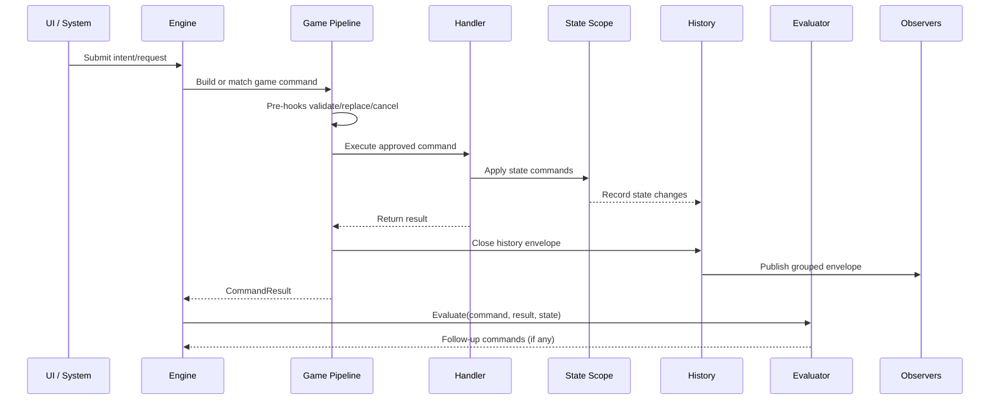
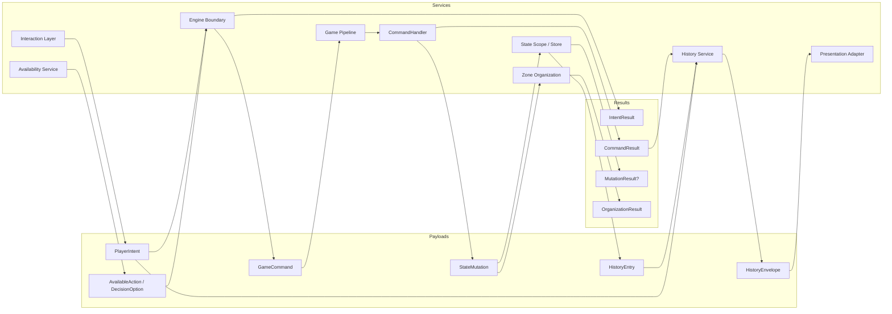
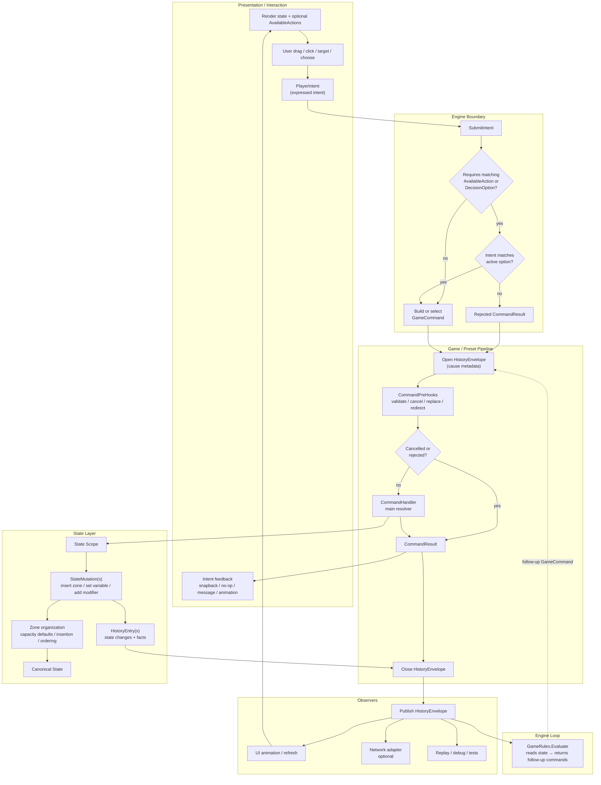
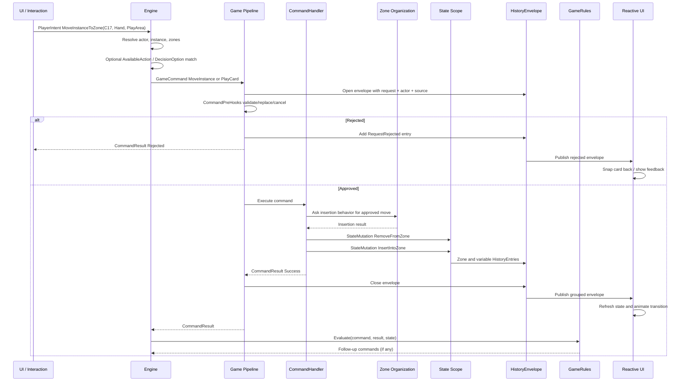

# Action, Request, Command, And History Model

This document proposes the first action-flow vocabulary for the Card Framework.

Related docs:

- [DeckMech Command Pipeline Reference](spikes/deckmech-command-pipeline.md)
- [Action Flow Decisions](features/actions/models/01-command-pipeline.md)
- [Zone Model](features/zones/models/01-zone-model.md)

## Model Summary

The working model is:

```text
Interaction/System
  -> PlayerIntent
  -> Pipeline approval
  -> Game command resolution
  -> State mutation commands
  -> State changes
  -> History envelope
  -> Presentation / network / debug observers
```

The framework should provide the shape. Games and presets provide the rules.

## Quick Vocabulary


| Term             | Meaning                                                          | Example                                                           |
| ---------------- | ---------------------------------------------------------------- | ----------------------------------------------------------------- |
| Intent           | Something an actor or system is trying to do.                    | "Drag this card onto that zone."                                  |
| PlayerIntent     | A structured intent submitted to the engine.                     | `MoveInstanceToZoneRequest(card, fromZone, toZone)`.              |
| AvailableAction  | A precomputed legal or suggested action the engine exposes.      | "Play this card targeting that enemy."                            |
| Game Command     | Approved or approvable high-level command that needs game logic. | Play card, draw card, deal damage, move instance.                 |
| StateMutation    | Low-level already-approved state mutation.                       | Set variable, insert into zone, remove from zone, apply modifier. |
| CommandHandler   | Resolves a game command into results and state mutations.        | Damage handler splits shield/health changes.                      |
| OnBefore\<T\>    | Before-trigger fold; `GameAction` can be modified, cancelled, or replaced. | Cost increase, prevention, redirect target. Replaces `CommandPreHook`. |
| OnAfter\<T\>     | After-trigger fold; dispatches reaction commands into the channel. | "After damage, draw a card." Replaces `CommandReaction`.          |
| CommandResult    | Structured outcome of a game command.                            | Move rejected, actual destination, damage amount, card drawn.     |
| State Change     | Concrete change to canonical state.                              | Instance moved, variable changed, modifier added.                 |
| History Entry    | Ordered fact emitted during resolution.                          | `ZoneChanged`, `VariableChanged`, `DecisionOpened`.               |
| History Envelope | Group of entries with cause metadata.                            | "Player A played Fireball; these changes happened."               |


Names are still proposals. See [Action Definition Proposal](features/actions/models/01-command-pipeline.md). The important distinction is between attempted request, high-level game command, low-level state mutation, result, and history.

## Pipeline Shape




## Intent And PlayerIntent

An intent begins outside the rules engine.

Sources:

- Player input.
- AI choice.
- Network message.
- Scripted enemy behavior.
- Triggered system.
- Tutorial automation.
- Replay playback.

Examples:

- Drag instance A from zone X to zone Y.
- Play card A.
- Activate ability on instance A.
- Choose option 3.
- Pass priority.
- Buy item from shop.

The request should carry what the actor attempted, not the final state mutation.

Example:

```text
MoveAttempt
  actor: Player1
  sourceInstance: CardA
  fromZone: Hand
  toZone: Battlefield
  pointerContext: optional
```

The engine may reject it, match it to a possible action, or convert it into another command.

## Possible Actions And Options

Possible actions are optional.

Games may use them to:

- Highlight legal cards.
- Show valid targets.
- Restrict network clients to server-approved choices.
- Support AI search.
- Display action menus.

But the base framework should still allow a request that is not from a precomputed list.

Possible action flow:

```text
Engine computes possible actions
  -> UI may display/highlight them
  -> Actor submits request
  -> Engine checks whether request matches active possible action
  -> If required by game, reject unmatched request
```

Permissive flow:

```text
Actor submits request
  -> Engine validates directly
  -> Approve or reject
```

## Game Commands

A game command is a high-level command that needs rules logic.

Examples:

- Play card.
- Move instance.
- Draw card.
- Deal damage.
- Heal.
- Attach equipment.
- Open pack.
- Resolve stack item.
- Choose option.

Game commands may:

- Be rejected.
- Be cancelled.
- Be replaced.
- Create decisions.
- Apply many state commands.
- Emit many history entries.
- Return a result.

Game commands should have one enforced entry point so they cannot bypass validation, hooks, logging, or history.

## StateMutation

A `StateMutation` is a lower-level mutation that has already been approved by the game command pipeline.

Examples:

- Insert instance into zone at index.
- Remove instance from zone.
- Set variable key to value.
- Add modifier.
- Remove modifier.
- Create instance.
- Destroy instance.
- Set visibility data.

State mutations should not ask broad legality questions. They are the "apply this fact" layer.

In a Store-based implementation, state mutations likely map to mutators. In a different implementation, they may map to entity/zone operations.

## Before Triggers (OnBefore\<T\>)

> **Note:** The `CommandPreHook` placeholder from earlier drafts has been superseded by the `OnBefore<T>` / `OnAfter<T>` trigger fold. See [features/triggers/models/01-trigger-fold.md](features/triggers/models/01-trigger-fold.md) for the full design.

Before triggers run before the handler. They receive the current `GameCommand` and may:

- Validate a condition and cancel the action.
- Replace the action with a different `GameAction`.
- Modify action values (cost, target, amount).
- Redirect targets.

Examples:

- "This actor is frozen, cancel movement."
- "Spell costs 1 more this turn."
- "Redirect damage to another target."
- "This effect ignores hand size."

Before triggers are where replacement and prevention effects live.

## Handler

The handler owns the main resolution of a game command.

It should:

- Read current state.
- Decide the outcome.
- Apply state commands through a state scope.
- Return a typed result.
- Emit or allow emission of history entries.

Example:

```text
Handle DealDamageCommand
  -> read shield, armor, health, prevention modifiers
  -> calculate result
  -> apply ReduceShield state command
  -> apply ReduceHealth state command
  -> maybe apply DestroyInstance state command
  -> return DamageResult
```

## CommandReactions

> **Note:** The inline `CommandReaction` pipeline step has been superseded by two separate mechanisms: `OnAfter<T>` triggers (per-instance reactions dispatched through the channel) and `GameRules.Evaluate` (state-based follow-up commands). `CommandPreHook` has been superseded by `OnBefore<T>` triggers. See [features/triggers/models/01-trigger-fold.md](features/triggers/models/01-trigger-fold.md) for the full trigger model and [features/engine/models/01-evaluation-loop.md](features/engine/models/01-evaluation-loop.md) for the evaluator pattern.

The evaluator reads current game state after each command and returns any follow-up actions. After-triggers handle per-instance reactions. Together these replace the need for inline pre/post-hook pipeline steps.

## CommandResult

A `CommandResult` is a structured outcome from a game command.

Examples:

- Approved/rejected/cancelled.
- Actual destination.
- Was redirected.
- Damage amount.
- Shield damage vs health damage.
- Drawn instance ID.
- Created instance IDs.
- Opened decision ID.

Results are useful for:

- Branching inside effects.
- Trigger/reaction conditions.
- UI feedback.
- History envelopes.
- Tests.

## History Envelope

A history envelope groups everything caused by one action-flow boundary.

Conceptual shape:

```text
HistoryEnvelope
  envelopeId
  originCommandId       // shared across all commands in a chain
  originRequest         // non-null only on the first command in a chain
  actor
  sourceInstance
  rootCommand
  result
  entries[]
  // Note: the scope.DispatchChild/child-folds-into-envelope model is superseded.
  // Effects call scope.Dispatch(action); each action gets its own independent envelope.
  // Evaluator follow-ups each produce their own separate envelope sharing originCommandId.
  // See features/effects/models/01-async-dispatch.md.
```

Entries might include:

- Instance created.
- Instance destroyed.
- Zone content changed.
- Variable changed.
- Modifier added/removed.
- Decision opened.
- Command cancelled.
- Command replaced.
- Visibility changed.

The envelope lets observers understand cause:

```text
Player1 used Fireball
  -> Card moved hand -> stack
  -> Cost spent
  -> Damage dealt to Enemy2
  -> Enemy2 health changed
  -> Card moved stack -> discard
```

Without an envelope, UI sees unrelated state changes. With an envelope, UI can animate and explain the whole sequence.

## UI Reaction

Presentation should consume state and history, not mutate simulation directly.

It can use envelopes to:

- Animate a coherent sequence.
- Display source/target lines.
- Show damage numbers with source context.
- Snap a rejected drag back.
- Reveal hidden information only when the envelope says it is visible.
- Batch UI refresh after a command resolves.

The UI may also subscribe to state directly for simple reactive rendering. But the envelope is the richer channel for animation and explanation.

## Networking Fit

Networking can attach at the same boundaries:

- Client sends request or selected option.
- Server pipeline validates and resolves.
- Server sends filtered history envelope.
- Client applies or displays envelope.

For local games, the same pipeline runs without transport.

For permissive games, the pipeline may approve most requests immediately.

For strict games, the pipeline may require active options, priority, or network authority.

## Zone Movement Fit

Zone movement fits the model:

```text
Interaction: drag card to zone
  -> PlayerIntent: move/use/drop/play this instance at this destination
  -> Pipeline: validate or auto-approve
  -> Handler: resolve exact meaning
  -> State commands:
      remove from old zone
      insert into new zone using zone organization behavior
      update variables/visibility if needed
  -> History envelope:
      source request
      zone changes
      any resulting triggers
```

The zone does not decide broad legality. It organizes approved content changes.

## Open Questions

- ~~Final names: Intent, Request, Action, Command, GameCommand?~~ **Settled:** `PlayerIntent` for external attempts, `GameCommand` for pipeline commands. See [Action Definition Proposal](features/actions/models/01-command-pipeline.md).
- Should possible actions be called `Option`, `ActionOption`, or `AvailableAction`? — still open
- How are active option lists represented and matched? — partially answered: `IAvailableActionsSnapshot` (doc 20 section 10); shape detail still open
- ~~How do nested commands produce nested envelopes?~~ — superseded: the `scope.DispatchChild`/child-folds-into-envelope model has been replaced. Effects (the async orchestration layer above handlers) call `scope.Dispatch(action)`; each action gets its own independent envelope. Evaluator follow-ups also each get their own envelope sharing `OriginCommandId`. See [features/effects/models/01-async-dispatch.md](features/effects/models/01-async-dispatch.md).
- ~~When does an envelope close?~~ — resolved: after the handler returns and history is published, before the evaluator is called (doc 18, doc 20)
- ~~Can pre-hooks mutate state, or only replace/cancel commands?~~ — resolved: the `OnBefore<T>` fold react function returns `FoldResult` (Keep/Cancel/Replace) — no direct state mutation from triggers. See [features/triggers/models/01-trigger-fold.md](features/triggers/models/01-trigger-fold.md).
- ~~Are post-reactions allowed to dispatch immediately or queued?~~ — resolved: there are no inline post-reactions; follow-up commands are returned by the evaluator and enqueued by the engine (doc 20)
- How do scheduler models affect action flow? — still open; see [ledgers/OPEN-QUESTIONS.md](ledgers/OPEN-QUESTIONS.md)
- How does rollback/rejection communicate to presentation? — still open
- What metadata must be mandatory in an envelope? — partially settled: `OriginCommandId`, `OriginIntent` (first command only), `actor`, `sourceInstance`, `result`, `entries` (doc 18)

## Useful Invariants

- UI creates intents/requests, not state changes.
- Game/action rules own approval.
- State commands apply approved facts.
- Handlers return typed results.
- Pre-hooks can cancel or replace before state changes.
- Post-reactions observe result and can trigger follow-up work.
- History envelopes group state changes by cause.
- Zones organize approved contents; they do not own broad legality.


---

# Provenance

The sections below preserve content from the source docs that were merged into this canonical Command Pipeline Model during workflow migration:

- **`features/actions/models/01-command-pipeline.md`** — load-bearing decisions on the action flow. Atomic decisions extracted as ADRs in `features/actions/decisions/`.
- **`features/actions/models/01-command-pipeline.md`** — original proposal-style doc; folded into the Model. Note: predates the trigger system (`features/triggers/`) and engine loop (`features/engine/models/01-evaluation-loop.md`); `CommandPreHook`/`CommandReaction` references reflect the older design and have been superseded by `OnBefore<T>`/`OnAfter<T>` triggers and `GameRules.Evaluate`.
- **`features/actions/models/01-command-pipeline.md`** — end-to-end code-shaped flow examples; serves as the Model's Examples section.
- **`features/actions/models/01-command-pipeline.md`** — handler return-shape and mutation semantics; the contract for handler bodies that sit alongside the pipeline.

---

# Provenance: Action Flow Decisions (from doc 14)

# Action Flow Decisions

This document captures the current direction for action flow, based on the Card Framework research so far and the DeckMech command-pipeline sample summarized in [DeckMech Command Pipeline Reference](spikes/deckmech-command-pipeline.md).

These are early research decisions, not implementation contracts.

## Status

The direction for action flow is now:

- The framework should provide a generic pipeline shape, not one universal rules engine.
- Each game or preset can decide how strict, networked, stacked, local, or permissive the pipeline is.
- UI is visual/reactive and should not own gameplay truth.
- Player interaction produces intent/request objects.
- The engine may approve, reject, replace, redirect, or ignore those requests depending on the game's rules.
- Approved requests resolve into game commands and state mutations.
- State changes are batched into an envelope with cause metadata so UI, animation, logs, networking, and debugging can understand why changes happened.
- Possible actions/options may exist and may be shown by the UI, but the base framework should still support attempts that are validated by the engine.
- Naming is not settled. The "action" family of terms needs its own discussion before implementation terminology spreads.

## Generic Pipeline, Game-Specific Rules

Decision: define an abstract action pipeline that every game can pass through, while allowing games to supply very different policy layers.

Examples:

- A Magic-like game may route an action through priority, stack, replacement effects, triggers, and networking before state changes.
- A Slay-like local game may validate against local values, energy, targets, relics, and encounter state before state changes.
- A Stacklands-like game may approve most movement automatically, update a physical stack zone, and let other systems observe that change.

The common shape is:

```text
intent/request -> game/preset pipeline -> approved command(s) -> state mutations -> batched history -> reactive UI
```

Reasoning:

The framework cannot hardcode the full rules of every card-based game. It can provide stable surfaces for routing, validation, resolution, mutation, history, and observation. Each game fills those surfaces with its own rules.

Implication:

The base action flow should be open enough that a preset can be strict, permissive, local, server-authoritative, stack-based, or real-time.

Confidence: high.

## UI And Interaction Boundary

Decision: UI is purely visual/reactive with respect to game state.

The UI can:

- Render current state.
- Render known possible actions.
- Highlight legal or suggested targets if the game exposes that data.
- Let the player drag, drop, click, target, inspect, cancel, or choose.
- Optimistically show a drag preview while waiting for approval.

The UI should not:

- Decide final legality.
- Mutate simulation state directly.
- Own card/zone truth.
- Assume every failed move is impossible to attempt.

Reasoning:

Different games want different UX constraints. A strict game may only let players drag legal cards. A sandbox-like game may let players try anything and reject or snap back if needed. The base framework should support both by making interaction produce an intent/request, not a state mutation.

Implication:

Failed requests should produce a result the presentation can react to:

- Snap back.
- Show invalid feedback.
- Show no-op.
- Ask for another target.
- Display reason, if the game chooses to expose one.

The result should be structured even when empty or default. This gives UI/UX a stable surface for rejected requests, no-ops, and accepted requests.

Confidence: high.

## Possible Actions And Free Attempts

Decision: support both precomputed possible actions and freeform attempted actions.

Some games generate explicit action options:

- Play this card.
- Move this card to this zone.
- Activate this ability.
- Choose option 2.
- Pass priority.

Other games may let the player attempt almost anything and validate after the request is submitted.

The base framework should not require one model exclusively.

Reasoning:

Hearthstone/SabberStone-style systems are built around server-authored option lists. Stacklands-style interaction feels more direct and spatial. Magic-like games may use both: actions available through priority plus choices during resolution.

Implication:

Action flow should support:

- `AvailableAction` or `DecisionOption` discovery.
- UI highlighting from known options.
- Attempted actions that are not in a precomputed list.
- Rejection or approval by the engine.
- Matching a request against an active option set when the game requires it.

Confidence: high.

## Actors And Entities

Decision: `Actor` and `Entity` are overlapping roles, not exclusive categories.

An entity is anything with variables/key-value state. An actor is anything that can own, control, view, or decide things. A player can be both:

- Entity: because it can have variables, resources, flags, score, life, mana, permissions, or status.
- Actor: because it can own cards, control instances, see hidden information, and make decisions.

Systems may also be actors:

- Environment actor.
- Neutral market actor.
- Dungeon actor.
- Stack/system actor.
- Automated enemy actor.

Reasoning:

Ownership, visibility, control, and decision-making are not limited to human players. Some cards or zones may belong to a system, encounter, shop, neutral board, or AI actor.

Implication:

The actor model should eventually define:

- Ownership.
- Control.
- Visibility/viewer relation.
- Decision authority.
- Source/cause metadata.

But it should not replace the entity model. Actors can be entities when they need variables.

Confidence: medium-high.

## Definitions, Metadata, And Effects

Decision: definitions should contain baseline variables and metadata; effects should start with a simple executable interface.

For cards, an early mental model is:

```text
Card Definition =
  baseline variables
  metadata
  visual/editor metadata
  effect entry point
```

The effect entry point can initially be a simple serializable class with an `Execute`-style method. Later it can be backed by visual scripting, databases, graphs, scripts, or generated logic.

Reasoning:

Effects will become complex, but the framework needs a simple entry point first. Complexity should hide behind an interface so authoring can evolve without rewriting the pipeline.

Implication:

Do not overdesign effect authoring now. Define a small execution boundary that can later support:

- Simple serialized classes.
- Triggered effects.
- Replacement/prevention effects.
- Visual scripting.
- Data-driven effects.
- Custom code.

For the immediate research phase, effects can be treated as a simple placeholder entry point such as `Trigger()` or `Execute()` that proves the pipeline can invoke something. Proper effect authoring, triggers, visual scripting, and reaction timing should be designed later.

Confidence: medium-high.

## Approval And Command Generation

Decision: an interaction intent/request is not necessarily the same thing as the command that mutates state.

Possible flow:

```text
Player drags card A to zone B
  -> Interaction creates request: Move/Use/Drop/Play A toward B
  -> Engine validates or matches against possible actions
  -> Engine approves, rejects, replaces, or redirects
  -> Approved request resolves into one or more commands/state mutations
```

The request might already contain enough information to become a command, or the engine might create the command after validation.

Reasoning:

In some games, "drag card to zone" maps directly to "move instance." In others, it maps to "play card," which may move to stack, pay cost, choose targets, resolve effects, and then move to discard.

Implication:

The framework should distinguish:

- What the user or system attempted.
- What the game approved.
- What commands/state mutations actually happened.

Confidence: high.

## Batched History Envelopes

Decision: state changes from one approved action should be grouped into a history/result envelope.

The envelope should preserve cause metadata:

- What request/action caused this.
- Which actor caused it.
- Which source instance caused it.
- Which command or handler produced it.
- Which state mutations happened.
- Which events/history entries were emitted.
- What result was returned.

Reasoning:

Raw state changes tell the UI that something changed, but not why. For animations, logs, networking, debug traces, and player clarity, we need the boundary object that says "this damage happened because this actor used this card on that target."

Implication:

The framework should batch changes at meaningful action boundaries. UI can then animate or present transitions as coherent groups instead of reacting to every low-level mutation independently.

Confidence: high.

## Deferred Or Grouped Notifications

Decision: state mutation can happen internally in steps, but external observers should usually receive grouped notifications at action boundaries.

This matches the DeckMech discovery: layering command resolution and grouping the resulting state changes makes UI and animation easier to schedule.

Reasoning:

Many card effects cause several changes:

- Pay cost.
- Move card.
- Deal damage.
- Apply modifier.
- Trigger reaction.
- Draw card.
- Move source to discard.

If presentation reacts to these as unrelated updates, it loses context. A history envelope lets presentation know the sequence and cause.

Implication:

The eventual state/event system should support:

- Internal state mutation and reads during command resolution.
- Deferred external notification.
- A history envelope containing ordered low-level changes.
- Optional animation timeline generation from the envelope.

Confidence: high.

## Decisions To Carry Forward

- Provide a generic action pipeline shape; games supply the rules.
- UI emits intents/requests and reacts to state/history.
- Rejections and no-ops should still return structured results.
- Possible action lists are optional, not mandatory for all games.
- Actor and Entity are overlapping roles.
- Definitions contain variables plus metadata.
- Effects exist, but deep effect design is deferred; use a minimal placeholder entry point for now.
- Approval and mutation are distinct.
- One approved action should produce a grouped history/result envelope.
- Low-level state changes should carry cause context through that envelope.


---

# Provenance: Action Definition Proposal (from doc 17)

# Action Definition Proposal

> **Status note:** This document predates the trigger system (doc 21) and engine loop (doc 20). References to `CommandPreHook` and `CommandReaction` throughout reflect the design at the time of writing. Both have since been superseded — `CommandPreHook` by `OnBefore<T>` triggers, `CommandReaction` by `OnAfter<T>` triggers and `GameRules.Evaluate`. See [features/triggers/models/01-trigger-fold.md](features/triggers/models/01-trigger-fold.md) and [features/engine/models/01-evaluation-loop.md](features/engine/models/01-evaluation-loop.md) for the current model.

This document proposes concrete definitions for the action-related shapes in the Card Framework.

It builds on:

- [Action Flow Decisions](features/actions/models/01-command-pipeline.md)
- [Action, Request, Command, And History Model](features/actions/models/01-command-pipeline.md)
- [Action Terminology Discussion](ledgers/GLOSSARY.md)
- [DeckMech Command Pipeline Reference](spikes/deckmech-command-pipeline.md)

## Proposal Summary

Use this core flow:

```text
Interaction
  -> PlayerIntent
  -> GameCommand
  -> StateMutation(s)
  -> StateChange(s)
  -> HistoryEnvelope
```

Use "Action" carefully:

- `AvailableAction` for things the engine exposes as possible choices.
- Avoid bare `Action` as a core runtime type.
- Avoid `GameAction` as a generic framework term unless a preset specifically means scheduled/timeline action.

Recommended working vocabulary:


| Shape                    | Proposed Name                         | Role                                                        |
| ------------------------ | ------------------------------------- | ----------------------------------------------------------- |
| External attempt         | `PlayerIntent`                        | Expressed player intent submitted to the engine.            |
| Possible choice          | `AvailableAction` or `DecisionOption` | Something the engine exposes as available or selectable.    |
| High-level rules command | `GameCommand`                         | Command that enters the game pipeline and returns a result. |
| Low-level mutation       | `StateMutation`                       | Already-approved state change applied to canonical state.   |
| Command outcome          | `CommandResult`                       | Structured result, even for failure or no-op.               |
| ~~Pre-handler hook~~     | ~~`CommandPreHook`~~                  | ~~Can validate, cancel, replace, redirect, or modify.~~ Superseded by `OnBefore<T>` trigger fold. See [features/triggers/models/01-trigger-fold.md](features/triggers/models/01-trigger-fold.md). |
| Main resolver            | `CommandHandler`                      | Resolves a game command into state mutations and result.    |
| Post-result follow-up    | `GameRules`                           | Reads state after command; returns follow-up commands. Replaces inline CommandReaction. |
| Ordered fact             | `HistoryEntry`                        | One meaningful state or simulation fact.                    |
| Batched output           | `HistoryEnvelope`                     | Group of entries with cause metadata.                       |
| Authored card behavior   | `Effect`                              | Simple content entry point, deeper design deferred.         |


## Core Term Categories

The action flow has three kinds of terms that should not be mixed:

1. **Payloads**: data objects passed between systems.
2. **Results**: outcome objects returned after work resolves.
3. **Services**: systems that receive payloads, execute logic, mutate state, or publish output.

### Payloads

Payloads are data. They should be serializable or at least easy to inspect in logs/debug views.


| Payload           | Created By                      | Consumed By                | Purpose                                         |
| ----------------- | ------------------------------- | -------------------------- | ----------------------------------------------- |
| `PlayerIntent`    | UI, AI, network, replay, script | Engine boundary            | Describes what an actor/system expressed intent to do. |
| `AvailableAction` | Engine/preset rules             | UI, AI, validation layer   | Optional affordance the actor may attempt.      |
| `DecisionOption`  | Decision system                 | UI, AI, network client     | One selectable option inside a decision window. |
| `GameCommand`     | Engine boundary or effect logic | Game pipeline              | High-level rules command to resolve.            |
| `StateMutation`   | Command handler or state system | State scope/store          | Already-approved state change.                  |
| `HistoryEntry`    | State scope, handler, pipeline  | History envelope           | Ordered fact about what happened.               |
| `HistoryEnvelope` | Pipeline/history service        | UI, network, debug, replay | Cause-aware group of history entries.           |


Payload rules:

- Payloads should not own long-lived behavior.
- Payloads may carry IDs, actor references, source references, target hints, and metadata.
- `PlayerIntent` is not a mutation.
- `GameCommand` is not a low-level state write.
- `StateMutation` is not a legality check.
- `HistoryEnvelope` is output, not an input command.

### Results

Results are returned by services after a payload has been processed.


| Result               | Returned By                     | Returned To                | Purpose                                                                 |
| -------------------- | ------------------------------- | -------------------------- | ----------------------------------------------------------------------- |
| `IntentResult`      | Engine boundary                 | UI / caller                | Says whether the request was accepted, rejected, converted, or matched. |
| `CommandResult`      | Game pipeline / command handler | Caller, reactions, history | Structured outcome of a `GameCommand`.                                  |
| `MutationResult`     | State scope/store, if needed    | Handler/history            | Optional low-level outcome of applying a `StateMutation`.               |
| `OrganizationResult` | Zone organization model         | Handler/state layer        | Says where/how an approved instance was inserted or removed.            |


Result rules:

- Results should be structured, even when empty/default.
- Rejection should be a result, not only an exception.
- Results may include reason codes for UX.
- Results should be included in the `HistoryEnvelope` when useful.
- Results are not the same as history; they summarize outcome, while history records facts.

### Services

Services perform work. They receive payloads, return results, and may coordinate other services.


| Service                 | Input                              | Output                                   | Responsibility                                                     |
| ----------------------- | ---------------------------------- | ---------------------------------------- | ------------------------------------------------------------------ |
| Interaction Layer       | Pointer/UI events                  | `PlayerIntent`                           | Converts UI gestures into expressed intents.                       |
| Engine Boundary         | `PlayerIntent`                     | `IntentResult`, `GameCommand`            | Resolves session/actor/instance, matches options, builds commands. |
| Availability Service    | State, actor context               | `AvailableAction`s / decisions           | Computes optional affordances or choice windows.                   |
| Game Pipeline           | `GameCommand`                      | `CommandResult`, `HistoryEnvelope`       | Runs pre-hooks, handler, reactions, and envelope boundary.         |
| CommandPreHook          | `GameCommand`                      | Continue/replace/cancel/reject signal    | Validates or modifies command before handler.                      |
| CommandHandler          | `GameCommand`                      | `CommandResult`, `StateMutation`s        | Resolves command into state changes.                               |
| State Scope / Store     | `StateMutation`                    | State changes, optional `MutationResult` | Applies canonical state changes.                                   |
| Zone Organization Model | Approved insertion/removal request | `OrganizationResult`                     | Organizes zone contents after legality is decided elsewhere.       |
| GameRules               | `GameCommand` + `CommandResult` + `GameState`  | Follow-up `GameCommand`s | Reads state after command; returns any follow-up commands. Replaces inline CommandReaction. |
| History Service         | `HistoryEntry`s + metadata         | `HistoryEnvelope`                        | Groups cause-aware history output.                                 |
| Presentation Adapter    | State + `HistoryEnvelope`          | Visual update / animation                | Updates UI without owning gameplay truth.                          |
| Network Adapter         | `PlayerIntent`/envelope            | Wire payloads                            | Optional multiplayer transport boundary.                           |


Service rules:

- Services own behavior.
- Services should expose clear input/output payloads.
- A service may be game-specific or preset-specific.
- The base framework should define the communication shape, not every game's rules.

### How They Connect

```text
Interaction Layer
  input: pointer events
  output payload: PlayerIntent

Engine Boundary
  input payload: PlayerIntent
  output result: IntentResult
  output payload: GameCommand

Game Pipeline
  input payload: GameCommand
  output result: CommandResult
  output payload: HistoryEnvelope

CommandHandler
  input payload: GameCommand
  output payload: StateMutation(s)
  output result: CommandResult

State Scope / Store
  input payload: StateMutation
  output payload: HistoryEntry
  optional result: MutationResult

History Service
  input payload: HistoryEntry(s)
  output payload: HistoryEnvelope

Presentation Adapter
  input payload: HistoryEnvelope
  input state: Canonical State
  output: UI update / animation
```

## Payload / Result / Service Graph




## Proposed Action Flow Graph

This graph shows the proposed data flow, system communication, payload movement, and decision points.




## Flow Graph Notes

### What Happens

1. Presentation renders current state and may render optional `AvailableAction`s.
2. User or system input creates a `PlayerIntent`.
3. The engine checks whether the game requires matching against active options.
4. If matching is required and fails, the engine creates a rejected `CommandResult`.
5. If accepted, the request becomes or selects a `GameCommand` (stamped with `OriginCommandId`).
6. The pipeline opens a `HistoryEnvelope`.
7. `CommandPreHook`s may validate, reject, cancel, replace, or redirect the command.
8. The `CommandHandler` resolves the command.
9. The handler applies `StateMutation`s through a state scope.
10. Zones organize approved content changes but do not decide broad legality.
11. State changes produce `HistoryEntry` facts.
12. The envelope closes and is published to observers.
13. The engine calls `GameRules.Evaluate(command, result, state)`.
14. The evaluator reads current state and returns any follow-up commands; the engine enqueues them.
15. UI updates from state/history and can animate grouped envelopes using `OriginCommandId` to correlate sequences.

### Where Systems Communicate


| Boundary                  | Payload                          | Notes                                                   |
| ------------------------- | -------------------------------- | ------------------------------------------------------- |
| UI -> Engine              | `PlayerIntent`                   | Expressed intent, not a mutation.                       |
| Engine -> Pipeline        | `GameCommand` or rejected result | Game-specific approval and option matching happen here. |
| Pipeline -> State         | `StateMutation`                  | Already-approved facts.                                 |
| State -> Pipeline/History | `HistoryEntry`                   | Ordered facts produced by mutations.                    |
| Pipeline -> Observers     | `HistoryEnvelope`                | Grouped cause-aware output.                             |
| Pipeline -> UI            | `CommandResult` and/or envelope  | Used for snapback, no-op, feedback, animation.          |


### Decision Points


| Decision                                | Owner                         | Outcome                                     |
| --------------------------------------- | ----------------------------- | ------------------------------------------- |
| Does this game require active options?  | Game/preset pipeline          | Match request or validate directly.         |
| Does request match an option?           | Engine/pipeline               | Reject or build command.                    |
| Do pre-hooks cancel or replace command? | Pipeline hooks                | Continue, reject, cancel, or modify.        |
| What state changes happen?              | Command handler               | Emits state mutations and result.           |
| How is zone content arranged?           | Zone organization model       | Inserts/removes/reorders approved contents. |
| Do reactions dispatch follow-up work?   | Command reactions / scheduler | May create child command flow.              |
| When are observers notified?            | Envelope boundary             | Usually after grouped envelope closes.      |


### Payload Movement

```text
PlayerIntent
  -> GameCommand
  -> StateMutation(s)
  -> StateChange(s)
  -> HistoryEntry(s)
  -> HistoryEnvelope
  -> UI/network/debug observers
```

Important distinction:

- `PlayerIntent` says what was intended.
- `GameCommand` says what the rules pipeline is resolving.
- `StateMutation` says what approved state fact is applied.
- `HistoryEntry` says what happened.
- `HistoryEnvelope` says why those things happened together.

## Example Flow: Player Drags Card Into Zone

This example uses a generic card drag. The game may interpret the drag as "move this instance" or as something richer like "play this card." The framework flow stays the same.

### Scenario

Initial state:

- Player actor `P1` views their hand.
- Card instance `C17` is in zone `P1.Hand`.
- Destination zone is `P1.PlayArea`.
- The UI lets the player drag `C17` over `P1.PlayArea`.

Player action:

```text
Player drags C17 from P1.Hand and drops it on P1.PlayArea.
```

### Step-By-Step Flow

```text
1. UI detects drop
   payload: pointer/drop data

2. Interaction layer builds PlayerIntent
   PlayerIntent:
     type: MoveInstanceToZone
     actor: P1
     sourceInstance: C17
     fromZone: P1.Hand
     toZone: P1.PlayArea
     inputContext: drag/drop metadata

3. Engine receives PlayerIntent
   - Finds game session.
   - Finds actor P1.
   - Finds instance C17.
   - Optionally checks active AvailableAction / DecisionOption list.

4. Engine decides interpretation
   Option A: this is a raw movement request.
     -> Build GameCommand: MoveInstance(C17, P1.Hand, P1.PlayArea)

   Option B: this game treats dragging hand card to play area as playing a card.
     -> Build GameCommand: PlayCard(C17, targetZone: P1.PlayArea)

5. Pipeline opens HistoryEnvelope
   HistoryEnvelope:
     actor: P1
     sourceIntent: original drag intent
     rootGameCommand: MoveInstance or PlayCard

6. CommandPreHooks run
   Examples:
     - Check actor has permission to act.
     - Check active option match if game requires one.
     - Check cost/resource if this is PlayCard.
     - Check card is not locked/stunned/exhausted.
     - Check network authority if multiplayer.
     - Redirect or replace command if a rule modifies destination.

7. Decision point: rejected?
   If rejected:
     CommandResult:
       status: Rejected
       reasonCode: NotEnoughEnergy / InvalidDestination / NotYourTurn / etc.

     HistoryEntry:
       RequestRejected(P1, C17, reason)

     HistoryEnvelope closes.
     UI receives result/envelope and snaps card back or shows feedback.
     Flow ends.

8. If approved, CommandHandler runs
   For MoveInstance:
     - Reads current zone membership.
     - Asks destination zone how to organize approved insertion.
     - Applies StateMutation RemoveFromZone(P1.Hand, C17).
     - Applies StateMutation InsertIntoZone(P1.PlayArea, C17, insertionResult).
     - Applies visibility or variable changes if needed.

   For PlayCard:
     - Pays cost through StateMutation(s).
     - Removes card from hand.
     - Inserts card into stack/play area depending on game rules.
     - May invoke effect placeholder.
     - May later move source to discard/resolved zone.

9. State layer applies StateMutations
   State changes:
     - P1.Hand contents changed.
     - P1.PlayArea contents changed.
     - C17 zone relationship changed.
     - Optional variables changed.

10. History entries are recorded
   HistoryEntry examples:
     - ZoneContentRemoved(P1.Hand, C17)
     - ZoneContentInserted(P1.PlayArea, C17, index)
     - InstanceVariableChanged(C17, "zone", P1.PlayArea)
     - CostPaid(P1, amount) if PlayCard

11. CommandHandler returns CommandResult
   MoveResult:
     status: Success
     movedInstance: C17
     fromZone: P1.Hand
     toZone: P1.PlayArea
     insertionIndex: 2

12. CommandReactions run
   Examples:
     - "Whenever a card enters play area..." reaction.
     - Animation/audio observer registers interest.
     - Debug trace records command result.
     - A game-specific trigger dispatches a child GameCommand.

13. HistoryEnvelope closes
   Envelope now contains:
     - Original request.
     - Actor/source metadata.
     - Root command.
     - Result.
     - Ordered state/history entries.
     - Optional child envelopes.

14. Observers receive grouped output
   UI:
     - Updates hand view.
     - Updates destination zone view.
     - Plays drag-drop settle animation or card-play animation.
     - Shows rejection feedback if rejected.

   Network:
     - Sends filtered envelope if multiplayer.

   Debug/replay:
     - Stores envelope for inspection/replay.
```

### Flow Diagram




### Notes

- The zone does not decide whether `C17` is allowed to enter `P1.PlayArea`.
- The zone does decide how an approved insertion is organized.
- A strict game can reject unless the request matches an active `AvailableAction`.
- A permissive game can auto-approve most movement requests.
- A networked game can insert server authority into the pre-hook or engine validation phase.
- UI can optimistically display the drag, but canonical state changes only after the engine approves and applies state mutations.
- State can update immediately inside the pipeline, while external notification waits for the envelope boundary.

## Why Avoid Bare "Action"

The word "action" can mean too many things:

- A player action.
- A UI action.
- A possible action.
- A scheduled timeline action.
- A card action.
- A command.
- An effect.
- A task in a queue.

DeckMech showed that this creates confusion fast. The framework should reserve "action" for user-facing language and use more precise runtime terms.

## Shape 1: PlayerIntent

Definition:

> A `PlayerIntent` is an expression of intent submitted to the engine by UI, AI, network, script, replay, or another system.

Examples:

- Move instance to zone.
- Play card.
- Activate ability.
- Choose option.
- Pass priority.
- Buy shop item.
- Stack one card onto another.

Important properties:

- It represents what was attempted, not what happened.
- It may be rejected.
- It may be matched against `AvailableAction`s or `DecisionOption`s.
- It may be converted into one or more `GameCommand`s.
- It should carry enough metadata for UX and history: actor, source instance, target hints, pointer context if relevant.

Example shape:

```text
PlayerIntent
  intentId
  actor
  sourceInstance
  intentType
  targetHints
  inputContext
```

Notes:

- `PlayerIntent` is the structured type name for any actor-originated input.
- A rejected intent should still produce a structured `IntentResult`.

## Shape 2: AvailableAction And DecisionOption

Definition:

> An `AvailableAction` is an action-like possibility exposed by the engine. A `DecisionOption` is a selectable option inside an explicit decision window.

Use `AvailableAction` for broad UI affordances:

- This card can be played.
- This card can move to this zone.
- This ability can be activated.

Use `DecisionOption` for explicit choice windows:

- Choose one of three cards.
- Select a target.
- Pass or respond.
- Choose one mode.

Important properties:

- Optional system. Not every game needs precomputed options.
- Can be local or server-authored.
- UI may use it for highlights, menus, or disabled states.
- The engine may require requests to match an active available action, or it may accept freeform requests.

Recommendation:

- Use `Decision -> DecisionOption` for formal choice windows.
- Use `AvailableAction` for general affordance discovery.
- Do not require all requests to originate from either.

## Shape 3: GameCommand

Definition:

> A `GameCommand` is a high-level rules command that enters the game pipeline, runs through hooks and a handler, and returns a `CommandResult`.

Examples:

- `PlayCard`.
- `MoveInstance`.
- `DealDamage`.
- `DrawCard`.
- `AttachInstance`.
- `ResolveStackItem`.
- `OpenPack`.

Important properties:

- Must have one enforced entry point.
- Must not silently no-op if sent through the wrong path.
- Can be cancelled or replaced by pre-hooks.
- Has exactly one main handler.
- Produces a structured result.
- Produces or causes `StateMutation`s.
- Opens/closes or contributes to a `HistoryEnvelope`.

Example flow:

```text
GameCommand
  -> CommandPreHook(s)
  -> CommandHandler
  -> CommandReaction(s)
  -> CommandResult
```

Why keep this name, for now:

- It is understandable from DeckMech.
- It clearly distinguishes from low-level state changes.
- It can be renamed later if `RulesCommand` or `EngineCommand` feels better.

## Shape 4: StateMutation

Definition:

> A `StateMutation` is an already-approved low-level state change.

This is the proposed replacement term for `StateCommand` in framework-level docs.

Examples:

- Insert instance into zone.
- Remove instance from zone.
- Set variable key/value.
- Add modifier.
- Remove modifier.
- Create instance.
- Destroy instance.
- Set visibility.

Important properties:

- It should not ask broad legality questions.
- It should not run the whole game pipeline again.
- It applies through a state scope or store/mutator layer.
- It records state changes for the current history envelope.
- It is implementation-adjacent and may map to Scaffold `Store` mutators.

Reasoning:

`StateMutation` is clearer than `StateCommand` for framework docs because it avoids making every layer a "command." If the implementation later uses command records for mutations, the conceptual term can still remain `StateMutation`.

## Shape 5: CommandResult

Definition:

> A `CommandResult` is the structured outcome of a `GameCommand`.

Examples:

- Success.
- Rejected.
- Cancelled.
- No-op.
- Actual destination.
- Damage split.
- Created instance IDs.
- Drawn card ID.
- Opened decision ID.
- Reason code.

Important properties:

- Always structured.
- Can be empty/default for simple cases.
- Should support UX feedback.
- Should support tests.
- Should be included in the history envelope.

Recommendation:

Use a base result shape with common fields:

```text
CommandResult
  status
  reasonCode optional
  message optional
```

Specific commands can extend with payload:

```text
MoveResult
  status
  actualZone
  actualIndex
  wasRejected
  wasRedirected
```

## Shape 6: CommandPreHook *(superseded — see [features/triggers/models/01-trigger-fold.md](features/triggers/models/01-trigger-fold.md))*

> **Status:** `CommandPreHook` has been replaced by the `OnBefore<T>` trigger fold. The intent described below is valid; the mechanism is not. Refer to doc 21 for the current design.

Definition (historical):

> A `CommandPreHook` runs before the command handler and can validate, cancel, replace, redirect, or modify a `GameCommand`.

Examples:

- Frozen actor cancels movement.
- Cost modifier changes play command.
- Replacement effect redirects damage.
- Network authority rejects request.
- Stack/priority rules transform an action into a stack entry.
- "Ignore hand size" effect modifies capacity handling.

Important properties:

- Runs before state mutations from the command.
- Should be deterministic.
- Should be ordered by registration or explicit priority.
- May return unchanged command, modified command, cancellation, or rejection.

Open question:

Can a pre-hook mutate state? My recommendation: not initially. It should return a signal. State mutation should remain in handlers or explicit follow-up commands unless a concrete need appears.

## Shape 7: CommandHandler

Definition:

> A `CommandHandler` is the main resolver for one `GameCommand` type. The interface signature is `Task<TResult> Handle(TCommand, IHandlerContext)` — handlers are async-capable so decision handlers can `await ctx.Resolver.Await(id)`. Synchronous handlers wrap their result in `Task.FromResult(...)`. See [features/effects/models/04-effect-flow.md §6](features/effects/models/04-effect-flow.md).

Responsibilities:

- Read state.
- Interpret the command.
- Decide actual outcome.
- Apply `StateMutation`s.
- Return `Task<CommandResult>`.
- Emit history entries through the current envelope.

Example:

```text
Handle MoveInstance
  -> inspect current zone and destination zone organization
  -> apply remove-from-zone mutation
  -> ask destination zone how to insert
  -> apply insert-into-zone mutation
  -> return MoveResult
```

Important properties:

- Required for every concrete game command.
- Missing handler should be a loud error.
- Should receive a scope, not necessarily raw global Store.
- Can dispatch child game commands only if the pipeline explicitly supports nesting.

## Shape 8: CommandReaction

> **Note:** The inline `CommandReaction` pipeline step has been superseded by the evaluator pattern (see [Engine — Orchestrator And Evaluation Loop](features/engine/models/01-evaluation-loop.md)). Follow-up commands are no longer dispatched as post-hooks inside the pipeline. Instead, `GameRules.Evaluate` is called after the pipeline finishes and returns follow-up commands based on current game state. This keeps the pipeline lean and gives the evaluator full visibility before deciding what runs next.

The `CommandPreHook` placeholder has been superseded by the `OnBefore<T>` / `OnAfter<T>` trigger fold — see [features/triggers/models/01-trigger-fold.md](features/triggers/models/01-trigger-fold.md) for the full design. `CommandReaction` as a post-step is removed; reactions dispatch through `GameRules.OnIncomingCommand` and `GameRules.Evaluate`.

## Shape 9: HistoryEntry

Definition:

> A `HistoryEntry` is one ordered fact emitted by simulation.

Examples:

- Instance created.
- Zone contents changed.
- Variable changed.
- Modifier added.
- Command rejected.
- Decision opened.
- Visibility changed.

Important properties:

- Ordered.
- Cause-aware through containing envelope.
- Can be filtered per viewer.
- Can drive UI animation.
- Can support replay/debug/networking.

## Shape 10: HistoryEnvelope

Definition:

> A `HistoryEnvelope` is a batch of related history entries plus metadata about why they happened.

Conceptual shape:

```text
HistoryEnvelope
  envelopeId
  originCommandId       // shared across all commands in a chain
  originRequest         // non-null only on the first command in a chain
  actor
  sourceInstance optional
  rootGameCommand
  commandResult
  entries
  // No childEnvelopes — child commands via scope.DispatchChild fold their
  // entries into the current envelope. Evaluator follow-ups each produce
  // their own separate envelope sharing originCommandId.
```

Important properties:

- Groups state changes at meaningful action boundaries.
- Lets UI know cause and sequence.
- Lets network send coherent updates.
- Lets debug tools explain "why did this happen?"
- `originCommandId` links all envelopes in a chain so UI can correlate a sequence of envelopes back to one player action.

## Shape 11: Effect

> **Status:** The placeholder `Effect.Trigger(context)` described below is superseded. See [features/effects/models/01-async-dispatch.md](features/effects/models/01-async-dispatch.md) for the current design.

Definition:

> An `Effect` is an async orchestration layer that sequences multiple `GameAction`s and threads their `CommandResult`s. It is the only layer that can dispatch a series of commands. Defined on or referenced from a card or ability definition.

Current shape:

```csharp
public interface IEffect
{
    Task Execute(IEffectScope scope);
}
```

Effects call `scope.Dispatch(action)` to execute `GameAction`s inline and in sequence, awaiting each result before continuing. Each dispatched action gets its own envelope. Most effects will be authored as concrete classes or data-driven definitions implementing this interface.

Important properties:

- Async orchestration — the only layer that sequences commands.
- Not a `GameAction` — not queued through the engine; invoked by `ExecuteCardCommand` or equivalent.
- Not the same as `StateMutation`.
- Sits above `GameAction` handlers in the layer hierarchy.

## Full Proposed Flow

```text
1. UI / AI / system creates PlayerIntent.
2. Engine optionally matches PlayerIntent to AvailableAction or DecisionOption.
3. Engine creates or selects GameCommand (stamped with OriginCommandId and OriginIntent).
4. Pipeline opens HistoryEnvelope.
5. OnBefore<T> trigger fold runs (replaces CommandPreHooks — see doc 21).
6. If rejected/cancelled:
     -> create CommandResult
     -> write rejection entry
     -> close and publish envelope
     -> notify observers
7. If approved:
     -> CommandHandler resolves.
     -> Handler applies StateMutations.
     -> State changes are recorded as HistoryEntries.
     -> Handler returns CommandResult.
8. Envelope closes and is published to observers.
9. Engine calls GameRules.Evaluate(command, result, state).
10. Evaluator returns follow-up commands (if any); engine enqueues them with same OriginCommandId.
11. Loop continues until queue is empty, then OnQueueDrained fires.
```

## Proposal For Core Terms

Use these terms in future docs unless we revise them:


| Term            | Use It For                                        | Avoid Using It For                     |
| --------------- | ------------------------------------------------- | -------------------------------------- |
| PlayerIntent    | Expressed actor/system intent entering the engine.| Low-level state mutation.              |
| AvailableAction | Optional engine-exposed affordance.               | A required command pipeline concept.   |
| DecisionOption  | Choice inside explicit decision.                  | Freeform drag attempts.                |
| GameCommand     | High-level command resolved by rules.             | Direct state mutation.                 |
| StateMutation   | Approved state change.                            | Game logic command.                    |
| CommandResult   | Structured outcome.                               | Raw state diff.                        |
| IntentResult    | Gateway outcome for a PlayerIntent.               | CommandResult or pipeline result.      |
| CommandPreHook  | Before-handler command modification/cancellation. | Post-result triggers.                  |
| CommandHandler  | Main command resolver.                            | UI event handler.                      |
| GameRules       | Post-pipeline follow-up command dispatch.         | Inline post-result pipeline hooks.     |
| HistoryEntry    | Ordered fact.                                     | Whole batch.                           |
| HistoryEnvelope | Cause-aware batch.                                | Single state change.                   |
| Effect          | Authored behavior entry point.                    | Runtime mutation primitive.            |


## Main Recommendation

Do not build the framework around a type named just `Action`.

Use:

- `PlayerIntent` for what enters from UI/network/AI.
- `AvailableAction` for optional affordances.
- `GameCommand` for rules pipeline input.
- `StateMutation` for approved state writes.
- `HistoryEnvelope` for grouped output.
- `Effect` for authored card behavior.

This gives us enough precision to discuss Slay-like local play, Magic-like stack play, and Stacklands-like permissive movement without collapsing every concept into "action."
---

# Examples: End-to-End Snippets (from doc 18)

# Action Flow Snippets

This document sketches a possible end-to-end flow in code-like snippets. It is not an implementation plan. The goal is to make the proposed payloads, results, services, handlers, state changes, history envelope, and animation handoff easier to see.

Scenario:

> Player drags a healing card from `Hand` to `PlayArea`. The game accepts the request. `**PlayCardCommand**` only performs placement: hand → play area, with semantics for that step. After the pipeline finishes, the **evaluator** reads state, sees a card sitting in `PlayArea`, and returns an `ExecuteCardCommand` for the engine to enqueue next. The execute step runs the card’s effect (here: heal) and moves the card to **discard** if that is what this game does after resolve. State updates and separate envelopes (one per command) drive UI. This sample ignores failure ordering and fine-grained “finished” vs “resolved” naming.

## 1. Definitions

The card definition has baseline variables, visual metadata, and one simple effect entry point.

```csharp
public sealed class CardDefinition
{
    public DefinitionId Id { get; init; }
    public string DisplayName { get; init; } = "";
    public VariableBag BaseVariables { get; init; } = new();
    public VisualDefinitionId Visual { get; init; }
    public IEffect Effect { get; init; } = EmptyEffect.Instance;
}

public sealed class HealFiveEffect : IEffect
{
    public async Task Execute(IEffectScope scope)
    {
        await scope.Dispatch(new HealActorAction(
            actor: scope.Actor,
            source: scope.SourceInstance,
            target: scope.Actor,
            amount: 5));
    }
}
```

## 2. UI Detects Drag

The UI does not move canonical state. It creates a request.

```csharp
public sealed class CardDragController
{
    private readonly IIntentGateway requests;

    public void OnDrop(CardView cardView, ZoneView targetZone, PointerDropContext pointer)
    {
        var request = new MoveInstanceToZoneRequest
        {
            Actor = cardView.ViewerActor,
            SourceInstance = cardView.InstanceId,
            FromZone = cardView.CurrentZoneId,
            ToZone = targetZone.ZoneId,
            Input = pointer
        };

        requests.Submit(request);
    }
}
```

Payload:

```csharp
public sealed record MoveInstanceToZoneRequest
{
    public required ActorId Actor { get; init; }
    public required InstanceId SourceInstance { get; init; }
    public required ZoneId FromZone { get; init; }
    public required ZoneId ToZone { get; init; }
    public PointerDropContext? Input { get; init; }
}
```

## 3. Engine Receives PlayerIntent

The gateway resolves actor/session/instance, optionally checks available actions, converts the intent into a game command, and hands it to the engine via `Dispatch`. It returns an `IntentResult` immediately — either a synchronous rejection (before the engine) or an acceptance with a `IntentId` the caller can use to match the future envelope.

```csharp
public sealed class IntentGateway : IIntentGateway
{
    private readonly IntentMapper actionMatcher;
    private readonly GameEngine engine;

    public IntentResult Submit(MoveInstanceToZoneRequest request)
    {
        var match = actionMatcher.TryMatch(request);
        if (match.RequiresMatch && !match.Success)
            return new IntentResult { Status = IntentStatus.Rejected, Reason = RejectReason.NotAvailableAction };

        var commandChainId = CommandChainId.New();

        // Game-specific interpretation: dragging from hand to play area means play card.
        GameCommand command = (match.CommandOverride
            ?? new PlayCardCommand(
                actor: request.Actor,
                source: request.SourceInstance,
                fromZone: request.FromZone,
                playZone: request.ToZone))
            with { OriginCommandId = commandChainId, OriginIntent = request };

        engine.Dispatch(command);
        return new IntentResult { Status = IntentStatus.Accepted, IntentId = commandChainId };
    }
}
```

`IntentResult.Accepted` does **not** mean the command succeeded — it means the engine received it. The actual outcome arrives via the published `HistoryEnvelope` whose `Cause.OriginCommandId` matches.

> **Decision-unaware boundary (ADR-0006, confirmed S15).** The gateway maps intent to command based on the template type only. It never inspects snapshot scope or emits a `DecisionResponseCommand`. The engine's pre-pipeline `ICommandAwaiter` check handles in-progress decision responses before they reach the normal pipeline. See [04-effect-flow §6](features/effects/models/04-effect-flow.md).

```csharp
public sealed record IntentResult
{
    public required IntentStatus Status { get; init; }
    public RejectReason? Reason { get; init; }
    public IntentId? IntentId { get; init; }
}
```

## 4. Game Command Enters Pipeline

`ICommandPipeline` opens an envelope, runs before triggers, invokes the handler, runs after triggers, and publishes the envelope. It handles exactly one command and returns a result. It does not decide what runs next — that is the evaluator's job (see section 6b).

```csharp
public sealed class CommandPipeline : ICommandPipeline
{
    private readonly IHistoryService history;
    private readonly ITriggerPipeline triggerPipeline;
    private readonly GameRules gameRules;

    public async Task<CommandResult> Execute(GameAction action, Context context)
    {
        using var envelope = history.OpenEnvelope(new EnvelopeCause
        {
            Actor = action.Actor,
            SourceInstance = action.Source,
            OriginCommandId = action.OriginCommandId,
            OriginIntent = action.OriginIntent  // non-null only on the first command in a chain
        });

        var available = gameRules.FilterTriggers(triggerPipeline.Candidates, action, context);
        var before = await triggerPipeline.RunBefore(action, available, context);
        if (before.IsCancelled)
        {
            var rejected = CommandResult.Rejected(before.CancelReason);
            envelope.Add(new CommandRejectedEntry(action, rejected));
            return history.CloseAndPublish(envelope, rejected);
        }

        if (before.IsReplaced)
        {
            history.CloseAndPublish(envelope, CommandResult.Replaced);
            engine.Dispatch(before.Replacement);
            return CommandResult.Replaced;
        }

        var result = Handle(before.FinalCommand, envelope);

        await triggerPipeline.RunAfter(before.FinalCommand, result, available, context);

        return history.CloseAndPublish(envelope, result);
    }
}
```

Payload:

```csharp
public readonly record struct GameActionId;

// Base for all pipeline-dispatchable types (GameAction, CompositeAction, GameSignal).
public abstract record GameCommand;

// Executable, modifiable, queued through the engine.
public abstract record GameAction : GameCommand
{
    public required ActorId Actor { get; init; }
    public required InstanceId Source { get; init; }
    public CommandChainId? OriginCommandId { get; init; }
    public PlayerIntent? OriginIntent { get; init; }  // set only on gateway-originated commands; carried by the first envelope for correlation
}

public sealed record PlayCardCommand : GameAction
{
    public required ZoneId FromZone { get; init; }
    public required ZoneId PlayZone { get; init; }

    public PlayCardCommand(ActorId actor, InstanceId source, ZoneId fromZone, ZoneId playZone)
    {
        Actor = actor;
        Source = source;
        FromZone = fromZone;
        PlayZone = playZone;
    }
}

// Second step: run definition effect and this game’s post-play moves (e.g. to discard).
// Created by the evaluator after it sees a card in PlayArea — not by PlayCardHandler or the pipeline.
public sealed record ExecuteCardCommand : GameAction
{
    public required ZoneId FromPlayZone { get; init; }
    public required ZoneId DiscardZone { get; init; }
}
```

## 5. Before Triggers Validate Or Modify

`OnBefore<T>` triggers run in sequence before the handler. Each receives the current command and returns the (potentially modified) command. Returning a cancelled marker or a different `GameAction` type stops the fold — the original action does not execute.

Game-rule validation (turn order, legality) registers as before triggers rather than as hardcoded pre-hook classes:

```csharp
// Registered by the game rules component at startup, not per-instance.
triggerSystem.OnBefore<PlayCardCommand>(
    condition: (cmd, ctx) => !ctx.Rules.ActorCanAct(cmd.Actor),
    react:     (cmd, ctx) => TriggerResult<PlayCardCommand>.Cancel(RejectReason.NotYourTurn));

triggerSystem.OnBefore<PlayCardCommand>(
    condition: (cmd, ctx) => !ctx.Rules.CardCanBePlayed(cmd.Actor, cmd.Source),
    react:     (cmd, ctx) => TriggerResult<PlayCardCommand>.Cancel(RejectReason.CardCannotBePlayed));
```

Per-instance effects (card abilities that modify or prevent actions) register the same way but with instance-scoped conditions and are unregistered when the instance leaves play. See [features/triggers/models/01-trigger-fold.md](features/triggers/models/01-trigger-fold.md) for the full trigger model.

## 6. Play Card Handler (Placement Only)

`PlayCardHandler` only performs **putting the card into the play area** and the semantics for that **step**. It does **not** run the card’s `Effect` and does **not** move the card to discard. Inserts use each zone’s default placement.

```csharp
public sealed class PlayCardHandler : ICommandHandler<PlayCardCommand, PlayCardResult>
{
    public Task<PlayCardResult> Handle(PlayCardCommand command, ResolutionScope scope)
    {
        scope.Emit(new CardPlayStartedSignal(
            actor: command.Actor,
            card: command.Source,
            fromZone: command.FromZone,
            playZone: command.PlayZone));

        scope.Apply(new RemoveFromZoneMutation(command.FromZone, command.Source));
        scope.Apply(new InsertIntoZoneMutation(command.PlayZone, command.Source));

        scope.Emit(new CardMovedSignal(
            card: command.Source,
            fromZone: command.FromZone,
            toZone: command.PlayZone));

        scope.Emit(new PlayCardResolvedSignal(command.Actor, command.Source, command.PlayZone));

        return Task.FromResult(new PlayCardResult
        {
            Status = CommandStatus.Success,
            PlayedCard = command.Source
        });
    }
}
```

**Note:** This handler is intentionally granular. Deeper design (composites, segment boundaries, and two-command stories) is in [Handler Mutations, Sequential Apply, And Semantic Events](features/actions/models/01-command-pipeline.md).

## 6b. Evaluator: “PlayArea Has A Card” → `ExecuteCardCommand`

After the pipeline returns, the engine calls `GameRules.Evaluate`. The evaluator reads the **current game state** — not which command just ran — and returns any follow-up commands to enqueue. This is where game-specific chaining logic lives, not inside the pipeline.

In this sample game the rule is: any card sitting in `PlayArea` must be executed. The evaluator does not match on `PlayCardCommand`; it just checks the zone. Any command that leaves a card in `PlayArea` (a trigger, a copy effect, etc.) produces the same follow-up automatically.

```csharp
public sealed class SampleGameEvaluator : GameRules
{
    public IReadOnlyList<GameAction> Evaluate(
        GameAction justExecuted,
        CommandResult result,
        GameState state)
    {
        // State-based check: is there a card in PlayArea waiting to be executed?
        var playArea = state.GetZone(WellKnownZones.PlayArea);
        if (playArea.HasCards)
        {
            var card = playArea.TopCard;
            return new GameAction[]
            {
                new ExecuteCardCommand
                {
                    Actor = state.ActiveActor,
                    Source = card,
                    FromPlayZone = WellKnownZones.PlayArea,
                    DiscardZone = state.DiscardZoneFor(state.ActiveActor)
                }
            };
        }

        return Array.Empty<GameAction>();
    }

    public void OnQueueDrained(GameEngine engine, GameState state)
    {
        // Queue is empty and PlayArea is empty.
        // Player still has cards in hand and energy — do nothing; await input.
    }
}
```

The evaluator is also called when the queue empties (`OnQueueDrained`). That is when the game decides to advance a phase, grant priority, or simply await the next player action. See [features/engine/models/01-evaluation-loop.md](features/engine/models/01-evaluation-loop.md) for the full `GameEngine` drain loop and evaluator interface.

## 6c. Execute Card Handler (Effect, Then Discard In This Game)

A **separate** handler for `**ExecuteCardCommand`**: runs the definition’s `Effect` (here: heal via a further child command) and, for this sample, removes from the play area and inserts into `DiscardZone`.

```csharp
public sealed class ExecuteCardHandler : ICommandHandler<ExecuteCardCommand, ExecuteCardResult>
{
    public async Task<ExecuteCardResult> Handle(ExecuteCardCommand command, ResolutionScope scope)
    {
        var card = scope.GetInstance(command.Source);
        var definition = scope.GetDefinition(card.DefinitionId);

        var effectScope = scope.CreateEffectScope(command.Actor, command.Source);
        await definition.Effect.Execute(effectScope);

        scope.Apply(new RemoveFromZoneMutation(command.FromPlayZone, command.Source));
        scope.Apply(new InsertIntoZoneMutation(command.DiscardZone, command.Source));

        return new ExecuteCardResult
        {
            Status = CommandStatus.Success,
            ExecutedInstance = command.Source
        };
    }
}
```

## 7. Effect Scope

`IEffectScope` is the context passed into `IEffect.Execute`. It carries actor/source identity and a `Dispatch` method that submits a `GameAction` for immediate inline execution. Each dispatched action runs through the full pipeline and publishes its own independent envelope — entries are not folded into the calling handler's envelope.

```csharp
public interface IEffectScope
{
    ActorId Actor { get; }
    InstanceId SourceInstance { get; }
    Task<CommandResult> Dispatch(GameAction action);
}
```

## 8. Heal Handler Changes Player Life

The heal command is rules-level because prevention, modifiers, caps, or triggers may exist later.

```csharp
public sealed record HealActorCommand : GameAction
{
    public required ActorId Target { get; init; }
    public required int Amount { get; init; }

    public HealActorCommand(ActorId actor, InstanceId source, ActorId target, int amount)
    {
        Actor = actor;
        Source = source;
        Target = target;
        Amount = amount;
    }
}

public sealed class HealActorHandler : ICommandHandler<HealActorCommand, HealResult>
{
    public Task<HealResult> Handle(HealActorCommand command, IHandlerContext ctx)
    {
        var target = ctx.Entities.Get<ActorDefinition>(command.Target);
        var current = target.GetVariable<int>(Vars.Life);
        var max = target.GetVariable<int>(Vars.MaxLife);
        var next = Math.Min(current + command.Amount, max);
        var actual = next - current;

        // Direct base-value write — Q3: out-of-band base mutation is acceptable for "current life" tracking.
        // Games modelling damage as a modifier stack would dispatch RemoveModifierPayload(...) here instead.
        ctx.Store.Execute(new SetBaseValuePayload(
            EntityId: command.Target,
            Variable: Vars.Life,
            Value: new IntVariableValue(next)));

        return Task.FromResult(new HealResult
        {
            Status = CommandStatus.Success,
            Target = command.Target,
            RequestedAmount = command.Amount,
            ActualAmount = actual
        });
    }
}
```

## 9. State Scope Applies Mutations And Records Changes

The state backend might be immutable Store, mutable tracked entities, or a hybrid. The handler does not care.

```csharp
public sealed class ResolutionScope
{
    private readonly IStateBackend state;
    private readonly HistoryEnvelopeBuilder history;

    public void Apply(StateMutation mutation)
    {
        StateChange change = state.Apply(mutation);
        history.Add(change);
    }

    public void Emit(GameSignal signal)
    {
        history.Add(signal);
    }

    public IEffectScope CreateEffectScope(ActorId actor, InstanceId source)
    {
        return new EffectScope(actor, source, engine);
    }
}
```

Mutation and change:

```csharp
public abstract record StateMutation;

public sealed record SetVariableMutation<T>(
    InstanceId instance,
    string key,
    T value) : StateMutation;

public abstract record StateChange : HistoryEntry;

public sealed record VariableChanged<T>(
    InstanceId instance,
    string key,
    T oldValue,
    T newValue) : StateChange;
```

## 10. Envelope Captures Semantic Events And State Changes

The envelope is the thing observers consume.

```csharp
public sealed class HistoryEnvelopeBuilder
{
    private readonly List<HistoryEntry> entries = new();

    public EnvelopeCause Cause { get; init; }

    public void Add(HistoryEntry entry)
    {
        entries.Add(entry);
    }

    public HistoryEnvelope Build(CommandResult result)
    {
        return new HistoryEnvelope
        {
            Cause = Cause,
            Result = result,
            Entries = entries.ToArray()
        };
    }
}

public sealed record HistoryEnvelope
{
    public required EnvelopeCause Cause { get; init; }
    public required CommandResult Result { get; init; }
    public required IReadOnlyList<HistoryEntry> Entries { get; init; }
}
```

Each engine queue step produces its own envelope. `PlayCardCommand` and `ExecuteCardCommand` are separate pipeline executions, so they produce separate envelopes. Both carry the same `OriginCommandId` — the engine threads it from the initial command onto all evaluator follow-ups. Only the first envelope also carries `OriginIntent`, the original player request that started the chain.

Actions dispatched by an Effect via `scope.Dispatch(action)` (e.g. `HealActorAction` inside `HealFiveEffect`) also produce their own independent envelopes — entries are not folded into the calling handler's envelope. Each such envelope shares the same `OriginCommandId`. Envelope 3 below is published inline during `ExecuteCardCommand`'s resolution, before Envelope 2 closes.

```text
// Envelope 1: PlayCardCommand
HistoryEnvelope
  Cause:
    originCommandId: C1
    originIntent: MoveInstanceToZoneRequest(C17, Hand -> PlayArea)  // first command only
    actor: P1
    source: C17
  Result: PlayCardResult { Status: Success }
  Entries:
    CardPlayStarted(P1, C17)
    ZoneContentRemoved(P1.Hand, C17)
    ZoneContentInserted(P1.PlayArea, C17, index: 0)
    CardMoved(C17, P1.Hand, P1.PlayArea)
    PlayCardResolved(P1, C17, P1.PlayArea)

// Envelope 2: ExecuteCardCommand (evaluator follow-up; engine threads OriginCommandId = C1)
HistoryEnvelope
  Cause:
    originCommandId: C1
    originIntent: null  // follow-up; no originating request
    actor: P1
    source: C17
  Result: ExecuteCardResult { Status: Success }
  Entries:
    ZoneContentRemoved(P1.PlayArea, C17)
    ZoneContentInserted(P1.Discard, C17, index: 0)

// Envelope 3: HealActorAction (Effect calls scope.Dispatch — own envelope, published inline before Envelope 2 closes)
HistoryEnvelope
  Cause:
    originCommandId: C1
    originIntent: null
    actor: P1
    source: C17
  Result: HealResult { Status: Success, ActualAmount: 5 }
  Entries:
    ActorHealed(C17, P1, amount: 5)
    VariableChanged(P1, "life", 10, 15)
```

## 11. UI Consumes Envelope

The UI reads semantic events for animation intent and state changes for final data.

```csharp
public sealed class CardAnimationEnvelopePlayer
{
    private readonly ICardVisualRegistry visuals;
    private readonly IViewModelUpdater viewModels;

    public async Task Play(HistoryEnvelope envelope)
    {
        foreach (var entry in envelope.Entries)
        {
            switch (entry)
            {
                case CardPlayStartedSignal e:
                    await visuals.Card(e.Card).Play("play_start");
                    break;

                case CardMovedSignal e:
                    await visuals.Card(e.Card).MoveFromTo(e.FromZone, e.ToZone);
                    break;

                case PlayCardResolvedSignal e:
                    await visuals.Card(e.Card).MarkPlacedInPlay();
                    break;

                case ActorHealedSignal e:
                    await visuals.Actor(e.Target).PlayNumberPopup($"+{e.Amount}");
                    break;

                case VariableChanged<int> e when e.Key == "life":
                    viewModels.SetVariable(e.Instance, e.Key, e.NewValue);
                    break;
            }
        }
    }
}
```

Notes:

- The state may already be updated internally.
- UI gets the envelope at a boundary and can sequence animation.
- UI can wait for animation markers before visually applying some entries if the presentation system wants that.
- Network clients can receive filtered versions of the same envelope.

## 12. Full Example Flow Summary

```text
UI drop
  -> MoveInstanceToZoneRequest
  -> IntentGateway.Submit
      -> available action check passes
      -> commandChainId = C1
      -> engine.Dispatch(PlayCardCommand { OriginCommandId: C1, OriginIntent: MoveInstanceToZoneRequest })
      -> return IntentResult { Accepted, IntentId: C1 }   <-- caller gets this immediately

Engine dequeues PlayCardCommand { OriginCommandId: C1 }:
  -> ICommandPipeline.Execute (async)
      -> triggerPipeline.RunBefore(PlayCardCommand, available, ctx)
      -> PlayCardHandler
          -> Semantic: CardPlayStarted
          -> StateMutation: RemoveFromZone(Hand, C17)
          -> StateMutation: InsertIntoZone(PlayArea, C17)
          -> Semantic: CardMoved
          -> Semantic: PlayCardResolved
      -> triggerPipeline.RunAfter(PlayCardCommand, result, available, ctx)
      -> Envelope 1 published { OriginCommandId: C1, OriginIntent: MoveInstanceToZone, Result: Success }
  -> GameRules.Evaluate(PlayCardCommand, result, state)
      -> state.GetZone(PlayArea).HasCards == true
      -> returns [ExecuteCardCommand { Source: C17 }]
  -> Engine threads C1 onto follow-up; enqueues ExecuteCardCommand { OriginCommandId: C1 }

Engine dequeues ExecuteCardCommand { OriginCommandId: C1 }:
  -> ICommandPipeline.Execute (async)
      -> ExecuteCardHandler (async)
          -> effectScope = scope.CreateEffectScope(P1, C17)
          -> await definition.Effect.Execute(effectScope)   // HealFiveEffect
              -> await effectScope.Dispatch(HealActorAction { Target: P1, Amount: 5 })
                  -> pipeline runs HealActorAction inline
                  -> HealActorHandler
                      -> Semantic: ActorHealed
                      -> StateMutation: SetVariable(P1, "life", 15)
                      -> StateChange: VariableChanged(P1, "life", 10, 15)
                  -> Envelope 3 published { OriginCommandId: C1, Result: HealResult }
          -> StateMutation: RemoveFromZone(PlayArea, C17)
          -> StateMutation: InsertIntoZone(Discard, C17)
      -> Envelope 2 published { OriginCommandId: C1, OriginIntent: null, Result: Success }
  -> GameRules.Evaluate(ExecuteCardCommand, result, state)
      -> state.GetZone(PlayArea).HasCards == false
      -> returns []

Queue empty -> OnQueueDrained:
  -> player still has energy and cards in hand -> no action, await input

UI receives Envelope 1 (C1): animate card placement
UI receives Envelope 3 (C1): animate heal popup + life update
UI receives Envelope 2 (C1): animate discard move
```


---

# Handler Mutations and Semantics (from doc 19)

# Handler Mutations, Sequential Apply, And Game Signals

This document responds to design concerns raised about the patterns in [Action Flow Snippets](features/actions/models/01-command-pipeline.md), especially `PlayCardHandler`: sequential `scope.Apply` calls, manual `scope.Emit` next to every zone change, and repeated remove/insert pairs. It is research, not a locked API.

## 1. Is Sequential `Apply` A Problem?

**What the snippet is doing:** Within one `Handle` call, the handler calls `Apply` more than once, and later lines assume earlier mutations succeeded (for example, insert *after* a remove from the same card).

**Is that dangerous?** In a *single-threaded* command resolution, with **no partial visibility** to other systems between `Apply` calls, this is a normal and common pattern. The handler is a **transactional scope** for one `GameCommand`. You are not posting mutations to a shared public mutable store that other code can interleave. You are building an ordered list of state transitions that belong to the same **cause** (the current command) and the same **envelope** at the end.

**Where the risk actually lives:**

- **If `Apply` can fail silently** or return without honoring invariants, then yes, the next line is built on sand. The fix is not “avoid multiple applies”; it is **make `Apply` contractually reliable**: fail fast, return structured outcomes, or roll back the whole scope. Games might use **all-or-nothing** commit, **staged then commit**, or **debug assertions** after each step.
- **If mutations are valid only as a bundle** (for example, remove+insert is one logical move with no stable intermediate state for rules), a **single composite mutation** (see below) can match the *logical* atomicity you want, while still being implemented as one `Apply` from the handler’s point of view.
- **If you expose the same `ResolutionScope` to nested** calls that run in unclear order, *that* is interleaving risk. The snippet’s pattern assumes **one handler owns ordering**; child `Dispatch` should be a **well-defined** sub-tree (stack frame or nested segment), not arbitrary sharing.

**Takeaway:** Multiple `Apply` calls in one handler are *expected* when a command is implemented as a **sequence of small, reusable mutations**. The safety property is: **one command resolution, deterministic order, and no one else mutates the same state mid-sequence**—or if they do, it is an explicit sub-command with defined semantics.

## 2. Sequential Game Commands, Nested Handlers, And The Envelope Chain

A full “play this card” moment in the *simulation* is often **several game-level steps**, not one undifferentiated blob. The **envelope and tooling should make that obvious** so UI, net sync, and debug never flatten “move to play area” and “the card’s effect runs” into the *same* logical action if you need them separated.

**What to separate in meaning (not necessarily in thread/syntax):**


| Step | Typical `GameAction` (example names)                           | What it is                                                                                                                                                                                                                                          |
| ---- | -------------------------------------------------------------- | --------------------------------------------------------------------------------------------------------------------------------------------------------------------------------------------------------------------------------------------------- |
| 1    | `PlayCardCommand` / `MoveInstanceCommand` (game-specific)      | **Placement / rules step**: remove from hand, insert into play area (or whatever this game thinks “played” is). This is the **move** or **play placement** in terms of state.                                                                       |
| 2+   | `HealActorCommand`, `DealDamageCommand`, `DrawCardsAction`, …  | **Follow-up resolution**: effect execution, stack resolution, or nested “do this because the card said so.” These are **another action** (or a short chain), **triggered** by the first step, not “the same” command doing everything.              |


**Why that matters for the history model:**

- **Not one monolithic label** like `EverythingHappened` with no interior structure. Observers need to know: **this segment** is “card moved / entered play” and **this segment** is “heal resolved,” with ordering preserved.
- **Chaining, not conflation:** The outer flow can still be a single *player request* and one *top-level* `Dispatch(PlayCardCommand)` if you want, but the **envelope** should record **ordered segments** (or frames), each with its own `Cause` metadata: *which* `GameCommand` ran, *which* handler, *which* `CommandResult`, and the **mutations/semantics** that belong to **that** command only.
- **Nested is explicit:** When `EffectContext.DispatchChild(HealActorCommand)` runs, that child is a **second** (or n-th) **command** in the **same overall resolution tick**, with a **link** in metadata such as *triggered by* / *child of* the `PlayCard` segment. You can follow a **chain** in order: parent segment → child segment(s) → optional further children. Siblings and depth are a **tree**; a simple linear “append segments” is enough for many games.
- **UI:** Segment 1 drives “card moves to play” animation; segment 2 drives “heal number” or VFX, without guessing that one semantic covered both.

**Flat vs shaped envelope:**

- A **flat** list of *all* `HistoryEntry` rows in one bag without **segment** boundaries makes it hard to see “one action then another.”
- A **shaped** envelope: **ordered `HistorySegment`[]** (or equivalent), where each segment has `{ Command, Result, RulePhase?, Entries: HistoryEntry[] }` and optional `ParentSegmentId` / `TriggerKind`. Same underlying facts can be rendered as a **followable chain** for animation and for multiplayer logs.

**Relationship to the next section:** **Composite mutations** (below) are about *packaging low-level* remove+insert into one `Apply`. **Nested commands** are about *a different game command* (effect) with its **own** handler and **own** segment. Both can appear in one play: first segment uses a composite move + semantics for “entered play,” later segments are child `GameCommand` dispatches for effects.

## 3. Why Semantic Events Are Not Automatically Every Mutation

There are two different streams in the history model:


| Stream                                   | Role                                                              | How it often appears                                                                                             |
| ---------------------------------------- | ----------------------------------------------------------------- | ---------------------------------------------------------------------------------------------------------------- |
| **State change** (`StateChange` / diffs) | *What* changed in canonical state                                 | Can often be **derived in one place** when a `StateMutation` is applied.                                         |
| **Game signal** (`GameSignal`)           | *What it means* in game language (`CardPlayed`, `DamageDealt`, …) | Often **not** recoverable from raw diffs alone, because the **same** low-level change can mean different things. |


**Example of ambiguity:** A `RemoveFromZone` + `InsertIntoZone` could be “play from hand to battlefield,” “discard from hand,” “sacrifice from battlefield,” or “opponent’s spell resolve.” The **physics** of zone entries can match while the **meaning** for animation and rules differs.

So:

- **Automatic everything from `InsertIntoZoneMutation` is risky** if the framework guesses the wrong *meaning*.
- **Automatic `StateChange` from every mutation** is a good default: one implementation path, one place to record `VariableChanged`, `ZoneContentRemoved`, and so on.
- **Game signals** (`GameSignal`) can still be *partially* **policy-driven** (for example, “when this zone’s insertion is triggered by a `PlayCard` command, emit `CardMoved` with cause play”)—but that drifts into **command-aware** or **context-aware** code, not pure mutation.

**Takeaway:** Repeating `Emit` at every `Apply` is not a law of nature; it is a **teaching** snippet. The long-term goal is: **low-level diffs** largely automatic from mutations; **high-level meaning** from **where you still need human intent** (handler, command kind, or a small set of **named operations**).

## 4. Composite Zone Moves: What It Is, And How The Scope Triggers It

**Composite (mutation layer)** = one *logical* move with one `Apply` from the handler, implemented *inside* the state layer as **remove + insert** (using each zone’s default placement) plus whatever `StateChange` rows you choose to emit. It does **not** replace a **nested `GameCommand`**; it only replaces *verbose micro-mutations* in the **same** command handler (usually `PlayCard` or `MoveInstance`).

**Two equivalent shapes (research-level, not a final API):**

**A. Single `StateMutation` type that encapsulates the pair**

The handler (or a helper) calls `Apply` **once** with a record that *means* “relocate this instance from zone A to zone B.”

```csharp
// One record; backend owns remove → insert and default zone ordering.
public sealed record RelocateInstanceMutation(
    ZoneId From,
    ZoneId To,
    InstanceId Instance,
    RelocateOptions? Options = null) : StateMutation;
```

**B. `ResolutionScope` sugar that builds the same thing**

The handler does not name `RelocateInstanceMutation` every time; the scope **creates and applies** the composite so rules code reads as “move this card”:

```csharp
// Inside ResolutionScope
public void RelocateInstance(ZoneId from, ZoneId to, InstanceId instance, RelocateOptions? options = null)
{
    // Default: one Apply of RelocateInstanceMutation; `options` can carry non-default
    // placement for the exceptional cases.
    Apply(new RelocateInstanceMutation(from, to, instance, options));
}
```

**What happens on `Apply` (conceptually, not a prescription):**

1. The **state backend** validates preconditions (instance in `From`, and so on) or returns failure; the handler can react before any other step in the same command.
2. The backend **removes** the instance from `From`, then **inserts** into `To` with **default** zone policy (no separate “plan” in the handler for the common case; see [Action Flow Snippets](features/actions/models/01-command-pipeline.md)).
3. The backend appends to the **current segment’s** history: either **two** `StateChange` lines (out of A, into B) or **one** composite “relocated” line if the game wants coarser history for replay/animation.
4. Optional: one **default** `Emit` for the *net* move, if the project chooses policy-driven `CardMoved` for relocations. Game-specific `Semantic` for “played from hand” still lives in the `PlayCard` handler or in a command-aware policy.

**When to use composite `Apply` vs two raw mutations**

- **Composite:** one English sentence in the rules—“**move** this from here to there”—and you want the handler to stay short; intermediate state is not interesting.
- **Two explicit `Remove` + `Insert`:** debugging, a game that *must* hook between remove and insert, or replay tooling that only understands primitive mutations without a `Relocate` type yet.

**Composite vs nested command (again, clearly):**

- `scope.RelocateInstance(Hand, PlayArea, card)` = **one** `GameCommand`’s *mutation step* (same segment as `PlayCardCommand`’s placement).
- `scope.DispatchChild(HealActorCommand)` = **another** `GameCommand`, **new** handler, **new** segment in the envelope; that is the “**second** action” (resolve effect), not a fancier `Apply`.

**C. Play lifecycle: hand → play → discard**

A second composite call for “relocate to discard” keeps the same pattern without four primitives in the open:

```csharp
var discard = scope.Game.DiscardZoneFor(command.Actor);
scope.RelocateInstance(command.PlayZone, discard, command.Source);
// or: scope.Apply(new RelocateInstanceMutation(command.PlayZone, discard, command.Source));
```

**D. “Nested” at the *mutation* level (optional building block)**

If you want a **single** `Apply` to mean “run this ordered list of *primitive* mutations as one unit” (all-or-nothing, one bundle of `StateChange`):

```csharp
scope.Apply(CompositeMutation.Seq(
    new RemoveFromZoneMutation(from, id),
    new InsertIntoZoneMutation(to, id)));
```

This is *still* the **same** `GameCommand` and **same** segment; it is *not* a child `GameCommand`. Prefer `**RelocateInstanceMutation`** for moves when the pair is always remove+insert with zone defaults, so the state layer can optimize and emit a consistent `StateChange` story.

**Takeaway (composite):** The scope **triggers** the composite by `Apply(single move mutation)` or `RelocateInstance(...)`. The **envelope** still gains **separate** segments when you **DispatchChild** for effects, not when you use a compositional *mutation* to tidy up a zone move.

## 5. Composite In Practice: Card Movement In `PlayCardHandler` And `ExecuteCardHandler`

The two prime candidates from the snippet doc share an identical low-level pattern: remove a card from one zone, insert it into another. `PlayCardHandler` also emits a `CardMovedSignal` semantic; `ExecuteCardHandler` silently omits it. Neither is wrong for a teaching snippet, but together they show the cost of not having a named operation: duplicated mutations and inconsistent semantics.

### Before — verbose, inconsistent

**`PlayCardHandler`** (placement step):
```csharp
// three lines for one logical move, semantic emitted manually
scope.Apply(new RemoveFromZoneMutation(command.FromZone, command.Source));
scope.Apply(new InsertIntoZoneMutation(command.PlayZone, command.Source));
scope.Emit(new CardMovedSignal(
    card: command.Source,
    fromZone: command.FromZone,
    toZone: command.PlayZone));
```

**`ExecuteCardHandler`** (move to discard after resolution):
```csharp
// same two mutations, but CardMovedSignal is missing — silent inconsistency
scope.Apply(new RemoveFromZoneMutation(command.FromPlayZone, command.Source));
scope.Apply(new InsertIntoZoneMutation(command.DiscardZone, command.Source));
```

In both cases the English sentence is the same — "move this card from zone A to zone B" — but the code says it differently every time and forgets the semantic in one of the two places.

A scope extension method (`scope.MoveCard(from, to, card)`) would collapse the boilerplate but is a dead end at scale: it has no seam, cannot be intercepted, cannot be overridden per game, and does not appear in history as a named operation. It is just an alias — it cannot be *reacted to*.

### The composite operation

A `CompositeOperation` is not a `GameCommand` and not a raw mutation. It is a named, self-contained unit of scope-level work: it owns its internal primitives, emits its own semantics, and is routed through the scope so it can be intercepted at both levels — before its primitives run and via the events it emits.

```csharp
// Not a GameAction — not enqueued by the engine.
// A named scope-level unit of work: owns its primitives, emits its own signals,
// and goes through OnBefore/OnAfter trigger folds via scope.Execute.
public abstract record CompositeAction : GameCommand
{
    public abstract void Execute(ResolutionScope scope);
}
```

```csharp
public sealed record MoveCardComposite(
    ZoneId From,
    ZoneId To,
    InstanceId Card) : CompositeAction
{
    public override void Execute(ResolutionScope scope)
    {
        // Primitives survive as the implementation atoms — full control retained.
        scope.Apply(new RemoveFromZoneMutation(From, Card));
        scope.Apply(new InsertIntoZoneMutation(To, Card));

        // Signal emitted unconditionally from one place.
        scope.Emit(new CardMovedSignal(Card, From, To));
    }
}
```

The scope routes composite actions rather than calling them directly, which provides the trigger seam:

```csharp
// ResolutionScope
public void Execute(CompositeAction composite)
{
    // OnBefore triggers run here — before any primitive inside fires.
    triggerSystem.RunBefore(composite, context);

    composite.Execute(this);

    // OnAfter triggers run here — reactions dispatched after primitives complete.
    triggerSystem.RunAfter(composite, context);
}
```

### Two levels of reactability

**Event level** — anything that listens for `CardMovedSignal` reacts to the *result* of the operation. This is the right place for trigger effects ("whenever a card moves to the graveyard, draw a card"). Because the event now comes from one place unconditionally, the trigger is reliable regardless of which handler initiated the move.

```csharp
// OnAfter trigger — reacts to the signal emitted by MoveCardComposite.
// Fires for both PlayCard and ExecuteCard moves without either handler doing anything extra.
triggerSystem.OnAfter<CardMovedSignal>(
    condition: (sig, ctx) => sig.ToZone == WellKnownZones.Graveyard,
    react: (sig, ctx) =>
    {
        ctx.Dispatch(new DrawCardsAction(actor: sig.MovingActor, amount: 1));
        return sig;
    });
```

**Operation level** — an `OnBefore<MoveCardComposite>` trigger runs *before* `RemoveFromZone` or `InsertIntoZone` fire. This is the right place for prevention effects ("if a card would move to the graveyard, exile it instead") — the composite can be replaced before any state changes.

```csharp
// Registered per-instance by a card ability — intercepts the composite before its primitives run.
triggerSystem.OnBefore<MoveCardComposite>(
    condition: (op, ctx) => op.To == WellKnownZones.Graveyard && ctx.HasReplacementEffect(op.Card),
    react:     (op, ctx) => op with { To = WellKnownZones.Exile });
```

### After — one `Execute` call per move, both handlers consistent

**`PlayCardHandler`**:
```csharp
public Task<PlayCardResult> Handle(PlayCardCommand command, ResolutionScope scope)
{
    scope.Emit(new CardPlayStartedSignal(
        actor: command.Actor,
        card: command.Source,
        fromZone: command.FromZone,
        playZone: command.PlayZone));

    scope.Execute(new MoveCardComposite(command.FromZone, command.PlayZone, command.Source));

    scope.Emit(new PlayCardResolvedSignal(command.Actor, command.Source, command.PlayZone));

    return Task.FromResult(new PlayCardResult { Status = CommandStatus.Success, PlayedCard = command.Source });
}
```

**`ExecuteCardHandler`**:
```csharp
public async Task<ExecuteCardResult> Handle(ExecuteCardCommand command, ResolutionScope scope)
{
    var card = scope.GetInstance(command.Source);
    var definition = scope.GetDefinition(card.DefinitionId);

    var effectScope = scope.CreateEffectScope(command.Actor, command.Source);
    await definition.Effect.Execute(effectScope);

    scope.Execute(new MoveCardComposite(command.FromPlayZone, command.DiscardZone, command.Source));

    return new ExecuteCardResult { Status = CommandStatus.Success, ExecutedInstance = command.Source };
}
```

### What this illustrates

- **Primitives survive.** `RemoveFromZoneMutation` and `InsertIntoZoneMutation` remain the atoms inside `MoveCardComposite.Execute`. The composite is an abstraction over the *pattern*, not over the *mechanism* — you still control every step.
- **Named, not anonymous.** `MoveCardComposite` has an identity. It appears as a named entry in history, shows up in debug tooling, and can carry metadata (initiating actor, reason) without the call site having to supply it on every `Apply`.
- **Two hook levels for two rule types.** Replacement effects (prevent, redirect) hook at the operation level before primitives run. Trigger effects (react to what happened) hook at the event level after. Both are the right model for their respective rule types.
- **Reusable from anywhere.** Any handler, effect, or child dispatch can `scope.Execute(new MoveCardComposite(...))` and get consistent primitives, consistent semantics, and consistent hook coverage — without knowing or caring how the move is implemented.
- **Changeable internals, stable call sites.** If a game adds "cards leaving hand trigger loyalty loss" or "zone insertion order matters," that logic goes inside `MoveCardComposite.Execute` or its hooks. Every call site gets the change for free.

## 6. Reducing Fumbling: Scope Helpers, Defaults, And Child Segments (Recap)

To avoid the “remove then insert twice, type four events” feel without losing clarity:

- **Composite relocations** (above) and optional **policy defaults** for boring `CardMoved` semantics.
- **Play lifecycle** may use two `Relocate` calls (to play, then to discard) or a **named** `PlayCard` helper that does both in one place—still one `PlayCard` **command** for the *placement and resolution* story, with **child commands** for effect bodies.
- **Sibling envelopes** when an Effect calls `scope.Dispatch(action)`: **separate** handler, **separate** envelope, sharing the same `OriginCommandId`. Published inline (before the calling handler’s envelope closes) in dispatch order. See [features/effects/models/01-async-dispatch.md](features/effects/models/01-async-dispatch.md).

**Takeaway:** The [snippet doc](features/actions/models/01-command-pipeline.md) is **verbose on purpose** to show each layer. Productivity is **composites** + **child dispatches** with **shaped** envelopes—not one flat list pretending one `GameCommand` did the move and the heal as the same *kind* of action.

## 7. How This Stays Aligned With Earlier Decisions

- **Determinism and multiplayer:** The boundary remains **game commands** (and, if needed, **aggregated** history for clients). Composites and helpers do not change the boundary; they **package** the same state transitions with less boilerplate.
- **Zones and legality:** Zone **organization** still applies *after* the command is allowed; compositing moves does not move “who validates legality” into the zone; it is still **game/action rules** before `Apply` (see [Zone Model](features/zones/models/01-zone-model.md)).
- **Batched history for UI:** Whether you record **one** `Relocate` fact or **two** `ZoneContent` facts is an **envelope design** choice; animation can subscribe to **semantics** and/or **deltas** (see [Action Flow Decisions](features/actions/models/01-command-pipeline.md)).

## 8. Open Choices (To Decide In Implementation, Not In Research)

- **Granularity of `StateChange` in history:** finest grain vs composite rows for replay and net sync.
- **Whether `Emit` is always explicit for “meaningful” events** vs **inferred** from a small catalog of `NamedGameOperation` types.
- ~~**Child commands:** flat list in one envelope vs **tree** of segments~~ — **Resolved:** each `scope.Dispatch(action)` call in an Effect produces its own sibling envelope sharing `OriginCommandId`. No folding, no tree. See [features/effects/models/01-async-dispatch.md](features/effects/models/01-async-dispatch.md).

These are tuning knobs, not a refutation of the pipeline shape.

## 9. Short Answers To The Original Worries

1. **“We remove then insert hoping the first worked.”** — In a single `Handle` on a `ResolutionScope`, ordered `Apply` is normal. Make failures **loud** or **transactional**; use **composites** if intermediate states are invalid for your game.
2. **”We have to `Emit` everywhere we `Apply` for zones.”** — No long-term. Prefer **auto `StateChange`**, and **composites or defaults** for common `CardMoved` signals; reserve manual `Emit` for **meanings the engine cannot infer** from raw data alone.
3. **“We do remove/insert twice for hand→play then discard.”** — That is the **play lifecycle**; wrap it in **one or two** named operations (composite or `PlayCard` sub-phases) so handlers read like rules, not like four copy-pasted mutations.

## Related

- [features/actions/models/01-command-pipeline.md](features/actions/models/01-command-pipeline.md) — motivating example
- [features/actions/models/01-command-pipeline.md](features/actions/models/01-command-pipeline.md) — payload/result/service split and flow graph
- [features/actions/models/01-command-pipeline.md](features/actions/models/01-command-pipeline.md) — history envelope and layers

