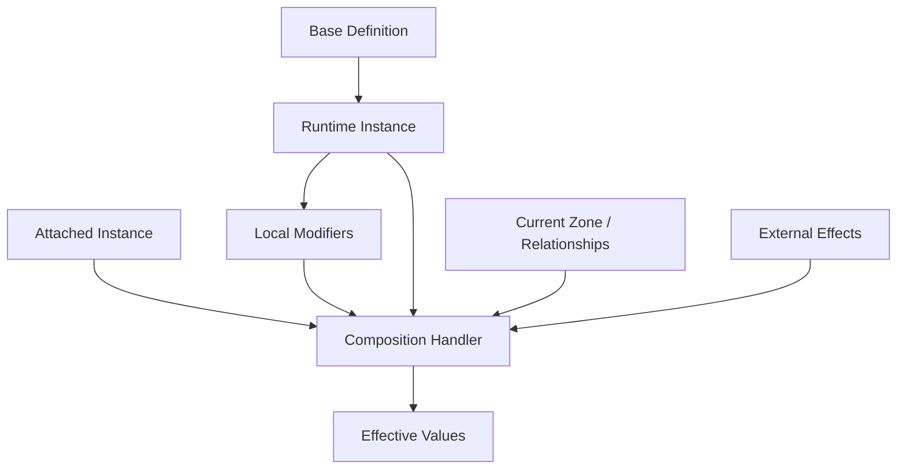

# Entity, Definition, And Instance Model

## What it is

The conceptual model for entities, definitions, instances, instance IDs, variables, modifiers, and composition. The runtime API surface — `StateEntity<TDef>`, `IEntityRegistry`, mutation calls — lives in [`02-runtime-surface.md`](features/entities/models/02-runtime-surface.md); this Model holds the conceptual skeleton and the bridge boundary between Scaffold's entity package and the canonical Store.

> Every runtime entity is an instance of a base definition. The instance has an instance ID for lookup/reference, plus relationships and modifiers. Its effective values are calculated from its definition, local state, attached instances, external effects, and context.



This model supports structured card games, roguelike deckbuilders, spatial card simulations, cards and card-adjacent objects, and future multiplayer/replay/debugging.

## Contracts

### Definitions

A definition is shared authored data describing what an entity is before runtime state. Conceptual fields:

- Stable definition ID.
- Display name or debug name.
- Entity kind or category.
- Base variables.
- Optional tags or keywords.
- Optional visual references.
- Optional behavior/effect references.
- Optional authoring metadata.

Definition IDs must be stable — needed for save/load, replay, debugging, and future networking.

Examples: card definitions, token definitions, zone definitions, villager definitions, equipment definitions, relic definitions, card pack definitions, system helper definitions.

### Instances

An instance is a runtime entity created from a definition. Conceptual fields:

- Instance ID.
- Definition ID.
- Current relationships.
- Local variable overrides or current values.
- Local modifiers.
- Visibility state.
- Lifecycle state.

The instance does not duplicate every definition field; it references its definition and stores only runtime differences.

Examples: this specific copy of Fireball in a player's hand; this specific villager on the board; this specific sword attached to a villager; this specific token created by an effect; this specific hand zone for player 1.

### Instance IDs and zone movement

There is no separate "identity" concept. The instance is the durable runtime object; its `InstanceId` (`Identifier<Instance>`) is a lookup/reference value. The framework provides `InstanceId.NewId()` for generating fresh values; mutations that create instances (e.g., `CreateCardMutation`) carry the generated `InstanceId` in the payload for replay determinism.

**Default rule:** moving an entity to another zone preserves the same instance and the same `InstanceId`. Zone movement is an event that may trigger rules, update visibility/ordering/modifiers/presentation — but does not inherently destroy/recreate the entity.

Game-specific systems may override this default explicitly: a Magic-like preset may treat certain zone changes as replacement; a transform effect may replace a definition or create a new instance; a clone effect may create a new instance with selected copied state; a token leaving play may be destroyed instead of preserved. Explicit game behavior, not a hidden property of all zones.

### Variables

The first value model is key-value variable-based, inspired by Scaffold Entities but not dependent on it.

```text
VariableKey -> VariableValue
```

The base framework does not hardcode specific variable names. A game, preset, schema, or authoring system defines available keys, value types, default values, validation rules, and display metadata.

Examples (illustrative, not required): `cost`, `attack`, `health`, `owner`, `controller`, `zone`, `visibility`, `energy`, `progress`, `stack_count`, `exhausted`.

Typed wrappers can exist later for convenience (e.g., a deckbuilder preset exposing `energy` through typed helper APIs), but the underlying base model remains key-value.

### Values and modifiers

An effective value is calculated from layered inputs:

1. Base definition value.
2. Instance base value or override.
3. Local modifiers on the instance.
4. Attached instance modifiers.
5. External modifiers from other entities or systems.
6. Zone or context modifiers.
7. Preset-specific composition rules.

The calculation order must eventually be explicit and deterministic. The load-bearing decision is that modifiers are layered and inspectable, not hidden inside one mutable value.

### Attachments and equipment

Attachments and equipment are usually their own instances:

```text
Villager Instance
  definition: villager.base
  attached instances:
    - iron_sword instance
    - leather_helmet instance
```

The villager does not become a different opaque object when a sword is attached. A composition handler reads the relationships and calculates effective values such as attack, job, speed, available actions.

Benefits: attachments have their own `InstanceId` and lifecycle; can move, break, transform, or be removed; can have effects of their own; debugging can trace exactly where a modifier came from.

### Tokens and generated entities

Tokens have definitions — authored, generated, preset-provided, or temporary game-setup definitions. Avoid definitionless runtime entities; even a tiny system definition is useful for debugging and replay.

### Transformation and replacement

Transformation needs explicit game-specific semantics. Possible models:

- Same instance, new definition reference.
- Same instance, transformation modifier layered over base definition.
- New instance that replaces the old instance.
- Attached overlay instance that changes effective values.

No single choice is built into the framework. The framework exposes the primitives needed for presets/games to define their own transformation semantics.

### Composition handlers

A composition handler calculates effective behavior from related instances and modifiers. Examples: equipment handler (equipped stats and abilities), stack recipe handler (whether a physical stack can craft), aura handler (continuous modifiers from nearby/attached cards), zone handler (restrictions/bonuses from current location), transformation handler (current definition overlay).

Composition handlers can be core utilities, preset-specific systems, or game-specific systems. They must be deterministic and traceable.

### Store and entities relationship

**Resolved.** Store is canonical; Entities is the API. The `com.scaffold.entities.states` bridge package wires this together.

Shape:

- **Per-entity variables** are canonical `EntityVariableState` slices in the Store (`BaseValues`, `ModifierStacks` keyed by `InstanceId`).
- **`StateEntity<TDefinition>`** is a thin handle implementing both `IReadOnlyEntity<TDef>` and `IMutableEntity<TDef>` over `StoreVariableStorage`. It substitutes for plain `EntityInstance` in polymorphic APIs.
- **Mutations** route through `Store.Execute` / `Store.ExecuteBatch` against six bridge payloads (see "Mutation API conventions" below). `IMutableEntity` calls produce the same payloads internally.
- **Reads** use a per-rebuild effective-value cache; `Variable` enumeration is ordered by `Variable.Key` (ordinal) for determinism.
- **Game-level state** (turn, phase, available actions, decisions) lives in plain Store slices alongside entity slices.
- **Zones** are thin domain handles (classes implementing `IReference`, not entities) sharing the `Identifier<Instance>` namespace with cards; their canonical state lives in `ZoneContentsState` (membership), `OwnershipState` (owner), and per-zone-type runtime slices (typed values like a counter). Zones do not participate in the entity-variable bridge or modifier-stack machinery. See [Zone Model](features/zones/models/01-zone-model.md).
- **Cards** are `StateEntity<TCardDef>` handles (classes; the bridge handle is a class, not a record) that also implement `IReference`. The canonical "this card exists" record is in `CardMapState` keyed by `CardRef` — replacing what would otherwise be the engine-side handle registry (`InstanceId → handle`). Putting that registration on the Store gives snapshot/rollback for free. Cards carry two IDs: stable `InstanceId` (used for variable storage, modifier storage, ownership, history, server-internal subscriptions) and ephemeral `CardRef` (the slice key in `CardMapState`, used in zone contents and client-visible state; rotates on every move and visibility transition). See [Card Model](features/cards/models/01-card-model.md) (provenance below the divider).
- **Definition swap (transformation)** — `Definition` is on the handle, not in `EntityVariableState`. To transform, create a new `StateEntity<TNewDef>` for the same `InstanceId`. There is no state-level `SetDefinitionPayload`.

Why this resolution:

- One source of truth, no duplicate state, no two-way sync.
- Snapshot/rollback covers per-entity variables for free.
- Modifier ordering, source attribution, atomic batches, and coalesced subscriber notifications all come from the Store + bridge.

### Mutation API conventions

The bridge defines six payloads for entity-variable mutations (sealed records, in `Scaffold.Entities.States`):

```csharp
AddModifierPayload(InstanceId EntityId, Variable Variable, VariableModifier Modifier, ModifierId ModifierId, ModifierSource? Source = null)
RemoveModifierPayload(InstanceId EntityId, Variable Variable, ModifierId ModifierId)
RemoveModifiersBySourcePayload(InstanceId EntityId, ModifierSource Source)
SetBaseValuePayload(InstanceId EntityId, Variable Variable, VariableValue Value)
AddEntityVariablePayload(InstanceId EntityId, Variable Variable, VariableValue InitialValue)
RemoveEntityVariablePayload(InstanceId EntityId, Variable Variable)
```

`EntityVariableState.BaseValues` is *override-only*. Reads fall back to `definition.TryGetDefaultValue(var)` for any variable not in the map; a freshly-spawned instance has an empty `BaseValues` and inherits everything from its definition. `WithModifier` inserts ascending by `Modifier.Order` (FIFO ties); `WithoutModifiersFromSource` sweeps by `(Source, Tag)` equality.

Card Framework conventions on top of these primitives:

- **Mutation surface.** Handlers prefer the `IMutableEntity` surface on `StateEntity` — obtain a handle from the engine's `IEntityRegistry` (`ctx.Entities.Get<TDef>(id)`) and call its mutator methods. Raw `ctx.Store.Execute(payload)` is the documented fallback for `SetBaseValuePayload` / `RemoveModifiersBySourcePayload` (which `IMutableEntity` doesn't expose), batch authoring, history-replay tooling, and paths that hold an `InstanceId` without a handle. See [`entities/02-runtime-surface.md` §Contracts](features/entities/models/02-runtime-surface.md) for the full handler-side surface.
- **`AddEntityVariablePayload` discipline.** Reserved for variables *not* declared in the entity's definition — per-instance ad-hoc state (token counters, custom buff bookkeeping). Definition-declared variables stay as definition defaults until a `SetBaseValuePayload` overrides the base or an `AddModifierPayload` stacks a modifier. The slice's `WithVariable` is a no-op when the variable already exists in `BaseValues`, encoding this rule on the storage side.
- **`SetBaseValuePayload` discipline.** Live, but reserved for *out-of-band* base changes: definition-default override at instance creation, level-up / progression hooks, save-state load, authoring tools. Effect-tracked changes always go through modifiers so source attribution and removal are preserved.
- **`ModifierSource` convention.** `Source` is the attachment entity's `InstanceId` — equipment instance, aura entity, status-effect entity, ongoing-effect attachment (per [`effects/03`](features/effects/models/03-ongoing-effects.md)). Cleanup-on-source-death is a uniform `RemoveModifiersBySourcePayload(target, new ModifierSource(attachment.Id))` per affected target. `Tag` defaults to 0 and is opt-in author disambiguation when one source contributes multiple modifier groups that may need partial removal.
- **`ModifierId` generation.** Modifier ids must be deterministic for replay and multiplayer. Handlers obtain modifier entries from the engine-provided `IModifierFactory` (`ctx.Modifiers.Create(key, modifier, source)`) — the factory generates a deterministic id from an engine-owned counter (snapshotted with engine state, restored on `LoadSnapshot`) and returns a fully-populated `EntityModifierEntry`. `EntityModifierEntry` carries optional `Id`/`Source`; when set, `IMutableEntity.AddModifier` honours them. Constructing entries directly via `new EntityModifierEntry(key, modifier)` falls back to `ModifierId.New()` (`Guid.NewGuid()`) and is forbidden in framework / handler code.

### Engine responsibilities (bridge boundary)

These are integration concerns the engine owns. None require further Scaffold work.

- **Handle registry and re-hydration.** `StateEntity` is a class (handle), not state itself. For cards, the `InstanceId → handle` registry is held on the Store as `CardMapState` (keyed by `CardRef`, value is the `Card` handle) — see the [Card Model](features/cards/models/01-card-model.md). `LoadSnapshot` rehydrates the map directly; the engine no longer maintains a separate registry. For entity kinds that don't have a corresponding map slice, the engine still re-creates handles on snapshot load using the `EntityVariableState` slices and a definition lookup.
- **Disposal on entity death.** Calling `StateEntity.Dispose()` releases the per-instance Store listener. The engine calls this on the entity-removal path so short-lived tokens do not retain handlers.
- **Single mutator registration per Store.** `EntityBridgeContext.RegisterMutators(store)` runs once per Store at engine bootstrap; a duplicate call throws `DuplicateMutatorRegistrationException`.
- **Structural-change subscription is diff-based.** Per-mutation granularity (an `Added` and a `Removed` for a remove-and-re-add inside one batch) requires subscribing to the `EntityVariableState` slice directly and diffing. The bridge's `SubscribeToVariableStructuralChanges` is the coalesced view, which is what continuous-effects cleanup actually wants.

### What the framework does not assume

- That all games have decks and hands.
- That zones replace instances.
- That every card has cost, attack, and health.
- That all effects are card effects.
- That all entities are visible.
- That all state is multiplayer replicated.
- That presentation objects are entities.
- That a Unity `GameObject` is the same thing as a simulation entity.

## Invariants

Model-local invariants. (See `entities.md ## Invariants` for feature-level rules — Store-canonical, definition immutability on handle, modifier source as attachment InstanceId, deterministic ModifierId via factory, eager cache rebuild.)

- **Every entity has an instance.** No definitionless runtime entities; even tokens and generated objects use system definitions.
- **Every instance references a base definition.** The instance carries `Definition` on the handle (not in state); transformation creates a new handle for the same `InstanceId`.
- **Effective values are explainable from base + modifiers.** Modifiers are layered and inspectable, not hidden inside one mutable value.
- **Attachments and equipment are usually separate instances.** Composition handlers calculate effective behavior from related instances + modifiers.
- **Game-specific systems can replace, transform, destroy, or recreate instances explicitly.** No hidden replacement; explicit per-game behavior.
- **Zone membership is a relationship or state, not the instance itself.** Zone movement preserves the instance by default.

## Examples

```text
Villager base attack: 1            ← definition default
Sword attachment attack bonus: +3  ← modifier from sword (ModifierSource = sword.InstanceId)
Rage status modifier: +2           ← modifier from status-effect entity
Rainy zone context modifier: -1    ← modifier from zone-applied composition handler
Effective attack: 5
```

For runtime API examples (worked equip/unequip, apply-aura with cross-handler modifier construction), see [`02-runtime-surface.md` §Examples](features/entities/models/02-runtime-surface.md).

## Open follow-ups

The zone-related follow-ups have been resolved in `features/zones/`:

- ~~Is a zone always an entity instance, or can some zones be lightweight session records?~~ → Resolved: zones are thin domain objects (not entities), state in slices.
- ~~Is zone membership a variable, relationship, Store slice, or combination?~~ → Resolved: `ZoneContentsState` slice.
- ~~How does ordered or grouped arrangement work inside zones?~~ → Resolved: `ContentEntry { InstanceId, SlotKey?, GroupKey? }`; interpretation lives in zone definition.
- ~~How do visibility and ownership interact?~~ → Resolved: zone definition policy + per-card flag enum + per-actor transport alias.

Open items live in `ledgers/OPEN-ITEMS.md` — see entities-related entries (`oq-entity-destruction`, `oq-engine-builder`, `bl-authoring-feature`).

---

*Below: provenance — the original Core Model decisions (formerly doc 8) that produced this Model. Single-feature scope (no project-wide ADR applies); folded into Model provenance per §4.5.*

Doc 8 was a mega-decisions doc spanning entities, zones, and actions. Per migration, load-bearing atomic decisions were extracted into per-feature locations; the entities-relevant decisions are preserved here as the provenance for this Model.

## Options considered

### Q1 — Dependency boundary

Should the simulation core depend directly on Scaffold packages, or should Scaffold be used only in Unity-facing adapters?

- **A — Strict purity boundary.** Scaffold confined to Unity adapters. Rejected — forces architecture before we know whether Scaffold helps or fights.
- **B — No enforced boundary yet.** Scaffold allowed wherever it genuinely fits. **Chosen** — early docs describe boundaries by responsibility, not by package dependency.

Resolved by `com.scaffold.entities.states`: per-entity variables are canonical `EntityVariableState` slices in the Store, exposed through `StateEntity<TDef>` handles that implement both `IReadOnlyEntity` and `IMutableEntity`. Store wraps; Entities is the ergonomic surface.

### Q2 — Value model

Should card/entity values be stored primarily as flexible variables/tags, typed state records, or a hybrid?

- **A — Typed state records as first model.** Rejected — too rigid; assumes a fixed variable list.
- **B — Hybrid from the start.** Rejected — overbuilds before patterns are proven.
- **C — Key-value variables first; typed wrappers later as convenience.** **Chosen** — flexible across game types; mirrors Scaffold Entities' variable bags; avoids hardcoding game values into the framework.

Implication: typed concepts can exist as optional convenience wrappers, validators, schemas, or preset conventions over key-value variables. They should not become required hardcoded fields in the base framework.

### Q3 — Canonical state

What is the canonical source of truth: entity instances, Store slices, or a composed model where each owns different concerns?

- **A — Entities are canonical; Store is auxiliary.** Rejected — duplicates state, requires two-way sync, no snapshot/rollback for entity variables.
- **B — Store is canonical; Entities is the API.** Per-entity variables live as `EntityVariableState` slices in the Store. `StateEntity<TDef>` is a thin handle over `StoreVariableStorage`. Implemented by `com.scaffold.entities.states` (the bridge package). **Chosen.**
- **C — Composed model with split ownership.** Rejected — adds coordination overhead without clear benefit.

Reasoning:

- One source of truth — no duplication, no two-way sync.
- Snapshot/rollback comes from the Store for free, including per-entity variables.
- Polymorphic substitution: any code holding `IReadOnlyEntity` / `IMutableEntity` works against either plain Entities or the state-backed handle.
- Modifier ordering, source attribution, atomic batches, and coalesced subscriber notifications all come from the Store + bridge.

### Q4 — Instances and zones

How should an instance behave when a card changes zones?

- **A — Bake Magic-style zone-change replacement into all games.** Rejected — many games don't need it; should be opt-in per game.
- **B — Preserve the same instance across zone changes by default; per-game overrides.** **Chosen** — zone changes are observable facts, not instance replacement by default.

The instance is the durable runtime object; its `InstanceId` is a lookup/reference value. Zone movement can trigger effects, modifiers, visibility changes, or game-specific replacement rules. The base system preserves the same instance by default.

### Q5 — Entity definitions

Do all entities have definitions, or can runtime-only entities exist without definitions?

- **A — Allow definitionless runtime entities.** Rejected — breaks save/load, replay, networking, debugging.
- **B — All entities have a base definition.** **Chosen** — applies broadly: cards, tokens, zones, players/actors, relics, equipment, resources, villagers, enemies, card packs, temporary helper objects.

The framework supports lightweight system definitions for tokens and temporary entities instead of allowing definitionless entities.

### Q6 — Composition (modifiers, attachments, transformation)

How do attachments, equipment, stacked cards, tokens, and transformed cards relate to a base card instance?

- **A — Absorb everything into the base card object.** Rejected — explodes object size; loses provenance.
- **B — Instance is base definition + modifiers; attachments and equipment are usually separate instances.** **Chosen** — sword attached to villager is an equipment instance attached to a villager instance; aura modifier may be an effect or relationship from another instance; token is an instance from a token definition; transformed card may be the same instance with a transformation modifier or a game-specific replacement; stack may be a relationship between instances.

Composition keeps instances explicit and supports Stacklands-like physical composition, RPG equipment, TCG auras, attached cards, and relic/passive systems without making the base card object enormous.

## Rationale

The chosen direction across Q1–Q6 produces a single coherent shape:

- **No enforced Scaffold boundary** lets the bridge package (`com.scaffold.entities.states`) emerge naturally without forcing premature architecture.
- **Key-value variables** keep the value model flexible across game types and align with Scaffold's variable-bag approach.
- **Store-canonical with Entities as API** gives one source of truth, free snapshot/rollback for per-entity variables, polymorphic substitution, and modifier ordering / source attribution / atomic batches / coalesced notifications from the Store + bridge.
- **Same instance across zone changes** is the right default for non-MTG games; explicit overrides handle games that need replacement semantics.
- **Definitions for everything** makes authoring, debugging, save/load, replay, networking, and tool inspection tractable.
- **Instances + modifiers + attachments as separate instances** keeps composition explicit and inspectable.

## Consequences

- **Enables:** snapshot/rollback for per-entity variables; deterministic replay (`ModifierId` factory + payload-carried ids); polymorphic code via `IReadOnlyEntity` / `IMutableEntity`; clean composition via attached-instance-as-modifier-source; framework-supplied lifecycle (Cleanup hook on destruction sweeps source-attributed modifiers); cross-game neutrality (no MTG semantics baked in).
- **Constrains:** all per-entity mutations route through bridge payloads or the `IMutableEntity` surface (no direct field writes); `Definition` lives on the handle, not in state (transformation requires new handle); `ModifierId.New()` is forbidden in framework/handler code; structural-change subscriptions are coalesced by default (per-mutation granularity requires direct slice subscription).
- **Decisions to carry forward:** key-value variable model as the first mental model; Store-canonical via bridge; preserve same instance across zone changes by default; require every entity to have a definition; model attachments/equipment/composition as relationships between instances.
