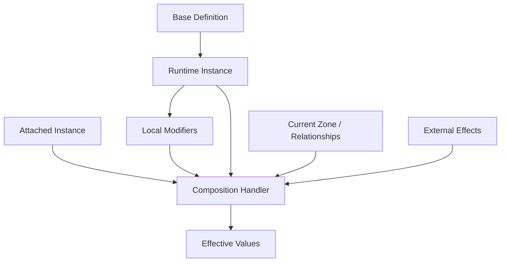

# Entity, Definition, And Instance Model

This document expands the Core Model decisions into a concrete conceptual model for entities, definitions, instances, instance IDs, variables, modifiers, and composition.

Related docs:

- [Core Model Decisions](features/entities/models/01-definition-instance-model.md)
- [Core Glossary](ledgers/GLOSSARY.md)
- [Scaffold Package Fit](spikes/scaffold-state-fit.md)

## Model Summary

The working model is:

> Every runtime entity is an instance of a base definition. The instance has an instance ID for lookup/reference, plus relationships and modifiers. Its effective values are calculated from its definition, local state, attached instances, external effects, and context.

This model should support:

- Structured card games.
- Roguelike deckbuilders.
- Spatial card simulations.
- Cards and card-adjacent objects.
- Future multiplayer, replay, and debugging.

## Definitions

A definition is shared authored data. It describes what an entity is before runtime state changes.

Examples:

- A card definition.
- A token definition.
- A zone definition.
- A villager definition.
- An equipment definition.
- A relic definition.
- A card pack definition.
- A system helper definition.

Minimum conceptual fields:

- Stable definition ID.
- Display name or debug name.
- Entity kind or category.
- Base variables.
- Optional tags or keywords.
- Optional visual references.
- Optional behavior/effect references.
- Optional authoring metadata.

Definition IDs should be stable because they are needed for save/load, replay, debugging, and future networking.

## Instances

An instance is a runtime entity created from a definition.

Examples:

- This specific copy of Fireball in a player's hand.
- This specific villager on the board.
- This specific sword attached to a villager.
- This specific token created by an effect.
- This specific hand zone for player 1.
- This specific shop offer zone.

Minimum conceptual fields:

- Instance ID.
- Definition ID.
- Current relationships.
- Local variable overrides or current values.
- Local modifiers.
- Visibility state.
- Lifecycle state.

The instance should not duplicate every definition field. It should reference its definition and store only runtime differences.

## Instance IDs And Zone Movement

There should not be a separate conceptual model called "identity." The instance is the thing. An instance may have an `Instance ID` so systems can look it up, reference it, serialize it, or include it in history.

The `Instance ID` is typed as `Identifier<Instance>` and is stable across the instance's lifetime. The framework provides `InstanceId.NewId()` for generating fresh values; mutations that create instances (e.g., `CreateCardMutation`) carry the generated `InstanceId` in the payload for replay determinism.

Default rule:

> Moving an entity to another zone preserves the same instance and the same instance ID.

This means:

- A card in deck, hand, discard, or board can remain the same instance.
- Zone movement is an event and may trigger rules.
- Zone movement can update visibility, ordering, modifiers, or presentation.
- Zone movement does not inherently destroy/recreate the entity.

Game-specific systems may override this default:

- A Magic-like preset may treat certain zone changes as replacing one instance with another for rules purposes.
- A transform effect may replace an instance's definition or create a new instance.
- A clone/copy effect may create a new instance from an existing definition and selected copied state.
- A token leaving play may be destroyed instead of preserved.

This should be explicit game behavior, not a hidden property of all zones.

## Variables

The first value model should be key-value variable-based, inspired by Scaffold Entities but not dependent on it.

Variables represent values attached to definitions or instances:

```text
VariableKey -> VariableValue
```

The base framework should not hardcode specific variable names. A game, preset, schema, or authoring system should define the available keys, value types, default values, validation rules, and display metadata.

Examples:

- `cost`.
- `attack`.
- `health`.
- `owner`.
- `controller`.
- `zone`.
- `visibility`.
- `energy`.
- `progress`.
- `stack_count`.
- `exhausted`.

These are examples only, not required framework fields.

Variable-based modeling is useful because:

- It is flexible across game types.
- It can mirror Scaffold Entities' variable bags if that package fits.
- It supports modifiers naturally.
- It avoids overbuilding typed state before patterns are proven.

Typed wrappers can still exist later for convenience. For example, a deckbuilder preset may expose `energy` through typed helper APIs, but the underlying base model remains key-value based.

## Values And Modifiers

An effective value should be calculated from layered inputs.

Conceptual layers:

1. Base definition value.
2. Instance base value or override.
3. Local modifiers on the instance.
4. Attached instance modifiers.
5. External modifiers from other entities or systems.
6. Zone or context modifiers.
7. Preset-specific composition rules.

Example:

```text
Villager base attack: 1
Sword attachment attack bonus: +3
Rage status modifier: +2
Rainy zone context modifier: -1
Effective attack: 5
```

The calculation order must eventually be explicit and deterministic. For now, the important decision is that modifiers are layered and inspectable rather than hidden inside one mutable value.

## Attachments And Equipment

Attachments and equipment should usually be their own instances.

Example:

```text
Villager Instance
  definition: villager.base
  attached instances:
    - iron_sword instance
    - leather_helmet instance
```

The villager does not become a different opaque object just because a sword is attached. A composition handler reads the relationships and calculates effective values such as attack, job, speed, or available actions.

Benefits:

- Attachments can have their own instance IDs and lifecycle.
- Attachments can move, break, transform, or be removed.
- Attachments can have effects of their own.
- Debugging can show exactly where a modifier came from.

## Tokens And Generated Entities

Tokens should still have definitions.

This can work through:

- Authored token definitions.
- Generated system definitions.
- Preset-provided definitions.
- Temporary definitions created by game setup.

Avoid definitionless runtime entities. Even a tiny system definition is useful for debugging and replay.

## Transformation And Replacement

Transformation needs explicit game-specific semantics.

Possible transformation models:

- Same instance, new definition reference.
- Same instance, transformation modifier layered over base definition.
- New instance that replaces the old instance.
- Attached overlay instance that changes effective values.

No single choice should be built into the entire framework. The base framework should expose the primitives needed for presets or games to define their own transformation semantics.

## Composition Handlers

A composition handler calculates effective behavior from related instances and modifiers.

Examples:

- Equipment handler computes equipped stats and abilities.
- Stack recipe handler computes whether a physical stack can craft something.
- Aura handler computes continuous modifiers from nearby or attached cards.
- Zone handler computes restrictions or bonuses from current location.
- Transformation handler computes current definition overlay.

Composition handlers may be:

- Core utilities for common patterns.
- Preset-specific systems.
- Game-specific systems.

They should be deterministic and traceable.

## Store And Entities Relationship

**Resolved.** Store is canonical; Entities is the API. The `com.scaffold.entities.states` bridge package wires this together.

Shape:

- **Per-entity variables** are canonical `EntityVariableState` slices in the Store (`BaseValues`, `ModifierStacks` keyed by `InstanceId`).
- **`StateEntity<TDefinition>`** is a thin handle implementing both `IReadOnlyEntity<TDef>` and `IMutableEntity<TDef>` over `StoreVariableStorage`. It substitutes for plain `EntityInstance` in polymorphic APIs.
- **Mutations** route through `Store.Execute` / `Store.ExecuteBatch` (`AddModifierPayload`, `SetBaseValuePayload`, `AddEntityVariablePayload`, etc.). `IMutableEntity` calls produce the same payloads internally.
- **Reads** use a per-rebuild effective-value cache; `Variable` enumeration is ordered by `Variable.Key` (ordinal) for determinism.
- **Game-level state** (turn, phase, available actions, decisions) lives in plain Store slices alongside entity slices.
- **Zones** are thin domain handles (classes implementing `IReference`, not entities) sharing the `Identifier<Instance>` namespace with cards; their canonical state lives in `ZoneContentsState` (membership), `OwnershipState` (owner), and per-zone-type runtime slices (typed values like a counter). Zones do not participate in the entity-variable bridge or modifier-stack machinery. See [Zone Model](features/zones/models/01-zone-model.md) and [ADR-0001 — Zone shape](features/zones/decisions/0001-zone-shape.md).
- **Cards** are `StateEntity<TCardDef>` handles (classes; the bridge handle is a class, not a record) that also implement `IReference`. The canonical "this card exists" record is in `CardMapState` keyed by `CardRef` — replacing what would otherwise be the engine-side handle registry (`InstanceId → handle`). Putting that registration on the Store gives snapshot/rollback for free. Cards carry two IDs: stable `InstanceId` (used for variable storage, modifier storage, ownership, history, server-internal subscriptions) and ephemeral `CardRef` (the slice key in `CardMapState`, used in zone contents and client-visible state; rotates on every move and visibility transition). See [Card Model](features/cards/models/01-card-model.md) and [Card ADR-0001](features/cards/decisions/0001-card-shape.md).
- **Definition swap (transformation)** — `Definition` is on the handle, not in `EntityVariableState`. To transform, create a new `StateEntity<TNewDef>` for the same `InstanceId`. There is no state-level `SetDefinitionPayload`.

Why this resolution:

- One source of truth, no duplicate state, no two-way sync.
- Snapshot/rollback (doc 23, 29) covers per-entity variables for free.
- Modifier ordering, source attribution (doc 24 continuous-effects cleanup), atomic batches (doc 19 command-as-batch), and coalesced subscriber notifications (doc 27 presentation loop) all come from the Store + bridge.

### Engine responsibilities (bridge boundary)

These are integration concerns the engine owns. None require further Scaffold work.

- **Handle registry and re-hydration.** `StateEntity` is a class (handle), not state itself. For cards, the `InstanceId → handle` registry is held on the Store as `CardMapState` (keyed by `CardRef`, value is the `Card` handle) — see the [Card Model](features/cards/models/01-card-model.md). `LoadSnapshot` rehydrates the map directly; the engine no longer maintains a separate registry. For entity kinds that don't have a corresponding map slice, the engine still re-creates handles on snapshot load using the `EntityVariableState` slices and a definition lookup.
- **Disposal on entity death.** Calling `StateEntity.Dispose()` releases the per-instance Store listener. The engine calls this on the entity-removal path so short-lived tokens do not retain handlers.
- **Single mutator registration per Store.** `EntityBridgeContext.RegisterMutators(store)` runs once per Store at engine bootstrap; a duplicate call throws `DuplicateMutatorRegistrationException`.
- **Structural-change subscription is diff-based.** Per-mutation granularity (an `Added` and a `Removed` for a remove-and-re-add inside one batch) requires subscribing to the `EntityVariableState` slice directly and diffing. The bridge's `SubscribeToVariableStructuralChanges` is the coalesced view, which is what continuous-effects cleanup actually wants.

## What The Framework Should Not Assume Yet

- That all games have decks and hands.
- That zones replace instances.
- That every card has cost, attack, and health.
- That all effects are card effects.
- That all entities are visible.
- That all state is multiplayer replicated.
- That presentation objects are entities.
- That a Unity `GameObject` is the same thing as a simulation entity.

## Useful Invariants

These are good early invariants:

- Every entity is represented by an instance.
- Every instance has an instance ID or reference value for lookups.
- Every entity references a base definition.
- Zone membership is a relationship or state, not the instance itself.
- Effective values should be explainable from base values plus modifiers.
- Attachments and equipment are usually separate instances.
- Generated entities still use definitions.
- Game-specific systems can replace, transform, destroy, or recreate instances explicitly.

## Next Questions

This model's zone-related follow-ups have been settled — see the Zone Model and ADRs in `features/zones/`:

- ~~Is a zone always an entity instance, or can some zones be lightweight session records?~~ → Resolved: zones are thin domain objects (not entities), state in slices. ([ADR-0001](features/zones/decisions/0001-zone-shape.md))
- ~~Is zone membership a variable, relationship, Store slice, or combination?~~ → Resolved: `ZoneContentsState` slice. ([ADR-0001](features/zones/decisions/0001-zone-shape.md))
- ~~How does ordered or grouped arrangement work inside zones?~~ → Resolved: `ContentEntry { InstanceId, SlotKey?, GroupKey? }`; interpretation lives in zone definition. ([ADR-0001](features/zones/decisions/0001-zone-shape.md))
- ~~How do visibility and ownership interact?~~ → Resolved: zone definition policy + per-card flag enum + per-actor transport alias. ([ADR-0002](features/zones/decisions/0002-visibility-model.md))


---

# Provenance: Core Model Decisions (from doc 8)

Doc 8 was a mega-decisions doc spanning entities, zones, and actions. Per §2 of MIGRATION-GUIDE.md it dissolves; load-bearing atomic decisions become ADRs in `features/{entities,zones,actions}/decisions/` (see phase 5). The full original is preserved here as provenance for the entities slice and as a record of the thinking that produced those ADRs.

# Core Model Decisions

This document answers the Core Model questions from [Open Questions](ledgers/OPEN-QUESTIONS.md). These are early research decisions, not final implementation contracts.

## Status

The direction for the core model is now:

- Do not enforce a hard Scaffold boundary yet.
- Start with key-value variables; do not hardcode variable names into the framework.
- Per-entity variables are canonical Store slices accessed through Entities-shaped handles, via the `com.scaffold.entities.states` bridge package. (See "Canonical State" below.)
- Card instances are independent from zone membership.
- Every entity should have a base definition.
- Instances are definitions plus modifiers, with attachments and equipment modeled as their own instances.

## Dependency Boundary

Question: should the simulation core depend directly on Scaffold packages, or should Scaffold be used only in Unity-facing adapters?

Decision: no enforced boundary yet.

Scaffold should be allowed wherever it genuinely fits:

- In simulation, if the package model supports deterministic rules cleanly.
- In Unity-facing authoring or presentation, if runtime simulation benefits from a separate model.
- In both, if conversion and shared IDs stay simple.
- In neither, if the framework needs a custom model.

Reasoning:

At this stage, the important rule is not "pure core at all costs." The important rule is to avoid forcing an architecture before we know whether Scaffold Entities and Scaffold States help or fight each other.

Implication:

Early docs should describe boundaries by responsibility, not by package dependency. We can still keep presentation, rules, authoring, and networking conceptually separated without deciding package references yet.

Confidence: medium.

Follow-up:

Resolved by `com.scaffold.entities.states`: per-entity variables are canonical `EntityVariableState` slices in the Store, exposed through `StateEntity<TDef>` handles that implement both `IReadOnlyEntity` and `IMutableEntity`. Store wraps; Entities is the ergonomic surface. (See "Canonical State" below and doc 10.)

## Value Model

Question: should card/entity values be stored primarily as flexible variables/tags, typed state records, or a hybrid?

Decision: start with simple key-value variables, regardless of whether the implementation uses Scaffold Entities, Store, or a custom model.

The starting model should assume entities can carry variable entries shaped conceptually like:

```text
VariableKey -> VariableValue
```

Examples of possible keys a game or preset might define:

- `cost`.
- `attack`.
- `health`.
- `energy`.
- `zone`.
- `owner`.
- `controller`.
- `visibility`.
- `stack_count`.
- `recipe_progress`.
- `exhausted`.

These are examples, not required built-in fields.

Reasoning:

Key-value variables are flexible enough for the early framework and align with Scaffold Entities' definition/instance/modifier model without requiring the framework to know every possible game value ahead of time. This keeps the model data-driven whether we adopt Scaffold Entities directly, wrap it, or create a custom representation.

Implication:

Typed concepts can exist as optional convenience wrappers, validators, schemas, or preset conventions over key-value variables. They should not become required hardcoded fields in the base framework.

Confidence: medium.

Follow-up:

Define how variable keys are registered, typed, validated, displayed, and versioned without making the base framework depend on a fixed variable list.

## Canonical State

Question: what is the canonical source of truth: entity instances, Store slices, or a composed model where each owns different concerns?

Decision: **Store is canonical; Entities is the API.** Per-entity variables live as `EntityVariableState` slices in the Store. `StateEntity<TDefinition>` is a thin handle implementing `IReadOnlyEntity<TDef>` and `IMutableEntity<TDef>` over `StoreVariableStorage`. Mutations route through `Store.Execute` / `Store.ExecuteBatch`; reads use a per-rebuild effective-value cache. Game-level state (turn, phase, available actions, decisions, zones-as-records) lives in plain Store slices alongside the entity slices.

This is implemented by **`com.scaffold.entities.states`** (the bridge package). See doc 10 §"Store And Entities Relationship" for the integration shape.

Reasoning:

- One source of truth — no duplication, no two-way sync.
- Snapshot/rollback comes from the Store for free, including per-entity variables.
- Polymorphic substitution: any code holding `IReadOnlyEntity` / `IMutableEntity` works against either plain Entities or the state-backed handle.
- Modifier ordering, source attribution, atomic batches, and coalesced subscriber notifications all come from the Store + bridge.

Implication:

Three engine-side responsibilities follow from the bridge boundary (none require further Scaffold work):

- **Handle re-hydration after `LoadSnapshot`.** For cards, the registry lives on the Store as `CardMapState` (keyed by `CardRef`, value is the `Card` handle); snapshot load rehydrates the map directly. For entity kinds without a corresponding map slice, the engine maintains an `InstanceId → (definition, store)` registry and re-creates `StateEntity<TDef>` references after load.
- **Disposal on entity death.** The engine calls `StateEntity.Dispose()` on the entity-removal path so the Store listener is released; short-lived tokens otherwise leak handlers.
- **Structural-change subscriptions are diff-based.** A single `ExecuteBatch` that removes and re-adds the same variable produces no net `Added`/`Removed` event. For per-mutation granularity, subscribe to the `EntityVariableState` slice directly and diff. (Coalesced view is the right default for continuous-effects cleanup — doc 24.)

Confidence: high.

Follow-up:

The small scenario sketch (definition + base values, runtime instance, cost modifier from aura, zone movement, history) is now an implementation exercise, not a design exercise.

## Instances And Zones

Question: how should an instance behave when a card changes zones?

Decision: do not model "identity" as a separate concept. The instance is the durable runtime object; its instance ID is only a lookup/reference value.

A card instance remains the same instance when it moves between zones unless a game-specific rule or effect explicitly replaces it, transforms it, destroys it, or recreates it.

Reasoning:

The framework should not bake Magic's zone-change replacement behavior into all games. Some games need that behavior, but many do not. Zone changes should be observable facts, not instance replacement by default.

Implication:

Zone movement can trigger effects, modifiers, visibility changes, or game-specific replacement rules. The base system should preserve the same instance by default.

Confidence: high.

Follow-up:

The Zone Model doc should include optional replacement policies for games that need zone movement to create or replace instances.

## Entity Definitions

Question: do all entities have definitions, or can runtime-only entities exist without definitions?

Decision: all entities should have a base definition.

This applies broadly:

- Cards.
- Tokens.
- Zones.
- Players or actors, if represented as entities.
- Relics.
- Equipment.
- Resources.
- Villagers.
- Enemies.
- Card packs.
- Temporary helper objects, if they need to be referenced as instances.

Reasoning:

Definitions make authoring, debugging, save/load, replay, networking, and tool inspection easier. Even generated runtime objects can point to a generated or system definition.

Implication:

The framework should support lightweight system definitions for tokens and temporary entities instead of allowing definitionless entities.

Confidence: high.

Follow-up:

Define the minimum fields required for a base definition.

## Instances, Modifiers, Attachments, And Composition

Question: how do attachments, equipment, stacked cards, tokens, and transformed cards relate to a base card instance?

Decision: an instance is a base definition plus modifiers. Attachments and equipment are usually separate instances from their own definitions.

A card instance should not absorb every attached thing into itself. Instead:

- A sword attached to a villager is an equipment instance attached to a villager instance.
- An aura modifier may be an effect or relationship from another instance.
- A token is an instance created from a token definition.
- A transformed card may be the same instance with a transformation modifier, or a game-specific replacement with a new definition and new instance.
- A stack may be a relationship between instances, a zone-like container, or a game-specific composed object.

Reasoning:

Composition keeps instances explicit. It also supports Stacklands-like physical composition, RPG equipment, TCG auras, attached cards, and relic/passive systems without making the base card object enormous.

Implication:

The framework needs composition handlers that can calculate effective values from:

- The base definition.
- Local instance modifiers.
- Attached instances.
- External effects.
- Zone or context modifiers.
- Game-specific systems.

Confidence: medium-high.

Follow-up:

The Entity Model doc should distinguish base values, local modifiers, external modifiers, attachments, and effective values.

## Revised Working Model

The current working model is:




The exact storage for this model is still open. The conceptual model is accepted enough to inform the next documents.

## Decisions To Carry Forward

- Do not require a pure non-Scaffold simulation boundary yet.
- Use key-value variable-based entities as the first mental model.
- Per-entity variables are canonical Store slices; the entity handle is the API. (`com.scaffold.entities.states` bridge.)
- Preserve the same instance across zone changes by default.
- Require every entity to have a definition.
- Model attachments/equipment/composition as relationships between instances, not as hidden fields on one card.

