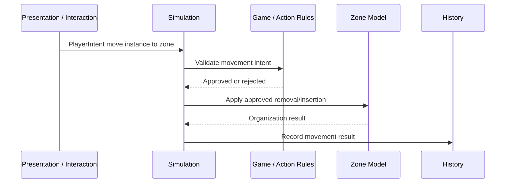

# Zone Model — model

## What it is

A zone is a group of cards. It carries identity, a definition that describes how it organizes its contents, and the runtime data that backs its behavior (membership and any per-zone-type values like a counter or recipe progress). Optional ownership lives on the `OwnershipState` slice (read via `zone.GetOwner(state)`).

> Zone = thin handle (`Ref<Zone> SelfRef` + protected `Definition` + `Storage`) + `ZoneContentsState` slice + per-zone-type runtime slice + (optional) entry in `OwnershipState`.

Zones are groups of cards. They can represent structured game concepts like hands, decks, discard piles, battlefields, stacks, shops, and production slots. **Card packs are not zones** — a pack is an entity that, when activated, generates new card instances; it does not contain pre-existing cards. **Reward offers, drafts, and choice surfaces are not zones either** — those are decisions, modeled through the action/decision system.

Zones use the entity bridge for any variables they declare. Most zones (hand, deck, discard) declare zero variables and pay no cost. Zones that need runtime values (a counter, recipe progress) declare them on `ZoneDefinition.DefinedVariables` and read/write through `zone.Storage`. Zones should not own broad gameplay legality — that's a game/action rules concern. Once a move is approved, the zone owns how its contents are arranged and what bookkeeping happens.

## Contracts

### Zone class

A zone is `class Zone : InstanceWithSlices<ZoneDefinition>` (unsealed) carrying typed `Ref<Zone> SelfRef`:

```csharp
public class Zone : InstanceWithSlices<ZoneDefinition>
{
    public Ref<Zone> SelfRef { get; init; }

    public Zone(ZoneDefinition def, IEntityVariableStorage storage) : base(def, storage) { }

    public IActor? GetOwner(IStateScope state) =>
        state.Get<OwnershipState>().OwnerOf(SelfRef);

    public IEnumerable<CardRef> GetCardRefs(IStateScope state) =>
        state.Get<ZoneContentsState>(SelfRef).Cards;

    public IEnumerable<Card> GetCards(Store store)
    {
        var contents = store.Get<ZoneContentsState>(SelfRef);
        var map      = store.Get<CardMapState>();
        return contents.Cards.Select(cardRef => store.Catalog.Resolve(map.InstanceOf(cardRef)));
    }
    // ... other state-reading methods
}
```

`Zone` is a class (handle), not a record. **Not sealed** (project convention: default to unsealed). One `Zone` instance per `Ref<Zone>` in the running engine, held in `store.Catalog`. Mutable zone data (contents, owner, declared variables) lives in slices.

The read-API split: `GetCardRefs(IStateScope state)` returns the unstable `CardRef`s from the zone's slice (state-only); `GetCards(Store store)` performs the two-hop resolution (`CardRef → CardMapState → Ref<Card> → Catalog → Card`) and so requires `Store` access. State-only consumers (presentation projections, history filters) use the ref form; handler code that wants typed handles uses the resolved form.

Cards, zones, and players all share the typed `Ref<T>` family — `Ref<Card>`, `Ref<Zone>`, `Ref<Player>` — all derived from the polymorphic `Reference` base. Targeting works uniformly: an effect that picks "a card or a zone" takes `Reference` and handles both through `Resolve`.

### `ZoneDefinition`

The authored base data for a kind of zone. `ZoneDefinition : DefinitionWithSlices` (which inherits from `Scaffold.EntityDefinition` and implements `ISliceProvider`). Carries authored configuration (capacity, ordering rules, insertion behavior, default visibility policy) plus a parameterless `GetInitialSlices()` that declares the per-zone slices to install at spawn (a `PileDefinition` returns `new PileState(Counter: 0, Target: Target)`; a `RecipeStackDefinition` returns `new RecipeStackState(Progress: 0, Active: null)`).

Zone runtime state lives across:

1. **`EntityState`** (framework-owned, from the entity bridge). Keyed by `Ref<Zone>`. Holds any variables the zone definition declares; for most zones (hand, deck, discard), this is empty.
2. **`ZoneContentsState`** (framework-owned, generic). Keyed by the zone. Holds an ordered `ImmutableList<CardRef>` referencing cards via their current `CardRef`. Per the [Card Model](features/cards/models/01-card-model.md), `CardRef` rotates on every move — the contents list is updated atomically by the same mutators that rotate the ref.
3. **`OwnershipState`** (framework-owned, generic across all catalog-registered handles; defined in `cards/`). `Dictionary<Reference, IActor>`. Both Cards and Zones read ownership through this slice.
4. **Per-zone-type runtime slices** (game-authored). Carry typed values for that zone type — e.g., `PileState`, `RecipeStackState`. Independent slices; no shared shape across zone types.

`Zone` is held in `store.Catalog`. Zones are spawned during `Build` from layout blocks declared on `GameDefinition.SharedZones` (game-shared zones — stack, battlefield, market) and `PlayerDefinition.PerPlayerZones` (per-player zones — hand, deck, discard, instantiated once per player actor). Per-match deviations from the standard layout flow through the optional `MatchSetup.ZoneOverlay` escape hatch. See [Game Definition](features/engine/models/07-game-definition.md) for the zone-layout contract and the factory's spawn-walk.

### Core responsibilities

Zones should be described by responsibilities, not a fixed trait checklist.

| Responsibility | Meaning |
|---|---|
| Contents | Which instances are in the zone. |
| Arrangement | How contents are ordered, grouped, stacked, slotted, or otherwise addressed. |
| Capacity / Size | Default size limits, count limits, slot limits, or similar organizational constraints. |
| Insertion Behavior | Where an approved incoming instance goes: top, bottom, next slot, chosen index, grouped pile, etc. |
| Removal Behavior | How contents close gaps, reorder, unstack, or update after an instance leaves. |
| Visibility | What each actor/viewer can know about membership and details. |
| Change Bookkeeping | What state changes or history facts are emitted when contents change. |

This avoids forcing all zones into a universal boolean trait list while keeping legality outside the zone.

### Legality boundary

The zone should not answer broad questions like "Can this card type go here?" / "Is this actor allowed to move this card here?" / "Is this target valid?" — those are game/action rules questions.

The zone may answer narrower organization questions: "How many instances are currently here?" / "What is the default capacity?" / "Where should an approved instance be inserted?" / "If full, what is the default organizational result?" / "Can the requested index/slot exist?" / "What changed when an instance was added or removed?"

Capacity is treated as an overridable/default organizational constraint, not an absolute law. A game rule or effect may force a move, ignore a limit, replace a limit, or choose a special insertion mode. The zone provides a default "this is full" answer, but that answer is data for the action rules to interpret. It does not prevent a higher-priority game effect from force-pushing an instance into the zone.

### Insertion API

A single payload carries zone insertion, with optional override fields for game effects that need to bypass zone defaults.

```csharp
record InsertCardPayload(
  Zone Zone,
  Card Card,
  InsertPosition? Position = null,    // null = use zone definition's default
  bool BypassCapacity = false);
```

`InsertPosition` is a sealed record hierarchy — each variant is its own type, so cases-with-data and cases-without-data don't share a single enum:

```csharp
abstract record InsertPosition;
sealed record DefaultPosition  : InsertPosition;
sealed record AtTop            : InsertPosition;
sealed record AtBottom         : InsertPosition;
sealed record AtIndex(int Idx) : InsertPosition;
```

Static factories provide call-site readability for the position axis:

- `InsertCardPayload.AtTop(zone, card)`
- `InsertCardPayload.AtBottom(zone, card)`
- `InsertCardPayload.AtIndex(zone, card, i)`
- `InsertCardPayload.Default(zone, card)` — explicit "use zone default"

The `BypassCapacity` axis uses a C# `with` expression: `InsertCardPayload.AtTop(zone, card) with { BypassCapacity = true }`. No separate `Force` factory.

The composite `MoveCardMutation` (remove + insert as one logical move, defined in the [Card Model](features/cards/models/01-card-model.md)) carries the same `InsertPosition` and `BypassCapacity` and forwards them to the insert side. It also carries a fresh `CardRef` — every move rotates the ref per the conservative privacy policy.

"Forced" at the mutation level means bypassing zone defaults. The separate axis — "this insertion can't be cancelled by replacement effects" — lives at the `GameAction` / trigger-fold layer, not here.

### Visibility model

Visibility uses two channels:

| Channel | Question It Answers | Example |
|---|---|---|
| Membership Visibility | Can this actor know which instances are in this zone and how arranged? | A player sees the exact cards in their hand; an opponent may only see a count. |
| Detail Visibility | Given a known instance, can this actor see its definition and variable data? | A face-down card may be visible as an instance but hide its definition. |

#### Zone visibility policy (definition-only)

The zone's default visibility policy lives on the `ZoneDefinition` as authored data. It is a sealed record hierarchy with named common cases plus a `Custom` escape hatch:

```csharp
public abstract record ZoneVisibilityPolicy
{
    // Public to every actor — battlefield, public discard.
    public sealed record AllPublic                 : ZoneVisibilityPolicy;

    // Hidden from every actor — sealed deck contents in some games.
    public sealed record AllHidden                 : ZoneVisibilityPolicy;

    // Owner sees full details; others see nothing — face-down hand in solo modes.
    public sealed record OwnerSees                 : ZoneVisibilityPolicy;

    // Owner sees full details; others see count only — standard hand.
    public sealed record OwnerSeesOthersCount      : ZoneVisibilityPolicy;

    // Owner sees count, others see nothing — standard deck.
    public sealed record OwnerCountOthersNothing   : ZoneVisibilityPolicy;

    // Game-specific resolution. The serialization story for arbitrary
    // delegates is tracked as `bl-zone-visibility-custom-policy-serialization`.
    public sealed record Custom(Func<IActor, IActor?, VisibilityResult> Resolve)
        : ZoneVisibilityPolicy;
}

public sealed record VisibilityResult(
    MembershipVisibility Membership,   // None | Count | Full
    DetailVisibility     Detail);      // None | Outline | Full
```

Hand zone = `OwnerSeesOthersCount`. Deck zone = `OwnerCountOthersNothing`. Battlefield = `AllPublic`. The policy is static per zone definition; runtime variation comes only from the per-card flag.

`card.IsVisibleTo(state, actor)` pattern-matches the policy from the zone's `ZoneDefinition`, combines with the per-card override (`CardVisibilityState`), and returns the effective visibility:

```csharp
public bool IsVisibleTo(IStateScope state, IActor actor)
{
    var override_ = state.Get<CardVisibilityState>().OverrideFor(SelfRef);
    if (override_ is { } v) return ResolveOverride(v, actor, GetOwner(state));

    var zone   = ResolveZone(state);   // game-side helper or framework lookup
    return zone.Definition.Visibility switch
    {
        ZoneVisibilityPolicy.AllPublic                  => true,
        ZoneVisibilityPolicy.AllHidden                  => false,
        ZoneVisibilityPolicy.OwnerSees                  => actor.Equals(GetOwner(state)),
        ZoneVisibilityPolicy.OwnerSeesOthersCount       => /* membership-only for non-owners */,
        ZoneVisibilityPolicy.OwnerCountOthersNothing    => /* membership-only for owner */,
        ZoneVisibilityPolicy.Custom c                   => c.Resolve(actor, GetOwner(state)).Allows,
        _                                               => throw new InvalidOperationException(),
    };
}
```

The named cases serialize cleanly (constant cases) and round-trip through replay/save/network. `Custom` carries arbitrary resolution logic for game-specific rules (team-visible, faction-visible) but pays the serialization cost — see `bl-zone-visibility-custom-policy-serialization` in `OPEN-ITEMS.md`.

#### Per-card visibility flag

Per-card runtime overrides live on `CardVisibilityState` (defined in the [Card Model § Card visibility](features/cards/models/01-card-model.md)) as a `CardVisibility` enum (`Hidden | VisibleToOwner | VisibleToAll`) keyed by `Ref<Card>`. Absent entry = use the zone's policy default. `VisibleToOwner` requires the card to have an Owner; collapses to `Hidden` if no Owner.

Per-card overrides flow through `SetCardVisibilityMutation` (with `Hide` / `ShowAll` / `ShowToOwner` factories — see Card Model § Mutations).

#### Server / client model

The server is omniscient and stores canonical state. Visibility is applied as a **send-time filter** that **cuts data**, never alters identity. The server only sends to a client what that actor is allowed to see:

- **Full data** — actor can see the card; client renders normally.
- **CardRef only** — actor knows a card exists at this `CardRef` but not what it is; client renders a hidden-card placeholder.
- **Nothing** — actor doesn't know the card exists (e.g., opponent's deck contents); client only knows the count if the zone policy reveals it.

The same filter runs locally and over the network — there is no per-actor ID divergence. All observers see the same canonical `CardRef` for a card; the only difference is whether they receive the card's data behind that ref.

#### Re-hide via server-side `CardRef` rotation

Per the [Card Model](features/cards/models/01-card-model.md), every card carries two refs:

- `Ref<Card>` — stable across the card's lifetime; used for variable storage (slice key), modifier storage, history, server-internal subscriptions, and as the catalog key.
- `CardRef` — temporary; the slice key in `CardMapState` and the reference used in `ZoneContentsState`. Rotates on every move and on every visibility transition.

When a card hides, `SetCardVisibilityMutation.Hide(card)` rotates the `CardRef` server-side: `CardMapState` swaps the old `CardRef` out (still pointing at the same `Ref<Card>`) and the new `CardRef` in, every `ZoneContentsState` containing the old ref swaps it for the new ref, and `CardVisibilityState[card.SelfRef]` updates. All observers — local and networked alike — see the new canonical ref. An observer who previously held the old ref sees it disappear; they cannot correlate the new ref with the old.

The simulation-side `Ref<Card>` stays stable forever. Triggers, effects, attachments, and history all reference the `Card` object or its `Ref<Card>` — they are unaffected by ref rotation.

Full mechanism + options weighed in [`Product/decisions/0008-zone-visibility-model.md`](Product/decisions/0008-zone-visibility-model.md) (project-wide cross-cutting decision: zones policy + cards override + presentation transport filter).

### History filtering

The server records a single canonical `HistoryEnvelope` stream with full `Ref<Card>`s and full data. Per-actor history views are produced at the transport boundary by applying detail gating:

- **CardRef-bearing entries are passed through** — entries that reference cards by `CardRef` (e.g., `ZoneContentInserted(zone, ref)`, `CardRefRotated(oldRef, newRef)`) are sent to all observers. Since all observers see the same canonical `CardRef`, no translation is needed.
- **Detail gating** — card-detail entries (`VariableChanged<T>`, modifier changes) are sent only to actors who have detail visibility on the affected card. **Movement entries** and **ref rotations** are always sent — the *fact* of movement and rotation is public.

For genuinely-secret movements (where even the fact must be hidden from observers), the game models the interaction differently — the framework does not provide a "secret history" mode.

Full reasoning in [`Product/decisions/0008-zone-visibility-model.md`](Product/decisions/0008-zone-visibility-model.md) §History.

### Zone movement

Zone movement is a simulation-driven game action. The zone model does not assume presentation can directly move cards. A drag/drop interaction can request movement, but the simulation decides whether it is allowed.



Movement is approved by simulation/game rules, while zones organize approved content changes. The exact action shapes live in `actions/`.

### What zones do not own yet

Zones do not own these concerns by default:

- Visual layout, screen-space or world-space coordinates, pointer interactions, animation.
- Broad gameplay legality, card type legality, actor permission rules.
- Generated reward choices, draft choice semantics.
- Networking transport.
- Final actor/player ownership rules.

Some game-specific zone types may incorporate spatial or reward behavior later, but the base zone model stays focused on contents, organization, visibility, capacity defaults, and change bookkeeping.

## Invariants

Model-local invariants. (See `zones.md ## Invariants` for feature-level rules — thin handles, shared `Reference` namespace with cards, legality outside the zone, ref rotation on move/visibility, simulation-driven movement, server-canonical with transport-boundary filter.)

- **Membership references cards by current `CardRef`.** The `ZoneContentsState` list is updated atomically by the same mutators that rotate the ref.
- **Zones use the entity bridge for declared variables.** Most zones declare zero variables; per-zone-type slices live alongside as game-authored slices.
- **Capacity is a default, not a law.** The zone provides a "this is full" answer, but game effects can bypass via `BypassCapacity = true` on `InsertCardPayload`.
- **`InsertPosition` is a sealed record hierarchy.** Each variant is its own type; pattern matching at the consumer side stays clean.
- **`ZoneVisibilityPolicy` is a sealed record hierarchy.** Named common cases serialize cleanly; `Custom` carries arbitrary resolution but pays the serialization cost.

## Decisions

Linked: [`Product/decisions/0008-zone-visibility-model.md`](Product/decisions/0008-zone-visibility-model.md) — Visibility model: definition policy + per-card flag + server-side `CardRef` rotation. Cross-cutting (zones + cards + presentation).

## Examples

| Zone | Contents | Organization | Visibility Direction | External Game Systems |
|------|----------|--------------|----------------------|------------------------|
| Hand | Card instances | Ordered or player-arranged list; optional size limit | Owner sees details; others may see count only (`OwnerSeesOthersCount`) | Playability, discard rules, maximum hand effects. |
| Deck | Card instances | Ordered hidden pile | Owner/opponent may see count but not order/details (`OwnerCountOthersNothing`) | Draw, shuffle, search, mill. |
| Discard | Card instances | Ordered or unordered pile | Usually public details (`AllPublic`) | Search, recycle, graveyard effects. |
| Battlefield | Card/unit instances | Slots, rows, groups, or unordered presence | Usually public details (`AllPublic`) | Combat, presence, auras, targeting. |
| Rules Stack | Pending spell/ability instances | Ordered stack, usually top-insertion | Usually public details | Priority, legal additions, resolution. |
| Physical Stack | Card/resource instances | Stack order/group | Depends on game | Recipes, timers, work, combat. |
| Shop Row | Offer instances | Indexed list | Usually public details | Purchase rules, refresh rules, pricing. |

Note: card packs are *not* zones. A pack is an entity with a generator effect; opening it executes an effect that creates new card instances and places them somewhere. Reward offers, drafts, and choice surfaces are also not zones — they flow through the action/decision system.

```csharp
// Inserting a card at the top of a zone, bypassing capacity (force-effect)
store.Execute(InsertCardPayload.AtTop(battlefield, summonedToken)
    with { BypassCapacity = true });

// Reading current contents (refs only)
var refsInHand = p1Hand.GetCardRefs(state);

// Reading current contents (resolved Card handles — requires Store)
var cardsInHand = p1Hand.GetCards(store);

// Reading effective visibility for a specific actor
bool visible = card.IsVisibleTo(state, opponent);
```

## Open follow-ups

- **Spatial rule attachment** — when games (e.g., Stacklands-style) need spatial coordinates as rules data rather than as presentation layout. The framework does not pre-define a hook for this; a spatial-rules game's design pass adds the appropriate fields when concrete requirements arrive. See `bl-spatial-rule-attachment` in `OPEN-ITEMS.md`.
- **Slot / group structure on contents** — battlefields with fixed rows or grouped piles. Same logic as spatial: no pre-defined hook; games add the fields when forced. The current contents shape is a flat `IReadOnlyList<CardRef>`.
- **Per-actor asymmetric reveals** — visibility states like "card visible to player A but not player B" are not first-class in the visibility model; games that need them model the reveal as a transient game-state slice. Per-actor map shape on the visibility flag was rejected as YAGNI.
- **Reverse `CardRef → Zone` index** — `bl-card-location-index`; deferred until concrete consumer surfaces.
- **`Custom` policy serialization** — `bl-zone-visibility-custom-policy-serialization`; the round-trip story for game-specific delegates needs design when the first multi-actor game forces it.

---

*Below: provenance — early high-level direction (Q1–Q6) plus the locked specifics for zone shape (folded on 2026-05-08 from `features/zones/decisions/0001-zone-shape.md`, originally landed 2026-05-01 and amended twice on 2026-05-06 for the Plan A/B/C cascade and the open-seams pass) and insertion API (folded on 2026-05-08 from `features/zones/decisions/0003-insertion-api.md`, originally landed 2026-05-01). The visibility model's full options-weighed lives in the elevated [`Product/decisions/0008-zone-visibility-model.md`](Product/decisions/0008-zone-visibility-model.md) (originally `features/zones/decisions/0002-visibility-model.md`, elevated to project-wide on 2026-05-08); Q4 below references the original early framing only.*

The zone Model evolved in two phases. **Phase 1** (early Q1–Q6 below): high-level direction set in the original Zone Model Decisions doc — responsibilities-not-traits, spatial deferred, stacks-as-zones, two visibility channels (early framing), movement is normal action flow, generated choices deferred. **Phase 2** (Q7–Q8 below): internal-opens session settled the specific shapes — zone-as-thin-handle (folded ADR-0001) and insertion-API-as-single-payload (folded ADR-0003). The visibility mechanism was settled in the same Phase-2 session and elevated to a project-wide ADR (visibility requires coordinated implementation across zones + cards + presentation).

## Options considered

### Q1 — Zone shape direction (early)

Should the zone be a trait checklist (`ordered`, `hidden`, `stackable`, `owned`, `public`, `capacityLimited`, ...) or a richer model with responsibilities and policies?

- **A — Trait checklist.** Rejected: gets awkward for stacks, reward offers, shop rows, production slots, card packs, shared battlefields with slots.
- **B — Richer model with responsibilities (contents, organization, capacity behavior, visibility, change bookkeeping).** **Chosen.**

The minimum zone model is a set of responsibilities (what instances are in the zone, how they're ordered, how new ones are inserted/removed, capacity behavior, change notifications, visibility). Game legality stays out — questions like "can this card type go here?" belong to the game/action rules layer.

### Q2 — Spatial placement (early)

How should spatial board positions relate to zone membership?

- **A — Bake spatial coordinates into zones.** Rejected: forces every zone to understand world positions, UI layout, 3D card placement; most zones only need simulation membership and ordering.
- **B — Spatial placement is outside the core zone model.** **Chosen** — view-defined when only presentation; game-specific when physical position is part of rules; later spatial-system concern, not mandatory.

The core zone model may support a generic position/order value, but does not require spatial coordinates.

### Q3 — Stacks (early)

Are stacks zones, relationships, or both?

- **A — Separate "stack relationship" concept.** Rejected: duplicates membership information; complicates the type system.
- **B — Model stacks as zones with custom organization.** **Chosen** — applies to both MTG-style rules stack and Stacklands-style physical stack.

If multiple cards are in the same stack zone, the relationship is already represented by zone membership. The zone owns the organization that makes those members behave like a stack.

### Q4 — Visibility (early framing; full mechanism in elevated ADR-0006)

How should hidden, partially visible, and viewer-specific state be modeled?

- **A — Single `hidden` boolean on a zone.** Rejected: insufficient — "something is there" and "I know what it is" are different concerns.
- **B — Two channels (membership + detail), actor-specific configuration.** **Chosen as direction** — separates "something is there" from "I know what it is," matters for presentation, networking, replay, AI, hidden information, spectator/debug.

The specific runtime mechanism (definition policy + per-card flag + server-side `CardRef` rotation + history filtering) was settled later and elevated to project-wide ADR. See [`Product/decisions/0008-zone-visibility-model.md`](Product/decisions/0008-zone-visibility-model.md) for the full options weighed.

### Q5 — Zone movement (early)

Should zone movement be a generic event, a task, or a specialized rules primitive?

- **A — Specialized rules primitive.** Rejected: zone movement should not be a direct view operation or a special shortcut.
- **B — Normal simulation-driven game action.** **Chosen** — flows through the same action pipeline as moving a card, changing a card, using a card, drawing a card, discarding a card, or placing a card into a stack.

Expected shape: presentation/system creates an intent → game/action rules validate → simulation applies the approved state change → destination/source zones organize their contents → history/events record the result → triggers/reactions may respond.

### Q6 — Temporary choices and generated views (early)

How do we model temporary views like reward offers, shops, card packs, draft picks, and generated choices?

- **A — Force these into the zone model.** Rejected: mixes zone modeling with action generation, decisions, rewards, economy, presentation.
- **B — Out of scope for the zone system.** **Chosen** — bigger action/decision question. A reward offer might be a temporary zone; a draft pick might be a decision with options, not a zone; a card pack might be a zone, an effect, or a generated content source; a shop row might be a zone plus economic rules.

Leave these cases open until the action/decision model exists.

### Q7 — Zone shape lock (formerly ADR-0001 — folded)

The zone Model settled high-level direction (Q1–Q6) but left "are zones entities or lightweight records?" and "where does membership live?" unanswered. Both are load-bearing: triggers, effects, presentation, history, and targeting all depend on what a zone *is* in the type system.

User constraint surfaced during the design pass: zones are groups of cards; they can have runtime values (a counter), but the moment something has stat-bearing semantics with deep modifier stacks at scale, that's a different entity that may have a zone associated with it. **Decisive: no rich modifier-stack semantics on zones**, even though the bridge technically supports variables.

- **A — Zones as `StateEntity<TZoneDef>` (full bridge with the original heavy adapter).** Rejected at the time — the bridge was 422 LOC of caching/multiplexing, too heavy for a no-variables zone.
- **B — Zones as plain Store slices keyed by a separate `ZoneId` type.** Pure data. Rejected: breaks free targeting (effects that pick "a card or a zone" need a unified ID namespace), and forces every game to re-implement membership data structures.
- **C — Zones as thin objects sharing the entity bridge.** Zone is `(Definition, Storage, SelfRef)`. State lives across `EntityState` (often empty), generic `ZoneContentsState`, `OwnershipState`, and per-zone-type runtime slices. Targeting works uniformly because cards and zones share `Reference` / `Ref<T>`. **Chosen** — and after Plan C trimmed the bridge to ~90 LOC, the cost of "always on the bridge" is negligible.

The ADR text evolved with main's design passes. The original named the bridge handle `StateEntity<ZoneDefinition>` and the polymorphic addressable type `IReference`; the Plan A/B/C cascade renamed them to `EntityInstance<ZoneDefinition>` and `Reference` (an abstract record); the open-seams pass introduced the framework parent `InstanceWithSlices<ZoneDefinition>` (consolidates `ISliceProvider` on the Instance side and exposes `Definition` as `protected`). `Zone` extends `InstanceWithSlices<ZoneDefinition>` in the current shape, is unsealed (project convention), and the previously-separate `ZoneRegistry` collapsed into `store.Catalog`.

### Q8 — Insertion API lock (formerly ADR-0003 — folded)

Zone insertion has two axes that game effects sometimes need to control beyond the zone's default behavior: **position** (top, bottom, specific index, specific slot) and **capacity** (respect or bypass).

A separate axis — "this insertion can't be cancelled by replacement effects" — lives at the `GameAction` / trigger-fold layer, not at the zone mutation layer.

For the payload shape:

- **A — Single payload with optional override fields.** `InsertCardPayload { Zone, Card, Position, BypassCapacity }`. `Position` and `BypassCapacity` defaults mean "use zone definition's default"; explicit values override. Sugar via static factories. **Chosen.**
- **B — Two payloads.** `InsertCardPayload` for standard, `ForceInsertCardPayload` for overrides. Rejected: duplicates mutator logic; effects pick which payload to use; framework grows two parallel paths for one concept.
- **C — Multiple targeted payloads.** `InsertAtTopPayload`, `InsertAtBottomPayload`, `InsertAtSlotPayload`, `ForceInsertPayload`. Rejected: reads nicely at call sites but multiplies framework surface; forces a "which payload?" decision on every call.

For the `Position` field shape:

- **Discriminated union mixing parameterless and parameterized variants** (e.g., `Top | Bottom | AtIndex(int) | AtSlot(SlotKey)` as one enum). Rejected: structurally awkward — cases-with-data and cases-without-data on the same type read as "functions on an enum" in C#, even when expressed as a sealed hierarchy in trivia.
- **Enum + optional `Index` field** (`enum InsertMode { ZoneDefault, Top, Bottom, AtIndex }; int? Index`). Rejected: invalid combinations are constructible (`Mode = Top, Index = 5`); flat shape but loses type safety.
- **Sealed record hierarchy.** `abstract record InsertPosition; sealed record AtTop/AtBottom/AtIndex(int)/DefaultPosition`. Each variant is its own type with its own data. **Chosen.**

## Rationale

The chosen direction across Q1–Q8 produces a coherent shape:

- **Responsibilities-not-traits** (Q1) keeps the model open for stacks, reward offers, shop rows, and other non-pile concepts without forcing them through a fixed boolean schema.
- **Spatial out of scope** (Q2) avoids forcing every zone to understand layout; spatial-rules games add fields when concrete requirements arrive.
- **Stacks-as-zones** (Q3) reuses zone membership for the relationship, with custom organization for ordering.
- **Two visibility channels** (Q4) separates "something is there" from "I know what it is"; the runtime mechanism in ADR-0006 cuts data per actor without altering identity.
- **Movement is normal action flow** (Q5) keeps the action pipeline as the single approval/execution path; zones stay focused on organization.
- **Generated choices deferred** (Q6) prevents mixing zone modeling with action/decision/reward/economy/presentation concerns.
- **Zone-as-thin-handle on the entity bridge** (Q7) gives the polymorphic targeting benefit (zones and cards both addressable via `Reference`) without dragging in heavy modifier-stack expectations.
- **Single insertion payload + sealed record hierarchy** (Q8) gives one mutator, one payload type, one mental model, with type-safe variant data.

## Consequences

- **Enables:** zones and cards both addressable via `Reference` and share the typed `Ref<T>` family → polymorphic targeting works uniformly; membership has a single canonical home (`ZoneContentsState`); per-zone-type runtime values have a typed home; the entity-bridge cost is negligible after Plan C; one mutator/payload for insertion with composite `MoveCardMutation` forwarding the same options; visibility branching is a one-line predicate (`card.IsVisibleTo`); `CardRef` rotation runs the same locally and over the wire (no per-actor ID divergence); per-actor reveal-then-hide privacy without breaking simulation-side `Ref<Card>` invariants.
- **Constrains:** zones should not be used as the home for rich stat-bearing semantics with deep modifier stacks (a game concept needing stats belongs on a different entity that *has* a zone, not a zone with stats); zone owner is read-only on the handle (mutations go through `OwnershipState`); server-internal subscriptions must use `Card`/`Ref<Card>` (never `CardRef`); client-visible state and projections must use `CardRef`; override semantics live on the payload (game effects that "force" insertion express it through `BypassCapacity = true` and explicit `Position`).
- **Decisions to carry forward:** zones are richer organization models, not trait bags; spatial placement is not a core requirement; stacks are zones with custom organization; visibility uses membership + detail channels with definition-policy + per-card flag + server-side ref rotation; zone movement is simulation-driven via normal action flow; game/action rules own legality; zones own contents, ordering, capacity defaults, and change bookkeeping; generated choices deferred to action/decision model.
