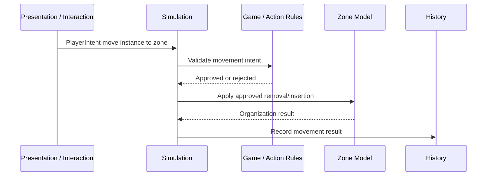

# Zone Model — model

## What it is

A zone is a group of cards. It carries identity, a definition that describes how it organizes its contents, and the runtime data that backs its behavior (membership and any per-zone-type values like a counter or recipe progress). Optional ownership lives on the `OwnershipState` slice (read via `zone.GetOwner(state)`).

> Zone = thin handle (id + definition) + contents slice + per-zone-type runtime slice + (optional) entry in `OwnershipState`.

Zones are groups of cards. They can represent structured game concepts like hands, decks, discard piles, battlefields, stacks, shops, and production slots. **Card packs are not zones** — a pack is an entity that, when activated, generates new card instances; it does not contain pre-existing cards. **Reward offers, drafts, and choice surfaces are not zones either** — those are decisions, modeled through the action/decision system.

Zones should not own broad gameplay legality. A larger game/action rules layer decides whether an actor may move an instance into, out of, or within a zone. Once a move is approved, the zone owns how its contents are arranged and what bookkeeping happens.

**Zones do not have stats.** A zone can carry runtime values (a counter, recipe progress) but does not participate in the entity-variable bridge or modifier-stack machinery — it has no `EntityVariableState`, no `IReadOnlyEntity` polymorphism, no modifiers. The moment a concept needs stats with modifier stacks, it is no longer a zone — it is a different entity that may have a zone associated with it.

## Contracts

### Zone shape

A zone is a class implementing `IReference` with two structural fields:

```csharp
public sealed class Zone : IReference
{
    public InstanceId Id { get; }
    public ZoneDefinition Definition { get; }

    public Actor? GetOwner(IStateScope state) =>
        state.Get<OwnershipState>().OwnerOf(this);

    public IEnumerable<Card> GetCards(IStateScope state)
    {
        var contents = state.Get<ZoneContentsState>(this);
        var map = state.Get<CardMapState>();
        return contents.Cards.Select(map.GetCard);
    }
    // ... other state-reading methods
}
```

Zone is a class (handle), not a record. There is one `Zone` instance per `InstanceId` in the running engine, shared by all framework code that operates on that zone. Mutable zone data (contents, owner, per-zone-type values) lives in slices.

The zone shares the `Identifier<Instance>` namespace with cards (and any other `IReference`-implementing entity). This makes targeting work uniformly: an effect that picks "a card or a zone" takes `IReference` and handles both through the same ID space.

Zone runtime state lives across:

1. **`ZoneContentsState`** — generic, framework-owned. Keyed by the zone. Holds an ordered `ImmutableList<CardRef>` referencing cards via their current `CardRef`. Per the [Card Model](features/cards/models/01-card-model.md), `CardRef` rotates on every move — the contents list is updated atomically by the same mutators that rotate the ref. When a game needs richer per-entry structure (slot keys, group keys, spatial coordinates), it adds fields on its own design pass — the framework doesn't pre-define those hooks.
2. **`OwnershipState`** — generic, framework-owned, applicable to any `IReference` instance. `Dictionary<InstanceId, Actor>`. Both Cards and Zones read ownership through this slice.
3. **Per-zone-type runtime slices** — game-authored. Carry typed values for that zone type — e.g., `PileState { Counter }`, `RecipeStackState { Progress }`. Independent slices; no shared shape across zone types.

Zone configuration lives on the `ZoneDefinition`: capacity, ordering rules, insertion behavior, default visibility policy. Different zone types vary by definition data, not by class hierarchy.

### Zone definition

The authored base data for a kind of zone. Examples: player hand, draw pile, discard pile, MTG stack, Stacklands physical stack, shop row.

### Zone object (runtime)

The runtime zone in a session — a `Zone` value carrying its `Id` and `Definition`. Owner is read via `zone.GetOwner(state)` from `OwnershipState`.

Zone storage is **game-authored**: the framework does not provide a generic `ZoneMapState` registry. Game code holds Zone objects in its own state slices (e.g., `GameZonesState { Zone P1Hand, Zone P1Deck, ... }`) or in a `Dictionary` keyed however the game prefers. Framework operations take Zone objects as parameters; they don't look them up generically.

Examples: player 1 hand, player 2 hand, current encounter draw pile, shared battlefield, active rules stack, this specific physical stack on a board.

### Core responsibilities

Zones should be described by responsibilities, not a fixed trait checklist.

| Responsibility | Meaning |
|----------------|---------|
| Contents | Which instances are in the zone. |
| Arrangement | How contents are ordered, grouped, stacked, slotted, or otherwise addressed. |
| Capacity / Size | Default size limits, count limits, slot limits, or similar organizational constraints. |
| Insertion Behavior | Where an approved incoming instance goes: top, bottom, next slot, chosen index, grouped pile, etc. |
| Removal Behavior | How contents close gaps, reorder, unstack, or update after an instance leaves. |
| Visibility | What each actor/viewer can know about membership and details. |
| Change Bookkeeping | What state changes or history facts are emitted when contents change. |

This avoids forcing all zones into a universal boolean trait list while keeping legality outside the zone.

### Legality boundary

The zone should not answer broad questions like:
- Can this card type go here?
- Is this actor allowed to move this card here?
- Can this card be played from this source zone?
- Does this effect ignore the normal maximum hand size?
- Is this target valid?

Those are game/action rules questions.

The zone may answer narrower organization questions like:
- How many instances are currently here?
- What is the default capacity?
- Where should an approved instance be inserted?
- If this zone is full, what is the default organizational result?
- Can the requested index/slot exist?
- What changed when an instance was added or removed?

Capacity is treated as an overridable/default organizational constraint, not an absolute law. A game rule or effect may force a move, ignore a limit, replace a limit, or choose a special insertion mode. The zone provides a default "this is full" answer, but that answer is data for the action rules to interpret. It does not prevent a higher-priority game effect from force-pushing an instance into the zone.

### Contents and arrangement

A zone must be able to answer what it contains. Arrangement can vary by game: ordered list, unordered set, indexed slots, top/bottom pile, stack order, grouped piles, hidden sequence, or game-specific structure.

Spatial coordinates are not required by the core zone model. If a game needs spatial placement as rules data, that should be added by a spatial preset or game-specific model. If spatial placement is only visual, it belongs to presentation/layout.

### Stack zones

Stacks are modeled as zones with custom organization.

**MTG-style rules stack** may define ordered contents, top/bottom insertion behavior, how contents are addressed for later resolution, who may see stack contents. Priority, legal actions, and resolution are scheduler/action rules — the stack zone organizes pending spell/ability instances but does not own the full priority system.

**Stacklands-style physical stack** may define which instances are stacked together, which is top/bottom, how new approved instances are inserted, how instances are removed/unstacked. Recipe matching, timers, production, automatic combat, work are game systems that may observe or query the stack zone. The visual pile is presentation; the fact that those instances are grouped together belongs to simulation.

### Read API

Per [`Product/decisions/0005-objects-over-ids.md`](decisions/0005-objects-over-ids.md), framework APIs prefer the zone object over its ID. The zone is used directly as a slice key, and utility methods on the zone take state per call. There is no `Zones` injected service.

```csharp
// slice access (zone is the key)
state.Get<ZoneContentsState>(zone);
state.Get<PileState>(zone);              // game-authored per-zone-type slice

// utility methods on the zone (sugar for slice reads)
zone.GetCards(state);                    // resolves CardRefs through CardMapState
zone.Count(state);
zone.IsFull(state);                      // reads definition.Capacity vs current count
zone.GetOwner(state);                    // reads OwnershipState
```

The `Zone` object is stateless beyond its identity — it does not hold a scope reference. Methods accept state per call, so a zone reference is timeless and can be passed across scope boundaries safely.

Reverse queries — "what zone is this card in?" — currently scan `ZoneContentsState` slices. A derived index slice can be added when a real consumer demands it; deferred to backlog (`bl-card-location-index`) until then.

### Insertion API

A single payload carries zone insertion, with optional override fields for game effects that need to bypass zone defaults.

```csharp
record InsertCardPayload(
  Zone Zone,
  Card Card,
  InsertPosition? Position = null,    // null = use zone definition's default
  bool BypassCapacity = false);
```

`InsertPosition` is a sealed record hierarchy — each variant is its own type, so cases-with-data and cases-without-data don't share a single enum:

```csharp
abstract record InsertPosition;
sealed record DefaultPosition  : InsertPosition;
sealed record AtTop            : InsertPosition;
sealed record AtBottom         : InsertPosition;
sealed record AtIndex(int Idx) : InsertPosition;
```

Static factories provide call-site readability for the position axis:

- `InsertCardPayload.AtTop(zone, card)`
- `InsertCardPayload.AtBottom(zone, card)`
- `InsertCardPayload.AtIndex(zone, card, i)`
- `InsertCardPayload.Default(zone, card)` — explicit "use zone default"

The `BypassCapacity` axis uses a C# `with` expression: `InsertCardPayload.AtTop(zone, card) with { BypassCapacity = true }`. No separate `Force` factory.

The composite `MoveCardMutation` (remove + insert as one logical move, defined in the [Card Model](features/cards/models/01-card-model.md)) carries the same `InsertPosition` and `BypassCapacity` and forwards them to the insert side. It also carries a fresh `CardRef` — every move rotates the ref per the conservative privacy policy.

"Forced" at the mutation level means bypassing zone defaults. The separate axis — "this insertion can't be cancelled by replacement effects" — lives at the `GameAction` / trigger-fold layer, not here.

### Visibility model

Visibility uses two channels:

| Channel | Question It Answers | Example |
|---------|---------------------|---------|
| Membership Visibility | Can this actor know which instance IDs are in this zone and how they are arranged? | A player sees the exact cards in their hand; an opponent may only see a count. |
| Detail Visibility | Given a known instance ID, can this actor see its definition and variable data? | A face-down card may be visible as an instance but hide its definition. |

**Zone visibility policy (definition-only).** The zone's default visibility policy lives on the `ZoneDefinition` as authored data. The policy expresses per-actor-role rules across the two channels — e.g., "visible to owner, count-only to others" (hand), "hidden to all" (deck contents), "visible to all" (battlefield). The policy is static per zone definition; runtime variation comes only from the per-card flag.

**Per-card visibility flag.** Per-card runtime overrides live on `CardVisibilityState` (defined in the [Card Model § `CardVisibilityState`](features/cards/models/01-card-model.md)) as a `CardVisibility` enum (`Hidden | VisibleToOwner | VisibleToAll`) keyed by `InstanceId`. Absent entry = use the zone's policy default. `VisibleToOwner` requires the card to have an Owner; collapses to `Hidden` if no Owner.

Per-card overrides flow through `SetCardVisibilityMutation` (with `Hide` / `ShowAll` / `ShowToOwner` factories — see Card Model § Mutations).

**Rules-side read.** Rules read visibility through the card object:

```csharp
card.IsVisibleTo(state, actor)
```

Visibility-conditional rules and triggers branch on this read. The predicate combines the zone's policy and the per-card flag.

**Server / client model.** The server is omniscient and stores canonical state. Visibility is applied as a **send-time filter** that **cuts data**, never alters identity. The server only sends to a client what that actor is allowed to see:

- **Full data** — actor can see the card; client renders normally.
- **CardRef only** — actor knows a card exists at this `CardRef` but not what it is; client renders a hidden-card placeholder.
- **Nothing** — actor doesn't know the card exists (e.g., opponent's deck contents); client only knows the count if the zone policy reveals it.

The same filter runs locally and over the network — there is no per-actor ID divergence. All observers see the same canonical `CardRef` for a card; the only difference is whether they receive the card's data behind that ref.

**Re-hide via server-side `CardRef` rotation.** Per the [Card Model](features/cards/models/01-card-model.md), every card carries two IDs:

- `InstanceId` — stable across the card's lifetime; used for variable storage, modifier storage, history, server-internal subscriptions.
- `CardRef` — temporary; the slice key in `CardMapState` and the reference used in `ZoneContentsState`. Rotates on every move and on every visibility transition.

When a card hides, `SetCardVisibilityMutation.Hide(card)` rotates the `CardRef` server-side: `CardMapState` swaps the old ref out and the new ref in, every `ZoneContentsState` containing the old ref swaps it for the new ref, and `CardVisibilityState[card.InstanceId]` updates. All observers — local and networked alike — see the new canonical ref. An observer who previously held the old ref sees it disappear; they cannot correlate the new ref with the old.

The simulation-side `InstanceId` stays stable forever (preserves the entities Model invariant). Triggers, effects, attachments, and history all reference the `Card` object or its `InstanceId` — they are unaffected by ref rotation.

Full mechanism + options weighed in [`decisions/0006-zone-visibility-model.md`](decisions/0006-zone-visibility-model.md) (project-wide cross-cutting decision: zones policy + cards override + presentation transport filter).

### History filtering

The server records a single canonical `HistoryEnvelope` stream with full `InstanceId`s and full data. Per-actor history views are produced at the transport boundary by applying detail gating:

- **CardRef-bearing entries are passed through** — entries that reference cards by `CardRef` (e.g., `ZoneContentInserted(zone, ref)`, `CardRefRotated(oldRef, newRef)`) are sent to all observers. Since all observers see the same canonical `CardRef`, no translation is needed; the ref shown matches what the actor sees in live state.
- **Detail gating** — card-detail entries (`VariableChanged<T>`, modifier changes) are sent only to actors who have detail visibility on the affected card. **Movement entries** and **ref rotations** are always sent — the *fact* of movement and rotation is public.

For genuinely-secret movements (where even the fact must be hidden from observers), the game models the interaction differently — the framework does not provide a "secret history" mode.

Full reasoning in [`decisions/0006-zone-visibility-model.md` § History](decisions/0006-zone-visibility-model.md).

### Zone movement

Zone movement is a simulation-driven game action.

The zone model does not assume presentation can directly move cards. A drag/drop interaction can request movement, but the simulation decides whether it is allowed.



The exact names for request, command, task, event, and history live in `actions/`. The important rule is that movement is approved by simulation/game rules, while zones organize approved content changes.

### What zones do not own yet

Zones do not own these concerns by default:

- Visual layout, screen-space or world-space coordinates, pointer interactions, animation.
- Broad gameplay legality, card type legality, actor permission rules.
- Generated reward choices, draft choice semantics.
- Networking transport.
- Final actor/player ownership rules.

Some game-specific zone types may incorporate spatial or reward behavior later, but the base zone model stays focused on contents, organization, visibility, capacity defaults, and change bookkeeping.

## Invariants

Model-local invariants. (See `zones.md ## Invariants` for feature-level rules — thin handles, shared `Identifier<Instance>` namespace with cards, no stats, legality outside the zone, ref rotation on move/visibility, simulation-driven movement, server-canonical with transport-boundary filter.)

- **Membership references cards by current `CardRef`.** The `ZoneContentsState` list is updated atomically by the same mutators that rotate the ref.
- **Zone storage is game-authored.** No generic `ZoneMapState` registry; game code holds Zone objects in its own state slices.
- **Capacity is a default, not a law.** The zone provides a "this is full" answer, but game effects can bypass via `BypassCapacity = true` on `InsertCardPayload`.
- **`InsertPosition` is a sealed record hierarchy.** Each variant is its own type; pattern matching at the consumer side stays clean.

## Decisions

Linked: [`Product/decisions/0006-zone-visibility-model.md`](decisions/0006-zone-visibility-model.md) — Visibility model: definition policy + per-card flag + server-side `CardRef` rotation. Cross-cutting (zones + cards + presentation).

## Examples

| Zone | Contents | Organization | Visibility Direction | External Game Systems |
|------|----------|--------------|----------------------|------------------------|
| Hand | Card instances | Ordered or player-arranged list; optional size limit | Owner sees details; others may see count only | Playability, discard rules, maximum hand effects. |
| Deck | Card instances | Ordered hidden pile | Owner/opponent may see count but not order/details | Draw, shuffle, search, mill. |
| Discard | Card instances | Ordered or unordered pile | Usually public details | Search, recycle, graveyard effects. |
| Battlefield | Card/unit instances | Slots, rows, groups, or unordered presence | Usually public details | Combat, presence, auras, targeting. |
| Rules Stack | Pending spell/ability instances | Ordered stack, usually top-insertion | Usually public details | Priority, legal additions, resolution. |
| Physical Stack | Card/resource instances | Stack order/group | Depends on game | Recipes, timers, work, combat. |
| Shop Row | Offer instances | Indexed list | Usually public details | Purchase rules, refresh rules, pricing. |

Note: card packs are *not* zones. A pack is an entity with a generator effect; opening it executes an effect that creates new card instances and places them somewhere. Reward offers, drafts, and choice surfaces are also not zones — they flow through the action/decision system.

```csharp
// Inserting a card at the top of a zone, bypassing capacity (force-effect)
store.Execute(InsertCardPayload.AtTop(battlefield, summonedToken)
    with { BypassCapacity = true });

// Reading current contents
var cardsInHand = p1Hand.GetCards(state);

// Reading effective visibility for a specific actor
bool visible = card.IsVisibleTo(state, opponent);
```

## Open follow-ups

- **Spatial rule attachment** — when games (e.g., Stacklands-style) need spatial coordinates as rules data rather than as presentation layout. The framework does not pre-define a hook for this; a spatial-rules game's design pass adds the appropriate fields to the contents shape (or a parallel slice) when the requirements are concrete. See `bl-spatial-rule-attachment` in `OPEN-ITEMS.md`.
- **Slot / group structure on contents** — battlefields with fixed rows or grouped piles. Same logic as spatial: no pre-defined hook; games add the fields when forced. The current contents shape is a flat `IReadOnlyList<Card>`.
- **Per-actor asymmetric reveals** — visibility states like "card visible to player A but not player B" are not first-class in the visibility model; games that need them model the reveal as a transient game-state slice. Per-actor map shape on the visibility flag was rejected as YAGNI.
- **Reverse `CardRef → Zone` index** — `bl-card-location-index`; deferred until concrete consumer surfaces.

---

*Below: provenance — the original Zone Model decisions (early high-level direction) plus the locked specifics for zone shape (folded from `features/zones/decisions/0001-zone-shape.md`) and insertion API (folded from `features/zones/decisions/0003-insertion-api.md`). The visibility model's full options-weighed lives in the elevated [`decisions/0006-zone-visibility-model.md`](decisions/0006-zone-visibility-model.md) — Q4 below references the original early framing only.*

The zone Model evolved in two phases. **Phase 1** (early Q1–Q6 below): high-level direction set in the original Zone Model Decisions doc — responsibilities-not-traits, spatial deferred, stacks-as-zones, two visibility channels (early framing), movement is normal action flow, generated choices deferred. **Phase 2** (Q7–Q8 below): internal-opens session settled the specific shapes — zone-as-thin-handle (folded ADR-0001), insertion-API-as-single-payload (folded ADR-0003). The visibility mechanism was settled in the same Phase-2 session and elevated to a project-wide ADR (visibility requires coordinated implementation across zones + cards + presentation).

## Options considered

### Q1 — Zone shape direction (early)

Should the zone be a trait checklist (`ordered`, `hidden`, `stackable`, `owned`, `public`, `capacityLimited`, ...) or a richer model with responsibilities and policies?

- **A — Trait checklist.** Rejected: gets awkward for stacks, reward offers, shop rows, production slots, card packs, shared battlefields with slots.
- **B — Richer model with responsibilities (contents, organization, capacity behavior, visibility, change bookkeeping).** **Chosen.**

The minimum zone model is a set of responsibilities (what instances are in the zone, how they're ordered, how new ones are inserted/removed, capacity behavior, change notifications, visibility). Game legality stays out — questions like "can this card type go here?" belong to the game/action rules layer.

### Q2 — Spatial placement (early)

How should spatial board positions relate to zone membership?

- **A — Bake spatial coordinates into zones.** Rejected: forces every zone to understand world positions, UI layout, 3D card placement; most zones only need simulation membership and ordering.
- **B — Spatial placement is outside the core zone model.** **Chosen** — view-defined when only presentation; game-specific when physical position is part of rules; later spatial-system concern, not mandatory.

The core zone model may support a generic position/order value, but does not require spatial coordinates.

### Q3 — Stacks (early)

Are stacks zones, relationships, or both?

- **A — Separate "stack relationship" concept.** Rejected: duplicates membership information; complicates the type system.
- **B — Model stacks as zones with custom organization.** **Chosen** — applies to both MTG-style rules stack and Stacklands-style physical stack.

If multiple cards are in the same stack zone, the relationship is already represented by zone membership. The zone owns the organization that makes those members behave like a stack.

### Q4 — Visibility (early framing; full mechanism in elevated ADR-0006)

How should hidden, partially visible, and viewer-specific state be modeled?

- **A — Single `hidden` boolean on a zone.** Rejected: insufficient — "something is there" and "I know what it is" are different concerns.
- **B — Two channels (membership + detail), actor-specific configuration.** **Chosen as direction** — separates "something is there" from "I know what it is," matters for presentation, networking, replay, AI, hidden information, spectator/debug.

The specific runtime mechanism (definition policy + per-card flag + server-side `CardRef` rotation + history filtering) was settled later and elevated to project-wide ADR. See [`decisions/0006-zone-visibility-model.md`](decisions/0006-zone-visibility-model.md) for the full options weighed.

### Q5 — Zone movement (early)

Should zone movement be a generic event, a task, or a specialized rules primitive?

- **A — Specialized rules primitive.** Rejected: zone movement should not be a direct view operation or a special shortcut.
- **B — Normal simulation-driven game action.** **Chosen** — flows through the same action pipeline as moving a card, changing a card, using a card, drawing a card, discarding a card, or placing a card into a stack.

Expected shape: presentation/system creates an intent → game/action rules validate → simulation applies the approved state change → destination/source zones organize their contents → history/events record the result → triggers/reactions may respond.

### Q6 — Temporary choices and generated views (early)

How do we model temporary views like reward offers, shops, card packs, draft picks, and generated choices?

- **A — Force these into the zone model.** Rejected: mixes zone modeling with action generation, decisions, rewards, economy, presentation.
- **B — Out of scope for the zone system.** **Chosen** — bigger action/decision question. A reward offer might be a temporary zone; a draft pick might be a decision with options, not a zone; a card pack might be a zone, an effect, or a generated content source; a shop row might be a zone plus economic rules.

Leave these cases open until the action/decision model exists.

### Q7 — Zone shape lock (formerly ADR-0001 — folded)

The zone Model settled high-level direction (Q1–Q6) but left "are zones entities or lightweight records?" and "where does membership live?" unanswered. Both are load-bearing: triggers, effects, presentation, history, and targeting all depend on what a zone *is* in the type system.

User constraint surfaced during the design pass: zones are groups of cards; they can have runtime values (a counter), but the moment something has stats with modifier stacks, it's not a zone anymore — it's a different entity that has a zone inside. **Decisive: no modifier-stack machinery on zones.**

- **A — Zones as `StateEntity<TZoneDef>`.** Full entity machinery. Rejected: drags in modifier stacks and the entity-variable bridge for a model that doesn't use either. Stat-bearing things are not zones.
- **B — Zones as plain Store slices keyed by a separate `ZoneId` type.** Pure data. Rejected: breaks free targeting (effects that pick "a card or a zone" need a unified ID namespace), and forces every game to re-implement membership data structures.
- **C — Zones as thin objects sharing the `Identifier<Instance>` namespace.** Zone is `(Id, Definition, Owner)`. State lives in two slices: a generic framework-owned `ZoneContentsState` for membership, and per-zone-type runtime slices for typed values. No `EntityVariableState`, no modifier stacks, no entity-bridge participation. Targeting works uniformly because cards and zones share the ID namespace. **Chosen.**

### Q8 — Insertion API lock (formerly ADR-0003 — folded)

Zone insertion has two axes that game effects sometimes need to control beyond the zone's default behavior: **position** (top, bottom, specific index, specific slot) and **capacity** (respect or bypass).

A separate axis — "this insertion can't be cancelled by replacement effects" — lives at the `GameAction` / trigger-fold layer, not at the zone mutation layer.

For the payload shape:

- **A — Single payload with optional override fields.** `InsertCardPayload { Zone, Card, Position, BypassCapacity }`. `Position` and `BypassCapacity` defaults mean "use zone definition's default"; explicit values override. Sugar via static factories. **Chosen.**
- **B — Two payloads.** `InsertCardPayload` for standard, `ForceInsertCardPayload` for overrides. Rejected: duplicates mutator logic; effects pick which payload to use; framework grows two parallel paths for one concept.
- **C — Multiple targeted payloads.** `InsertAtTopPayload`, `InsertAtBottomPayload`, `InsertAtSlotPayload`, `ForceInsertPayload`. Rejected: reads nicely at call sites but multiplies framework surface; forces a "which payload?" decision on every call.

For the `Position` field shape:

- **Discriminated union mixing parameterless and parameterized variants** (e.g., `Top | Bottom | AtIndex(int) | AtSlot(SlotKey)` as one enum). Rejected: structurally awkward — cases-with-data and cases-without-data on the same type read as "functions on an enum" in C#, even when expressed as a sealed hierarchy in trivia.
- **Enum + optional `Index` field** (`enum InsertMode { ZoneDefault, Top, Bottom, AtIndex }; int? Index`). Rejected: invalid combinations are constructible (`Mode = Top, Index = 5`); flat shape but loses type safety.
- **Sealed record hierarchy.** `abstract record InsertPosition; sealed record AtTop/AtBottom/AtIndex(int)/DefaultPosition`. Each variant is its own type with its own data. **Chosen.**

## Rationale

The chosen direction across Q1–Q8 produces a coherent shape:

- **Responsibilities-not-traits** (Q1) keeps the model open for stacks, reward offers, shop rows, and other non-pile concepts without forcing them through a fixed boolean schema.
- **Spatial out of scope** (Q2) avoids forcing every zone to understand layout; spatial-rules games add fields when concrete requirements arrive.
- **Stacks-as-zones** (Q3) reuses zone membership for the relationship, with custom organization for ordering.
- **Two visibility channels** (Q4) separates "something is there" from "I know what it is"; the runtime mechanism in ADR-0006 cuts data per actor without altering identity.
- **Movement is normal action flow** (Q5) keeps the action pipeline as the single approval/execution path; zones stay focused on organization.
- **Generated choices deferred** (Q6) prevents mixing zone modeling with action/decision/reward/economy/presentation concerns.
- **Zone-as-thin-handle** (Q7) gives the polymorphic targeting benefit (zones and cards both `IReference`) without dragging in modifier stacks.
- **Single insertion payload + sealed record hierarchy** (Q8) gives one mutator, one payload type, one mental model, with type-safe variant data.

## Consequences

- **Enables:** zones and cards both implement `IReference` and share the `InstanceId` namespace → polymorphic targeting works uniformly; membership has a single canonical home (`ZoneContentsState`); per-zone-type runtime values have a typed home; no modifier-stack baggage on zones; one mutator/payload for insertion with composite `MoveCardMutation` forwarding the same options; visibility branching is a one-line predicate (`card.IsVisibleTo`); `CardRef` rotation runs the same locally and over the wire (no per-actor ID divergence); per-actor reveal-then-hide privacy without breaking simulation-side `InstanceId` invariants.
- **Constrains:** zones can never carry stats with modifier stacks (a game concept needing stats must be a different entity that *has* a zone, not a zone with stats); zone owner is read-only on the handle (mutations go through `OwnershipState`); server-internal subscriptions must use `Card`/`InstanceId` (never `CardRef`); client-visible state and projections must use `CardRef`; override semantics live on the payload (game effects that "force" insertion express it through `BypassCapacity = true` and explicit `Position`).
- **Decisions to carry forward:** zones are richer organization models, not trait bags; spatial placement is not a core requirement; stacks are zones with custom organization; visibility uses membership + detail channels with definition-policy + per-card flag + server-side ref rotation; zone movement is simulation-driven via normal action flow; game/action rules own legality; zones own contents, ordering, capacity defaults, and change bookkeeping; generated choices deferred to action/decision model.
