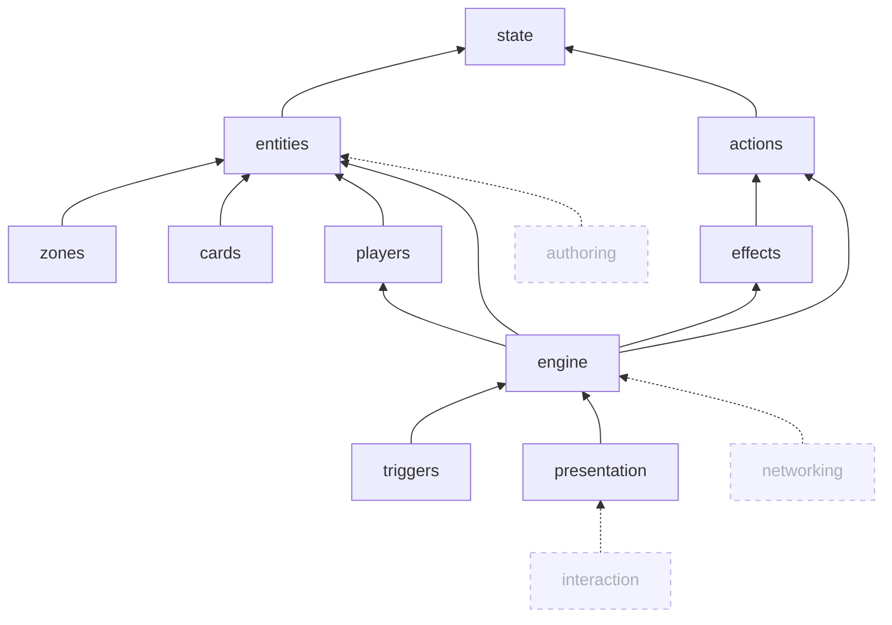
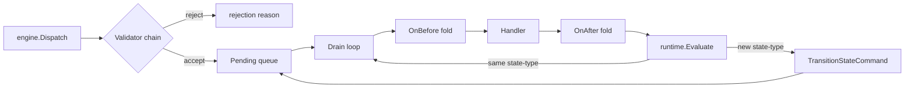
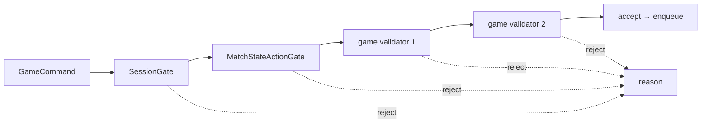
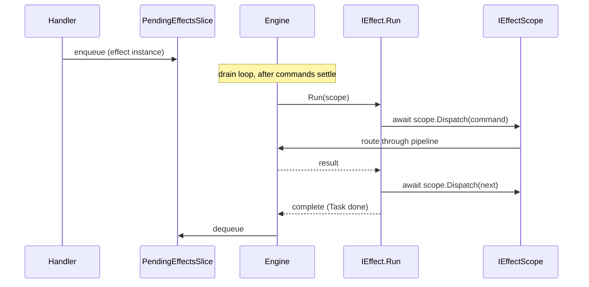
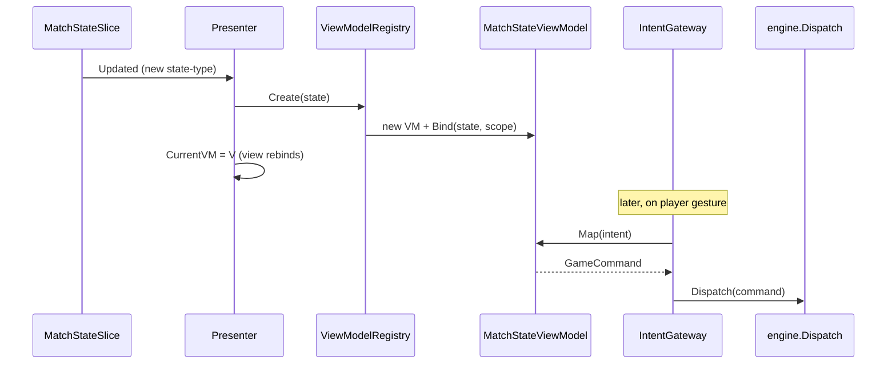

> **Archived 2026-10-18.** Superseded by [`docs/architecture.md`](docs/architecture.md) and [ADR-0014](Product/decisions/0014-service-first-state-model.md). This is the research-phase picture of the old slice-based model; most types it names were never built. The body below is kept as history.

# Architecture

The framework's top-down picture. Read in order; each section anchors what comes next. Detail lives in feature roots, Models, and ADRs — link out, don't repeat.

## What this is

A C# framework for **deterministic card-game simulations** with **reactive presentation**. Game-mode-agnostic (TCG / deckbuilder / spatial / puzzle). The core is a FSM-shaped command pipeline backed by a `Store` of state slices; UI subscribes to those slices through per-state ViewModels.

## Layered architecture



| Tier | Feature | Owns | Doesn't own |
|---|---|---|---|
| Foundation | [`state`](features/state/archive/state.md) | `Store`, `BaseState`, `Mutator<,>`, `IStateScope`, subscription channels | Anything game-specific |
| Entity bridge | [`entities`](features/entities/archive/entities.md) | `EntityDefinition`, `InstanceWithSlices<TDef>`, `Variable`, `Modifier`, `Attachment` | Domain-shape specifics |
| Domain shapes | [`zones`](features/zones/archive/zones.md) · [`cards`](features/cards/archive/cards.md) · [`players`](features/players/archive/players.md) | Zone organization + visibility · `Card` + `CardRef` privacy · `Player` + `IActor` | Game-specific gameplay rules |
| Dispatch | [`actions`](features/actions/archive/actions.md) · [`triggers`](features/triggers/archive/triggers.md) | `GameCommand` family, validators, handlers, history envelope · `Trigger<T>`, fold mechanic | Effect orchestration |
| Orchestration | [`effects`](features/effects/archive/effects.md) | `IEffect.Run`, `IEffectScope`, `PendingEffectsSlice`, request system | Command pipeline mechanics |
| Engine | [`engine`](features/engine/archive/engine.md) | `GameEngine`, FSM (`MatchState` + `ITurnFlow` + `ISBA`), `GameRulesRuntime<T>`, factory, session lifecycle | View concerns |
| UI | [`presentation`](features/presentation/archive/presentation.md) | Per-state `MatchStateViewModel<TState>`, `ViewModelRegistry`, presenter, `IntentGateway` boundary | Final gameplay legality |

Dashed nodes are **considered** — known gaps with deferred design (see §What's still considered).

## How the engine works

The engine is a strict-FIFO command drain. It is also the FSM.



- **Strict-FIFO.** No priority, no reordering. (ADR-0006.)
- **FSM.** `Evaluate(action, result) → MatchState`. Type change synthesizes a `TransitionStateCommand`, dispatched through the same pipeline. (ADR-0009.)
- **Transitions are commands.** Same envelope; same history fold.

**Session lifecycle is separate.** `engine.Session` is a typed `SessionState` field, not a Store slice.

| Session state | Permits |
|---|---|
| `NotStartedSession` | `StartMatchCommand`, `EndMatchCommand` only |
| `InMatchSession` | All commands subject to validators + `MatchState.Actions` |
| `EndedSession(MatchOutcome)` | Nothing (terminal) |

Two framework validators gate intake:

- `SessionGate` — rejects when `engine.Session` doesn't admit the command.
- `MatchStateActionGate` — rejects when the command type isn't in `MatchStateSlice.Current.Actions`.

Both register first. Game-shipped validators run after. (ADR-0010.)

## How commands work

`GameCommand` is a five-sibling family. Single async `Dispatch<TResult>(GameCommand)` routes all five. (ADR-0011.)

| Sibling | Shape | What it does |
|---|---|---|
| `GameAction` | Executable, queued | Mutates state via handler |
| `CompositeAction` | Inline, no queue | Bundles a sequence into one envelope |
| `GameSignal` | History-only | Records a fact; no handler runs |
| `Request<TResponse>` | Writes `RequestsSlice` | Opens a player-decision request |
| `Response` | Writes `AnswersSlice` + clears `RequestsSlice` | Answers a request by ID |

Each command flows through three execution layers:

```
Effect (orchestrator)
  ↓ scope.Dispatch(command)
Handler (atomic state work)
  ↓ Store.Execute(payload)
Mutator (pure state → state)
```

- **Effect** — async coroutine; composes multiple `Dispatch` calls; never mutates directly.
- **Handler** — extends `GameCommandHandler<TCommand, TResult>` with `[Inject] Store`. Atomic from player-input POV; calls `Store.Execute` only. (ADR-0010.)
- **Mutator** — `Mutator<TState, TPayload>`; pure function of `(currentState, payload, scope) → newState`. Registered via DI.

**Validation is a registered chain.** `ICommandValidator<TCommand>` runs at dispatch:



Validators are independent (command-only signature; state via `[Inject]` on `CommandValidator<>` base), short-circuit on first reject, run in DI registration order. Framework defaults register first; game validators append. The same chain applies uniformly to every `GameCommand` sibling. (ADR-0010.)

## How effects work

Only the engine fires effects.



- **Engine-only firing.** Cast handlers push to `PendingEffectsSlice`; the engine drains. No handler holds an `IEffectPipeline` reference. (ADR-0011 lock 1.)
- **Async coroutines.** `IEffect.Run(scope) : Task`. Effects `await scope.Dispatch` calls; no state-machine steps. Mid-effect save/load isn't supported.
- **Universal queue.** `PendingEffectsSlice` is the single queue. Cast handlers + trigger reactions both push there.

**Player decisions ride the request system.** An effect that needs a player choice routes through `Request<TResponse>` / `Response`:

```
effect: await scope.Dispatch(new TargetRequest(...))
   → engine routes Request through pipeline
   → handler writes RequestsSlice.Open
   → drain pauses (RequestsSlice non-empty)
   → UI (active VM) reads RequestsSlice, prompts player
   → player gesture → VM.Map → Response
   → engine handles Response: writes AnswersSlice, clears RequestsSlice.Open
   → effect awaits, picks up the typed response, continues
```

Predicates and option-filters live on the typed `Request` subclass — by ID/data, never by `Func` (so requests serialize cleanly for replay/network). (ADR-0011 D17.)

## How state works

State is Scaffold.State — `Store` + `BaseState` slices + `Mutator<TState, TPayload>` registered per `(state, payload)` pair.

| Tier | Examples | Lifecycle | Author |
|---|---|---|---|
| Framework-owned | `EngineState`, `HistoryState`, `MatchStateSlice`, `PendingEffectsSlice`, `RequestsSlice`, `AnswersSlice`, `EntityState`, `ZoneContentsState`, `CardMapState`, `OwnershipState` | Auto-seeded at `Build` | Framework |
| Per-spawn instance | Card slices, zone slices, player slices declared via `ISliceProvider` on the instance | Spawned with the instance | Game |
| Per-spawn definition | Same shape via `ISliceProvider` on the definition; delegated to from the instance | Spawned with the instance | Game |
| Game-singleton | `TurnState`, etc., from `GameDefinition.GetInitialSlices()` | Seeded at `Build` | Game |
| Manual overlay | `MatchSetup.InitialSlices` | Seeded at `Build` after game-singletons | Tests / scripted scenarios |

Mutation discipline:

- **Reads** via `IStateScope.Get<TState>()`.
- **Writes** via `Store.Execute(payload)` → registered `Mutator<TState, TPayload>` → new immutable state.
- **Mutators are pure.** `(currentState, payload, scope) → newState`. No side effects.
- **`ExecuteBatch`** for atomic multi-payload writes.

Every slice writer is a mutator; every reader resolves through `IStateScope`. See [`state/state.md`](features/state/archive/state.md) for the full Scaffold integration.

## How presentation works

Presentation is **per-state polymorphic ViewModels**. (ADR-0012.)



- **`MatchStateViewModel<TState>`** — typed VM per `MatchState` subtype. Owns `Bind(state, scope)` + `Map(intent) → GameCommand`.
- **`ViewModelRegistry`** — sealed type → factory lookup. Many-to-one supported.
- **Presenter** — subscribes to `MatchStateSlice`; on type change, asks the registry for a new VM; view re-binds via standard MVVM template selection.

No global mapper, no `AffordanceMap`, no `ActionTemplate` wire form. Each VM owns its observables (the affordance projection) and its `Map(intent)` (the gesture-to-command translation). In request-mode (per `RequestsSlice.Open`), `Map` returns a `Response` instead of a `GameAction`.

`IntentGateway` is the input boundary: raw device gestures → typed `PlayerIntent` records → active VM via `ViewModelRegistry` → `engine.Dispatch` with the mapped command.

## What's still considered

Three feature folders are considered. Tooling is cross-cutting.

| Feature | Owns | Trigger for folder creation |
|---|---|---|
| `authoring` | Card catalog, schemas, keyword system, effect recipes, definition editor surfaces | After vertical-slice exercises the runtime contract end-to-end |
| `interaction` | Raw input gesture → typed `PlayerIntent` translation (drag/drop/click/target) | Next presentation or engine-wiring session |
| `networking` | Command/history transport, visibility filter on transport, deterministic RNG, versioned definitions, snapshots for join/reconnect | Post-v1; when multiplayer or save/load becomes a real concern |

**Tooling** isn't a feature folder. Items live under [`OPEN-ITEMS.md`](ledgers/OPEN-ITEMS.md):

- Definition editor (after `authoring`)
- Simulation debugger (state + history + pending queues)
- Scenario runner (load state, dispatch commands, inspect)
- Replay viewer (step through history)
- Rule trace (explain legality)
- Validation reports (broken definitions, bad refs)

Each fires when a real consumer surfaces. None block v1 of the simulation core.

## Cross-cutting doctrines

- **Objects over IDs.** Framework APIs pass typed objects (`Ref<T>`, `Reference`), not bare IDs. Typed objects flow through commands, envelopes, history, and transport. (ADR-0005.)
- **Two-pipeline architecture.** Framework command pipeline (FIFO, no customization) + game effect pipeline (game-customizable orchestration). Triggers ⊆ effects. (ADR-0006.)
- **Five validation layers.** Eligibility (`MatchState.Actions`) → UI affordance (VM observables) → gesture well-formedness (VM's `Map` throws on unknown intents) → registered validator chain (authoritative) → engine-internal invariants. Authoritative legality lives in the validator chain. (ADR-0007 refreshed under ADR-0010.)
- **Visibility.** Per-zone policy (`ZoneVisibilityPolicy`) + per-card visibility flag; server-side `CardRef` rotation hides identity from filtered transports. (ADR-0008.)
- **Determinism.** `MatchSetup.Seed` (int) today; pinned `IRandom` contract when networking lands.

## Reading order

If you're new to the project, read in this order:

1. This document (top-down).
2. [`features/engine/archive/engine.md`](features/engine/archive/engine.md) — the simulation core.
3. [`features/actions/archive/actions.md`](features/actions/archive/actions.md) — the command pipeline.
4. [`features/effects/archive/effects.md`](features/effects/archive/effects.md) — orchestration.
5. [`features/state/archive/state.md`](features/state/archive/state.md) — the state primitive.
6. Then individual Models on demand.

For the locked design decisions, walk [`decisions/`](decisions/) in number order — `0005` (objects over IDs), `0006` (two-pipeline), `0007` (validation layers), `0008` (visibility), `0009`–`0012` (the FSM-arch cascade).
