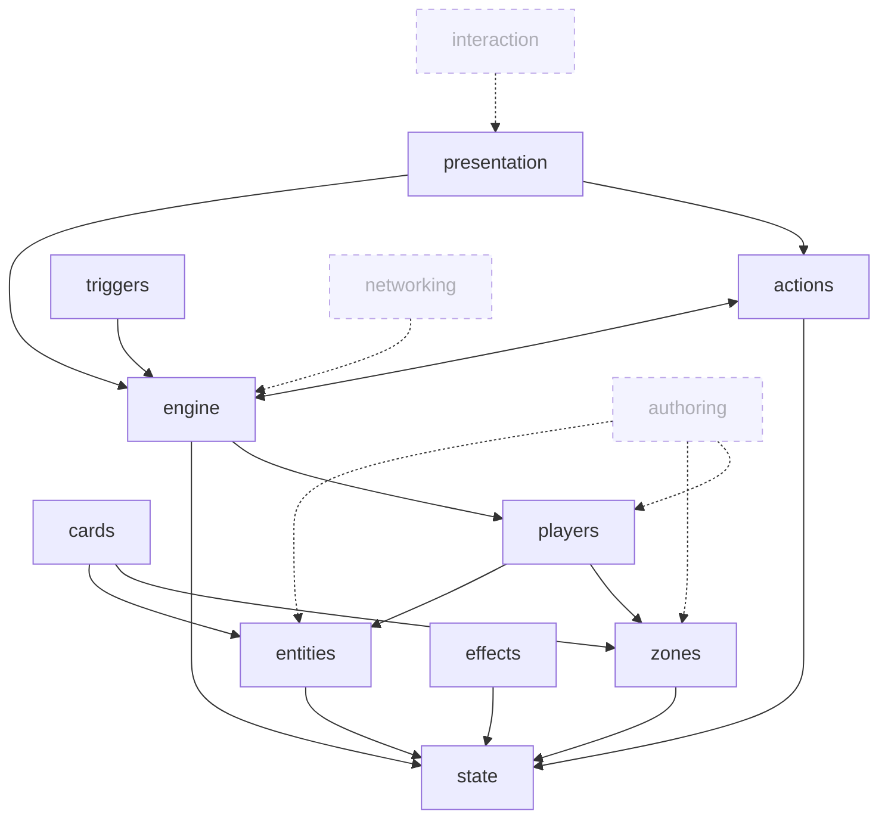

# Feature Map

Bird's-eye view of features in this project. Three layers: feature index table, mermaid dependency graph, model-level breakdown. Hand-maintained at v1; auto-generated at v2 (see `OPEN-ITEMS.md`, trigger ~15 Models).

Update cadence: when a Model lands, a Feature ships, or dependencies shift, OR when a candidate feature is promoted from `considered` to `draft`.

**Status legend.** Feature rows can carry one of these states:

- **`considered`** — capability identified, no folder yet. The row exists here so we don't forget; it's not yet a commitment.
- **`draft` / `settled` / `implemented` / `superseded` / `abandoned`** — same as the Feature root's `status` field once the folder exists. Mirrors the Feature root, doesn't replace it.

When a `considered` row is promoted, follow the §5.11 *Adding a new feature* ceremony and update this file in step 4 of that ceremony.

---

## Feature index

| Feature | Status | Models | Purpose |
|---|---|---|---|
| [`state`](features/state/state.md) | settled | 0 | Scaffold.State integration — `Store`, `BaseState`, `IStateScope`, `Mutator<TState, TPayload>`, four subscription channels, `ExecuteBatch` atomic semantics, slice-authoring conventions. The framework's state primitive. Feature-root only. |
| [`entities`](features/entities/entities.md) | settled | 5 | Definition / Instance / Variable / Modifier / Attachment Models — the entity bridge primitive. Foundation for every runtime object. |
| [`zones`](features/zones/zones.md) | settled | 1 | Zone organization, membership, movement. Where instances live. |
| [`cards`](features/cards/cards.md) | settled | 1 | `Card` handle on top of the entity bridge with privacy-rotating `CardRef`. |
| [`actions`](features/actions/actions.md) | settled | 5 | Command pipeline + intent mapper + command handler + history envelope + available-actions snapshot. |
| [`triggers`](features/triggers/triggers.md) | settled | 2 | `Trigger<T>` reaction class + `ITriggerPipeline` fold orchestrator. `OnBefore<T>` / `OnAfter<T>` registration around command handlers. |
| [`effects`](features/effects/effects.md) | settled | 4 | Effect orchestration + effect scope + handler context + command awaiter (decision routing). Before-fold semantics live in `triggers/`; attachment-entity pattern lives in `entities/`. |
| [`engine`](features/engine/engine.md) | settled | 6 | `GameEngine` class (with lifecycle gate + types), `GameRulesDefinition` (data) + `GameRulesRuntime<T>` (runtime) split, available-actions service, game factory, `GameDefinition` bundle. Slice-tier conventions live in `state/`; framework-slice catalog in `engine.md`. The simulation core. |
| [`players`](features/players/players.md) | settled | 1 | `Player : EntityInstance<PlayerDefinition>, IActor`, `IActor` interface, `PlayerDefinition` shape, per-player slice conventions. |
| [`presentation`](features/presentation/presentation.md) | settled | 1 | Reactive presentation loop reading state + history. |
| `authoring` | **considered** | — | Card catalog, card schema, keyword system, effect definitions, interaction definitions. The authoring layer per ARCHITECTURE. |
| `interaction` | **considered** | — | Input gesture → `PlayerIntent` translation. Drag/drop/click/target. The interaction layer per ARCHITECTURE. |
| `networking` | **considered** | — | Command/history transport, visibility filter, deterministic RNG, versioned definitions, snapshots for join/reconnect. The networking layer per ARCHITECTURE; post-v1. |

**Sub-system reminders** (not separate features, tracked here so they don't get lost):

- *Richer schedulers* (stack+priority, turn/phase machine, real-time tick) — `engine` currently runs immediate queue drain. Other modes are deferred extensions inside `engine`. See ARCHITECTURE §"Effect Resolution Direction."
- *Visibility / Reveal* — cross-concern of `engine` (membership/detail visibility on zones) and `presentation` (rendering filter). Will land as Models inside those features when work begins.
- *Determinism / RNG* — sub-concern of `engine`; folded into `networking` for the seeded/recorded random source.
- *State-Based Checks* — handled inside `engine` evaluation loop. Game-specific extensions (e.g. MTG-strict ordering) are folded into `features/engine/models/03-game-rules-runtime.md` provenance (Q3) per the §4.5 ADR migration recipe.

## Dependency graph

**Cycle observation:** `actions ↔ engine` is bidirectional because `actions/05-available-actions-snapshot` (template shape) builds on `engine/04-available-actions` (production pipeline), while `engine/04-available-actions` builds on `actions/05-available-actions-snapshot`. This is by design — the snapshot's *shape* is owned by `actions/`, the *production* by `engine/`. Worth a future Model to document the contract that closes the loop, but not currently flagged as drift.

Solid arrows = current `references` edges between settled features. Dashed arrows = expected dependency direction once the considered feature lands.

## Model-level breakdown

### `state` (settled)
No models. Feature-root only — `state.md` documents the Scaffold.State integration directly. A model would be added if a framework-specific extension to Scaffold.State emerges.

### `entities` (settled)
- [`models/01-definition.md`](features/entities/models/01-definition.md) — *Definition* — settled, references: `entities/02`, `entities/03`, `entities/04`, `entities/05`, `engine/06`
- [`models/02-instance.md`](features/entities/models/02-instance.md) — *Instance* — settled, references: `entities/01`, `entities/03`, `entities/04`, `entities/05`, `cards/01`, `zones/01`, `players/01`, `engine/06`
- [`models/03-variable.md`](features/entities/models/03-variable.md) — *Variable* — settled, references: `entities/01`, `entities/02`, `entities/04`
- [`models/04-modifier.md`](features/entities/models/04-modifier.md) — *Modifier* — settled, references: `entities/01`, `entities/02`, `entities/03`, `entities/05`
- [`models/05-attachment.md`](features/entities/models/05-attachment.md) — *Attachment* — settled, references: `entities/01`, `entities/02`, `entities/03`, `entities/04`, `effects/03`

*Reorg 2026-05-09:* `01-definition-instance-model.md` + `02-runtime-surface.md` split per concept axis (definition / instance / variable / modifier / attachment). `ISliceProvider` now declared in `01-definition.md` (canonical home; engine/06 references it).

### `zones` (settled)
- [`models/01-zone-model.md`](features/zones/models/01-zone-model.md) — settled, references: `root`

### `cards` (settled)
- [`models/01-card-model.md`](features/cards/models/01-card-model.md) — settled, references: `entities/01`, `entities/02`, `zones/01`

### `actions` (settled)
- [`models/01-command-pipeline.md`](features/actions/models/01-command-pipeline.md) — settled, references: `actions/02`, `actions/03`, `actions/04`, `triggers/01`, `effects/02`, `engine/03`, `decisions/0006`, `decisions/0007`
- [`models/02-intent-mapper.md`](features/actions/models/02-intent-mapper.md) — settled, references: `actions/01`, `actions/05`, `triggers/01`
- [`models/03-command-handler.md`](features/actions/models/03-command-handler.md) — settled, references: `actions/01`, `actions/04`, `state`, `engine/04`
- [`models/04-history-envelope.md`](features/actions/models/04-history-envelope.md) — settled, references: `actions/01`, `actions/03`, `engine/04`
- [`models/05-available-actions-snapshot.md`](features/actions/models/05-available-actions-snapshot.md) — settled, references: `actions/02`, `actions/01`, `engine/04` ⚠️ (see cycle)

### `triggers` (settled)
- [`models/01-trigger.md`](features/triggers/models/01-trigger.md) — *Trigger\<T\>* — settled, references: `triggers/02`, `actions/01`, `effects/02`, `engine/03`, `decisions/0006`
- [`models/02-trigger-pipeline.md`](features/triggers/models/02-trigger-pipeline.md) — *ITriggerPipeline* — settled, references: `triggers/01`, `actions/01`, `effects/02`, `engine/03`, `decisions/0006`

*Reorg 2026-05-09:* `01-trigger-fold.md` split per type axis (`Trigger<T>` reaction class + `ITriggerSystem` registration in `01-trigger`; `ITriggerPipeline` orchestrator + fold mechanic + ordering in `02-trigger-pipeline`); cross-Model synthesis (game-style scheduling table, history-when-replaced, dispatch-channel narrative) absorbed into `triggers.md` feature root. Filename now matches central type per `_docs/model.md` gate 3 (title-filename equality).

### `effects` (settled)
- [`models/01-effect.md`](features/effects/models/01-effect.md) — settled, references: `triggers/01`, `actions/01`, `effects/02`, `effects/04`, `engine/01`
- [`models/02-effect-scope.md`](features/effects/models/02-effect-scope.md) — settled, references: `effects/01`, `effects/03`, `state`
- [`models/03-handler-context.md`](features/effects/models/03-handler-context.md) — settled, references: `effects/02`, `effects/04`, `actions/03`, `state`, `entities/02`
- [`models/04-command-awaiter.md`](features/effects/models/04-command-awaiter.md) — settled, references: `effects/01`, `effects/03`, `actions/02`, `actions/03`, `engine/01`

### `engine` (settled)
- [`models/01-game-engine.md`](features/engine/models/01-game-engine.md) — *GameEngine* — settled, references: `engine/03`, `actions/01`, `state`
- [`models/02-game-rules-definition.md`](features/engine/models/02-game-rules-definition.md) — *GameRulesDefinition* — settled, references: `engine/03`, `engine/05`, `engine/06`
- [`models/03-game-rules-runtime.md`](features/engine/models/03-game-rules-runtime.md) — *GameRulesRuntime\<T\>* — settled, references: `engine/01`, `engine/02`, `engine/04`, `engine/05`, `engine/06`, `triggers/01`
- [`models/04-available-actions.md`](features/engine/models/04-available-actions.md) — *IAvailableActions* — settled, references: `engine/03`, `actions/05`, `effects/04` ⚠️ (see cycle)
- [`models/05-game-factory.md`](features/engine/models/05-game-factory.md) — settled, references: `engine/01`, `engine/03`, `engine/06`, `engine.md`
- [`models/06-game-definition.md`](features/engine/models/06-game-definition.md) — *GameDefinition* — settled, references: `engine/02`, `engine/05`, `state`, `zones/01`, `cards/01`, `players/01`, `entities/01`, `entities/02`

*Reorg 2026-05-09:* `02-gamerules-contract.md` split into `02-game-rules-definition.md` (data half) + `03-game-rules-runtime.md` (runtime half). `03-snapshot-pipeline.md` renamed + renumbered to `04-available-actions.md`. `07-game-definition.md` renumbered to `06-game-definition.md`.

*Dissolved 2026-05-09:* `04-gamestate-slices.md` (pattern; tier conventions folded into `state/state.md` §Slice tiers, framework-slice catalog folded into `engine.md` §Framework-owned slices). `06-match-lifecycle.md` (multi-type bundle; lifecycle types folded into `engine/01-game-engine.md` §Lifecycle types as supports of `GameEngine`).

### `players` (settled)
- [`models/01-player-model.md`](features/players/models/01-player-model.md) — settled, references: `entities/01`, `entities/02`, `engine/05`, `engine/06`, `zones/01`, `decisions/0005`

### `presentation` (settled)
- [`models/01-presentation-loop.md`](features/presentation/models/01-presentation-loop.md) — settled, references: `actions/05`, `engine/04`, `engine/03`, `effects/01`

### `authoring` (considered)
No models yet. Promote when authoring tooling becomes the active thread (likely after first feature reaches `implemented`).

### `interaction` (considered)
No models yet. Promote when the input → PlayerIntent surface needs canonical design (likely after `presentation` reaches `implemented`).

### `networking` (considered)
No models yet. Promote post-v1 when multiplayer or save/load becomes a real concern. Folds in: visibility filter, command envelope, transport adapter, snapshot, deterministic RNG, versioned definitions.
