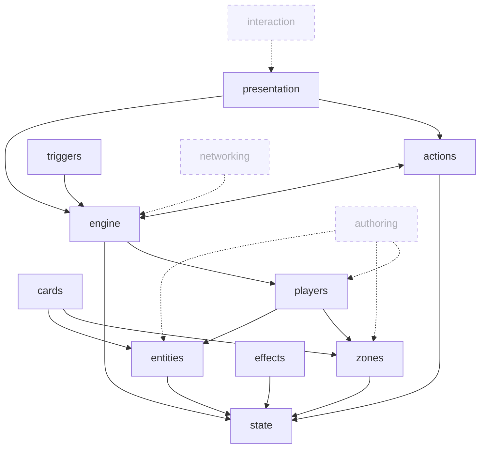

# Feature Map

Bird's-eye view of features in this project. Three layers: feature index table, mermaid dependency graph, model-level breakdown. Hand-maintained at v1; auto-generated at v2 (see `OPEN-ITEMS.md`, trigger ~15 Models).

Update cadence: when a Model lands, a Feature ships, or dependencies shift, OR when a candidate feature is promoted from `considered` to `draft`.

**Status legend.** Feature rows can carry one of these states:

- **`considered`** — capability identified, no folder yet. The row exists here so we don't forget; it's not yet a commitment.
- **`draft` / `settled` / `implemented` / `superseded` / `abandoned`** — same as the Feature root's `status` field once the folder exists. Mirrors the Feature root, doesn't replace it.

When a `considered` row is promoted, follow the §5.11 *Adding a new feature* ceremony and update this file in step 4 of that ceremony.

---

## Feature index

| Feature | Status | Models | Purpose |
|---|---|---|---|
| [`state`](features/state/state.md) | settled | 0 | Scaffold.State integration — `Store`, `BaseState`, `IStateScope`, `Mutator<TState, TPayload>`, four subscription channels, `ExecuteBatch` atomic semantics, slice-authoring conventions. The framework's state primitive. Feature-root only. |
| [`entities`](features/entities/entities.md) | settled | 1 | Definition / Instance / Identifier model. Foundation for every runtime object. |
| [`zones`](features/zones/zones.md) | settled | 1 | Zone organization, membership, movement. Where instances live. |
| [`cards`](features/cards/cards.md) | settled | 1 | `Card` handle on top of the entity bridge with privacy-rotating `CardRef`. |
| [`actions`](features/actions/actions.md) | settled | 2 | Command pipeline (intent → command → handler → state) + availability snapshot. |
| [`triggers`](features/triggers/triggers.md) | settled | 1 | `OnBefore<T>` / `OnAfter<T>` reaction fold around command handlers. |
| [`effects`](features/effects/effects.md) | settled | 4 | Async orchestration of action sequences. Replacement / prevention. Ongoing effects. Effect-flow contract (services, decision threading, mutation discipline). |
| [`engine`](features/engine/engine.md) | settled | 7 | `GameEngine` class, `GameRulesDefinition`/`GameRulesRuntime<T>` contract, snapshot production, framework slice tier conventions, game factory, match lifecycle system, `GameDefinition` bundle + `ISliceProvider` mechanism. The simulation core. |
| [`players`](features/players/players.md) | settled | 1 | `Player : EntityInstance<PlayerDefinition>, IActor`, `IActor` interface, `PlayerDefinition` shape, per-player slice conventions. |
| [`presentation`](features/presentation/presentation.md) | settled | 1 | Reactive presentation loop reading state + history. |
| `authoring` | **considered** | — | Card catalog, card schema, keyword system, effect definitions, interaction definitions. The authoring layer per ARCHITECTURE. |
| `interaction` | **considered** | — | Input gesture → `PlayerIntent` translation. Drag/drop/click/target. The interaction layer per ARCHITECTURE. |
| `networking` | **considered** | — | Command/history transport, visibility filter, deterministic RNG, versioned definitions, snapshots for join/reconnect. The networking layer per ARCHITECTURE; post-v1. |

**Sub-system reminders** (not separate features, tracked here so they don't get lost):

- *Richer schedulers* (stack+priority, turn/phase machine, real-time tick) — `engine` currently runs immediate queue drain. Other modes are deferred extensions inside `engine`. See ARCHITECTURE §"Effect Resolution Direction."
- *Visibility / Reveal* — cross-concern of `engine` (membership/detail visibility on zones) and `presentation` (rendering filter). Will land as Models inside those features when work begins.
- *Determinism / RNG* — sub-concern of `engine`; folded into `networking` for the seeded/recorded random source.
- *State-Based Checks* — handled inside `engine` evaluation loop. Game-specific extensions (e.g. MTG-strict ordering) are folded into `features/engine/models/02-gamerules-contract.md` provenance (Q3) per the §4.5 ADR migration recipe.

## Dependency graph

**Cycle observation:** `actions ↔ engine` is bidirectional because `actions/02-availability-snapshot` builds on `engine/03-snapshot-pipeline`, while `engine/03-snapshot-pipeline` builds on `actions/02-availability-snapshot`. This is by design — the availability snapshot is produced by the engine *and* consumed by the action pipeline as part of validation. Worth a future Model to document the contract that closes the loop, but not currently flagged as drift.

Solid arrows = current `references` edges between settled features. Dashed arrows = expected dependency direction once the considered feature lands.

## Model-level breakdown

### `state` (settled)
No models. Feature-root only — `state.md` documents the Scaffold.State integration directly. A model would be added if a framework-specific extension to Scaffold.State emerges.

### `entities` (settled)
- [`models/01-definition-instance-model.md`](features/entities/models/01-definition-instance-model.md) — settled, references: `root`

### `zones` (settled)
- [`models/01-zone-model.md`](features/zones/models/01-zone-model.md) — settled, references: `root`

### `cards` (settled)
- [`models/01-card-model.md`](features/cards/models/01-card-model.md) — settled, references: `entities/01`, `entities/02`, `zones/01`

### `actions` (settled)
- [`models/01-command-pipeline.md`](features/actions/models/01-command-pipeline.md) — settled, references: `root`
- [`models/02-availability-snapshot.md`](features/actions/models/05-available-actions-snapshot.md) — settled, references: `actions/01`, `engine/03` ⚠️ (see cycle)

### `triggers` (settled)
- [`models/01-trigger-fold.md`](features/triggers/models/01-trigger-fold.md) — settled, references: `engine/01`

### `effects` (settled)
- [`models/01-async-dispatch.md`](features/effects/models/01-async-dispatch.md) — settled, references: `root`
- [`models/02-replacement-prevention.md`](features/effects/models/02-replacement-prevention.md) — settled, references: `effects/01`
- [`models/03-ongoing-effects.md`](features/effects/models/03-ongoing-effects.md) — settled, references: `effects/01`
- [`models/04-effect-flow.md`](features/effects/models/04-effect-flow.md) — settled, references: `effects/01`, `engine/03`

### `engine` (settled)
- [`models/01-evaluation-loop.md`](features/engine/models/01-evaluation-loop.md) — *Game Engine* — settled, references: `engine/02`, `engine/06`, `actions/01`, `state`
- [`models/02-gamerules-contract.md`](features/engine/models/02-gamerules-contract.md) — settled, references: `engine/01`, `engine/05`
- [`models/03-snapshot-pipeline.md`](features/engine/models/03-snapshot-pipeline.md) — *Snapshot Production* — settled, references: `engine/02`, `actions/02` ⚠️ (see cycle), `state`
- [`models/04-gamestate-slices.md`](features/engine/models/04-gamestate-slices.md) — *Framework Slice Tier* — settled, references: `state`, `engine/05`, `engine/07`
- [`models/05-game-factory.md`](features/engine/models/05-game-factory.md) — settled, references: `engine/01`, `engine/02`, `engine/04`, `engine/07`, `engine.md`
- [`models/06-match-lifecycle.md`](features/engine/models/06-match-lifecycle.md) — settled, references: `engine/01`, `engine/02`, `engine/05`
- [`models/07-game-definition.md`](features/engine/models/07-game-definition.md) — settled, references: `engine/05`, `engine/04`, `engine/02`, `zones/01`, `cards/01`, `players/01`, `entities/01`

### `players` (settled)
- [`models/01-player-model.md`](features/players/models/01-player-model.md) — settled, references: `entities/01`, `entities/02`, `engine/05`, `engine/07`, `zones/01`, `decisions/0005`

### `presentation` (settled)
- [`models/01-presentation-loop.md`](features/presentation/models/01-presentation-loop.md) — settled, references: `actions/02`, `engine/03`

### `authoring` (considered)
No models yet. Promote when authoring tooling becomes the active thread (likely after first feature reaches `implemented`).

### `interaction` (considered)
No models yet. Promote when the input → PlayerIntent surface needs canonical design (likely after `presentation` reaches `implemented`).

### `networking` (considered)
No models yet. Promote post-v1 when multiplayer or save/load becomes a real concern. Folds in: visibility filter, command envelope, transport adapter, snapshot, deterministic RNG, versioned definitions.
