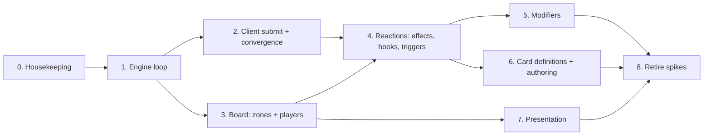

# Framework Roadmap

The one place that puts the remaining framework work in order. It replaces [`wire-refoundation-roadmap.md`](archive/wire-refoundation-roadmap.md) (2026-05-18). That roadmap's steps 1–5 are done. Its steps 6 (engine reassembly with hooks) and 7 (views) continue here as phases 1, 4 and 7.

For how the current code works, read [`docs/architecture.md`](../../docs/architecture.md).

> **Status of this plan: proposed.** The order below comes from the deferred items in the existing spikes and from what the code is missing. Review the order before you start phase 1. Update the **Status** column when a phase starts or lands.

## Where we are

Done on `main` (last code 2026-06-05): Core, Wire, Tags, Entities, Requests, States, Commands (validate + handle), Engine, Bootstrap (`GameplayLayer` + installers), Multiplayer lobby, acceptance suite phases 1–2.

The older [`VerticalSlice`](../../Assets/Spike/ECS/VerticalSlice/) spike has a complete game loop (effects, hooks, Deathrattle, zones, players). The framework does not have these parts yet. Use the slice as the reference when you design them. Delete it in phase 8.

## Sequence

| # | Phase | Status | Needs |
|---|---|---|---|
| 0 | Housekeeping | in progress | — |
| 1 | Engine loop | not started | 0 |
| 2 | Client submit + convergence | not started | 1 |
| 3 | Board: zones + players | not started | 1 |
| 4 | Reactions: effects, hooks, triggers | not started | 2, 3 |
| 5 | Modifiers | not started | 4 |
| 6 | Card definitions + authoring | not started | 4 |
| 7 | Presentation | not started | 3 (can run in parallel with 4–6) |
| 8 | Retire spikes | not started | 5, 6, 7 |

## Phases

### 0. Housekeeping

**Goal.** Make `main`, the docs and the tools match the code before new work starts.

- ✅ Merge PR #182 (test suite consolidation, `docs/testing.md`) and PR #183 (Unity 6000.6.6f1). Merged 2026-10-18; EditMode 364/364 on 6000.6.6f1.
- ✅ Close or move the stale PRs (#18, #19, #101, #148, #156, #159). Closed 2026-10-18, branches kept.
- ✅ Refresh `Product/SESSION-CHECKPOINT.md` (it stops at 2026-05-31).
- Mark the old-model docs superseded: `Product/features/**`, ADR-0009 to 0013 where the state model changed, the `MatchStateSlice` glossary entries. Write ADR-0014 for the service-first state model (deferred since step 5b). ✅ Done: [ADR-0014](../decisions/0014-service-first-state-model.md), feature docs archived, glossary replaced. Still open: sweep `ledgers/OPEN-ITEMS.md` and `general/ARCHITECTURE.md`.
- ✅ Rename `CommandLayer` / `StateLayer` / `RequestLayer` to the `*Installer` names in the spikes that still use them.
- Optional: CI that runs EditMode tests on each PR; `.editorconfig`; warnings as errors.

**Done when.** The checkpoint, glossary and spike docs name only types that exist in code.

### 1. Engine loop

**Goal.** Replace the synchronous `CommandService.Execute` with the pipeline that the architecture invariant names: `Enqueue`.

- A queue and a pump that runs one item at a time. Reactions (phase 4) schedule into this queue.
- Async commands: a command can `await` a `Request` in the middle of its run.
- Block nesting: `BlockScope` keeps a stack, so inner blocks get a real `ParentId`.
- Decide ids vs live `Entity` refs on queued commands.
- System-gate validation (is this command legal in the current state?) moves into the loop.

**Inputs.** `command-service.md` § Deferred items (rows: evaluate-loop, block nesting, live-ref vs id, validation model).
**Done when.** Acceptance scenarios run through `Enqueue`. A command that awaits a request passes a test. Nested blocks have correct `ParentId`.

### 2. Client submit + convergence

**Goal.** Clients send intents. Server and client end with the same state.

- **L+1 `Submit`:** how an intent serializes, how the server receives and validates it. Needs its own spike (like `request-service.md`).
- The response half of `Request`: the client's `Response` travels to the server and completes the task.
- **L+2 convergence:** a test that server and client stores are equal after a match script. Start with `LoopbackTransport.Pair()` in EditMode.
- Connect Multiplayer to gameplay: an installer that uses `NgoTransport`, and peers mapped to player entities.

**Inputs.** `acceptance-test-suite.md` § Deferred ladder (L+1, L+2), `request-service.md`, `multiplayer-architecture.md`.
**Done when.** A two-sided test plays a command from client submit to equal stores on both sides.

### 3. Board: zones + players

**Goal.** The data model that card games need: who owns what, and where each card is.

- Zone store: ordered membership (deck, hand, battlefield, graveyard), move events, apply handlers.
- Player entities linked to the Multiplayer `Peer` / `PlayerContext`.
- Ownership and controller tags.

**Inputs.** `VerticalSlice` zones and players (reference code), `features/zones/archive/zones.md` and `features/players/archive/` (old model — read for the questions, not the contract). Write a new spike for the zone store.
**Done when.** A `MoveCard` command moves a card between zones on server and client, covered by an acceptance scenario.

### 4. Reactions: effects, hooks, triggers

**Goal.** Card abilities. This is the largest missing part.

- Effects that compose commands and run inside an `Effect` block.
- Hooks: Before / After / Replacement on commands.
- Triggers (for example Deathrattle on a zone change) that schedule into the engine loop.
- State-based actions (SBA) checked by the loop.
- **L+3:** tests that a reaction fires exactly once.

**Inputs.** `VerticalSlice` (hooks, `EffectStore`, Deathrattle), `hook-config-design.md` (deferred, old model), `archive/effect-pipeline.md`, OPEN-ITEMS `oq-effect-authoring`. Write a new spike for the Store / Service / Handler shape of reactions first.
**Done when.** The VerticalSlice Deathrattle scenario passes as an acceptance test on the framework.

### 5. Modifiers

**Goal.** Temporary and permanent stat changes as entities.

**Inputs.** `modifiers-as-entities.md` (design locked 2026-05-18, sandbox not built).
**Done when.** A modifier changes a stat, expires, and the change reaches the client.

### 6. Card definitions + authoring

**Goal.** Designers describe cards as data, not C#.

- Concrete definitions in `Catalog<TDef>`; a card instance points to its definition.
- The effect authoring vocabulary (primitives, graphs, or code).
- Decide whether `com.scaffold.graphflow` is the authoring tool. It is a candidate: a graph editor, baked to runtime nodes.

**Inputs.** OPEN-ITEMS `bl-authoring-feature`, `oq-effect-authoring`; `Packages/com.scaffold.graphflow/FOLLOW-UPS.md`.
**Done when.** One card with an effect is defined without new C# code.

### 7. Presentation

**Goal.** Views that show the client stores and send intents.

**Inputs.** `card-presentation.md` and the `CardPresentation` spike. ADR-0012 (per-state view-models) needs a review first, because it depends on the old `MatchStateSlice`.
**Done when.** A scene shows a hand and a battlefield from client stores, and a drag sends a `Submit`.

### 8. Retire spikes

Delete `Assets/Spike/ECS/VerticalSlice`, `StateMachine`, `CardPresentation`, `Modifiers` and `TagAuthoringPrototype` when their parts exist in `Assets/Framework/`. Follow `docs/feature-layout.md` § Spike → Framework promotion.

## Not scheduled

- **Rollback / undo** — `WireEventHandler.Unapply` throws. Needed for scrub or replay tools.
- **Block payload + source capture** — command type and source on `BlockStart`, for replay readability.
- **`WireRegistrar` replacement** — channel ids come from reflection and the class is marked temporary.
- **Save / load mid-effect** — not supported by design (ADR-0011).
