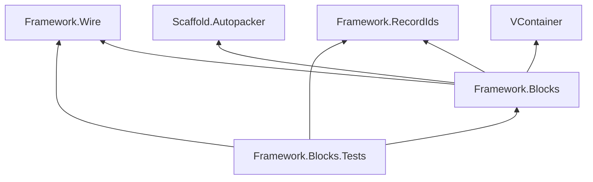

# Shared infrastructure — events and blocks

> **Status: proposed.** One of the shared pipeline infrastructure pieces (pipeline, router, record
> ids, kind ids, events and blocks). This piece owns the event model: the shape of a wire event,
> how to write, listen and react, how to add an event type, blocks and groups. No code changes yet.

## 1. Summary

The server writes game blocks into one ordered stream. A **block** is one line of the game log. A
**group** is a pair of blocks (`GroupStart`, `GroupEnd`) that brackets other blocks, and groups nest.
The stream is the source of truth: no store keeps group state.

1. **Two layers.** `WireEvent` (Framework.Wire) is the transport base: pack, send, stream, handlers. `Block : WireEvent` (Framework.Blocks) is the game-log base. Lobby and membership events stay plain `WireEvent`.
2. **Block id = position.** `BlockId` is the position of the block in the stream. `BlockPositions` sets `Block.Position` on both sides. No allocator and no id on the wire.
3. **Block types.** A group is 2 blocks. A change (tag, entity, state) is 1 block. A request and its response are 2 independent blocks (later).
4. **Links.** Parent comes from nesting and is not on the wire. `TriggerId` (on `GroupStart`) points to the block that caused the work. `SourceId` points to the entity that did the work. `GroupEnd.StartId` points to the `GroupStart` that it closes.
5. **Write.** Only server services call `IEventEmitter.Emit`. The client never emits game blocks.
6. **Groups.** `GroupService.Open` / `Close` are public. `Create` is the helper: open, run the logic, close. A group that opens while another group is open is nested. `Close` throws if a child group is open. A group has no kind.
7. **Build first.** The plan (§8) builds `Framework.Blocks` in its own folder and changes no current system. The migration of current callers is one later item (§10).

### Decisions

User decisions, 2026-10-31 (all infrastructure pieces):

1. ~~Ids are typed `readonly struct`s around `int`.~~ Replaced by decision 27. `Id`, `EntityId` and `IEntity` are in `Framework.RecordIds` (decision 34).
2. Shared infrastructure (allocator, `RecordStore`) is in `Framework.Core`. The routers are in `Framework.Routing` (decision 33). `Framework.Wire` references `Framework.Core`.
3. The `Framework.Blocks` feature is accepted.
4. The async core uses `System.Threading.Tasks.Task`, not UniTask.
5. The parent comes from bracket order. It is not on the wire.
6. An intent opens no group. No `Intent` kind and no reserved slot.
7. Hooks exist only at the command level.

User decisions, 2026-11-01 (this piece):

8. **Scope.** This piece owns the event model. Page name: "Events & Blocks".
9. **Nesting.** A group can open inside another group. A group cannot close while a child group is open.
10. **API.** `Open` and `Close` are public. `Create` is the helper. No `BlockHeader` type.
11. **React** is split. This piece defines what an observer gets. The pipeline piece owns the scheduling.
12. **Lobby events** are out. They stay plain `WireEvent` on their own network channels.
13. **Names.** The base class of a game-log line is `Block` (from the Hearthstone block protocol). The bracket pair is a `Group`. "Entry" and "Event" are too generic.
14. **`Block : WireEvent`.** `WireEvent` stays the transport base, because other wire events are not part of the block protocol.
15. **Links.** `Cause` is renamed `Trigger`. Parent, trigger and source are 3 separate values. Parent is derived from nesting. Trigger and parent can agree; both stay.
16. **Block id.** `BlockId` is the position of the block in the stream. A group id is the id of its `GroupStart`.
17. **Groups or not.** The system or the element type decides if work opens a group. Reactions that write more than one block use a group.
18. **Timing.** Nesting follows timing, and the pipeline decides the timing. Default for now: reactions run at the end of the trigger group, before its `Close`.
19. **Requests.** A request is not a group and does not follow the close rule. A response can come after the asking group closes.

User decisions, 2026-11-01 (open questions):

20. **`RequestId` goes away.** A request is a block, so its id is its `BlockId`.
21. **Blocks references.** `Block` stays in `Framework.Blocks`. Tags, Entities, States and Requests reference Blocks (in the migration).
22. **Root blocks** are permitted. The engine does not open a `Match` group.
23. **No group kind.** No runtime code reads the kind today. The `Command` / `Effect` kind and the kind registry are removed.
24. **Error path.** If the logic throws, `Create` closes the open child groups as `Errored`, then the parent, and then rethrows the original error.
25. **Deferred:** hidden information, "what ran" for presentation, and the response queue (§10).
26. **Response rule.** A response is always a root block.

Pipeline v0 has no groups and no hooks (Pipeline decision, 2026-11-01). Reaction timing (decision 18) goes to the hooks and reactions discussion. The split at `Ask` waits until groups come into the Pipeline.

User decisions, 2026-11-02:

27. **Record-class ids** (Record Ids). `public sealed record BlockId : Id;` in `Framework.Blocks`. "No id" is `null` in code and `-1` on the wire. There is no `BlockId.None`. API defaults are `= null`. `0` still means "never set".
28. **Author APIs take records** (Record Ids decision 20). `Open` and `Create` take `IEntity source`. `GroupStart.SourceId` stays an `EntityId` on the wire.
29. **No group store.** The stream is the source of truth. `GroupService` keeps the open-group stack as private state (server only). A reader that needs the parent, the depth or the outcome reads the stream.
30. **`GroupEnd` links to its start.** `GroupEnd { StartId, Outcome }`. `StartId` is the `BlockId` of the `GroupStart` that it closes. The trigger and the source are not copied: a reader uses `stream[StartId]`.
31. **Two group types.** `GroupStart` and `GroupEnd` stay separate types. No flag and no shared base: dispatch uses the exact type, so a base handler does not run.
32. **Extraction plan** (catalog rule). The plan builds `Framework.Blocks` in `Assets/Blocks/` and changes no current system. Thus `Position` lives on `Block`, not on `WireEvent`. The two listen stages, requests as blocks and the change-block base move to the migration (§10).
33. **Routers** live in `Framework.Routing` (TypeRouter decision D14). Ids live in `Framework.RecordIds` (decision 34).
34. **Record Ids assembly** (Record Ids, 2026-11-02). `Id`, `EntityId` and `IEntity` live in `Framework.RecordIds` (`Assets/RecordIds/`). `Framework.Blocks` references it, not `Framework.Core`.
35. **One install method** (catalog rule). `builder.AddBlocks(o => ...)` with `BlocksOptions` is the only setup call. It registers every part and holds all configuration. The caller only registers the current Wire. No `Framework.Bootstrap.IInstaller`; a Bootstrap adapter is later.

## 2. Scope

| Concern | In / out | Owner if out |
|---|---|---|
| `Block` base, block types | in | — |
| Write a block (`Emit`) | in | — |
| Listen: apply stage, observe stage, order | in (later: changes Wire) | — |
| Add a new block type | in | — |
| Groups: `Open` / `Close` / `Create`, nesting rule | in | — |
| Links: parent, `TriggerId`, `SourceId`, `StartId` | in | — |
| Request and response as blocks | in (later): shape and links | request store: `Framework.Requests` |
| React to a block | in: observer contract only | scheduling, timing, hooks: [Pipeline](https://claude.ai/artifact/74vPp64abx63ubpagvdpAg) |
| Find handlers by type | out | [TypeRouter](https://claude.ai/artifact/XuUm6w84yt5zw4BHMfz9u4) (`Framework.Routing`) |
| Id record shape, `RecordStore` base | out | [Record Ids](https://claude.ai/artifact/66MvZgwWo8hSEeKJ6KMDms) |
| Undo, replay cursor | out | [Record Ids](https://claude.ai/artifact/66MvZgwWo8hSEeKJ6KMDms) |
| `WireEvent` transport, packing, channels | out | `Framework.Wire` network (no change) |
| Lobby and membership events | out | `Framework.Multiplayer` |
| Hidden information | out (deferred) | not designed |
| "What ran" for presentation | out (deferred) | a handler for that type, later |

**Boundary.** The piece receives blocks from server services (tags, entities, states, requests,
pipeline). It gives an ordered, well-nested stream to stores, client tools and the network. It
gives the "react" contract to the pipeline, which schedules the work.

## 3. Today

| # | Use | What it does | Location |
|---|---|---|---|
| 1 | Services emit | Each service calls `IEventEmitter.Emit` with its own event. | `Tags/Runtime/TagService.cs:28,38,50`; `Entities/Runtime/EntityService.cs:20`; `States/Runtime/StateService.cs:15`; `Requests/Runtime/RequestService.cs:24` |
| 2 | Apply handlers | `HandlerRegistry` subscribes to `OnAppended` and calls `Apply` for each handler of the exact type. `Unapply` throws. | `Wire/Runtime/Stream/HandlerRegistry.cs:19,22-26`; `WireEventHandler.cs:11` |
| 3 | Raw listeners | `WireForwarder` and tests subscribe to `EventStream.OnAppended`. Order against handlers is the subscribe order. | `Wire/Runtime/WireForwarder.cs:6`; `Commands/Tests/CommandServiceTests.cs:22` |
| 4 | Client input | `NetworkInboundBridge` emits received events into the client stream. | `Wire/Runtime/NetworkInboundBridge.cs:6` |
| 5 | One base for all | Game events and lobby events derive from the empty `WireEvent`. | `Wire/Runtime/WireEvent.cs:6`; `Multiplayer/Runtime/Lobby/*Event.cs` |
| 6 | New type recipe | Event class, handler, `RegisterHandler<T>()` in an installer. `WireRegistrar` finds the type. | `Bootstrap/Runtime/HandlerRegistrationExtensions.cs:10-12`; `TagInstaller.cs:18-20` |
| 7 | Flat bracket | `BlockScope.Open` / `Close`. One counter. `ParentId` is always 0. `BlockEndEvent.Id` names the start. | `Wire/Runtime/Events/BlockScope.cs:7-20` |
| 8 | Framework bracket user | `CommandService.Execute`: open, try, catch → `Errored`, close. | `Commands/Runtime/CommandService.cs:28-38` |
| 9 | Bracket events | Packed. `Kind` is a `byte`. Closed `BlockKind` enum with `Trigger`. | `Wire/Runtime/Events/BlockStartEvent.cs:5-11`, `BlockEndEvent.cs:5-9`, `BlockKind.cs:3-9` |
| 10 | Request links | `Request` has its own `Id` and `ParentId`. `Response.RequestId` links back. | `Requests/Runtime/Request.cs:8-9`; `Response.cs:8` |
| 11 | VS nested bracket | Block stack + `parentOverride` for deferred work. | `Spike/ECS/VerticalSlice/Engine/Pipeline/World.cs:45-54` |
| 12 | VS bracket copies | The same open, try, finally, close body three times. | VS `CommandService.cs:59-84`, `EffectService.cs:92-111`, `RequestsService.cs:43-56` |
| 13 | VS deferred cause | After hooks capture `CurrentBlockId` into `StackFrame.ParentBlockId`. | VS `CommandService.cs:95,101`; `StackFrame.cs:30`; `Stack.cs:93` |
| 14 | VS source capture | Reflection: property named `Source`, all public properties into a dictionary. | VS `PayloadCapture.cs:16,37-45` |
| 15 | VS readers | `MirrorWorld` skips brackets. The log view indents with a stack and scans to match an end to its start. | VS `Mirror/MirrorWorld.cs:60`; `Unity/SliceBootstrap.cs:385-430` |

Paths in rows 1–10 start at `Assets/` (the flat layout on `main`).

### What repeats

| Common part | Seen in | Varies between uses |
|---|---|---|
| Emit one event | #1, #7 | event type |
| Listen to the stream | #2, #3 | path: handler, raw hook |
| Open, run, close a bracket | #8, #12 | kind, parent rule, payload |
| Parent of an event | #7, #10, #11 | always 0, own field, override |
| Id of a line | #7, #10, #11 | own counter in each feature |
| Read the source | #7, #14 | `int` argument, reflection |

## 4. Proposal

### 4.1 API

| Audience | Entry point | Does |
|---|---|---|
| author | `GroupService.Open` / `Close` / `Create` / `CreateAsync` | Brackets work in a group (server) |
| author | `IEventEmitter.Emit(block)` | Writes one block (server services only) |
| author | `sealed partial class XBlock : Block` | Adds a block type |
| author | `ISourced` | A message gives its source entity |
| composition | `builder.AddBlocks(o => o.Server = true)` | Registers every part; the only setup call |
| runtime | `EventStream[i]`, `Block.Id` | Reads the log; no group store |

Shape:

```csharp
// Framework.Blocks
public sealed record BlockId : Id;                       // null = no block; -1 on the wire

public abstract partial class Block : WireEvent
{
    public int     Position { get; internal set; }       // set by BlockPositions; not packed; 0 = never set
    public BlockId Id => new BlockId { Value = Position };
}

public sealed class BlockPositions                       // both sides
{
    public BlockPositions(EventStream stream);
}

public sealed class GroupService                         // server only
{
    public GroupService(IEventEmitter events);           // BlockPositions subscribes first on the same stream
    public BlockId Current { get; }                      // null when no group is open
    public BlockId Open(IEntity source = null, BlockId trigger = null);
    public void    Close(BlockId id, GroupOutcome outcome = GroupOutcome.Completed); // throws if a child is open
    public void    Create(IEntity source, Action logic, BlockId trigger = null);
    public T       Create<T>(IEntity source, Func<T> logic, BlockId trigger = null);
    public Task    CreateAsync(IEntity source, Func<Task> logic, BlockId trigger = null);
    public Task<T> CreateAsync<T>(IEntity source, Func<Task<T>> logic, BlockId trigger = null);
}

public interface ISourced { IEntity Source { get; } }
```

Call site (an effect, after the pipeline port):

```csharp
groups.Create(effect.Source, () =>
{
    tags.Set(target, Health, hp - damage);       // TagChange block: inside the effect group
}, trigger: damageBlock.Id);
```

Install:

```csharp
public sealed class BlocksOptions { public bool Server { get; set; } }   // true: also GroupService

public static IContainerBuilder AddBlocks(this IContainerBuilder builder, Action<BlocksOptions> configure = null);

// caller: registers the current Wire (read only), then one call
builder.Register<EventStream>(Lifetime.Singleton).AsSelf().As<IEventEmitter>();
builder.AddBlocks(o => o.Server = isServer);
```

`AddBlocks` in `Runtime/BlocksInstall.cs` registers `BlockPositions` (both roles, resolved at build)
and `GroupService` (server only). The caller registers nothing else. It does not use
`Framework.Bootstrap.IInstaller`; a Bootstrap adapter is later (§10).

Dependencies:

| Depends on | Why |
|---|---|
| `Framework.Wire` | `WireEvent`, `IEventEmitter`, `EventStream` |
| `Framework.RecordIds` | `Id`, `EntityId`, `IEntity` (Record Ids) |
| `Scaffold.Autopacker` | `[Packed]` fields; a null record id packs as `-1` |
| `VContainer` | `AddBlocks` |

asmdef references: `Framework.RecordIds`, `Framework.Wire`, `Scaffold.Autopacker`, `VContainer` (`noEngineReferences: true`). Must not depend on
`Framework.Blocks`: `Framework.Core`, `Framework.RecordIds`, `Framework.Wire`, `Framework.Routing`.

Rules:

| Rule | Enforced by |
|---|---|
| A group closes only when it is the innermost open group | runtime: `GroupService.Close` throws `InvalidOperationException` |
| Each `GroupEnd.StartId` is the innermost open `GroupStart` | test: `GroupNestingTests` walks the stream (rule BLK-03, later in the rulebook) |
| Blocks references only RecordIds, Wire, AutoPacker and VContainer | rulebook ARCH-02 row, asmdef check in the gate |
| Only Blocks sets `Block.Position` | compiler: `internal set` |
| Only `GroupService` constructs `GroupStart` or `GroupEnd` | rulebook BLK-01, `il.callersOnly` (later) |
| Game-log types derive from `Block` | rulebook BLK-05, IL base-type check (later) |
| Apply handlers and observers do not emit | rulebook EVT-01, `il.forbiddenCalls` (later) |

### 4.2 Block model

```
stream (one ordered list of blocks)

#1  GroupStart  source: Goblin       (play card)
#2    TagChange  player Mana 5 → 3
#3    CardMove   Goblin hand → board
#4  GroupEnd    start: #1  Completed
#5  GroupStart  source: Knight       (attack)
#6    TagChange  Goblin Health 2 → 0
#7    TagChange  Knight Health 4 → 3
#8    GroupStart  source: Goblin     (death)  trigger: #6
#9      TagSet     Goblin Dead = true
#10     CardMove   Goblin board → graveyard
#11   GroupEnd    start: #8  Completed
#12 GroupEnd    start: #5  Completed
```

The number is the `BlockId`. The text in parentheses is a comment, not a field. Group `#8` has parent `#5` (from nesting), trigger `#6` and source Goblin.

Block types:

| Type | Blocks | Links | Close rule |
|---|---|---|---|
| Group | `GroupStart` + `GroupEnd` | `TriggerId`, `SourceId` on start; `StartId` on end | inner groups close first |
| Change | 1 (`TagSet`, `TagChange`, `EntityCreated`, …) | none | — |
| Request (later) | `Request` + `Response` | `Response.TriggerId` = the request | none: any order |

Rules:

1. A block belongs to the innermost open group. The block holds no parent field.
2. A block with no open group is a root block (for example match setup). A response is always a root block.
3. A group contains blocks and other groups.
4. A group cannot close while a child group is open.
5. Only `GroupStart` and `Response` hold `TriggerId`. Only `GroupEnd` holds `StartId`. Change blocks hold no link fields.
6. Apply handlers and observers do not emit. A reaction schedules work in the pipeline.

When a group is needed: the system or the element type decides. A command or an effect opens a
group. A reaction that writes more than one block opens a group. One change inside a running group
does not open a group.

Dispatch order for one block (today's `EventStream`, no change):

```
Emit(block) → EventStream: append
  → OnAppended subscribers, in subscribe order:
      WireForwarder → Network.Send (server only)
      BlockPositions → block.Position = stream.Count
      HandlerRegistry.Dispatch → apply handlers of the exact type (later: WireEventDispatcher)
```

New block type, one recipe:

1. Add `public sealed partial class XBlock : Block` (ROUTE-03) with `[Packed]` fields in the feature `Runtime/Blocks/`.
2. Add `XHandler : WireEventHandler<XBlock>` if the block changes a store.
3. Add `builder.RegisterHandler<XHandler>()` in the feature installer (both roles).
4. Emit the block from the feature service. `WireRegistrar` finds the type.

### 4.3 Wire shape and ids

```csharp
namespace Framework.Blocks
{
    public sealed partial class GroupStart : Block
    {
        [Packed] public BlockId  TriggerId;  // null = no trigger
        [Packed] public EntityId SourceId;   // null = no source
    }

    public sealed partial class GroupEnd : Block
    {
        [Packed] public BlockId StartId;     // the GroupStart that this block closes
        [Packed] public byte    Outcome;
    }

    public enum GroupOutcome : byte { None = 0, Completed = 1, Errored = 2, Cancelled = 3, Waiting = 4 }
}
```

`BlockId` is the position of the block in the stream. `BlockPositions` subscribes to
`EventStream.OnAppended` on both sides and sets `Position = stream.Count`. Positions start at `1`.
`null` means "no block" and packs as `-1`. `0` means "never set" (a bug). No id field is on the
wire, and no allocator exists.

```csharp
public BlockPositions(EventStream stream)
    => stream.OnAppended += ev => { if (ev is Block b) b.Position = stream.Count; };
```

**Requirements:**

- The server and the client append the same events in the same order. Lobby events stay off the game stream. If a block is ever filtered for one client, the positions differ (§10).
- `BlockPositions` subscribes first on the stream. `AddBlocks` resolves it at build. A listener that subscribed earlier reads `Position = 0`. The migration moves the line into `EventStream` (§10).

The record fields need the AutoPacker pin from Record Ids step 0 (`8b27bacf`, Scaffold PR 63).

### 4.4 No kind

`GroupStart` holds no kind. No runtime code reads the kind today: only tests assert it, and the VS
tools read the message name. A reaction is a group with a `TriggerId`.

If presentation must know what ran (Attack, Fireball), it adds a handler or an observer for that
type, as the tag listeners do (deferred, §10).

### 4.5 Source

A message implements `ISourced` explicitly. The pipeline passes
`message is ISourced s ? s.Source : null` to `Open`. No reflection. `Open` writes `source?.Id` into
`GroupStart.SourceId`.

### 4.6 Readers (both roles)

No store keeps group state. A reader reads the stream:

| Data | How |
|---|---|
| Trigger, source of a group | `stream[id.Value - 1]` is the `GroupStart` |
| Start of a group end | `GroupEnd.StartId` |
| Parent, depth | a walk with a stack, from the start of the stream |
| Outcome | the `GroupEnd` whose `StartId` is the group |

The VS log view already walks the stream with a stack (`SliceBootstrap.cs:385-430`). A shared read
helper waits until a second reader needs it (§10).

### 4.7 Service (server only)

```csharp
readonly Stack<BlockId> _open = new();

public BlockId Current => _open.Count > 0 ? _open.Peek() : null;

public BlockId Open(IEntity source = null, BlockId trigger = null)
{
    var start = new GroupStart { TriggerId = trigger, SourceId = source?.Id };
    _events.Emit(start);                           // BlockPositions sets start.Position
    _open.Push(start.Id);
    return start.Id;
}

public void Close(BlockId id, GroupOutcome outcome = GroupOutcome.Completed)
{
    if (!Equals(Current, id))
        throw new InvalidOperationException($"Group {id} has an open child group, or is not open.");
    _open.Pop();
    _events.Emit(new GroupEnd { StartId = id, Outcome = (byte)outcome });
}
```

```csharp
public void Create(IEntity source, Action logic, BlockId trigger = null)
{
    var id = Open(source, trigger);
    try   { logic(); }
    catch (OperationCanceledException) { CloseFrom(id, GroupOutcome.Cancelled); throw; }
    catch { CloseFrom(id, GroupOutcome.Errored); throw; }
    Close(id, GroupOutcome.Completed);
}

// Error path only: close the open child groups as Errored, then the group itself.
void CloseFrom(BlockId id, GroupOutcome outcome)
{
    while (!Equals(Current, id))
        _events.Emit(new GroupEnd { StartId = _open.Pop(), Outcome = (byte)GroupOutcome.Errored });
    _open.Pop();
    _events.Emit(new GroupEnd { StartId = id, Outcome = (byte)outcome });
}
```

The other `Create` overloads have the same body. The async ones `await` the logic.

A child group stays open on the error path only if the logic opened it with `Open` and threw before
its `Close`. `CloseFrom` keeps the stream well nested, and the caller sees the original error.

`Open` reads `start.Id` after `Emit`. **Requirement:** `Emit` appends and runs `OnAppended` before
it returns (true today).

### 4.8 Requests (later)

```
#1  GroupStart  source: Fireball     (play card)
#2    TagChange  player Mana 5 → 1
#3    Request    player A: choose target
#4  GroupEnd    start: #1  Waiting
#5  Response   target = Goblin          trigger: #3     root block
#6  GroupStart  source: Fireball     trigger: #5
#7    TagChange  Goblin Health 2 → 0
#8  GroupEnd    start: #6  Completed
```

1. The request is a block inside the asking group.
2. The asking group closes with `Waiting`. Other groups can run while the player answers.
3. The response is a root block. Responses to different requests can come in any order.
4. The work continues in a new group with `TriggerId` = the response.

The author still writes `await Ask(...)`. The pipeline closes the group at `Ask` and opens the new
group when the response arrives. If a group is open when the response arrives, the pipeline waits
until no group is open (rule 2). Pipeline v0 has no groups, so this is later (§10).

### 4.9 Decisions behind the contract

- **Two base classes.** `WireEvent` is transport. `Block` is meaning. Wire does not know blocks. Blocks uses Wire to carry its lines.
- **Position as id.** Every block already has a unique, ordered position on both sides. An allocator and an id field add bytes and a second source of truth.
- **No group store.** The stream already holds every group. A store copies it and can disagree with it. Only the server needs the open-group stack.
- **`StartId` on `GroupEnd`.** It replaces the scan back to the matching start with one lookup. Today's `BlockEndEvent.Id` does the same job.
- **Two group types.** Dispatch uses the exact type, so a shared base gives no handler benefit. A flag adds fields with no meaning on half the blocks.
- **Public `Open` / `Close`.** Authors can see and control the brackets. `Create` is the safe default: it maps the result of the logic to the outcome. Validation stays before `Open`, so a reject emits nothing.
- **Async.** `CreateAsync` keeps the group open across `await`. If two flows open groups at the same time, a close can find an open child and throw. Requests avoid this later: the group closes at `Ask`.
- **Parent, trigger, source.** Parent answers "where did it run", trigger "why", source "who". They often differ: in the example in §4.2, group `#8` has 3 different values.
- **No emit while dispatch runs.** An emit inside a handler starts a second dispatch before the first one ends. Later handlers of the first block then see the state after the second block.
- **No kind.** A kind field with no reader adds a registry and wire bytes. A field is easy to add later, because no saved data exists yet.
- **No payload.** Change blocks carry the truth.
- **Own feature.** Presentation can read groups without the pipeline.

## 5. Call-site migration (later)

The plan in §8 does not do these changes. They are one later item (§10). The catalog's cross-spike
order schedules them.

| Current code | New code | Change |
|---|---|---|
| `Framework.Wire.BlockScope` | `Framework.Blocks.GroupService` | Delete `BlockScope`. No allocator. |
| `BlockStartEvent`, `BlockEndEvent` | `GroupStart`, `GroupEnd` | Delete from Wire. `BlockEndEvent.Id` → `GroupEnd.StartId`. |
| `BlockKind` enum, `BlockOutcome` | removed; `GroupOutcome` (+ `Waiting`) | Tests stop asserting the kind. |
| `CommandService.Execute` open / try / catch / close | `_groups.Create(SourceOf(cmd), () => handler.Handle(cmd))` | Validation stays above it. |
| `CommandInstaller`: `Register<BlockScope>` | `builder.AddBlocks(o => o.Server = isServer)` through a Bootstrap adapter | `AddBlocks` registers every part. |
| `TagSetEvent<T>`, `TagChangeEvent<T>`, `EntityCreatedEvent`, `StatePushEvent`, … | Derive from `Block` | Base class change only. |
| `Request.Id`, `Request.ParentId`, `Response.RequestId` | `Request.Id` (position), `Response.TriggerId` | `RequestStore` keys on `BlockId`. |
| `BlockPositions` on `OnAppended` | `EventStream` sets `Position` on append | Removes the subscribe-order requirement. |
| `HandlerRegistry` (TypeRouter renames it `WireEventDispatcher`) | Two stages: apply, then observe | Add `WireEventObserver<T>`, `RegisterObserver<T>()`. |
| Tests on `OnAppended` | `RecordingObserver` in `Framework.Testing.Support` | `OnAppended` becomes `internal`. |
| `RoundTripTests` / `NgoTransportPlayTests` use bracket events | `PingEvent` / `PongEvent` | Wire tests stop using domain events. |
| VS `World.OpenBlock(parentOverride)` | `groups.Open(source, trigger: frame.TriggerId)` | Pattern for phase 4. |
| VS `EffectService.RunInline` | `groups.Create(effect.Source, () => effect.Run(scope))` | Pattern for phase 4. |
| VS `RequestsService.OpenRequestInternal` | No group. The request block is inside the asking group. | Pattern for phase 4. |
| VS `PayloadCapture` | `ISourced`; no payload on the wire | Dropped. |

## 6. What stays specialized

- **Validation** stays at the call site. A reject must emit nothing.
- **Scheduling and timing** stay in the pipeline. This piece gives `Current` and accepts `trigger`.
- **Lobby events** stay plain `WireEvent` on their own network channels.
- **`GroupOutcome`** stays a closed enum: a group completes, fails, is cancelled or waits.
- **The replay cursor** stays in Wire, owned by the record ids piece.
- **Presentation** reads the stream or registers its own handler for `GroupStart`. No new callback API.

## 7. Rulebook rules to propose

Only the ARCH-02 row for `Framework.Blocks` lands in the plan (§8 step 1). The other rules land with the migration (§10).

| Id | Rule | Check | Note |
|---|---|---|---|
| BLK-01 | Only `GroupService` constructs `GroupStart` or `GroupEnd`. | `il.callersOnly` | Needs a `type` parameter. |
| BLK-02 | `Framework.Wire` declares no `WireEvent` subtypes. | ARCH-09 `allowed: []` | Replaces the `Block*` exception. |
| BLK-03 | Groups are well nested: each `GroupEnd.StartId` is the innermost open group. | `attached` (test) | `GroupNestingTests` in the plan. |
| BLK-04 | A deferred reaction group carries its trigger block as `TriggerId`. | `attached` | Phase 4. |
| BLK-05 | Game-log types derive from `Block`, not directly from `WireEvent`. | `il` (base type) | Lobby and test fixtures excluded. |
| EVT-01 | `WireEventHandler<T>` and `WireEventObserver<T>` subclasses do not call `IEventEmitter.Emit`. | `il.forbiddenCalls` (new) | |
| EVT-02 | Only `Framework.Wire` and `Framework.Multiplayer` call `Network.Send`. | `il.callersOnly` | |

ARCH-02 row in the plan:

```json
"Framework.Blocks": ["Framework.RecordIds", "Framework.Wire"]
```

ARCH-02 rows in the migration (changed rows only):

```json
"Framework.Tags":      ["Framework.Core", "Framework.Wire", "Framework.Blocks"],
"Framework.Entities":  ["Framework.Core", "Framework.Tags", "Framework.Wire", "Framework.Blocks"],
"Framework.Requests":  ["Framework.Core", "Framework.Wire", "Framework.Blocks"],
"Framework.States":    ["Framework.Core", "Framework.Wire", "Framework.Blocks"],
"Framework.Commands":  ["Framework.Core", "Framework.Wire", "Framework.Blocks"],
"Framework.Engine":    [..., "Framework.Blocks"],
"Framework.Bootstrap": [..., "Framework.Blocks"]
```

## 8. Plan

Build only. Each step is one PR. The diff of each step stays in `Assets/Blocks/`, except the
ARCH-02 row in step 1.

Prerequisites:

| Needs | From |
|---|---|
| AutoPacker pin: `Packages/packages-lock.json` `15f5e5d2` → `8b27bacf` (Scaffold PR 63) | Record Ids, step 0 |
| `Id` base | Record Ids, step 1 (`Assets/RecordIds/`) |
| `EntityId`, `IEntity` | Record Ids, step 4 (`Assets/RecordIds/`) |
| VContainer in a `noEngineReferences` asmdef | TypeRouter checks it; use its solution |

### 8.1 Folder structure

```
Assets/Blocks/
├─ Runtime/                       Framework.Blocks.asmdef
│  ├─ BlockId.cs
│  ├─ Block.cs
│  ├─ BlockPositions.cs
│  ├─ ISourced.cs
│  ├─ BlocksOptions.cs
│  ├─ BlocksInstall.cs            AddBlocks
│  └─ Groups/
│     ├─ GroupStart.cs
│     ├─ GroupEnd.cs
│     ├─ GroupOutcome.cs
│     └─ GroupService.cs
└─ Tests/                         Framework.Blocks.Tests.asmdef
   ├─ BlockTests.cs
   ├─ BlockPositionsTests.cs
   ├─ GroupWireTests.cs
   ├─ GroupServiceTests.cs
   ├─ GroupNestingTests.cs
   ├─ BlocksInstallTests.cs
   └─ Fixtures/
      ├─ TestBlock.cs
      └─ TestEntity.cs
```

### 8.2 Dependency graph



### 8.3 Steps

Gate command for each step:

```powershell
powershell -NoProfile -File Tools/Rulebook/gate.ps1
```

**1 · Assembly, `Block`, `BlockId`, `BlockPositions`**

```json
// Runtime/Framework.Blocks.asmdef
{ "name": "Framework.Blocks", "rootNamespace": "Framework.Blocks",
  "references": ["Framework.RecordIds", "Framework.Wire", "Scaffold.Autopacker"],
  "noEngineReferences": true }

// Tests/Framework.Blocks.Tests.asmdef
{ "name": "Framework.Blocks.Tests",
  "references": ["Framework.Blocks", "Framework.Wire", "Framework.RecordIds",
                 "Scaffold.Autopacker", "Unity.Netcode.Runtime"],
  "optionalUnityReferences": ["TestAssemblies"], "includePlatforms": ["Editor"],
  "overrideReferences": true, "precompiledReferences": ["nunit.framework.dll", "AutoPackerContracts.dll"],
  "autoReferenced": false, "defineConstraints": ["UNITY_INCLUDE_TESTS"] }

// Tools/Rulebook/rulebook.json, ARCH-02 "allowed"
"Framework.Blocks": ["Framework.RecordIds", "Framework.Wire"]
```

```csharp
public sealed record BlockId : Id;

public abstract partial class Block : WireEvent
{
    public int     Position { get; internal set; }
    public BlockId Id => new BlockId { Value = Position };
}

public sealed class BlockPositions
{
    public BlockPositions(EventStream stream)
        => stream.OnAppended += ev => { if (ev is Block b) b.Position = stream.Count; };
}

public sealed partial class TestBlock : Block { }   // Tests/Fixtures
```

```csharp
[Test] public void Emit_SetsPositionAndId()
{
    var stream = new EventStream();
    _ = new BlockPositions(stream);                  // subscribes first on the stream
    var block = new TestBlock();
    Assert.AreEqual(0, block.Position);
    stream.Emit(block);
    Assert.AreEqual(new BlockId { Value = 1 }, block.Id);
}

[Test] public void Positions_MatchOnBothSides()
{
    var w = Wire.Connect();
    w.ServerNetwork.Register<TestBlock, TestBlock.Packed>();
    w.ClientNetwork.Register<TestBlock, TestBlock.Packed>();
    _ = new BlockPositions(w.ServerStream);
    _ = new BlockPositions(w.ClientStream);
    for (var i = 0; i < 3; i++) w.ServerStream.Emit(new TestBlock());
    Assert.AreEqual(3, ((Block)w.ServerStream[2]).Position);
    Assert.AreEqual(3, ((Block)w.ClientStream[2]).Position);
}
```

Done: gate PASS; `BlockTests` and `BlockPositionsTests` green; diff in `Assets/Blocks/` and
`Tools/Rulebook/rulebook.json` (ARCH-02 row only).

**2 · Group blocks**

```csharp
public sealed partial class GroupStart : Block
{
    [Packed] public BlockId  TriggerId;
    [Packed] public EntityId SourceId;
}
public sealed partial class GroupEnd : Block
{
    [Packed] public BlockId StartId;
    [Packed] public byte    Outcome;
}
public enum GroupOutcome : byte { None, Completed, Errored, Cancelled, Waiting }
```

```csharp
[Test] public void GroupStart_RoundTrips_NullTrigger()
{
    var w = Wire.Connect();
    w.ServerNetwork.Register<GroupStart, GroupStart.Packed>(); w.ClientNetwork.Register<GroupStart, GroupStart.Packed>();
    w.ServerNetwork.Register<GroupEnd, GroupEnd.Packed>();     w.ClientNetwork.Register<GroupEnd, GroupEnd.Packed>();
    w.ServerStream.Emit(new GroupStart { TriggerId = null, SourceId = new EntityId { Value = 7 } });
    var start = (GroupStart)w.ClientStream[0];
    Assert.IsNull(start.TriggerId);
    Assert.AreEqual(new EntityId { Value = 7 }, start.SourceId);
}
```

Done: gate PASS; `GroupWireTests` green (null trigger, set trigger, `StartId`); diff in `Assets/Blocks/` only.

**3 · `GroupService`**

```csharp
public GroupService(IEventEmitter events);   // BlockPositions subscribes first on the same stream
public BlockId Open(IEntity source = null, BlockId trigger = null);
public void    Close(BlockId id, GroupOutcome outcome = GroupOutcome.Completed);
public void    Create(IEntity source, Action logic, BlockId trigger = null);
public Task    CreateAsync(IEntity source, Func<Task> logic, BlockId trigger = null);
void           CloseFrom(BlockId id, GroupOutcome outcome);
```

| Test | Expects |
|---|---|
| nested `Create` | inner start after outer start |
| `GroupEnd.StartId` | the id that `Open` returned |
| throw | `Errored`; the original error |
| cancel | `Cancelled` |
| close with an open child | `InvalidOperationException` |
| throw with an open manual child | both `Errored` |
| `GroupNestingTests` | each `StartId` is on top of the walk stack |

Done: gate PASS; `GroupServiceTests` and `GroupNestingTests` green; diff in `Assets/Blocks/` only.

**4 · `ISourced`**

```csharp
public interface ISourced { IEntity Source { get; } }
```

```csharp
[Test] public void Open_WritesSourceId()
{
    groups.Open(new TestEntity(new EntityId { Value = 4 }));
    Assert.AreEqual(new EntityId { Value = 4 }, ((GroupStart)stream[0]).SourceId);
    groups.Open(null);
    Assert.IsNull(((GroupStart)stream[1]).SourceId);
}
```

Done: gate PASS; `GroupServiceTests` green; diff in `Assets/Blocks/` only.

**5 · Install: `AddBlocks`**

Add `"VContainer"` to the `references` of both asmdefs.

```csharp
public sealed class BlocksOptions { public bool Server { get; set; } }   // true: also GroupService

public static IContainerBuilder AddBlocks(this IContainerBuilder builder, Action<BlocksOptions> configure = null)
{
    var options = new BlocksOptions();
    configure?.Invoke(options);
    builder.Register<BlockPositions>(Lifetime.Singleton);
    builder.RegisterBuildCallback(c => c.Resolve<BlockPositions>());   // subscribes at build
    if (options.Server) builder.Register<GroupService>(Lifetime.Singleton);
    return builder;
}
```

```csharp
static IObjectResolver Build(bool server)
{
    var b = new ContainerBuilder();
    b.Register<EventStream>(Lifetime.Singleton).AsSelf().As<IEventEmitter>();   // current Wire, read only
    b.AddBlocks(o => o.Server = server);
    return b.Build();
}

[Test] public void Server_OpensGroup()
{
    using var c = Build(server: true);
    Assert.AreEqual(new BlockId { Value = 1 }, c.Resolve<GroupService>().Open());
}

[Test] public void Client_SetsPositions_HasNoGroupService()
{
    using var c = Build(server: false);
    var stream = c.Resolve<EventStream>();
    stream.Emit(new TestBlock());
    Assert.AreEqual(1, ((Block)stream[0]).Position);
    Assert.Throws<VContainerException>(() => c.Resolve<GroupService>());
}
```

Done: gate PASS; `BlocksInstallTests` green (one test for each role); diff in `Assets/Blocks/` only.

## 9. Interfaces with the other pieces

**Needs from the record ids piece:**

- `Id` base record, `EntityId`, `IEntity`. `BlockId : Id` lives in `Framework.Blocks`.
- `null` packs as `-1` (AutoPacker pin, Record Ids step 0).
- Later: `Unapply` support.

**Needs from the router piece:** later, `TypeMultiRouter<T>` in `Framework.Routing` for the apply list and the observe list in `WireEventDispatcher` (today `HandlerRegistry`).

**Gives to the pipeline piece:**

- `GroupService.Open` / `Close` / `Create` / `CreateAsync`. No `BlockHeader` type.
- `GroupService.Current` and `trigger`, to link deferred work.
- `GroupOutcome.Waiting`, for the close at `Ask` (later).
- `ISourced`.
- Later: `WireEventObserver<T>`, the contract for reactions.

**Needs from the pipeline piece:**

- Later (not Pipeline v0): timing of reactions, in the hooks and reactions discussion. Default: at the end of the trigger group, before its `Close`.
- Later (not Pipeline v0): close the asking group at `Ask`; queue a response until no group is open; open a new group with `TriggerId` = the response.
- Validation before `Open`.
- A reaction schedules work. It does not emit inside an observer.
- An `Answer` intent opens no group.

**Gives to client tools:** a well-nested stream with `StartId` links, and `Block.Id` on both sides.

## 10. Later

| Item | Why later | Trigger to reopen |
|---|---|---|
| Migration of current callers (§5) | The plan changes no current system | The catalog cross-spike order reaches Blocks |
| Two listen stages (observers) | Changes `WireEventDispatcher` (today `HandlerRegistry`) in Wire | Migration; `Framework.Routing` is ready |
| `Position` set in `EventStream` | Changes Wire | Migration |
| Requests and responses as blocks | Changes Requests; Pipeline v0 has no groups | Groups come into the Pipeline |
| Split at `Ask`, response queue | Pipeline v0 has no groups | Groups come into the Pipeline |
| Reaction timing | Belongs to the hooks discussion | Hooks and reactions discussion |
| Rules BLK-01, -02, -03, -05, EVT-01, -02 | Edit the rulebook outside the folder | Migration |
| Bootstrap adapter (`IInstaller`) for `AddBlocks` | `Framework.Bootstrap` is a current system | Migration |
| Side effect: `GroupStart`, `GroupEnd` become live channels | `WireRegistrar` finds them by reflection in the current engine | Step 2 lands; migration uses them |
| Hidden information | Not designed | The hidden-information design |
| "What ran" for presentation | No reader needs it today | Presentation needs it |
| Read helper: parent, depth, outcome | One reader today (VS log view) | A second reader walks the stream |
| Cache of `Block.Id` | Each read makes a new record | A profile shows the cost |

**Hidden information.** If the server sends a block to only one client, the positions differ, and a
`TriggerId` points to a different block on each side. Options: a placeholder block (`Hidden`) at the
same position; an id field on every block; or redacted fields in the same block.
