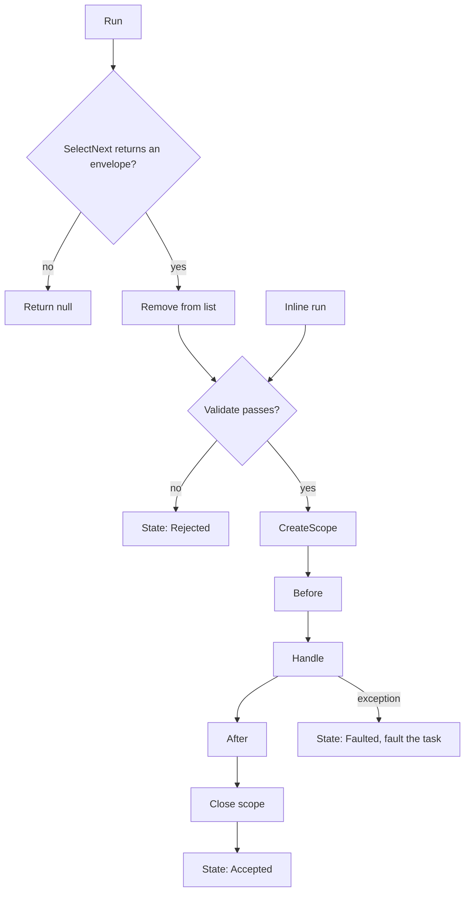
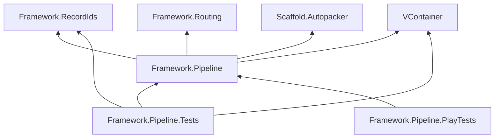

# Pipeline

> **Status: proposed.** Design only. No code changes. Page: https://claude.ai/artifact/74vPp64abx63ubpagvdpAg (catalog: https://claude.ai/artifact/Y1iBedUs8htkxDpkg6QYGU).

## 1. Summary

1. `Pipeline<TMessage, TScope>` wraps each `Message` in an `Envelope` and runs it through a fixed order: `Validate`, `CreateScope`, `Before`, `Handle`, `After`. The envelope holds the state and the handler result. A caller gets a `Result`, or a typed `Result<T>`.
2. The owner system calls `Run()`. By default, it runs one envelope. A subclass can override `Run()` to drain the list. A scope can run a message inline in the same pipeline.
3. v0 is **one pipeline**. Hooks, two or more pipelines, the loop across pipelines, groups and the concrete pipelines are **out**. Section 2 names their owners.

### Decisions

From 2026-10-31 (all four infra spikes):

1. Ids are typed records on the `Id` base: `EntityId`, `RequestId`, `MessageId` (`infra-record-ids.md`). `BlockId` is the position of a block in the stream (`infra-block-wire.md`).
2. `Id`, `IdAllocator<TId>` and `EntityId` live in `Framework.RecordIds` (Record Ids decision 25). `TypeRouter<T>` lives in `Framework.Routing` (router decision D14).
3. A new `Framework.Blocks` feature owns `Block`, `Group` and `GroupService` (`infra-block-wire.md`).
4. The async core uses `System.Threading.Tasks.Task`.
5. The wire carries `TriggerId` only. The parent comes only from group nesting.
6. An intent opens no group.

From 2026-11-01 (this spike):

7. **Scope first.** The pipeline owns only the concerns marked "in" in section 2.
8. **API first.** Each part serves an entry point in section 4.
9. **v0 is one pipeline.** Two or more pipelines (the wiring cycle, inline runs across pipelines) are v2.
10. `Execute` is not virtual. The steps in it are virtual: `Validate`, `Before`, `Handle`, `After`, `SelectNext`. `CreateScope` is abstract.
11. One public run entry: `Run()`. Its default runs one envelope. A subclass overrides it to drain. A runner object waits for the builder discussion.
12. Inline runs skip `SelectNext`. The concrete pipeline decides if its scope exposes them.
13. Validators are a separate first slot. A reject runs no other step.
14. Every message is wrapped in an `Envelope`. The envelope holds the identity, the chain and the result. A non-generic `Envelope` base exists for groups and logs.
15. The scope holds verbs only. It closes after the run, so a kept scope throws. Lifetime and chain data live on the envelope.
16. The base holds two stores keyed by message type: `TypeRouter<Handler<TMessage, TScope>>` and `TypeRouter<Validator<TMessage>>`. The defaults of `Handle` and `Validate` read them.
17. `Handler` and `Validator` are abstract base classes. Their entry is `protected internal`, so only the pipeline calls them. The concrete pipeline gives the typed author base, for example `CommandHandler<T>`.
18. **Hooks are out of v0.** `Before` and `After` are virtual and empty by default. Decision 27 gives the hook model for v2.
19. Handlers get services from DI. Scope verbs are not in DI. `AddPipeline` registers the pipeline (decision 28). PIPE-04 stops a handler that calls a pipeline.
20. No tuple returns in the API. `out` parameters are acceptable.
21. `Add` returns the `Envelope`. The owner reads `State` and `Reason` after `Run()`.
22. Reaction timing and the `Ask` split (requests from `infra-block-wire.md`) are not in v0. v0 has no groups.
23. **`Message` is the shared base** of every pipeline element. `Command`, `Effect` and `Intent` derive from it. `Command` keeps its glossary meaning: one atomic state change.
24. **A message can have a typed result.** The handler returns it. The envelope keeps it as `object Result`. A caller gets `Result<T>`: state, reason and value. A message with no result gives a plain `Result`, so the caller still sees if the run worked. Both are classes, and neither goes on the wire.
25. A rejected run does not throw. `Result.Accepted` is false, and `Reason` gives the cause. A fault still throws.
26. **Extraction, not refactor.** The plan builds the Pipeline next to the current systems, in one root folder: `Assets/Pipeline/`. No step edits, moves or migrates a current system. The migration is one row in section 11.
27. **Hook model (v2 direction).** A hook has the same shape as a handler: a routed instance with a code body. It adds a timing value (`Before` or `After`).
    - The route type is the trigger message type. The store is a `TypeRouter` in `Multiple` mode, ordered by `IOrdered`.
    - The body gets the envelope: the request, and also the result at `After`. `Before` can change the message. `After` can read the result.
    - Code or data makes the instance. A generic data class reads the trigger, the timing and the body from data. Handlers use the same path.
    - The body usually starts an effect on the layer above. That wiring needs two pipelines, so hooks are v2. In v0, `Before` and `After` stay empty virtual methods.
28. **One install method.** `builder.AddPipeline<TPipeline, TMessage, TScope>(o => …)` in `Runtime/PipelineInstall.cs` registers every part: the two routers, the `MessageId` allocator, the options and the pipeline. The caller registers nothing else. A `Framework.Bootstrap.IInstaller` adapter is a Later row.
29. **One root folder:** `Assets/Pipeline/` with `Runtime/`, `Tests/` and `PlayTests/`.

## 2. Scope

### In

| Concern | Owner |
|---|---|
| Fixed run order: `Validate` → `CreateScope` → `Before` → `Handle` → `After` | Pipeline |
| Validator slot, first and separate | Pipeline |
| `Before`, `Handle`, `After`, `Validate`, `SelectNext` as virtual methods | Pipeline |
| Handler and validator stores (`TypeRouter`), read by the defaults | Pipeline |
| `Handler` and `Validator` abstract bases | Pipeline |
| `Message` base | Pipeline |
| `Envelope`: id, parent id, state, reason, result | Pipeline |
| `Result` and `Result<T>` | Pipeline |
| List: `Add`, `Remove`, `TryPeek`, `Items` | Pipeline |
| `Run()` with a one-envelope default; inline run for scopes | Pipeline |
| Scope base: verbs throw after the run | Pipeline |

### Out

| Concern | Owner |
|---|---|
| Hooks: the build of the decision 27 model | This spike, v2 |
| Two or more pipelines (v2) | This spike, after v0 runs |
| `PipelineBuilder` and a runner object (next) | This spike, after v0 |
| Replace a message, cancel an envelope (later) | This spike; `Envelope` is the place |
| How a store works inside, base-type match | `infra-type-router.md` |
| Typed author bases (`CommandHandler<T>`) and scope verbs | Concrete pipeline (Commands) |
| Group bracket (`GroupService`), `TriggerId`, wire form | `infra-block-wire.md` (later) |
| `MessageId`, `EntityId` | `infra-record-ids.md` |
| Loop and order across pipelines, intents, `Answer` | Engine loop (`GameEngine`; no spike yet) |
| `Ask`: request id, await, completion | `RequestService`; the scope only forwards |
| Event fan-out, list changes on the wire | Wire (`EventStream`) / Events & Blocks |

**Boundary.** The pipeline receives a message from `Add` or from an inline run. It wraps the message in an `Envelope`, runs it, and writes the result on the envelope. Handlers call services, and services emit events to `EventStream`.

## 3. Today

### Uses

| Use | Where | Does |
|---|---|---|
| Command execute | `Framework/Commands/Runtime/CommandService.cs:21` | validate, block, one handler; sync |
| Command + hooks | VS `Engine/Pipeline/CommandService.cs:59` | block, Before hooks, `Apply`, After hooks |
| Effect resolve | VS `Engine/Pipeline/EffectService.cs:84` | `Validate`, block, `Run` |
| Effect stack | VS `Engine/Pipeline/Stack.cs:121` | LIFO list, virtual `ShouldResolve` (`:80`) |
| Command queue | VS `Engine/Pipeline/GameEngine.cs:52,96` | FIFO list, drained by the pump |

### Current shapes

| | Framework command | VS command | VS effect |
|---|---|---|---|
| Message | `Command` (`Commands/Runtime/Command.cs:3`) | `Command` with `Apply` (`Commands/Command.cs:22`) | `Effect` with `Validate`, `Run` (`Effects/Effect.cs:18-19`) |
| Validate | `CommandValidatorRegistry.TryFor` (`:24`) | none | `effect.Validate` |
| Handler lookup | `CommandHandlerRegistry.HandlerFor` (`:22`) | none: logic on the message | none: logic on the message |
| Hooks | none | `EffectStore.Subscribe` (`EffectStore.cs:47`); Before drains with `GetResult()` (`CommandService.cs:109`) | none |
| Scope | none | `ICommandScope` leaks `EffectStore`, `Stack` (`ICommandScope.cs:47,53`) | `IEffectScope` |
| Result | `CommandResult` (`CommandResult.cs:3`) | none | none (`Validate` false = no block) |
| List | none | `Queue<Command>` (`GameEngine.cs:52`) | `Stack` (`Stack.cs:58,121`) |

### What repeats

| Common part | Seen in | Varies between uses |
|---|---|---|
| Validate first; a reject does nothing | FW command, VS effect | validator object or method on the message |
| Find the logic by type | FW command | DI handler or method on the message |
| Before, handler, After | VS command | only commands have hooks |
| A scope for the handler | VS command, VS effect | verbs; the VS scopes leak engine objects |
| A list and a "next" rule | VS stack, VS command queue | LIFO with a policy, or FIFO |
| A result to the caller | FW command | VS returns nothing |
| Block bracket (later: group) | all three | out of scope (Events & Blocks) |

## 4. API

### Entry points

| Audience | Entry point | Does |
|---|---|---|
| author | `Handler<TMessage, TScope>.Handle(TMessage, TScope)` | the logic for one message type |
| author | `Validator<TMessage>.Validate(TMessage, out string)` | the check before the run |
| composition | `builder.AddPipeline<TPipeline, TMessage, TScope>(o => …)` | registers every part; the only setup call |
| subclass | `CreateScope`, `SelectNext`, `Validate`, `Before`, `Handle`, `After`, `Run` | the custom part of one pipeline |
| owner | `Add`, `Remove`, `TryPeek`, `Items`, `Run` | the owner system uses the list |
| scope | a verb that calls `RunInline(parent, message)` | a message runs now, nested, same pipeline |
| migration example (Later) | `CommandHandler<T, TResult>.Handle(T, ICommandScope)` returns `TResult` | the typed author base of Commands |
| migration example (Later) | `CommandValidator<T>.Validate(T, out string)` | the typed validator base of Commands |

### Shape

```csharp
public abstract class Message { }                                  // base of every pipeline element

public abstract class Pipeline<TMessage, TScope> where TMessage : Message
{
    protected Pipeline(TypeRouter<Handler<TMessage, TScope>> handlers,
                       TypeRouter<Validator<TMessage>> validators,
                       IdAllocator<MessageId> ids);

    public Envelope<TMessage> Add(TMessage message);                // ids.Next(); into the list
    public bool Remove(MessageId id);                               // false: absent, or already taken
    public bool TryPeek(out Envelope<TMessage> envelope);           // the envelope that Run takes next
    public IReadOnlyList<Envelope<TMessage>> Items { get; }         // read-only view
    public virtual Task Run() => RunOne();                          // default: one envelope, then stop

    protected Task<Envelope<TMessage>> RunOne();                    // SelectNext + Execute; null if none
    protected Task<Envelope<TMessage>> RunInline(Envelope parent, TMessage message);   // ids.Next(); ParentId = parent.Id
}

public abstract class Envelope
{
    public MessageId Id { get; }
    public MessageId ParentId { get; }                              // null if not an inline run
    public EnvelopeState State { get; }                             // Listed, Running, Accepted, Rejected, Faulted
    public string Reason { get; }                                   // set only if Rejected
    public object Result { get; }                                   // set only if Accepted; null if none
    public Message Message => GetMessage();
    protected abstract Message GetMessage();
}
public sealed class Envelope<TMessage> : Envelope where TMessage : Message
{
    public new TMessage Message { get; }
    protected override Message GetMessage() => Message;
}

public class Result                                                 // what a caller gets; server only
{
    public EnvelopeState State { get; }                             // Accepted or Rejected
    public string Reason { get; }
    public bool Accepted => State == EnvelopeState.Accepted;
    public static Result From(Envelope e);
}
public sealed class Result<T> : Result
{
    public T Value { get; }
    public static new Result<T> From(Envelope e);
}

public abstract class Handler<TMessage, TScope> : IRouted
{
    public abstract Type RouteType { get; }
    protected internal abstract Task<object> Handle(TMessage message, TScope scope);   // null if no result
}
public abstract class Validator<TMessage> : IRouted
{
    public abstract Type RouteType { get; }
    protected internal abstract bool Validate(TMessage message, out string reason);
}
```

### Call site

Migration example (Later): a Commands handler on the shared base.

```csharp
public sealed class DealDamage : Command<DamageDealt> { … }   // a message with a result

sealed class LifestealHandler : CommandHandler<LifestealHit>  // ctor: services from DI
{
    protected override async Task Handle(LifestealHit c, ICommandScope s)
    {
        var dealt = await s.Run(new DealDamage { Target = c.Target, Amount = c.Amount });   // verb: only from the scope
        if (dealt.Accepted) await s.Run(new Heal { Target = c.Source, Amount = dealt.Value.Amount });
    }
}
```

The owner system adds a message, runs, and reads the result on the envelope (migration example, Later):

```csharp
var envelope = commands.Add(new PlayCard { CardId = card });
await commands.Run();
var result = Result.From(envelope);
if (!result.Accepted) Show(result.Reason);
```

### Install

```csharp
public sealed class PipelineOptions
{
    public int FirstMessageId { get; set; } = 1;            // used if no MessageId allocator exists yet
}

public static class PipelineInstall                        // Runtime/PipelineInstall.cs
{
    public static void AddPipeline<TPipeline, TMessage, TScope>(this IContainerBuilder b, Action<PipelineOptions> configure = null)
        where TPipeline : Pipeline<TMessage, TScope> where TMessage : Message
    {
        var o = new PipelineOptions(); configure?.Invoke(o);
        b.RegisterTypeRouter<Handler<TMessage, TScope>>(RouteMode.Single);
        b.RegisterTypeRouter<Validator<TMessage>>(RouteMode.Single);
        if (!b.Exists(typeof(IdAllocator<MessageId>)))      // one id space for all levels
            b.RegisterInstance(new IdAllocator<MessageId>(o.FirstMessageId));
        b.Register<TPipeline>(Lifetime.Singleton);
    }
}

builder.AddPipeline<CommandPipeline, Command, ICommandScope>();   // one call for each level
```

### Dependencies

| Depends on | Why |
|---|---|
| `Framework.Routing`: `TypeRouter<T>`, `IRouted`, `RouteMode` | The stores; `[RequireImplementors]` keeps author subclasses |
| `Framework.RecordIds`: `Id`, `IdAllocator<TId>` | One `MessageId` for each envelope |
| `VContainer` | `AddPipeline`; in a `noEngineReferences` asmdef, the same solution as `Framework.Routing` (TypeRouter checks it) |
| `Scaffold.Autopacker` | `MessageId : Id` is an `[AutoPack]` record |
| `System.Threading.Tasks` | The async run (decision 4) |
| `Framework.Blocks` (later) | `GroupService.Open` and `Close` wrap `Before`, `Handle`, `After` |

asmdef references: `Framework.RecordIds`, `Framework.Routing`, `Scaffold.Autopacker`, `VContainer`. · Must NOT depend on `Framework.Pipeline`: `Framework.Core`, `Framework.RecordIds`, `Framework.Routing`, `Framework.Wire`, `Framework.Blocks`. · No current system references it until the migration (section 11).

### Rules

| Rule | Enforced by |
|---|---|
| Only the pipeline calls a handler or a validator | C# access: `protected internal` entry; compiler |
| A subclass does not change the run order | C# access: `Execute` is not virtual; compiler |
| Only the subclass runs a message inline | C# access: `RunInline` is protected; compiler |
| A scope verb throws after the run | Runtime: `PipelineScope.ThrowIfClosed`; `PipelineTests.ScopeVerb_AfterRun_Throws` |
| `Remove` does not stop a running envelope | Runtime: the envelope leaves the list first; `PipelineTests.Remove_Running_ReturnsFalse` |
| A scope interface exposes only its pipeline verbs | Rulebook PIPE-01 (proposed): `type.memberTypes` with `includeParameters` |
| A handler does not call a pipeline or the owner | Rulebook PIPE-04 (proposed): `il.forbiddenCalls` |
| A handler does not leave the run thread | Rulebook PIPE-05 (proposed): `il.forbiddenCalls` with `methods[]` |

PIPE-02 and PIPE-03 (effect and intent handlers do not call a Framework service) wait for v2. `rulebook.json` does not change in this spike.

## 5. Parts

| Part | Serves | Replaces |
|---|---|---|
| `Pipeline<TMessage, TScope>` | `Add`, `Remove`, `TryPeek`, `Run`, inline run | FW `CommandService`, VS `CommandService.Execute`, VS `Stack`, VS engine queue |
| `Message` | every pipeline element | the base of FW `Command` |
| `Envelope`, `Envelope<TMessage>`, `EnvelopeState` | owner, groups | nothing in VS |
| `Result`, `Result<T>` | inline callers, owner | `CommandResult`; the mutable fields on VS `DealDamage` |
| `Handler<TMessage, TScope>`, `Validator<TMessage>` | the stores | `ICommandHandler`, `ICommandValidator` as store types |
| `PipelineScope` | the concrete scope | VS `ICommandScope`, `IEffectScope` |

### `Pipeline<TMessage, TScope>`

`Execute` is protected and not virtual. `RunOne` and `RunInline` call it. The scope closes on every path.

```csharp
protected async Task<Envelope<TMessage>> Execute(Envelope<TMessage> e)
{
    e.State = EnvelopeState.Running;
    if (!Validate(e, out var reason)) { e.Reject(reason); return e; }        // no other step
    var scope = CreateScope(e);
    try
    {
        await Before(e, scope);
        e.Result = await Handle(e, scope);
        await After(e, scope);
        e.State = EnvelopeState.Accepted;
        return e;
    }
    catch { e.State = EnvelopeState.Faulted; throw; }                       // the fault stays in the task
    finally { (scope as PipelineScope)?.Close(); }                          // verbs throw after this
}

protected abstract TScope CreateScope(Envelope<TMessage> e);
protected virtual bool Validate(Envelope<TMessage> e, out string reason);         // validators.TryGet(type)
protected virtual Task Before(Envelope<TMessage> e, TScope s) => Task.CompletedTask;
protected virtual Task<object> Handle(Envelope<TMessage> e, TScope s);            // handlers.Get(type)
protected virtual Task After(Envelope<TMessage> e, TScope s) => Task.CompletedTask;
```

### List and `Run`

```csharp
protected Task<Envelope<TMessage>> RunOne()
{
    var e = SelectNext(_items);                     // null: nothing to run now
    if (e == null) return Task.FromResult<Envelope<TMessage>>(null);
    _items.Remove(e);                               // before the run: a running envelope can Add more
    return Execute(e);
}

protected virtual Envelope<TMessage> SelectNext(IReadOnlyList<Envelope<TMessage>> items)
    => items.Count > 0 ? items[0] : null;           // FIFO; a stack returns the last envelope

public override async Task Run() { while (await RunOne() != null) { } }   // a subclass that drains
```

An MTG stack overrides `SelectNext` and returns `null` until both players pass priority. Then a drain stops too.

### `Envelope`

The pipeline makes one envelope for each message at `Add` or at an inline run. The message is the data that the author writes. The envelope is the run of that message: its identity, its parent, its state and its result. `Result.From` and `Result<T>.From` read it for a caller. Groups can read `Id` and `ParentId` later. Replace and cancel come later, as new states or fields.

### Stores and author bases

The base holds two `TypeRouter` stores (`infra-type-router.md`, `RouteMode.Single`). `Handle` reads `Get`, and `Validate` reads `TryGet`. The pipeline chooses the mode for each router. The concrete pipeline gives the typed author base. Migration example (Later):

```csharp
public abstract class Command : Message { }
public abstract class Command<TResult> : Command { }                    // as Request<TResponse>

public abstract class CommandHandler<T, TResult> : Handler<Command, ICommandScope> where T : Command<TResult>
{
    public override Type RouteType => typeof(T);
    protected override async Task<object> Handle(Command m, ICommandScope s) => await Handle((T)m, s);   // another assembly: protected
    protected abstract Task<TResult> Handle(T command, ICommandScope scope);
}
public abstract class CommandHandler<T> : Handler<Command, ICommandScope> where T : Command
{
    public override Type RouteType => typeof(T);
    protected override async Task<object> Handle(Command m, ICommandScope s) { await Handle((T)m, s); return null; }
    protected abstract Task Handle(T command, ICommandScope scope);
}
```

The form follows `Request<TResponse>` and `RequestService.Open<TResponse>` in `Framework.Requests`. A result that is a value type is boxed once in `Task<object>`.

If a pipeline needs another store, it overrides the step.

### Scope

A scope holds the verbs of one pipeline that are not in DI. `CreateScope` makes one scope for each envelope. The concrete pipeline defines the verbs, and decides if the scope exposes an inline run. Migration example (Later):

```csharp
public interface ICommandScope                                                    // example; Commands owns it
{
    Task<Result<TResult>> Run<TResult>(Command<TResult> command);
    Task<Result> Run(Command command);
}

sealed class CommandPipeline : Pipeline<Command, ICommandScope>
{
    protected override ICommandScope CreateScope(Envelope<Command> e)
        => new CommandScope(m => RunInline(e, m));                                 // e becomes the parent
}

sealed class CommandScope : PipelineScope, ICommandScope
{
    readonly Func<Command, Task<Envelope<Command>>> _run;
    public async Task<Result<TResult>> Run<TResult>(Command<TResult> c) { ThrowIfClosed(); return Result<TResult>.From(await _run(c)); }
    public async Task<Result> Run(Command c) { ThrowIfClosed(); return Result.From(await _run(c)); }
}
```

## 6. Architecture

### Call stack

Migration example (Later): the command pipeline.

```
owner system: commands.Run()
└─ RunOne → SelectNext → PlayCard envelope; remove from the list
   └─ Execute(envelope)
      ├─ Validate                                   validators.TryGet(PlayCard)
      ├─ CreateScope → CommandScope
      ├─ Before                                     empty by default
      ├─ Handle → PlayCardHandler.Handle(c, scope)
      │  ├─ ZoneService.Move → ZoneChanged (wire event)
      │  └─ scope.Run(DrawCard) → RunInline(parent, DrawCard)
      │     └─ Execute(child envelope)              same order; ParentId = PlayCard
      ├─ After                                      empty by default
      └─ close scope → envelope.State = Accepted
```

### Logic flow



## 7. Trade-offs

| Loss | Why it matters | Mitigation |
|---|---|---|
| A game changes policy with a subclass | The game must know the base class. | Few virtual methods; each has a default. |
| `Execute` is fixed | A pipeline cannot run a step before validation. | Validation is opt-in for each type. |
| Author bases are classes | An author base cannot have another parent. | No author base has one today. |
| Each pipeline writes its typed author base | About 10 lines for each pipeline. | Examine a shared base in v2. |
| Two ways to get dependencies | Verbs come from the scope. Services come from DI. | One rule: call down with the scope. |
| The pipeline is in DI | A handler can inject a pipeline. | PIPE-04 (Later) forbids the call. |
| `Remove` cannot stop a running envelope | A counter to a running message needs another verb. | Cancel on `Envelope` comes later. |
| Every handler is async | A sync handler returns `Task.CompletedTask`. Stack traces are longer. | Named bases; one inline-continuation test. |

## 8. Folder structure

```
Assets/Pipeline/
├─ Runtime/                     Framework.Pipeline.asmdef
│  ├─ Message.cs
│  ├─ MessageId.cs              [AutoPack] record; shape from Record Ids
│  ├─ Envelope.cs               Envelope, Envelope<TMessage>, EnvelopeState
│  ├─ Result.cs                 Result, Result<T>
│  ├─ Handler.cs                Handler<TMessage, TScope>
│  ├─ Validator.cs              Validator<TMessage>
│  ├─ PipelineScope.cs
│  ├─ Pipeline.cs               Pipeline<TMessage, TScope>
│  ├─ PipelineOptions.cs
│  └─ PipelineInstall.cs        AddPipeline<TPipeline, TMessage, TScope>
├─ Tests/                       Framework.Pipeline.Tests.asmdef
│  ├─ Fixtures/TestPipeline.cs  TestPipeline, TestScope, Ping, Echo, handlers
│  ├─ ResultTests.cs
│  ├─ RouterTests.cs
│  ├─ PipelineTests.cs
│  └─ InstallTests.cs
└─ PlayTests/                   Framework.Pipeline.PlayTests.asmdef
   └─ InlineContinuationTests.cs
```

## 9. Dependency graph



## 10. Steps

### 1 · Build — asmdef, `Message`, `MessageId`, `Envelope`, `Result`

```json
// Runtime/Framework.Pipeline.asmdef
{ "name": "Framework.Pipeline", "references": ["Framework.RecordIds", "Framework.Routing", "Scaffold.Autopacker", "VContainer"], "noEngineReferences": true }
// Tools/Rulebook/rulebook.json, ARCH-02 "allowed"
"Framework.Pipeline": ["Framework.RecordIds", "Framework.Routing"]
```

```csharp
public abstract class Message { }
[AutoPack] public sealed record MessageId : Id;         // shape from Record Ids
public abstract class Envelope { Id; ParentId; State; Reason; Result; Message => GetMessage(); protected abstract Message GetMessage(); }
public sealed class Envelope<TMessage> : Envelope where TMessage : Message { public new TMessage Message { get; } protected override Message GetMessage() => Message; }
public class Result { State; Reason; Accepted; static Result From(Envelope e); }
public sealed class Result<T> : Result { public T Value { get; } }
```

```csharp
[Test] public void From_Rejected_NotAccepted()   => Assert.That(Result.From(Rejected("no mana")).Reason, Is.EqualTo("no mana"));
[Test] public void FromT_Accepted_ReturnsValue() => Assert.That(Result<int>.From(Accepted(5)).Value, Is.EqualTo(5));
```

```powershell
powershell -NoProfile -File Tools/Rulebook/gate.ps1
```

Done: gate PASS; `ResultTests` green; the diff is only in `Assets/Pipeline/` and the ARCH-02 row in `Tools/Rulebook/rulebook.json`.

### 2 · Build — `Handler<,>`, `Validator<>`

```csharp
public abstract class Handler<TMessage, TScope> : IRouted
{
    public abstract Type RouteType { get; }
    protected internal abstract Task<object> Handle(TMessage message, TScope scope);
}
public abstract class Validator<TMessage> : IRouted
{
    public abstract Type RouteType { get; }
    protected internal abstract bool Validate(TMessage message, out string reason);
}
```

```csharp
sealed class PingHandler : Handler<Message, TestScope>            // Fixtures/; another assembly: protected override
{
    public override Type RouteType => typeof(Ping);
    protected override Task<object> Handle(Message m, TestScope s) => Task.FromResult<object>("pong");
}

[Test] public void Router_Single_FindsPingHandler()
    => Assert.That(new TypeRouter<Handler<Message, TestScope>>(handlers, RouteMode.Single).Get(typeof(Ping)), Is.SameAs(ping));
```

```powershell
powershell -NoProfile -File Tools/Rulebook/gate.ps1
```

Done: gate PASS; `RouterTests` green; the diff is only in `Assets/Pipeline/`.

### 3 · Build — `Pipeline<,>`, `PipelineScope`

```csharp
protected async Task<Envelope<TMessage>> Execute(Envelope<TMessage> e)
{
    e.State = EnvelopeState.Running;
    if (!Validate(e, out var reason)) { e.Reject(reason); return e; }
    var scope = CreateScope(e);
    try { await Before(e, scope); e.Result = await Handle(e, scope); await After(e, scope); e.State = EnvelopeState.Accepted; return e; }
    catch { e.State = EnvelopeState.Faulted; throw; }
    finally { (scope as PipelineScope)?.Close(); }
}
```

```
PipelineTests
  Reject_RunsNoOtherStep
  Fault_ClosesScope
  Steps_RunInFixedOrder
  SelectNext_Fifo
  SelectNext_LifoOverride
  Remove_Running_ReturnsFalse
  RunInline_SetsParentId
  Handle_TypedResult_ReachesResultT
  ScopeVerb_AfterRun_Throws
```

```powershell
powershell -NoProfile -File Tools/Rulebook/gate.ps1
```

Done: gate PASS; `PipelineTests` green; the diff is only in `Assets/Pipeline/`.

### 4 · Build — inline continuation in PlayMode

```csharp
[UnityTest] public IEnumerator RunInline_CompletesInSameFrame()
{
    var frame = Time.frameCount;
    var task = pipeline.RunInlineForTest(new Ping());     // fixture: parent = Add(new Ping()); return RunInline(parent, m)
    Assert.That(task.IsCompleted && Time.frameCount == frame);
    yield break;
}
```

```powershell
powershell -NoProfile -File Tools/Rulebook/gate.ps1 -With playmode
```

Done: gate PASS; `InlineContinuationTests` green in PlayMode; the diff is only in `Assets/Pipeline/`.

### 5 · Build — `AddPipeline`, `PipelineOptions`

```csharp
public static void AddPipeline<TPipeline, TMessage, TScope>(this IContainerBuilder b, Action<PipelineOptions> configure = null)
    where TPipeline : Pipeline<TMessage, TScope> where TMessage : Message;   // body: API > Install
```

```csharp
[Test] public async Task AddPipeline_RunsOneMessage()
{
    var b = new ContainerBuilder();
    b.AddPipeline<TestPipeline, Message, TestScope>();
    b.Register<PingHandler>(Lifetime.Singleton).As<Handler<Message, TestScope>>();   // fixture: the scan skips test assemblies
    var pipeline = b.Build().Resolve<TestPipeline>();
    var e = pipeline.Add(new Ping()); await pipeline.Run();
    Assert.That(Result<string>.From(e).Value, Is.EqualTo("pong"));
}
```

```powershell
powershell -NoProfile -File Tools/Rulebook/gate.ps1
```

Done: gate PASS; `InstallTests` green; the diff is only in `Assets/Pipeline/`.

## 11. Later

These items are not open for v0. Each row says why it waits and what reopens it.

| Item | Why later | Trigger to reopen |
|---|---|---|
| Migration: Commands onto the Pipeline (`Command : Message`, `CommandPipeline`, async handlers, registries to `TypeRouter`, delete `CommandService` and `CommandResult`, add PIPE-01, PIPE-04, PIPE-05) | The plan is an extraction; no current system changes | All specced systems built; the cross-spike plan gives the order |
| Hooks: build the decision 27 model | The body starts an effect on the layer above | Two or more pipelines |
| Rules with a state condition (for example the death rule): a hook with a condition, or a separate trigger kind | Part of the hooks build | Hooks build |
| Live subscription: a router that can change, or a fixed hook with a condition | No current caller; VS uses a condition | A card adds a hook at runtime |
| Per-card trigger lookup (VS `EffectStore._direct`, `SetDirect`): (entity, trigger) to effect | Not a hook; belongs to effects. Router D8 gave it to this spike | Effects pipeline |
| Reaction timing: run before the trigger group closes | v0 has no groups | Hooks build |
| `Ask` split: close the group with `Waiting`, continue in a new group | v0 has no groups | Groups enter the pipeline |
| Bootstrap adapter: a `Framework.Bootstrap.IInstaller` that calls `AddPipeline` | One install method first | Bootstrap installs the Pipeline |
| `Task<object>` boxing in the handler entry, and the `Result` allocation | Works now; one box and one object for each run | Before the migration, or a benchmark |
| `PipelineBuilder` and a runner object | Needs one pipeline that runs | v0 is done |
| Two or more pipelines: wiring cycle, effects, PIPE-02 | v0 is one pipeline | v0 is done |
| A shared typed author base | Needs two pipelines to compare | v2 |
| Replace a message, also with a type change | No use in v0 | Hooks build; place: `Envelope` |
| Cancel an envelope | No use in v0 | Hooks build; place: `EnvelopeState` |
| Base-type match for validators | Router owns matching | Router spike |
| Many validators or handlers for one type: run policy (all, stop at first failure, order) | v0 uses `RouteMode.Single`; the Pipeline owns the policy | A second validator on one type |
| `Request<TResponse>` as a `Message` | Requests are not a pipeline | Requests enter a pipeline |
