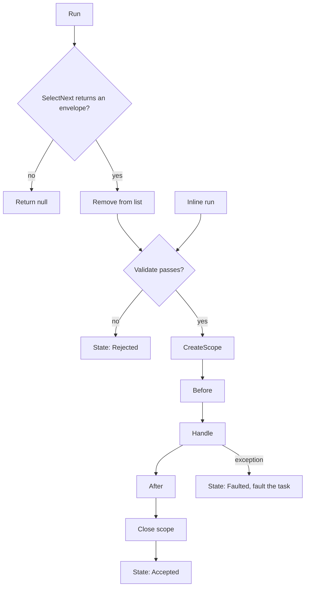

# Pipeline

> **Status: proposed.** Design only. No code changes. Page: https://claude.ai/artifact/74vPp64abx63ubpagvdpAg (catalog: https://claude.ai/artifact/Y1iBedUs8htkxDpkg6QYGU).

## 1. Summary

1. `Pipeline<TMessage, TScope>` wraps each `Message` in an `Envelope` and runs it through a fixed order: `Validate`, `CreateScope`, `Before`, `Handle`, `After`. The envelope holds the state and the handler result. A caller gets a `Result`, or a typed `Result<T>`.
2. The owner system calls `Run()`. By default, it runs one envelope. A subclass can override `Run()` to drain the list. A scope can run a message inline in the same pipeline.
3. v0 is **one pipeline**. Hooks, two or more pipelines, the loop across pipelines, groups and the concrete pipelines are **out**. Section 2 names their owners.

### Decisions

From 2026-10-31 (all four infra spikes):

1. Ids are typed `readonly struct`s: `EntityId`, `RequestId`, `MessageId` (`infra-record-ids.md`). `BlockId` is the position of a block in the stream (`infra-block-wire.md`).
2. `TypeRouter<T>`, `IdAllocator<TId>` and `EntityId` live in `Framework.Core`.
3. A new `Framework.Blocks` feature owns `Block`, `Group` and `GroupService` (`infra-block-wire.md`).
4. The async core uses `System.Threading.Tasks.Task`.
5. The wire carries `TriggerId` only. The parent comes only from group nesting.
6. An intent opens no group.

From 2026-11-01 (this spike):

7. **Scope first.** The pipeline owns only the concerns marked "in" in section 2.
8. **API first.** Each part serves an entry point in section 4.
9. **v0 is one pipeline.** Two or more pipelines (the wiring cycle, inline runs across pipelines) are v2.
10. `Execute` is not virtual. The steps in it are virtual: `Validate`, `Before`, `Handle`, `After`, `SelectNext`. `CreateScope` is abstract.
11. One public run entry: `Run()`. Its default runs one envelope. A subclass overrides it to drain. A runner object waits for the builder discussion.
12. Inline runs skip `SelectNext`. The concrete pipeline decides if its scope exposes them.
13. Validators are a separate first slot. A reject runs no other step.
14. Every message is wrapped in an `Envelope`. The envelope holds the identity, the chain and the result. A non-generic `Envelope` base exists for groups and logs.
15. The scope holds verbs only. It closes after the run, so a kept scope throws. Lifetime and chain data live on the envelope.
16. The base holds two stores keyed by message type: `TypeRouter<Handler<TMessage, TScope>>` and `TypeRouter<Validator<TMessage>>`. The defaults of `Handle` and `Validate` read them.
17. `Handler` and `Validator` are abstract base classes. Their entry is `protected internal`, so only the pipeline calls them. The concrete pipeline gives the typed author base, for example `CommandHandler<T>`.
18. **Hooks are out of v0.** `Before` and `After` are virtual and empty by default. The hooks and reactions discussion decides their model.
19. Handlers get services from DI. Scope verbs are not in DI. Pipelines are not in DI.
20. No tuple returns in the API. `out` parameters are acceptable.
21. `Add` returns the `Envelope`. The owner reads `State` and `Reason` after `Run()`.
22. Reaction timing and the `Ask` split (requests from `infra-block-wire.md`) are not in v0. v0 has no groups.
23. **`Message` is the shared base** of every pipeline element. `Command`, `Effect` and `Intent` derive from it. `Command` keeps its glossary meaning: one atomic state change.
24. **A message can have a typed result.** The handler returns it. The envelope keeps it as `object Result`. A caller gets `Result<T>`: state, reason and value. A message with no result gives a plain `Result`, so the caller still sees if the run worked. Both are classes, and neither goes on the wire.
25. A rejected run does not throw. `Result.Accepted` is false, and `Reason` gives the cause. A fault still throws.
26. **Build first, migrate later.** v0 builds the parts as standalone code. No current caller changes. Migration starts after all specced systems have their basic shapes. One cross-spike plan gives its order.

## 2. Scope

### In

| Concern | Owner |
|---|---|
| Fixed run order: `Validate` → `CreateScope` → `Before` → `Handle` → `After` | Pipeline |
| Validator slot, first and separate | Pipeline |
| `Before`, `Handle`, `After`, `Validate`, `SelectNext` as virtual methods | Pipeline |
| Handler and validator stores (`TypeRouter`), read by the defaults | Pipeline |
| `Handler` and `Validator` abstract bases | Pipeline |
| `Message` base | Pipeline |
| `Envelope`: id, parent id, state, reason, result | Pipeline |
| `Result` and `Result<T>` | Pipeline |
| List: `Add`, `Remove`, `TryPeek`, `Items` | Pipeline |
| `Run()` with a one-envelope default; inline run for scopes | Pipeline |
| Scope base: verbs throw after the run | Pipeline |

### Out

| Concern | Owner |
|---|---|
| Hooks and reactions: model, stores, order | Hooks and reactions discussion |
| Two or more pipelines (v2) | This spike, after v0 runs |
| `PipelineBuilder` and a runner object (next) | This spike, after v0 |
| Replace a message, cancel an envelope (later) | This spike; `Envelope` is the place |
| How a store works inside, base-type match | `infra-type-router.md` |
| Typed author bases (`CommandHandler<T>`) and scope verbs | Concrete pipeline (Commands) |
| Group bracket (`GroupService`), `TriggerId`, wire form | `infra-block-wire.md` (later) |
| `MessageId`, `EntityId` | `infra-record-ids.md` |
| Loop and order across pipelines, intents, `Answer` | Engine loop (`GameEngine`; no spike yet) |
| `Ask`: request id, await, completion | `RequestService`; the scope only forwards |
| Event fan-out, list changes on the wire | Wire (`EventStream`) / Events & Blocks |

**Boundary.** The pipeline receives a message from `Add` or from an inline run. It wraps the message in an `Envelope`, runs it, and writes the result on the envelope. Handlers call services, and services emit events to `EventStream`.

## 3. Today

### Uses

| Use | Where | Does |
|---|---|---|
| Command execute | `Framework/Commands/Runtime/CommandService.cs:21` | validate, block, one handler; sync |
| Command + hooks | VS `Engine/Pipeline/CommandService.cs:59` | block, Before hooks, `Apply`, After hooks |
| Effect resolve | VS `Engine/Pipeline/EffectService.cs:84` | `Validate`, block, `Run` |
| Effect stack | VS `Engine/Pipeline/Stack.cs:121` | LIFO list, virtual `ShouldResolve` (`:80`) |
| Command queue | VS `Engine/Pipeline/GameEngine.cs:52,96` | FIFO list, drained by the pump |

### Current shapes

| | Framework command | VS command | VS effect |
|---|---|---|---|
| Message | `Command` (`Commands/Runtime/Command.cs:3`) | `Command` with `Apply` (`Commands/Command.cs:22`) | `Effect` with `Validate`, `Run` (`Effects/Effect.cs:18-19`) |
| Validate | `CommandValidatorRegistry.TryFor` (`:24`) | none | `effect.Validate` |
| Handler lookup | `CommandHandlerRegistry.HandlerFor` (`:22`) | none: logic on the message | none: logic on the message |
| Hooks | none | `EffectStore.Subscribe` (`EffectStore.cs:47`); Before drains with `GetResult()` (`CommandService.cs:109`) | none |
| Scope | none | `ICommandScope` leaks `EffectStore`, `Stack` (`ICommandScope.cs:47,53`) | `IEffectScope` |
| Result | `CommandResult` (`CommandResult.cs:3`) | none | none (`Validate` false = no block) |
| List | none | `Queue<Command>` (`GameEngine.cs:52`) | `Stack` (`Stack.cs:58,121`) |

### What repeats

| Common part | Seen in | Varies between uses |
|---|---|---|
| Validate first; a reject does nothing | FW command, VS effect | validator object or method on the message |
| Find the logic by type | FW command | DI handler or method on the message |
| Before, handler, After | VS command | only commands have hooks |
| A scope for the handler | VS command, VS effect | verbs; the VS scopes leak engine objects |
| A list and a "next" rule | VS stack, VS command queue | LIFO with a policy, or FIFO |
| A result to the caller | FW command | VS returns nothing |
| Block bracket (later: group) | all three | out of scope (Events & Blocks) |

## 4. API

### Entry points

| Audience | Entry point | Does |
|---|---|---|
| author | `CommandHandler<T, TResult>.Handle(T, ICommandScope)` returns `TResult` | the logic for one message type |
| author | `CommandHandler<T>.Handle(T, ICommandScope)` | the same, with no result |
| author | `CommandValidator<T>.Validate(T, out string)` | the check before the run |
| composition | `builder.RegisterTypeRouter<Handler<Command, ICommandScope>>(RouteMode.Single)`, same for validators | fills the stores |
| composition | `new CommandPipeline(handlers, validators)` | makes the one pipeline; not in DI |
| subclass | `CreateScope`, `SelectNext`, `Validate`, `Before`, `Handle`, `After`, `Run` | the custom part of one pipeline |
| owner | `Add`, `Remove`, `TryPeek`, `Items`, `Run` | the owner system uses the list |
| scope | a verb that calls `RunInline(parent, message)` | a message runs now, nested, same pipeline |

### Shape

```csharp
public abstract class Message { }                                  // base of every pipeline element

public abstract class Pipeline<TMessage, TScope> where TMessage : Message
{
    protected Pipeline(TypeRouter<Handler<TMessage, TScope>> handlers,
                       TypeRouter<Validator<TMessage>> validators);

    public Envelope<TMessage> Add(TMessage message);                // into the list
    public bool Remove(MessageId id);                               // false: absent, or already taken
    public bool TryPeek(out Envelope<TMessage> envelope);           // the envelope that Run takes next
    public IReadOnlyList<Envelope<TMessage>> Items { get; }         // read-only view
    public virtual Task Run() => RunOne();                          // default: one envelope, then stop

    protected Task<Envelope<TMessage>> RunOne();                    // SelectNext + Execute; null if none
    protected Task<Envelope<TMessage>> RunInline(Envelope parent, TMessage message);   // skips SelectNext
}

public abstract class Envelope
{
    public MessageId Id { get; }
    public MessageId? ParentId { get; }                             // set on an inline run
    public EnvelopeState State { get; }                             // Listed, Running, Accepted, Rejected, Faulted
    public string Reason { get; }                                   // set only if Rejected
    public object Result { get; }                                   // set only if Accepted; null if none
    public abstract Message Message { get; }
}
public sealed class Envelope<TMessage> : Envelope { public new TMessage Message { get; } }

public class Result                                                 // what a caller gets; server only
{
    public EnvelopeState State { get; }                             // Accepted or Rejected
    public string Reason { get; }
    public bool Accepted => State == EnvelopeState.Accepted;
    public static Result From(Envelope e);
}
public sealed class Result<T> : Result
{
    public T Value { get; }
    public static new Result<T> From(Envelope e);
}

public abstract class Handler<TMessage, TScope> : IRouted
{
    public abstract Type RouteType { get; }
    protected internal abstract Task<object> Handle(TMessage message, TScope scope);   // null if no result
}
public abstract class Validator<TMessage> : IRouted
{
    public abstract Type RouteType { get; }
    protected internal abstract bool Validate(TMessage message, out string reason);
}
```

### Call site

```csharp
public sealed class DealDamage : Command<DamageDealt> { … }   // a message with a result

sealed class LifestealHandler : CommandHandler<LifestealHit>  // ctor: services from DI
{
    protected override async Task Handle(LifestealHit c, ICommandScope s)
    {
        var dealt = await s.Run(new DealDamage { Target = c.Target, Amount = c.Amount });   // verb: only from the scope
        if (dealt.Accepted) await s.Run(new Heal { Target = c.Source, Amount = dealt.Value.Amount });
    }
}
```

The owner system adds a message, runs, and reads the result on the envelope:

```csharp
var envelope = commands.Add(new PlayCard { CardId = card });
await commands.Run();
var result = Result.From(envelope);
if (!result.Accepted) Show(result.Reason);
```

### Access

| Bypass route | What stops it |
|---|---|
| Game code calls a handler directly | `Handle` is `protected internal`. Only `Framework.Pipeline` calls it. |
| A handler injects a pipeline | Pipelines are not in DI. |
| A handler injects the owner system | Rulebook check PIPE-04. |
| A handler keeps the scope and uses it later | The scope closes after the run. Its verbs then throw. |
| A subclass changes the run order | `Execute` is not virtual. |
| A caller runs a message inline without a scope | `RunInline` is protected. Only the subclass gives it to its scope. |
| A game removes the running envelope | `Remove` returns false. The envelope left the list before the run. |

## 5. Parts

| Part | Serves | Replaces |
|---|---|---|
| `Pipeline<TMessage, TScope>` | `Add`, `Remove`, `TryPeek`, `Run`, inline run | FW `CommandService`, VS `CommandService.Execute`, VS `Stack`, VS engine queue |
| `Message` | every pipeline element | the base of FW `Command` |
| `Envelope`, `Envelope<TMessage>`, `EnvelopeState` | owner, groups | nothing in VS |
| `Result`, `Result<T>` | inline callers, owner | `CommandResult`; the mutable fields on VS `DealDamage` |
| `Handler<TMessage, TScope>`, `Validator<TMessage>` | the stores | `ICommandHandler`, `ICommandValidator` as store types |
| `PipelineScope` | the concrete scope | VS `ICommandScope`, `IEffectScope` |

### `Pipeline<TMessage, TScope>`

`Execute` is protected and not virtual. `RunOne` and `RunInline` call it. The scope closes on every path.

```csharp
protected async Task<Envelope<TMessage>> Execute(Envelope<TMessage> e)
{
    e.State = EnvelopeState.Running;
    if (!Validate(e, out var reason)) { e.Reject(reason); return e; }        // no other step
    var scope = CreateScope(e);
    try
    {
        await Before(e, scope);
        e.Result = await Handle(e, scope);
        await After(e, scope);
        e.State = EnvelopeState.Accepted;
        return e;
    }
    catch { e.State = EnvelopeState.Faulted; throw; }                       // the fault stays in the task
    finally { Close(scope); }                                               // verbs throw after this
}

protected abstract TScope CreateScope(Envelope<TMessage> e);
protected virtual bool Validate(Envelope<TMessage> e, out string reason);         // validators.TryGet(type)
protected virtual Task Before(Envelope<TMessage> e, TScope s) => Task.CompletedTask;
protected virtual Task<object> Handle(Envelope<TMessage> e, TScope s);            // handlers.Get(type)
protected virtual Task After(Envelope<TMessage> e, TScope s) => Task.CompletedTask;
```

### List and `Run`

```csharp
protected Task<Envelope<TMessage>> RunOne()
{
    var e = SelectNext(_items);                     // null: nothing to run now
    if (e == null) return Task.FromResult<Envelope<TMessage>>(null);
    _items.Remove(e);                               // before the run: a running envelope can Add more
    return Execute(e);
}

protected virtual Envelope<TMessage> SelectNext(IReadOnlyList<Envelope<TMessage>> items)
    => items.Count > 0 ? items[0] : null;           // FIFO; a stack returns the last envelope

public override async Task Run() { while (await RunOne() != null) { } }   // a subclass that drains
```

An MTG stack overrides `SelectNext` and returns `null` until both players pass priority. Then a drain stops too.

### `Envelope`

The pipeline makes one envelope for each message at `Add` or at an inline run. The message is the data that the author writes. The envelope is the run of that message: its identity, its parent, its state and its result. `Result.From` and `Result<T>.From` read it for a caller. Groups can read `Id` and `ParentId` later. Replace and cancel come later, as new states or fields.

### Stores and author bases

The base holds two `TypeRouter` stores (`infra-type-router.md`, `RouteMode.Single`). `Handle` reads `Get`, and `Validate` reads `TryGet`. The pipeline chooses the mode for each router. The concrete pipeline gives the typed author base:

```csharp
public abstract class Command : Message { }
public abstract class Command<TResult> : Command { }                    // as Request<TResponse>

public abstract class CommandHandler<T, TResult> : Handler<Command, ICommandScope> where T : Command<TResult>
{
    public override Type RouteType => typeof(T);
    protected internal override async Task<object> Handle(Command m, ICommandScope s) => await Handle((T)m, s);
    protected abstract Task<TResult> Handle(T command, ICommandScope scope);
}
public abstract class CommandHandler<T> : Handler<Command, ICommandScope> where T : Command
{
    public override Type RouteType => typeof(T);
    protected internal override async Task<object> Handle(Command m, ICommandScope s) { await Handle((T)m, s); return null; }
    protected abstract Task Handle(T command, ICommandScope scope);
}
```

The form follows `Request<TResponse>` and `RequestService.Open<TResponse>` in `Framework.Requests`. A result that is a value type is boxed once in `Task<object>`.

If a pipeline needs another store, it overrides the step.

### Scope

A scope holds the verbs of one pipeline that are not in DI. `CreateScope` makes one scope for each envelope. The concrete pipeline defines the verbs, and decides if the scope exposes an inline run.

```csharp
public interface ICommandScope                                                    // example; Commands owns it
{
    Task<Result<TResult>> Run<TResult>(Command<TResult> command);
    Task<Result> Run(Command command);
}

sealed class CommandPipeline : Pipeline<Command, ICommandScope>
{
    protected override ICommandScope CreateScope(Envelope<Command> e)
        => new CommandScope(m => RunInline(e, m));                                 // e becomes the parent
}

sealed class CommandScope : PipelineScope, ICommandScope
{
    readonly Func<Command, Task<Envelope<Command>>> _run;
    public async Task<Result<TResult>> Run<TResult>(Command<TResult> c) { ThrowIfClosed(); return Result<TResult>.From(await _run(c)); }
    public async Task<Result> Run(Command c) { ThrowIfClosed(); return Result.From(await _run(c)); }
}
```

## 6. Architecture

### Call stack

```
owner system: commands.Run()
└─ RunOne → SelectNext → PlayCard envelope; remove from the list
   └─ Execute(envelope)
      ├─ Validate                                   validators.TryGet(PlayCard)
      ├─ CreateScope → CommandScope
      ├─ Before                                     empty by default
      ├─ Handle → PlayCardHandler.Handle(c, scope)
      │  ├─ ZoneService.Move → ZoneChanged (wire event)
      │  └─ scope.Run(DrawCard) → RunInline(parent, DrawCard)
      │     └─ Execute(child envelope)              same order; ParentId = PlayCard
      ├─ After                                      empty by default
      └─ close scope → envelope.State = Accepted
```

### Logic flow



## 7. Trade-offs

| Loss | Why it matters | Mitigation |
|---|---|---|
| A game changes policy with a subclass | The game must know the base class. | Few virtual methods; each has a default. |
| `Execute` is fixed | A pipeline cannot run a step before validation. | Validation is opt-in for each type. |
| Author bases are classes | An author base cannot have another parent. | No author base has one today. |
| Each pipeline writes its typed author base | About 10 lines for each pipeline. | Examine a shared base in v2. |
| Two ways to get dependencies | Verbs come from the scope. Services come from DI. | One rule: call down with the scope. |
| `Remove` cannot stop a running envelope | A counter to a running message needs another verb. | Cancel on `Envelope` comes later. |
| Every handler is async | A sync handler returns `Task.CompletedTask`. Stack traces are longer. | Named bases; one inline-continuation test. |

## 8. Rulebook rules to propose

Proposals only. `rulebook.json` does not change in this spike.

| Id | Rule | Check kind |
|---|---|---|
| PIPE-01 | A scope interface exposes only the verbs of its pipeline. | `type.memberTypes`, extended with `includeParameters: true` |
| PIPE-04 | A handler does not call a pipeline or the owner system. | `il.forbiddenCalls` |
| PIPE-05 | A handler does not leave the run thread (`Task.Run`, `Task.Delay`, `ConfigureAwait`). | `il.forbiddenCalls`, extended with a `methods[]` filter |

PIPE-02 and PIPE-03 (effect and intent handlers do not call a Framework service) wait for v2.

## 9. Build, then migration

The build is one PR. It keeps `powershell -NoProfile -File Tools/Rulebook/gate.ps1` green. The migration is not in this spike (decision 26).

1. **Build. Standalone.** Add `Message`, `Pipeline<,>`, `Envelope`, `Envelope<>`, `EnvelopeState`, `Result`, `Result<T>`, `PipelineScope`, `Handler<,>` and `Validator<>`. Use `TypeRouter<T>` and `MessageId` from the standalone builds of those spikes. Do not change `Command`, `CommandService` or the command registries. Add `PipelineTests` with test messages and test handlers: a reject runs no step, the scope closes on a fault, the step order, `SelectNext` FIFO and LIFO, `Remove` of a running envelope, `ParentId` on an inline run, a typed result, and the inline continuation (decision 4) in EditMode and PlayMode.
2. **Migration. Later.** The cross-spike plan gives the order and the owner of each change. The Pipeline changes are:
   - `Command` derives from `Message`. Add `Command<TResult>`.
   - Add `CommandPipeline` and `ICommandScope`.
   - `CommandHandler<T>` derives from `Handler<Command, ICommandScope>`, and `CommandValidator<T>` from `Validator<Command>`. Handlers become async.
   - The command registries become `TypeRouter`. The router spike also lists this change. The cross-spike plan gives it one owner.
   - Delete `CommandService` and `CommandResult`.
   - Ask for approval, then add PIPE-01, PIPE-04 and PIPE-05.

## 10. Interfaces needed from the other pieces

| Piece | Needs |
|---|---|
| Router (`infra-type-router.md`) | `TypeRouter<T>.Get` and `TryGet`. `RegisterTypeRouter<T>(RouteMode.Single)`. `[RequireImplementors]` on `IRouted` keeps author subclasses after stripping. The `T : class, IRouted` constraint accepts an abstract class. |
| Record ids (`infra-record-ids.md`) | `MessageId` and `IdAllocator<MessageId>`. The id is local and not on the wire. |
| Events & Blocks (`infra-block-wire.md`) | Later. `GroupService.Open(source, trigger)` and `Close(id, outcome)` wrap `Before`, `Handle` and `After`, and not `Validate`. |
| Requests | The scope forwards `Ask` to `RequestService`. |

## 11. Later

These items are not open for v0. Each row says why it waits and what reopens it.

| Item | Why later | Trigger to reopen |
|---|---|---|
| Hooks and reactions: a handler in a phase, or a reaction message | Needs its own discussion | Next discussion |
| Hooks: may a Before hook change the message? Does the result read the change? | Part of the hooks model | Hooks discussion |
| Hooks: reactions inline or in the list | Part of the hooks model | Hooks discussion |
| Hooks: static or live subscription (`HookTable`) | Router owns subscription | Hooks discussion |
| Reaction timing: run before the trigger group closes | v0 has no groups | Hooks discussion |
| `Ask` split: close the group with `Waiting`, continue in a new group | v0 has no groups | Groups enter the pipeline |
| `Task<object>` boxing in the handler entry, and the `Result` allocation | Works now; one box and one object for each run | Before the migration, or a benchmark |
| `PipelineBuilder` and a runner object | Needs one pipeline that runs | v0 is done |
| Two or more pipelines: wiring cycle, effects, PIPE-02 | v0 is one pipeline | v0 is done |
| A shared typed author base | Needs two pipelines to compare | v2 |
| Replace a message, also with a type change | No use in v0 | Hooks discussion; place: `Envelope` |
| Cancel an envelope | No use in v0 | Hooks discussion; place: `EnvelopeState` |
| Base-type match for validators | Router owns matching | Router spike |
| Many validators or handlers for one type: run policy (all, stop at first failure, order) | v0 uses `RouteMode.Single`; the Pipeline owns the policy | A second validator on one type |
| `Request<TResponse>` as a `Message` | Requests are not a pipeline | Requests enter a pipeline |
