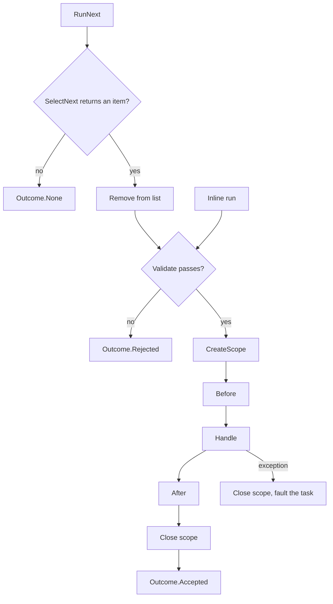

# Pipeline

> **Status: proposed.** Design only. No code changes. Page: https://claude.ai/artifact/74vPp64abx63ubpagvdpAg (catalog: https://claude.ai/artifact/Y1iBedUs8htkxDpkg6QYGU).

## 1. Summary

1. `Pipeline<TMessage, TScope>` runs one message through a fixed order: `Validate`, `CreateScope`, `Before`, `Handle`, `After`. It returns an `Outcome`.
2. A pipeline holds a list of items. The owner system calls `RunNext()`. The pipeline selects the next item, removes it from the list and runs it. A scope runs a message inline through an `IInlineRunner<TMessage>`.
3. The loop, blocks, ids, requests and the concrete pipelines are **out** of this spike. Section 2 names their owners.

### Decisions

From 2026-10-31 (all four infra spikes):

1. Ids are typed `readonly struct`s: `EntityId`, `RequestId`, `BlockId`, `MessageId` (`infra-record-ids.md`).
2. `TypeRouter<T>`, `TypeMultiRouter<T>`, `IdAllocator<TId>` and `EntityId` live in `Framework.Core`.
3. A new `Framework.Blocks` feature owns all `Block*` types (`infra-block-wire.md`).
4. The async core uses `System.Threading.Tasks.Task`.
5. The wire carries `CauseId` only. The nesting parent comes from bracket order.
6. An intent opens no block.
7. Hooks exist only at the command level. Only the command pipeline fills its `Before` and `After` stores.

From 2026-11-01 (this spike):

8. **Scope first.** The pipeline owns only the concerns marked "in" in section 2.
9. **API first.** Each part serves an entry point in section 4.
10. The loop is out. The owner system decides when to call `RunNext`.
11. `Execute` is not virtual. The steps in it are virtual: `Validate`, `Before`, `Handle`, `After`. `CreateScope` is abstract. `SelectNext` is virtual.
12. One public run entry: `RunNext()`. Inline runs skip `SelectNext`. Only scopes get the inline runner.
13. Validators are a separate first slot. A reject runs no other step.
14. Every message is wrapped in a `PipelineItem<TMessage>`. It has little behavior now. Replace and cancel come later.
15. After hooks cannot cancel.
16. Handlers get services from DI. Scope verbs are not in DI.
17. The pipeline defines the read interfaces of its stores and fills them at composition. Live add and remove is out.
18. No tuple returns in the API. `out` parameters are acceptable.

## 2. Scope

| Concern | In / Out | Owner if out |
|---|---|---|
| Fixed run order: `Validate` → `CreateScope` → `Before` → `Handle` → `After` → `Outcome` | in | — |
| Validator slot, first and separate | in | — |
| `Before`, `Handle`, `After` as virtual methods; the defaults read the stores | in | — |
| Store read interfaces and their injection | in | — |
| Fill the stores at composition | in | — |
| Item wrapper `PipelineItem<TMessage>` | in | — |
| Item list: `Add`, `Remove`, `TryPeek`, `SelectNext` | in | — |
| Run entries: `RunNext`, and `IInlineRunner<TMessage>` for scopes | in | — |
| Scope: one for each item, not in DI, closed after the run | in | — |
| Fill the stores at runtime (live add and remove) | out | Concrete pipeline or game; `HookTable` in `infra-type-router.md` |
| How a store works inside | out | `infra-type-router.md` |
| Block bracket, `CauseId`, wire form | out | `infra-block-wire.md` (later) |
| `MessageId`, `EntityId` | out | `infra-record-ids.md` |
| Loop and order across pipelines (SBA, stack, next intent) | out | Engine loop (`GameEngine`; no spike yet) |
| Intents, client input, the `Answer` path | out | Engine loop / Requests |
| `Ask`: request id, await, completion | out | `RequestService`; the scope only forwards |
| Concrete pipelines, their scope verbs and their hooks | out | Commands and Effects features |
| Event fan-out and replication | out | Wire (`EventStream`, `HandlerRegistry`) |

**Boundary.** The pipeline receives a message from `Add` or from an inline runner. It wraps the message in a `PipelineItem`, runs the item, and gives an `Outcome` back to the caller. Handlers call services, and services emit events to `EventStream`.

## 3. Today

### Uses

| Use | Where | Does |
|---|---|---|
| Command execute | `Framework/Commands/Runtime/CommandService.cs:21` | validate, block, one handler; sync |
| Command + hooks | VS `Engine/Pipeline/CommandService.cs:59` | block, Before hooks, `Apply`, After hooks |
| Effect resolve | VS `Engine/Pipeline/EffectService.cs:84` | `Validate`, block, `Run` |
| Effect stack | VS `Engine/Pipeline/Stack.cs:121` | LIFO list, virtual `ShouldResolve` (`:80`) |
| Command queue | VS `Engine/Pipeline/GameEngine.cs:52,96` | FIFO list, drained by the pump |

### Current shapes

| | Framework command | VS command | VS effect |
|---|---|---|---|
| Message | `Command` (`Commands/Runtime/Command.cs:3`) | `Command` with `Apply` (`Commands/Command.cs:22`) | `Effect` with `Validate`, `Run` (`Effects/Effect.cs:18-19`) |
| Validate | `CommandValidatorRegistry.TryFor` (`:24`) | none | `effect.Validate` |
| Handler lookup | `CommandHandlerRegistry.HandlerFor` (`:22`) | none: logic on the message | none: logic on the message |
| Hooks | none | `EffectStore.Subscribe` (`EffectStore.cs:47`); Before drains with `GetResult()` (`CommandService.cs:109`) | none |
| Scope | none | `ICommandScope` leaks `EffectStore`, `Stack` (`ICommandScope.cs:47,53`) | `IEffectScope` |
| Result | `CommandResult` (`CommandResult.cs:3`) | none | none (`Validate` false = no block) |
| List | none | `Queue<Command>` (`GameEngine.cs:52`) | `Stack` (`Stack.cs:58,121`) |

### What repeats

| Common part | Seen in | Varies between uses |
|---|---|---|
| Validate first; a reject does nothing | FW command, VS effect | validator object or method on the message |
| Find the logic by type | FW command | DI handler or method on the message |
| Before, handler, After | VS command | only commands have hooks |
| A scope for the handler | VS command, VS effect | verbs; the VS scopes leak engine objects |
| A list and a "next" rule | VS stack, VS command queue | LIFO with a policy, or FIFO |
| A result to the caller | FW command | VS returns nothing |
| Block bracket | all three | out of scope (Blocks) |

## 4. API

### Entry points

| Audience | Entry point | Does |
|---|---|---|
| author | `Handler<T, TMessage, TScope>.Handle(T, TScope)` | the logic for one message type |
| author | `Validator<T, TMessage>.Validate(T, out string)` | the check before the run |
| author | `Hook<T, TMessage, TScope>.Run(PipelineItem<TMessage>, TScope)` | a Before or After step |
| composition | `builder.RegisterHandler<TMessage, TScope, THandler>()` and the same for validators and hooks | fills the stores |
| composition | `builder.RegisterPipelines(set => …)` | makes the pipelines with `new` and fills a `PipelineSet` |
| composition | subclass `Pipeline<TMessage, TScope>`: `CreateScope`, `SelectNext`, `Before`, `After` | the custom part of one pipeline |
| runtime | `Add`, `Remove`, `TryPeek`, `Items`, `RunNext` | the owner system uses the list |
| runtime | `IInlineRunner<TMessage>.Run(TMessage)` | a scope runs a message now, nested |

### Shape

```csharp
public abstract class Pipeline<TMessage, TScope> where TMessage : class
{
    public MessageId Add(TMessage message);                         // into the list
    public bool Remove(MessageId id);                               // false: absent, or already taken
    public bool TryPeek(out PipelineItem<TMessage> item);           // the item that RunNext takes
    public IReadOnlyList<PipelineItem<TMessage>> Items { get; }     // read-only view
    public Task<Outcome> RunNext();                                 // Outcome.None if no item is selected
}

public interface IInlineRunner<TMessage> { Task<Outcome> Run(TMessage message); }   // scopes only

public sealed class PipelineItem<TMessage> { public MessageId Id { get; } public TMessage Message { get; } public ItemState State { get; } }

public readonly struct Outcome { public OutcomeKind Kind { get; } public string Reason { get; } }   // Accepted, Rejected, None
```

### Call site

```csharp
sealed class PlayCardHandler : CommandHandler<PlayCard>       // ctor: ZoneService (DI)
{
    public override Task Handle(PlayCard c, ICommandScope s)
    {
        _zones.Move(c.CardId, Zones.Limbo);                     // service: from DI
        s.Add(new Fireball { Source = c.CasterId });            // verb: only from the scope
        return Task.CompletedTask;
    }
}
```

The owner system runs the list:

```csharp
while ((await effects.RunNext()).Kind != OutcomeKind.None) { }
```

### Access

| Bypass route | What stops it |
|---|---|
| A handler injects a pipeline | Pipelines and `PipelineSet` are not in DI. |
| A handler injects the owner system | Rulebook check PIPE-04. |
| An effect handler injects a service and skips command hooks | Rulebook check PIPE-02. The scope cannot stop this. |
| A handler keeps the scope and uses it later | The scope closes after the run. Its verbs then throw. |
| A subclass changes the run order | `Execute` is not virtual. |
| A caller runs a message inline without a scope | `IInlineRunner<TMessage>` is only in `PipelineSet`. |
| A game removes the running item | `Remove` returns false. The item left the list before the run. |

## 5. Parts

| Part | Replaces |
|---|---|
| `Pipeline<TMessage, TScope>` | FW `CommandService`, VS `CommandService.Execute`, VS `EffectService.RunInline` |
| Item list and `SelectNext` | VS `Stack`, VS `GameEngine` queue |
| `PipelineItem<TMessage>` and `Outcome` | `CommandResult`; nothing in VS |
| Stores and author bases | `CommandHandlerRegistry`, `CommandValidatorRegistry`, VS `EffectStore` subscriptions, logic on messages |
| Scope | VS `ICommandScope`, `IEffectScope` |
| `PipelineSet` and `IInlineRunner<TMessage>` | direct calls to `CommandService` and `EffectService` |

### `Pipeline<TMessage, TScope>`

`Execute` is protected and not virtual. `RunNext` and the inline runner call it.

```csharp
protected async Task<Outcome> Execute(PipelineItem<TMessage> item)
{
    if (!Validate(item, out var reason)) return Outcome.Rejected(reason);   // no other step
    var scope = CreateScope(item);
    try
    {
        await Before(item, scope);
        await Handle(item, scope);
        await After(item, scope);
        return Outcome.Accepted();
    }
    finally { Close(scope); }                                              // verbs throw after this
}

protected abstract TScope CreateScope(PipelineItem<TMessage> item);
protected virtual bool Validate(PipelineItem<TMessage> item, out string reason);   // validators.TryFor(type)
protected virtual Task Before(PipelineItem<TMessage> item, TScope scope);          // before.All(type), in order
protected virtual Task Handle(PipelineItem<TMessage> item, TScope scope);          // handlers.For(type)
protected virtual Task After(PipelineItem<TMessage> item, TScope scope);           // after.All(type), in order
```

A fault goes into the returned task. The scope closes on every path.

### Item list and `SelectNext`

```csharp
public Task<Outcome> RunNext()
{
    var item = SelectNext(_items);                 // null: nothing to run now
    if (item == null) return Task.FromResult(Outcome.None());
    _items.Remove(item);                           // before the run: a running item can Add more
    return Execute(item);
}

protected virtual PipelineItem<TMessage> SelectNext(IReadOnlyList<PipelineItem<TMessage>> items)
    => items.Count > 0 ? items[0] : null;          // FIFO; a stack returns the last item
```

An MTG stack overrides `SelectNext` and returns `null` until both players pass priority.

### `PipelineItem<TMessage>` and `Outcome`

The item gives each message an id and a state. Replace and cancel come later.

```csharp
public sealed class PipelineItem<TMessage>
{
    public MessageId Id { get; }                   // from IdAllocator<MessageId> at Add or inline run
    public TMessage Message { get; }
    public ItemState State { get; internal set; }  // Listed, Running, Completed, Rejected, Faulted
}
```

### Stores and author bases

The pipeline reads four stores. The router spike owns how each store works.

```csharp
public sealed class PipelineStores<TMessage, TScope>
{
    public TypeRouter<IValidator<TMessage>>               Validators { get; }   // zero or one
    public TypeRouter<IHandler<TMessage, TScope>>         Handlers   { get; }   // exactly one
    public IRouteSource<IHook<TMessage, TScope>>          Before     { get; }   // a list
    public IRouteSource<IHook<TMessage, TScope>>          After      { get; }   // a list
}

public abstract class Handler<T, TMessage, TScope> : IHandler<TMessage, TScope> where T : TMessage
{
    public abstract Task Handle(T message, TScope scope);
}
```

`IValidator<TMessage>`, `IHandler<TMessage, TScope>` and `IHook<TMessage, TScope>` implement `IRouted`. `IHook` also implements `IOrdered`. A concrete pipeline gives named bases, for example `CommandHandler<T> : Handler<T, Command, ICommandScope>`.

### Scope

A scope holds the verbs of one pipeline that are not in DI. `CreateScope` makes one scope for each item. The concrete pipeline defines the verbs.

```csharp
public interface ICommandScope { void Add(Effect effect); }       // example; Commands feature owns it

sealed class CommandScope : PipelineScope, ICommandScope
{
    readonly Pipeline<Effect, IEffectScope> _effects;
    public void Add(Effect effect) { ThrowIfClosed(); _effects.Add(effect); }
}
```

`Add` returns `void`. A command cannot await an effect that runs after the command completes.

### `PipelineSet` and `IInlineRunner<TMessage>`

Composition makes the pipelines with `new` and puts them in one `PipelineSet`. A pipeline reads the other pipelines from the set when it makes a scope. This solves the wiring cycle: the command scope needs the effect pipeline, and the effect scope needs the command pipeline.

```csharp
builder.RegisterPipelines(set =>
{
    set.Add(new CommandPipeline(set, stores.For<Command, ICommandScope>()));
    set.Add(new EffectPipeline(set, stores.For<Effect, IEffectScope>()));
});

// inside EffectPipeline
protected override IEffectScope CreateScope(PipelineItem<Effect> item)
    => new EffectScope(Set.Inline<Command>(), Set.Inline<Effect>());
```

`PipelineSet` is not in DI. Only the owner system gets it.

## 6. Architecture

### Call stack

```
owner system: effects.RunNext()
└─ SelectNext → Fireball item; remove from the list
   └─ Execute(item)
      ├─ Validate                                   validators.TryFor(Fireball)
      ├─ CreateScope → EffectScope
      ├─ Before                                     empty store
      ├─ Handle → FireballHandler.Handle(e, scope)
      │  └─ scope.Execute(DealDamage) → IInlineRunner<Command>.Run
      │     └─ CommandPipeline.Execute(item)
      │        ├─ Validate, CreateScope
      │        ├─ Before → DivineShieldHook          may run an effect inline
      │        ├─ Handle → DealDamageHandler → TagService.Set → TagSet (wire event)
      │        └─ After                              may Add effects to the list
      ├─ After
      └─ close scope → Outcome.Accepted
```

### Logic flow



## 7. Trade-offs

| Loss | Why it matters | Mitigation |
|---|---|---|
| A game changes policy with a subclass | The game must know the base class. | Few virtual methods; each has a default. |
| `Execute` is fixed | A pipeline cannot run hooks before validation. | Validation is opt-in for each type. |
| Two ways to get dependencies | Verbs come from the scope. Services come from DI. | One rule: call down with the scope. |
| DI can skip the scope | The scope does not protect services. | Rulebook checks PIPE-02 to PIPE-04. |
| `Remove` cannot stop a running item | A counter to a running effect needs another verb. | Cancel on `PipelineItem` comes later. |
| Every handler is async | A sync handler returns `Task.CompletedTask`. Stack traces are longer. | Named bases; one inline-continuation test. |
| One class for each message type | The VS style (`Apply` on the message) is shorter. | DI handlers are testable. |

## 8. Rulebook rules to propose

Proposals only. `rulebook.json` does not change in this spike.

| Id | Rule | Check kind |
|---|---|---|
| PIPE-01 | A scope interface exposes only the verbs of its pipeline. | `type.memberTypes`, extended with `includeParameters: true` |
| PIPE-02 | An effect handler does not call a Framework service. | `il.forbiddenCalls` |
| PIPE-03 | An intent handler does not call a Framework service. | `il.forbiddenCalls` |
| PIPE-04 | A handler does not call a pipeline, `PipelineSet` or the owner system. | `il.forbiddenCalls` |
| PIPE-05 | A handler does not leave the run thread (`Task.Run`, `Task.Delay`, `ConfigureAwait`). | `il.forbiddenCalls`, extended with a `methods[]` filter |

## 9. Migration steps

Each step is one PR. Each step keeps `powershell -NoProfile -File Tools/Rulebook/gate.ps1` green. Steps 1 and 2 come after the router step that adds `TypeRouter<T>`, and after the record-ids step that adds `MessageId`.

1. **Base pipeline. No behavior change.** Add `Pipeline<,>`, `PipelineItem<>`, `Outcome`, `PipelineStores<,>`, `IHandler<,>`, `IValidator<>`, `IHook<,>`, `PipelineSet` and `IInlineRunner<>`. Add `CommandPipeline` with a scope that has no verbs. `CommandService.Execute` calls the inline runner, throws if the task is not complete, and maps `Outcome` to `CommandResult`. The block bracket stays in `CommandService` until the Blocks step. Proof: `CommandServiceTests` and all acceptance bindings pass unchanged. Add `PipelineTests`: a reject runs no step, the scope closes on a fault, the step order, `SelectNext` FIFO and LIFO, `Remove` of a running item.
2. **Async handlers.** Change `CommandHandler<T>` to `Task Handle(T, ICommandScope)`. Delete `CommandService`. Add PIPE-01, PIPE-04 and PIPE-05. Add the inline-continuation test (decision 4) in EditMode and PlayMode.
3. **Effect pipeline.** Add `EffectPipeline`, `IEffectScope`, `ICommandScope.Add`, and a LIFO `SelectNext`. Add PIPE-02. Proof: the Fireball picture.
4. **Command hooks.** Fill the command `Before` and `After` stores. The live `HookTable` comes from the router spike. Proof: the Divine Shield picture.

The engine loop, intents and the `Answer` path move to the engine-loop spike.

## 10. Interfaces needed from the other pieces

| Piece | Needs |
|---|---|
| Router (`infra-type-router.md`) | `TypeRouter<T>.For(Type)` and `TryFor(Type, out T)`. `IRouteSource<T>.All(Type)` with a stable order, no allocation. `IRouted`, `IOrdered`. |
| Record ids (`infra-record-ids.md`) | `MessageId` and `IdAllocator<MessageId>`. The id is local and not on the wire. |
| Blocks (`infra-block-wire.md`) | Later. The bracket must wrap `Before`, `Handle` and `After`, and not `Validate`. |
| Requests | The scope forwards `Ask` to `RequestService`. |

## 11. Open questions

1. **Replace with a type change.** A Before hook replaces `DealDamage` with `PreventDamage`. Do the Before hooks of the new type run?
2. **Cancel.** Which steps can cancel an item, and what is the `Outcome`?
3. **Base-type routing** for validators and hooks.
4. **List changes on the wire.** A stack UI must see `Add` and `Remove`. This comes with the Blocks discussion.
5. **Same-pipeline inline runs.** `IEffectScope` can run an effect inline. Confirm that a command cannot run a command.
6. **`Outcome.None` or `TryRunNext`.** `RunNext` returns `Outcome.None` when `SelectNext` gives no item. Confirm this shape.
