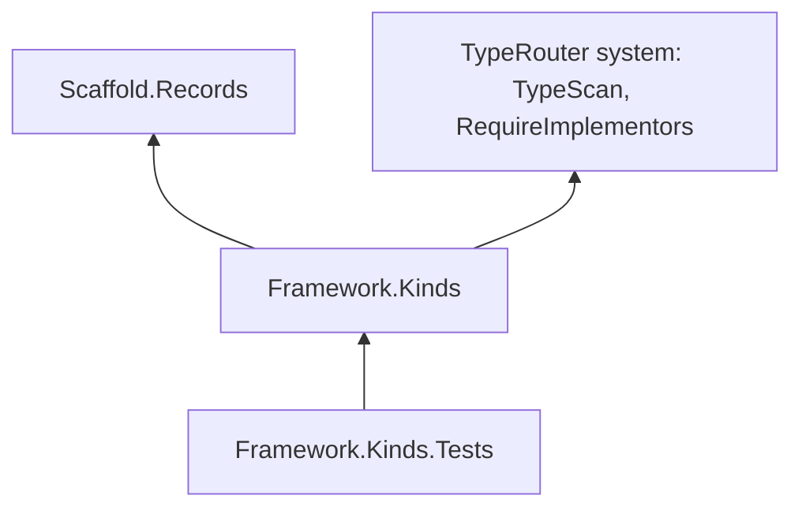

# Shared infra — kind ids

> **Status: proposed.** This spike came from a split of `infra-record-ids.md` (2026-11-01).
> A **kind** is a type that names one member of an open set: a tag, an entity type, a game
> state. Its id is the **slot**: an authored number for the type, not for an instance.
> Page: https://claude.ai/artifact/CPgJfPpSDPmpWKah1tQPFb. No code changes yet.

## 1. TL;DR

1. Keep the standard in `docs/lookup-patterns.md`: a kind is a record over a `TypeKey` base, and a registry maps slots to members.
2. The slot stays an authored `int`. It is the only identity on the wire and in data. The record is the identity in code.
3. The slot is `private` to `TypeKey`. The registry is nested in `TypeKey` (`TypeKey.Registry<TKey>`), so it is the only reader: `SlotOf(key)` and `BySlot(slot)`.
4. Code members register through a scan of all loaded assemblies (`RegisterCodeMembers()`). Data members register through `Define(slot)` or `Register(member)`. Then the registry freezes.
5. A member type has no public constructor with a slot parameter. Data tags come only from `tags.Define<int>(slot)`.
6. The framework has no slot ranges. An on-demand `KindValidator` checks the member shapes. A project adds its own number rules.
7. `TypeKey` implements `IKind`, which carries `[RequireImplementors]`, so IL2CPP stripping keeps the member types.

### Decisions

1. (2026-11-01) The authored number stays the one wire identity. A gate rule checks that slots are unique. The options that remove the number (a count at composition, a hash of the type name) are rejected. Saves, replays and data need a number that does not change across builds.
2. (2026-11-01) Kind ids and record ids are two different patterns. They get two spikes and two pages.
3. (2026-11-01) No typed slot struct. The slot is an `int` and only the registry reads it. This replaces the slot structs (`TagSlot`, `EntityTypeSlot`, `StateSlot`) from decision 1.
4. (2026-11-01) Scope follows the two-tab page template (§2). Block kind, tag values, the state stack, the wire path and the asset format are out.
5. (2026-11-01) The registry is nested in `TypeKey`, and the slot is `private`. No `internal` slot and no friend assembly.
6. (2026-11-01) No `AddKind` installer call. v1: a reflection scan calls `Register<T>()` for each sealed member type. v2: a source generator writes the same list. Kinds are an exception to the "explicit registration" rule.
7. (2026-11-01) `Tag<T>` is a concrete record, so data tags are instances. Data members have no name: code holds a reference, or uses `BySlot`.
8. (2026-11-02) The scan reads all loaded assemblies, test assemblies included. Test members appear on purpose; a test filter can come later. The scan uses the router's `TypeScan` (`infra-type-router.md`) with one new parameter: `ConcreteTypesOf(baseType, includeTests: true)`.
9. (2026-11-02) The framework has no slot ranges. The old KIND-02 rule (0–999 for the framework) is removed. Each project writes its own number guidance. `KindValidator.Validate()` in Core runs on demand, returns issues and throws nothing. An analyzer can use it later.
10. (2026-11-02) `Register` of a member that is equal to a registered member (same type and slot) does nothing. A different member on a used slot throws, and the message names both types.
11. (2026-11-02) The `Tag<T>` constructor is `protected internal`. `TagRegistry.Define<T>(slot)` makes and registers a data tag. The base registry has `Define(slot, make)` for other kind spaces. `KindValidator` reports a member type with a public constructor that has parameters. `SlotOf` has no extra check: it stays one field read.
12. (2026-11-02) Stripping: `TypeKey` implements `IKind`, and `IKind` carries the router's own `[RequireImplementorsAttribute]`. The router smoke build proved this attribute on IL2CPP at stripping level High. Add one kind member to that build, because kind members get `IKind` through a base class.
13. (2026-11-02) Tag value types (the `T` in `Tag<T>`) are out of scope. They are a `Framework.Tags` concern. The "Framework.Tags refactor" issue (https://github.com/MgCohen/Card-Framework/issues/196) holds them, with the other tag gaps.
14. (2026-11-02) The data asset format is out of scope. This spike gives only `Define<T>(slot)`. The data work comes after this spike.
15. (2026-11-02) The plan is an extraction. It builds a new system, `Framework.Kinds`, in `Assets/Framework/Kinds/`, next to the current systems. No step edits a current system. The migration of Tags, Entities and States is one row in §5 Later.

## 2. Scope

| Concern | In / Out | Owner if out |
|---|---|---|
| Kind root record and its members (`Tag`, `EntityType`, `GameState`) | in | — |
| Slot number for each member: unique in its kind space | in | — |
| Registry: slot to member, member to slot, type to member | in | — |
| Registration at composition: code members, data members, then freeze | in | — |
| Slot access: only the registry reads the slot | in | — |
| Members from data, added before the freeze (`Define`) | in | — |
| Checks: unique slots, no public slot constructor, no positional root record | in | — |
| Slot ranges and number guidance | out | each project |
| Instance ids (`EntityId`, `BlockId`, `MessageId`) and their allocation | out | `infra-record-ids.md` |
| Wire event fields, packing and apply handlers | out | `Framework.Wire` and each feature |
| Asset format for data members | out | data-authoring work |
| Tag values: value types, `TagStore`, value checks | out | `Framework.Tags` refactor (https://github.com/MgCohen/Card-Framework/issues/196) |
| Game state stack (`Push`, `Pop`, current state) | out | `Framework.States` |
| `BlockKind`: change from an `enum` to a kind space | out | `infra-block-wire.md` (it can use this pattern) |
| Card definition ids in `Catalog` | out | `Framework.Entities` (Catalog) |
| Handler lookup by message type, `TypeScan` | out | `infra-type-router.md` |
| VS `TagKey` and `[TagSlot]` attribute | out | VS spike (deletable, not promoted) |

Boundary: the pattern receives kind records from code and from data at composition. It gives each feature a frozen registry. The feature turns a member into a slot (`SlotOf`) and a slot into a member (`BySlot`). What the feature does with the slot is out of scope.

## 3. Today

### 3.1 Uses

| Kind space | Root record | Members today | Registry | Read by slot | Where |
|---|---|---|---|---|---|
| tag | `Tag`, `Tag<T>` | none in the framework; samples `HealthTag(2001)`, `CostTag(2002)`, `IsCardTag(2003)` | `TagRegistry`, **empty** | never: `TagStore` keys by `(entityId, slot)` | `Tags/Runtime/Tag.cs:6,11`; `Testing/Support/SampleTags.cs:9-11`; `Bootstrap/Runtime/TagInstaller.cs:15` |
| entity type | `EntityType` | `Unknown(0)`, `Player(2)`, `Zone(3)`, `Card(4)`, `Modifier(5)` | `EntityTypeRegistry.WithBaselines` | `EntityCreatedHandler` | `Entities/Runtime/EntityType.cs:5-11`; `Registry/EntityTypeRegistry.cs:7-16`; `Handlers/EntityCreatedHandler.cs:17` |
| game state | `GameState` | `MatchNotStartedState(0)`, `PlayingState(1)`, `MatchEndedState(2)` | `GameStateRegistry.WithBaselines` | `StatePushHandler` | `States/Runtime/GameState.cs:5`; `Registry/GameStateRegistry.cs:7-14`; `Handlers/StatePushHandler.cs:16` |

Paths are under `Assets/Framework/`. `key.Slot` is public. Runtime code reads it at 10 sites (`TagService.cs:18-50`, `EntityService.cs:23`, `StateService.cs:15`). Tests read it at 3 sites (`TwoSidedMatchIntegrationTests.cs:45-47`).

Four findings:

1. **Tag slots have no check.** `TagInstaller` registers an empty `TagRegistry`. Two tags with the same slot and the same value type share one storage cell. No error shows.
2. **Games cannot add kinds.** `EntityInstaller` and `StateInstaller` register `WithBaselines()` as an instance. No installer call adds a game member.
3. **A clash shows late.** `SlotRegistry.Add` throws when the registry fills, when a match starts. Nothing checks in the gate.
4. **Any code reads the slot.** `Slot` is a public positional property, so code can use a slot with no registry.

### 3.2 What repeats

| Common part | Seen in | Varies between uses |
|---|---|---|
| Root record over `TypeKey(int Slot)` | Tag, EntityType, GameState | Extra members: `Tag.ValueType` |
| Sealed member with a fixed slot | all three | Slot numbers; tags are samples only |
| Sealed registry subclass over `SlotRegistry<TKey>` | all three | Tag: empty; others: a hand-written `WithBaselines()` list |
| Feature code reads `key.Slot` | all three | Number of sites |

## 4. Proposal

### 4.1 API

| Audience | Entry point | Does |
|---|---|---|
| author | `sealed record X() : Root(slot)` | Defines a code member. |
| author | `tags.Define<int>(slot)` | Defines a data member. Only roots that allow data, for example tags. |
| author | `abstract record Root : TypeKey` + `TypeKey.Registry<Root>` | Defines a kind space. Feature authors only. |
| composition | `registry.RegisterCodeMembers()` | Finds every sealed member type and registers it. |
| composition | `registry.Register(member)`, `Freeze()` | Adds one member; closes the registry. |
| runtime | `registry.SlotOf(key)`, `BySlot(slot)` | Member to slot, slot to member. |
| runtime | `registry.Of<T>()`, `is T` | Type to member; branch on a member. |
| gate, tools | `KindValidator.Validate()` | Returns the shape issues. Throws nothing. |

Shape:

```csharp
[RequireImplementors] public interface IKind { }

public abstract record TypeKey : IKind
{
    protected TypeKey(int slot);
    private readonly int _slot;                         // only Registry reads it

    public class Registry<TKey> where TKey : TypeKey
    {
        public void RegisterCodeMembers();              // scan: Register<T>() for each sealed member
        public void Register<T>() where T : TKey, new(); // one code member
        public void Register(TKey member);              // equal member: no-op; slot clash: throws
        public T    Define<T>(int slot, Func<int, T> make) where T : TKey;  // make + Register
        public void Freeze();                           // Register then throws

        public int  SlotOf(TKey key);                   // member → slot
        public TKey BySlot(int slot);                   // slot → member
        public bool TryBySlot(int slot, out TKey key);
        public T    Of<T>() where T : TKey;             // type → code member
        public IReadOnlyCollection<TKey> Members { get; }
    }
}

public static class KindValidator
{
    public static IReadOnlyList<string> Validate(params Type[] roots);   // no roots = all; no throw
}
```

Call site:

```csharp
public sealed record PoisonTag() : Tag<int>(1001);     // code tag
Tag<int> shield = tags.Define<int>(1002);              // data tag
if (entity.Type is Card) { ... }
```

Dependencies:

| Depends on | Why |
|---|---|
| `Scaffold.Records` | Record types (C# 9 records shim). |
| `TypeScan` from the TypeRouter system | `RegisterCodeMembers()` finds the member types. |
| `RequireImplementorsAttribute` from the TypeRouter system | `IKind` keeps the member types in IL2CPP builds. |

asmdef references: `Framework.Kinds` → `Scaffold.Records` and the TypeRouter system asmdef. After the migration (§5): `Framework.Tags`, `Framework.Entities` and `Framework.States` → `Framework.Kinds`.
Must NOT depend on this part: `Framework.Wire`. Wire fields stay `[Packed] int`. `Framework.Kinds` references no feature assembly and no `UnityEngine`.

Rules:

| Rule | Enforced by |
|---|---|
| Only a registry reads the slot. | C# access: `private _slot`, read by the nested `TypeKey.Registry` (compiler). |
| Slots are unique in each kind space. | `Register` throws at composition. KIND-01: `KindValidator` in an `attached` gate test. |
| A kind member type has no public constructor with parameters. | KIND-02: `KindValidator` in the same gate test. |
| A kind root record is not positional. | KIND-03: `KindValidator` in the same gate test. |
| Only `TagRegistry` makes a data tag. | C# access: `protected internal` `Tag<T>` constructor (compiler). |
| `SlotOf` takes only members of its kind space. | Generic constraint `TKey : TypeKey` (compiler). |
| No member is added during a match. | `Freeze()`: `Register` throws at runtime. |
| IL2CPP keeps the member types. | `[RequireImplementors]` on `IKind`; the TypeRouter IL2CPP smoke build. |

### 4.2 Parts

| Part | Home | Serves |
|---|---|---|
| `TypeKey` with a private slot, `IKind` | `Framework.Kinds` | define a member, keep it in IL2CPP builds |
| `TypeKey.Registry<TKey>` | `Framework.Kinds` | `SlotOf`, `BySlot`, `Of<T>`, `Define`, `Freeze` |
| Code member scan | `Framework.Kinds` (calls `TypeScan`) | `RegisterCodeMembers()` |
| `KindValidator` | `Framework.Kinds` | KIND-01/02/03 on demand |
| Data tags: `Tag<T>` + `TagRegistry.Define<T>` | `Framework.Tags` | `tags.Define<int>(slot)` |
| Kind space: root record + registry subclass | the feature | define a kind space |

**TypeKey and Registry.** A nested type can read the private members of its outer type. So only the registry can read the slot.

```csharp
public abstract record TypeKey : IKind
{
    protected TypeKey(int slot) => _slot = slot;
    private readonly int _slot;

    public class Registry<TKey> where TKey : TypeKey
    {
        public int SlotOf(TKey key) => key._slot;    // one field read
        // Register, Define, Freeze, BySlot, Of<T>
    }
}
```

**Kind space.** The root is not positional, because a positional parameter makes a new public `Slot` property. Member lines do not change. There is no hand-written baseline list.

```csharp
public abstract record EntityType : TypeKey
{
    protected EntityType(int slot) : base(slot) { }
}
public sealed class EntityTypeRegistry : TypeKey.Registry<EntityType> { }
public sealed record Card() : EntityType(4);
```

B1 has a test that proves two things: a positional member (`Card() : EntityType(4)`) can call the protected constructor of a non-positional root, and code outside `TypeKey` cannot read `_slot`.

**Code member scan.** The scan finds each sealed subtype of `TKey` with a parameterless constructor and calls the `Register<T>()` path for it. It reads all loaded assemblies, test assemblies included. A source generator replaces the scan in v2, with the same result.

```csharp
public void RegisterCodeMembers()
{
    foreach (var type in TypeScan.ConcreteTypesOf(typeof(TKey), includeTests: true))
        if (type.IsSealed && type.GetConstructor(Type.EmptyTypes) != null)
            RegisterType(type);                     // same path as Register<T>()
}
```

**Register.** Record equality compares the type and the slot. So a second `Register` of an equal member does nothing, and a different member on the same slot throws.

```csharp
if (_bySlot.TryGetValue(member._slot, out var old))
{
    if (old.Equals(member)) return;
    throw new InvalidOperationException($"Slot {member._slot}: {old.GetType().Name} and {member.GetType().Name}.");
}
```

**Data tags.** A data tag is an instance, not a class. Only `TagRegistry` can make one, so each data tag is registered. Code holds the reference that `Define` returns.

```csharp
public record Tag<T> : Tag where T : unmanaged
{
    protected internal Tag(int slot) : base(slot) { }
    public override Type ValueType => typeof(T);
}
public sealed class TagRegistry : TypeKey.Registry<Tag>
{
    public Tag<T> Define<T>(int slot) where T : unmanaged => Define(slot, s => new Tag<T>(s));
}
```

`EntityType` and `GameState` stay abstract. Each root chooses whether it accepts data members.

**KindValidator.** It runs on demand: in the gate test, in a menu item, or later in an analyzer. It returns issues and throws nothing.

| Id | Check |
|---|---|
| KIND-01 | Each registry fills with no slot clash. |
| KIND-02 | A kind member type has no public constructor with parameters. |
| KIND-03 | A kind root record (a direct abstract subtype of `TypeKey`) is not positional. |

**Stripping.** IL2CPP at stripping level High removes member types that no code uses, so the scan finds nothing. The router test (`infra-type-router.md` §5.5) proved that our own `RequireImplementorsAttribute` keeps them, also through a base class. The linker reads the attribute by its short name.

```csharp
[RequireImplementors] public interface IKind { }   // the TypeRouter system's attribute
```

### 4.3 Architecture

```
composition, both sides
TagInstaller.Install
├─ new TagRegistry()
├─ RegisterCodeMembers() → Register<PoisonTag>()   (clash → throw)
├─ tags.Define<int>(1002)                          (data tags, before the freeze)
├─ Freeze()
└─ builder.RegisterInstance(tags)

runtime
TagService.Set(entity, GameTags.Poison, 3)
└─ TagRegistry.SlotOf(GameTags.Poison) → 1001      (the feature uses the slot)
```

### 4.4 Trade-offs

| Loss | Why it matters | Mitigation |
|---|---|---|
| Slot numbers stay hand-written | An author must pick a free number for each new member. | A clash throws at composition and fails the gate. The number does not change across builds. |
| No slot ranges | A later framework member can take a number that a game uses. | Each project writes its own guidance. `KindValidator` can get a project check. |
| Registration is not explicit | `docs/lookup-patterns.md` asks for explicit registration. | Kinds become a written exception. `registry.Members` lists them. The v2 source generator gives a visible list. |
| Reflection scan at startup | The scan costs time, and IL2CPP stripping can remove a member type. | The scan runs once at composition. `IKind` with `[RequireImplementors]` keeps the types. The source generator removes both costs. |
| Test members appear in the scan | A test kind can take a slot in a game build that loads test assemblies. | Wanted for now. A test filter can come later. |
| A public slot constructor still compiles | C# cannot block `new CustomKind(5)` for a member type. | `KindValidator` reports it. An analyzer can come later. |
| Data tags have no type | `Of<T>` and `is` do not find a data tag. | Code keeps the reference from `Define`, or uses `BySlot`. |
| Root records are not positional | A root needs a protected constructor in place of one line. | Only a feature author writes a root. KIND-03 catches a positional root. |
| Frozen registries | No kind can be added during a match. | Data loads before composition, through `Define`. |

## 5. Later

| Item | Why later | Trigger to reopen |
|---|---|---|
| Migration of the current systems to `Framework.Kinds` | The plan is an extraction. It changes no current system. The migration: `GameState`, `EntityType` and `Tag` derive from the new `TypeKey`; their registries derive from `TypeKey.Registry<TKey>` and use the scan and `Freeze()`; `TagService`, `EntityService`, `StateService` and the integration tests use `SlotOf`; `Tag<T>` becomes concrete with `TagRegistry.Define<T>`; `Core/Runtime/TypeKey.cs` and `SlotRegistry.cs` are deleted; KIND-01/02/03 go into `rulebook.json`; `docs/lookup-patterns.md` and `docs/architecture.md` change. | `Framework.Kinds` is built and the gate is green. |
| `Framework.Tags` refactor: tag value types | A refactor of a current system: https://github.com/MgCohen/Card-Framework/issues/196 (sub-issues #197–#200). | The Tags refactor starts. |
| IL2CPP smoke build with a kind member | The smoke build is in the TypeRouter system. The router test proved that `[RequireImplementors]` keeps a type that gets the interface from a base class. | The migration starts, or a Unity upgrade. |
| v2 source generator for code members | The reflection scan is enough for v1. | The scan shows in a startup profile, or the IL2CPP smoke build loses a member. |
| Roslyn analyzer for KIND-02 and KIND-03 | `KindValidator` gives the same result on demand. | Authors often see KIND-02 or KIND-03 only at gate time. |
| Test filter for the scan | Test members are wanted now. | A player build loads test assemblies, or a test slot clashes with a game slot. |
| Data asset format | The data work comes after this spike. It only calls `Define(slot, make)`. | The data-authoring work starts. |
| Slot ranges | Each project writes its own guidance. | A game asks the framework for a reserved range. |
| `BlockKind` as a kind space | `infra-block-wire.md` owns it. | The block piece moves `BlockKind` from an `enum`. |

## 6. Plan

The plan builds `Framework.Kinds` next to the current systems. No step edits a current system.

### 6.1 Folder structure

```
Assets/Framework/Kinds/
├─ Runtime/                          Framework.Kinds.asmdef
│  ├─ IKind.cs                       B1
│  ├─ TypeKey.cs                     B1
│  ├─ TypeKey.Registry.cs            B2, B3
│  └─ KindValidator.cs               B4
└─ Tests/                            Framework.Kinds.Tests.asmdef
   ├─ Fixtures/
   │  └─ SampleKinds.cs              B1
   ├─ TypeKeyTests.cs                B1
   ├─ TypeKeyRegistryTests.cs        B2
   ├─ RegisterCodeMembersTests.cs    B3
   └─ KindValidatorTests.cs          B4
```

No `Assets/` subfolder: the system has no data.

### 6.2 Dependency graph



### 6.3 Steps

**B1 · Build — `IKind`, `TypeKey`, asmdef.**

```csharp
namespace Framework.Kinds
{
    [RequireImplementors] public interface IKind { }
    public abstract partial record TypeKey : IKind
    {
        protected TypeKey(int slot) => _slot = slot;
        private readonly int _slot;
    }
}
```

```csharp
// Fixtures/SampleKinds.cs
public abstract record SampleKind : TypeKey { protected SampleKind(int slot) : base(slot) { } }
public sealed record Alpha() : SampleKind(1);
public sealed record Beta() : SampleKind(2);
```

Test (`TypeKeyTests`): a positional member compiles over a non-positional root; `_slot` is not visible outside `TypeKey` (reflection: the field is private).

```
powershell -NoProfile -File Tools/Rulebook/gate.ps1
```

Done: gate PASS; `TypeKeyTests` green; `git diff --stat` shows only `Assets/Framework/Kinds/`.

**B2 · Build — `TypeKey.Registry<TKey>`.**

```csharp
public class Registry<TKey> where TKey : TypeKey
{
    public void Register(TKey member) { /* equal: no-op; clash: throw, both names */ }
    public T Define<T>(int slot, Func<int, T> make) where T : TKey { var m = make(slot); Register(m); return m; }
    public void Freeze();
    public int SlotOf(TKey key) => key._slot;
}
```

Test (`TypeKeyRegistryTests`): clash throws and names both types; equal member is a no-op; `Register` after `Freeze` throws; `Define` returns a registered member; `BySlot(SlotOf(x)) == x`; `Of<Alpha>()` returns the member.

Done: gate PASS; `TypeKeyRegistryTests` green; diff only under `Assets/Framework/Kinds/`.

**B3 · Build — `RegisterCodeMembers()`.**

```csharp
public void RegisterCodeMembers()
{
    foreach (var type in TypeScan.ConcreteTypesOf(typeof(TKey), includeTests: true))
        if (type.IsSealed && type.GetConstructor(Type.EmptyTypes) != null)
            RegisterType(type);
}
```

Test (`RegisterCodeMembersTests`): finds `Alpha` and `Beta` from the test assembly; skips a fixture type with a public slot constructor.

Done: gate PASS; `RegisterCodeMembersTests` green; diff only under `Assets/Framework/Kinds/`.

**B4 · Build — `KindValidator`.**

```csharp
public static class KindValidator
{
    public static IReadOnlyList<string> Validate(params Type[] roots);   // KIND-01/02/03; no roots = all
}
```

Test (`KindValidatorTests`): a positional root gives KIND-03; a public slot constructor gives KIND-02; two members on one slot give KIND-01; `Validate(typeof(SampleKind))` gives no issue.

Done: gate PASS; `KindValidatorTests` green; diff only under `Assets/Framework/Kinds/`.

## 7. Interfaces for the other pieces

- **Type-keyed router.** Kinds use `TypeScan` and the `[RequireImplementors]` attribute from `infra-type-router.md`. `TypeScan.ConcreteTypesOf` gets one optional parameter, `includeTests`. The router smoke build gets one kind member.
- **Block and wire.** If the block piece moves `BlockKind` to a kind space, it uses this shape: `BlockKind : TypeKey`, `BlockKindRegistry : TypeKey.Registry<BlockKind>`, `[Packed] int Kind`, `SlotOf` on emit.
- **Record ids.** The `TagStore` key is the entity id and the `int` slot. `infra-record-ids.md` decides the form of the entity id. The order of the two migrations does not matter.
