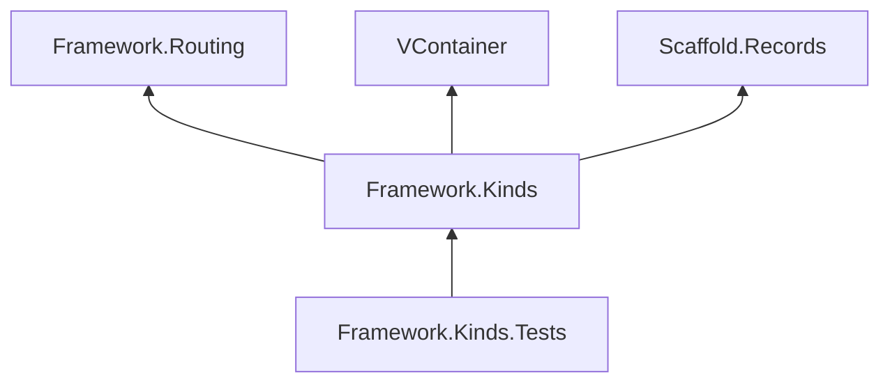

# Shared infra — kind ids

> **Status: proposed.** A **kind** is a type that names one member of an open set: an entity
> type, a game state. Its id is the **slot**: an authored number for the type, not for an
> instance. Page: https://claude.ai/artifact/CPgJfPpSDPmpWKah1tQPFb. Catalog:
> https://claude.ai/artifact/Y1iBedUs8htkxDpkg6QYGU. No code changes yet.

## 1. TL;DR

1. A new system, `Framework.Kinds` in `Assets/Kinds/`, holds the kind pattern: a record over `TypeKey` and a registry that maps slots to members.
2. The slot stays an authored `int`. It is the only identity on the wire and in data. The record is the identity in code.
3. The slot is `private` to `TypeKey`. The registry is nested in `TypeKey` (`TypeKey.Registry<TKey>`), so it is the only reader.
4. Each system registers its own kind space: `builder.AddKindSpace<Color, ColorRegistry>()`. The call scans the code members, adds data members, freezes, validates and registers the registry. A repeated call merges. `builder.AddKinds(o => ...)` holds only the shared options.
5. A member type has no public constructor with parameters. Data members come only from `registry.Define(slot, make)`.
6. The framework has no slot ranges. `KindValidator` checks the member shapes.
7. `TypeKey` implements `IKind`, which carries `[RequireImplementors]` from `Framework.Routing`, so IL2CPP keeps the member types.

### Decisions

1. (2026-11-01) The authored number stays the one wire identity. Saves, replays and data need a number that does not change across builds.
2. (2026-11-01) Kind ids and record ids are two different patterns, with two pages.
3. (2026-11-01) No typed slot struct. The slot is an `int` and only the registry reads it.
4. (2026-11-01) Scope follows the page template (§2).
5. (2026-11-01) The registry is nested in `TypeKey`, and the slot is `private`. No `internal` slot and no friend assembly.
6. (2026-11-01) No hand-written member list. v1: a reflection scan. v2: a source generator. Kinds are an exception to the "explicit registration" rule.
7. (2026-11-01) Data members are instances of a member record with a non-public constructor. Data members have no name: code holds a reference, or uses `BySlot`.
8. (2026-11-02) The scan reads all loaded assemblies, test assemblies included, through `TypeScan.ConcreteTypesOf(type, includeTests)` from `Framework.Routing`.
9. (2026-11-02) The framework has no slot ranges. Each project writes its own number guidance.
10. (2026-11-02) `Register` of a member that is equal to a registered member does nothing. A different member on a used slot throws, and the message names both types.
11. (2026-11-02) `Define(slot, make)` makes and registers a data member. `KindValidator` reports a member type with a public constructor that has parameters. `SlotOf` stays one field read.
12. (2026-11-02) Stripping: `TypeKey` implements `IKind`, and `IKind` carries `[RequireImplementors]`. The TypeRouter build test proved this attribute, also through a base class.
13. (2026-11-02) The user took Tags out of this system. The `Framework.Tags` refactor is one row in §5 Later.
14. (2026-11-02) The data asset format is out of scope. A data loader only calls `Define(slot, make)`.
15. (2026-11-02) The plan is an extraction. It builds `Framework.Kinds` in `Assets/Kinds/`, next to the current systems. No step edits a current system. The migration is one row in §5 Later.
16. (2026-11-02) Install methods in `Runtime/KindsInstall.cs`. A `Framework.Bootstrap.IInstaller` adapter is a Later row.
17. (2026-11-02, user, I1) Each system registers its own part. There is no central list. `AddKindSpace<TKey, TRegistry>(data)` registers one kind space; a repeated call for the same registry adds its data action and registers nothing new (the same shape as Record Ids' `AddIdSpace<TId>()`). `AddKinds(o => ...)` registers only what Kinds owns: `KindsOptions`. It is optional; with no call, the defaults apply. Kinds has no server or client role. If a role is ever needed, use the shared `Role` enum in `Framework.RecordIds` (issue #202).

## 2. Scope

| Concern | In / Out | Owner if out |
|---|---|---|
| Kind root record and its members | in | — |
| Slot number for each member: unique in its kind space | in | — |
| Registry: slot to member, member to slot, type to member | in | — |
| Setup: scan code members, add data members, freeze, validate, register (`AddKindSpace`) | in | — |
| Slot access: only the registry reads the slot | in | — |
| Shape checks: unique slots, no public slot constructor, no positional root record | in | — |
| Slot ranges and number guidance | out | each project |
| Instance ids and their allocation | out | Record Ids page |
| Wire event fields, packing and apply handlers | out | `Framework.Wire` and each feature |
| Asset format for data members | out | data-authoring work |
| The type scan and the stripping attribute | out | TypeRouter page (`Framework.Routing`) |
| Migration of the current kind spaces | out | §5 Later |

Boundary: the system receives kind records from code and from data at composition. It gives each feature a frozen registry. The feature turns a member into a slot (`SlotOf`) and a slot into a member (`BySlot`). What the feature does with the slot is out of scope.

## 3. Today

### 3.1 Uses

| Kind space | Root record | Members today | Registry | Read by slot | Where |
|---|---|---|---|---|---|
| entity type | `EntityType` | `Unknown(0)`, `Player(2)`, `Zone(3)`, `Card(4)`, `Modifier(5)` | `EntityTypeRegistry.WithBaselines` | `EntityCreatedHandler` | `Entities/Runtime/EntityType.cs:5-11`; `Registry/EntityTypeRegistry.cs:7-16`; `Handlers/EntityCreatedHandler.cs:17` |
| game state | `GameState` | `MatchNotStartedState(0)`, `PlayingState(1)`, `MatchEndedState(2)` | `GameStateRegistry.WithBaselines` | `StatePushHandler` | `States/Runtime/GameState.cs:5`; `Registry/GameStateRegistry.cs:7-14`; `Handlers/StatePushHandler.cs:16` |

Paths are under `Assets/`. `key.Slot` is public. Runtime code reads it in `EntityService.cs:23` and `StateService.cs:15`.

Three findings:

1. **Games cannot add kinds.** `EntityInstaller` and `StateInstaller` register `WithBaselines()` as an instance. No call adds a game member.
2. **A clash shows late.** `SlotRegistry.Add` throws when the registry fills, when a match starts. Nothing checks in the gate.
3. **Any code reads the slot.** `Slot` is a public positional property, so code can use a slot with no registry.

### 3.2 What repeats

| Common part | Seen in | Varies between uses |
|---|---|---|
| Root record over `TypeKey(int Slot)` | EntityType, GameState | — |
| Sealed member with a fixed slot | both | Slot numbers |
| Sealed registry subclass over `SlotRegistry<TKey>` with a hand-written `WithBaselines()` list | both | The list |
| Installer registers the registry instance | both | — |
| Feature code reads `key.Slot` | both | Number of sites |

## 4. Proposal

### 4.1 API

| Audience | Entry point | Does |
|---|---|---|
| author | `sealed record X() : Root(slot)` | Defines a code member. |
| author | `abstract record Root : TypeKey` + `TypeKey.Registry<Root>` | Defines a kind space. |
| author | `registry.Define(slot, make)` | Defines a data member, in the `AddKindSpace` data action. |
| composition | `builder.AddKindSpace<Root, RootRegistry>(data)` | Each system registers its own kind space. A repeated call merges. |
| composition | `builder.AddKinds(o => ...)` | Optional. Sets the shared options: scan scope, validation. |
| runtime | `registry.SlotOf(key)`, `BySlot(slot)`, `TryBySlot` | Member to slot, slot to member. |
| runtime | `registry.Of<T>()`, `is T` | Type to member; branch on a member. |
| tools | `KindValidator.Validate(roots)` | Returns the shape issues. Throws nothing. |

Shape:

```csharp
[RequireImplementors] public interface IKind { }

public abstract partial record TypeKey : IKind
{
    protected TypeKey(int slot);
    private readonly int _slot;                          // only Registry reads it

    public class Registry<TKey> where TKey : TypeKey
    {
        public void RegisterCodeMembers(bool includeTests);   // scan: Register<T>() for each sealed member
        public void Register<T>() where T : TKey, new();
        public void Register(TKey member);                    // equal: no-op; clash: throws
        public T    Define<T>(int slot, Func<int, T> make) where T : TKey;
        public void Freeze();                                 // Register then throws
        public int  SlotOf(TKey key);
        public TKey BySlot(int slot);
        public bool TryBySlot(int slot, out TKey key);
        public T    Of<T>() where T : TKey;
        public IReadOnlyCollection<TKey> Members { get; }
    }
}

public static class KindValidator { public static IReadOnlyList<string> Validate(params Type[] roots); }
```

Install:

```csharp
public static class KindsInstall
{
    public static IContainerBuilder AddKindSpace<TKey, TRegistry>(this IContainerBuilder builder, Action<TRegistry> data = null)
        where TKey : TypeKey where TRegistry : TypeKey.Registry<TKey>, new();      // repeated call: data merges
    public static IContainerBuilder AddKinds(this IContainerBuilder builder, Action<KindsOptions> configure);
}
public sealed class KindsOptions
{
    public bool IncludeTests { get; set; } = true;   // scan scope
    public bool Validate { get; set; } = true;       // KindValidator on each space; throw on an issue
}
```

Call site:

```csharp
public abstract record Color : TypeKey { protected Color(int slot) : base(slot) { } }
public sealed class ColorRegistry : TypeKey.Registry<Color> { }
public sealed record Red() : Color(1);

builder.AddKindSpace<Color, ColorRegistry>();      // in the system that owns Color
int slot = colors.SlotOf(colors.Of<Red>());          // colors: ColorRegistry, injected
```

Dependencies:

| Depends on | Why |
|---|---|
| `Framework.Routing` | `TypeScan.ConcreteTypesOf(type, includeTests)` finds the member types (TypeRouter B2). `RequireImplementorsAttribute` keeps them in IL2CPP builds. |
| VContainer | `AddKindSpace` registers the registries. Use the same solution as TypeRouter for VContainer in a `noEngineReferences` asmdef. |
| `Scaffold.Records` | Record types (C# 9 records shim). |

asmdef references: `Framework.Kinds` → `Framework.Routing`, VContainer, `Scaffold.Records`; `noEngineReferences: true`.
Must NOT depend on this part: `Framework.Wire`. Wire fields stay `[Packed] int`. `Framework.Kinds` references no feature assembly.

Rules:

| Rule | Enforced by |
|---|---|
| Only a registry reads the slot. | C# access: `private _slot`, read by the nested `TypeKey.Registry` (compiler). |
| Slots are unique in each kind space. | `Register` throws when the container builds. KIND-01 in `KindValidator`. Rulebook row: Later. |
| A kind member type has no public constructor with parameters. | KIND-02 in `KindValidator`, run for each space when `KindsOptions.Validate` is on. Rulebook row: Later. |
| A kind root record is not positional. | KIND-03 in `KindValidator`, run for each space. Rulebook row: Later. |
| `SlotOf` takes only members of its kind space. | Generic constraint `TKey : TypeKey` (compiler). |
| No member is added during a match. | `Freeze()` when the space builds: `Register` then throws at runtime. |
| IL2CPP keeps the member types. | `[RequireImplementors]` on `IKind`. Smoke build: Later. |
| Each system registers its own space; no central list. | `KindsInstallTests`: a container with only `AddKindSpace` calls resolves the public API; two calls for one space give one registry. |

### 4.2 Parts

| Part | Replaces |
|---|---|
| `TypeKey` with a private slot, `IKind` | `Core/Runtime/TypeKey.cs` (`TypeKey(int Slot)`, public slot) |
| `TypeKey.Registry<TKey>` | `SlotRegistry<TKey>` |
| `RegisterCodeMembers(includeTests)` | the hand-written `WithBaselines()` lists |
| `Define(slot, make)` | — (new: data members) |
| `KindValidator` | — (new: the shape checks) |
| `AddKindSpace`, `AddKinds` + `KindsOptions` | `builder.RegisterInstance(XRegistry.WithBaselines())` in each installer |

**TypeKey and Registry.** A nested type can read the private members of its outer type. So only the registry can read the slot.

```csharp
public abstract partial record TypeKey : IKind
{
    protected TypeKey(int slot) => _slot = slot;
    private readonly int _slot;
    public class Registry<TKey> where TKey : TypeKey
    {
        public int SlotOf(TKey key) => key._slot;    // one field read
    }
}
```

**Kind space.** The root is not positional, because a positional parameter makes a new public `Slot` property. Member lines stay one line.

```csharp
public abstract record Color : TypeKey { protected Color(int slot) : base(slot) { } }
public sealed class ColorRegistry : TypeKey.Registry<Color> { }
public sealed record Red() : Color(1);
```

**Code member scan.** It registers each sealed subtype of `TKey` with a parameterless constructor.

```csharp
public void RegisterCodeMembers(bool includeTests)
{
    foreach (var type in TypeScan.ConcreteTypesOf(typeof(TKey), includeTests))
        if (type.IsSealed && type.GetConstructor(Type.EmptyTypes) != null)
            RegisterType(type);                     // same path as Register<T>()
}
```

**Register.** Record equality compares the type and the slot.

```csharp
if (_bySlot.TryGetValue(member._slot, out var old))
{
    if (old.Equals(member)) return;
    throw new InvalidOperationException($"Slot {member._slot}: {old.GetType().Name} and {member.GetType().Name}.");
}
```

**Data members.** A data member is an instance of a member record with a non-public constructor. Only code in its assembly can make one, and `Define` registers it.

```csharp
public sealed record CustomColor : Color { internal CustomColor(int slot) : base(slot) { } }
var teal = colors.Define(10, s => new CustomColor(s));
```

**KindValidator.** It runs when a space builds, in a gate test or in a menu item. It returns issues and throws nothing.

| Id | Check |
|---|---|
| KIND-01 | Each registry fills with no slot clash. |
| KIND-02 | A kind member type has no public constructor with parameters. |
| KIND-03 | A kind root record (a direct abstract subtype of `TypeKey`) is not positional. |

**AddKindSpace.** Each system registers its own space. The registry builds once, when the container builds. A repeated call adds its data action to the first call.

```csharp
var space = Spaces.Of(builder).GetOrAdd<TRegistry>(out bool first);
space.Data += data;                                 // repeated call: merge
if (!first) return builder;
builder.Register(r => space.Build(r.ResolveOrDefault<KindsOptions>()), Lifetime.Singleton).AsSelf();
builder.RegisterBuildCallback(r => r.Resolve<TRegistry>());   // errors at container build
```

`space.Build`: `new TRegistry()`, `RegisterCodeMembers(options.IncludeTests)`, the data actions, `Freeze()`, then `KindValidator.Validate(typeof(TKey))` when `options.Validate` is on.

### 4.3 Architecture

```
composition
builder.AddKindSpace<Color, ColorRegistry>(c => c.Define(10, s => new CustomColor(s)))
container build → space.Build(options)
├─ new ColorRegistry()
├─ RegisterCodeMembers(includeTests) → Register<Red>()   (clash → throw)
├─ Define(10, make)                                      (data members)
├─ Freeze()
├─ KindValidator.Validate(typeof(Color))                 (issue → throw)
└─ builder.RegisterInstance(colors)

runtime
colors.SlotOf(red) → 1
```

### 4.4 Trade-offs

| Loss | Why it matters | Mitigation |
|---|---|---|
| Slot numbers stay hand-written | An author must pick a free number for each new member. | A clash throws when the container builds. The number does not change across builds. |
| No slot ranges | A later framework member can take a number that a game uses. | Each project writes its own guidance. |
| Registration is not explicit | `docs/lookup-patterns.md` asks for explicit registration. | Kinds are a written exception. `registry.Members` lists them. A source generator gives a visible list in v2. |
| Reflection scan at startup | The scan costs time, and IL2CPP stripping can remove a member type. | The scan runs once for each space. `IKind` keeps the types. |
| Test members appear in the scan | A test kind can take a slot when test assemblies load. | `KindsOptions.IncludeTests`. |
| A public slot constructor still compiles | C# cannot block `new Member(5)` for a member type. | KIND-02. An analyzer can come later. |
| Data members have no type of their own | `Of<T>` and `is` do not find one data member. | Code keeps the reference from `Define`, or uses `BySlot`. |
| Root records are not positional | A root needs a protected constructor in place of one line. | Only a feature author writes a root. KIND-03 catches a positional root. |
| Frozen registries | No kind can be added during a match. | Data members load in the `AddKindSpace` data action, before the freeze. |

## 5. Later

| Item | Why later | Trigger to reopen |
|---|---|---|
| Migration of the current kind spaces | The plan is an extraction. It changes no current system. The migration: `EntityType` and `GameState` derive from the new `TypeKey`; their registries derive from `TypeKey.Registry<TKey>`; each system calls `AddKindSpace` for its own space; `EntityService`, `StateService` and the tests use `SlotOf`; `Core/Runtime/TypeKey.cs` and `SlotRegistry.cs` are deleted; `docs/lookup-patterns.md` and `docs/architecture.md` change. | `Framework.Kinds` is built and the gate is green. |
| `Framework.Tags` refactor | The user took Tags out of this system: https://github.com/MgCohen/Card-Framework/issues/196 (sub-issues #197–#200). | The Tags refactor starts. |
| `Framework.Bootstrap.IInstaller` adapter for `AddKindSpace` | Each system calls `AddKindSpace` directly. An adapter is a Bootstrap concern. | Bootstrap composes systems through installers. |
| Rulebook rows for KIND-01, KIND-02, KIND-03 | `KindValidator` enforces them when a space builds. A rulebook row needs user review. | The migration starts. |
| IL2CPP smoke build with a kind member | The smoke build is in `Framework.Routing`. | The migration starts, or a Unity upgrade. |
| v2 source generator for code members | The reflection scan is enough for v1. | The scan shows in a startup profile, or the IL2CPP smoke build loses a member. |
| Roslyn analyzer for KIND-02 and KIND-03 | `KindValidator` gives the same result. | Authors often see KIND-02 or KIND-03 only at startup. |
| Data asset format | A data loader only calls `Define(slot, make)`. | The data-authoring work starts. |
| Slot ranges | Each project writes its own guidance. | A game asks the framework for a reserved range. |

## 6. Plan

The plan builds `Framework.Kinds` next to the current systems. No step edits a current system.

### 6.1 Folder structure

```
Assets/Kinds/
├─ Runtime/                          Framework.Kinds.asmdef (noEngineReferences)
│  ├─ IKind.cs                       B1
│  ├─ TypeKey.cs                     B1
│  ├─ TypeKey.Registry.cs            B2, B3
│  ├─ KindValidator.cs               B4
│  ├─ KindsOptions.cs                B5
│  └─ KindsInstall.cs                B5
└─ Tests/                            Framework.Kinds.Tests.asmdef
   ├─ Fixtures/
   │  ├─ Colors.cs                   B1
   │  └─ BadKinds.cs                 B4
   ├─ TypeKeyTests.cs                B1
   ├─ TypeKeyRegistryTests.cs        B2
   ├─ RegisterCodeMembersTests.cs    B3
   ├─ KindValidatorTests.cs          B4
   └─ KindsInstallTests.cs           B5
```

No `Assets/` subfolder: the system has no data.

### 6.2 Dependency graph



### 6.3 Steps

**B1 · Build — `IKind`, `TypeKey`, asmdef.**

```csharp
using Framework.Routing;
namespace Framework.Kinds
{
    [RequireImplementors] public interface IKind { }
    public abstract partial record TypeKey : IKind
    {
        protected TypeKey(int slot) => _slot = slot;
        private readonly int _slot;
    }
}
```

```csharp
// Tests/Fixtures/Colors.cs
public abstract record Color : TypeKey { protected Color(int slot) : base(slot) { } }
public sealed class ColorRegistry : TypeKey.Registry<Color> { }
public sealed record Red() : Color(1);
public sealed record Green() : Color(2);
public sealed record CustomColor : Color { internal CustomColor(int slot) : base(slot) { } }
```

```json
// Tools/Rulebook/rulebook.json, ARCH-02 "allowed"
"Framework.Kinds": ["Framework.Routing"]
```

Test (`TypeKeyTests`): a positional member compiles over a non-positional root; the slot field is private.

```
powershell -NoProfile -File Tools/Rulebook/gate.ps1
```

Done: gate PASS; `TypeKeyTests` green; `git diff --stat` shows only `Assets/Kinds/` and `Tools/Rulebook/rulebook.json` (one ARCH-02 row).

**B2 · Build — `TypeKey.Registry<TKey>`.**

```csharp
public class Registry<TKey> where TKey : TypeKey
{
    public void Register(TKey member) { /* equal: no-op; clash: throw, both names */ }
    public T Define<T>(int slot, Func<int, T> make) where T : TKey { var m = make(slot); Register(m); return m; }
    public void Freeze();
    public int SlotOf(TKey key) => key._slot;
}
```

Test (`TypeKeyRegistryTests`): clash throws and names both types; equal member is a no-op; `Register` after `Freeze` throws; `Define(10, s => new CustomColor(s))` returns a registered member; `BySlot(SlotOf(x)) == x`; `Of<Red>()` returns the member.

Done: gate PASS; `TypeKeyRegistryTests` green; diff only under `Assets/Kinds/`.

**B3 · Build — `RegisterCodeMembers(includeTests)`.** Needs `TypeScan.ConcreteTypesOf(type, includeTests)` from TypeRouter B2.

```csharp
public void RegisterCodeMembers(bool includeTests)
{
    foreach (var type in TypeScan.ConcreteTypesOf(typeof(TKey), includeTests))
        if (type.IsSealed && type.GetConstructor(Type.EmptyTypes) != null)
            RegisterType(type);
}
```

Test (`RegisterCodeMembersTests`): finds `Red` and `Green`; skips `CustomColor`; finds nothing with `includeTests: false`.

Done: gate PASS; `RegisterCodeMembersTests` green; diff only under `Assets/Kinds/`.

**B4 · Build — `KindValidator`.** Each bad-shape fixture has its own root, so the `Color` scan does not find it.

```csharp
// Tests/Fixtures/BadKinds.cs
public abstract record ClashKind : TypeKey { protected ClashKind(int s) : base(s) { } }
public sealed record ClashA() : ClashKind(1);
public sealed record ClashB() : ClashKind(1);                                  // KIND-01
public sealed class ClashRegistry : TypeKey.Registry<ClashKind> { }
public abstract record OpenKind : TypeKey { protected OpenKind(int s) : base(s) { } }
public sealed record OpenMember : OpenKind { public OpenMember(int s) : base(s) { } }   // KIND-02
public abstract record PositionalKind(int Slot) : TypeKey(Slot);              // KIND-03
```

Test (`KindValidatorTests`): `Validate(typeof(ClashKind))` gives KIND-01; `Validate(typeof(OpenKind))` gives KIND-02; `Validate(typeof(PositionalKind))` gives KIND-03; `Validate(typeof(Color))` gives no issue.

Done: gate PASS; `KindValidatorTests` green; diff only under `Assets/Kinds/`.

**B5 · Build — `AddKindSpace`, `AddKinds` and `KindsOptions`.**

```csharp
public static IContainerBuilder AddKindSpace<TKey, TRegistry>(this IContainerBuilder builder, Action<TRegistry> data = null)
{
    var space = Spaces.Of(builder).GetOrAdd<TRegistry>(out bool first);
    space.Data += data;
    if (!first) return builder;
    builder.Register(r => space.Build(r.ResolveOrDefault<KindsOptions>()), Lifetime.Singleton).AsSelf();
    builder.RegisterBuildCallback(r => r.Resolve<TRegistry>());
    return builder;
}
public static IContainerBuilder AddKinds(this IContainerBuilder builder, Action<KindsOptions> configure)
{ var o = new KindsOptions(); configure(o); builder.RegisterInstance(o); return builder; }
```

Test (`KindsInstallTests`): a container with only `AddKindSpace<Color, ColorRegistry>(c => c.Define(10, s => new CustomColor(s)))` resolves `ColorRegistry`; `SlotOf(Of<Red>()) == 1`; `BySlot(10)` is the data member; the registry is frozen; a second `AddKindSpace<Color, ColorRegistry>(c => c.Define(11, …))` gives one registry with both data members; with no `AddKinds` call the defaults apply; `AddKindSpace<ClashKind, ClashRegistry>()` throws at container build.

Done: gate PASS; `KindsInstallTests` green; diff only under `Assets/Kinds/`.

## 7. Interfaces for the other pieces

- **TypeRouter.** Kinds use `TypeScan.ConcreteTypesOf(type, includeTests)` (TypeRouter B2) and `RequireImplementorsAttribute` from `Framework.Routing`. Kinds use the same VContainer setup as `Framework.Routing`.
- **Record Ids.** No shared type. A record id names an instance. A kind slot names a type.
