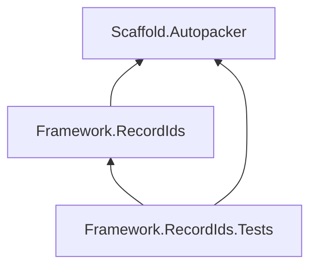

# Shared infra — record ids and id allocation

> **Status: proposed.** One of four shared-infrastructure spikes for the
> intent / effect / command / event pipeline. The other three are the
> type-keyed router, the block and wire system, and the command pipeline.
> This spike owns instance id spaces, id allocation and the record read names.
> Page: https://claude.ai/artifact/66MvZgwWo8hSEeKJ6KMDms. No code changes yet.

## 1. TL;DR

1. Base pattern: typed ids, `IdAllocator<TId>` (`Next`, `Release`) and `RecordStore<TRecord, TId>`. It knows nothing about the wire or the server.
2. A typed id is a one-line `sealed record` that derives from `abstract record Id`. The base holds `[Packed] int Value` (default `-1`). Inheritance removes the repeated members.
3. Records name their id type: `Entity : IRecord<EntityId>`. Events carry ids. Author APIs take records.
4. An AutoPacker upgrade packs an id field inline (nested packing). The wire cost stays 4 bytes for each id.
5. Blocks and requests have no allocator. `BlockId` is the stream position, and `RequestId` is removed (`infra-block-wire.md`).
6. Out of scope: inverse events (rollback), "messages hold ids" (pipeline) and the nested `TagStore` (Tags). See §2a and the appendix.

### Decisions (2026-10-31)

The user made these decisions for all four infra spikes:

1. ~~Ids are typed `readonly struct`s around `int`.~~ Replaced by decision 17.
2. Shared infrastructure lives in `Framework.Core`: routers. ~~`IdAllocator<TId>`, `Id`, `EntityId`~~ (decision 25 moves the record ids system to its own folder). `Framework.Wire` references `Framework.Core`. This needs an ARCH-02 edit. This spike does not edit `rulebook.json`.
3. A new `Framework.Blocks` feature owns all `Block*` types and `BlockId`. `Framework.Wire` does not.
4. The async core uses `System.Threading.Tasks.Task`, not UniTask.
5. ~~The block events carry `CauseId` only.~~ The Blocks piece renamed it: `TriggerId` (decision 18).
6. An intent opens no block.
7. Hooks exist only at the command level.

### Decisions (2026-11-01)

8. Kind ids (tag, entity type, game state and block kind slots) are a different pattern from record ids. They moved to `infra-kind-ids.md`. This spike covers instance ids only.
9. Scope (§2a) is approved. "Events carry their inverse" and "messages hold ids" are out. Their design text moves to the appendix and is kept for the owners.
10. ~~Typed ids have no public `int`.~~ Replaced by decision 17. A future gate rule limits who makes ids (ID-07).
11. ~~Rewind with a mark stack and `IdPolicy`.~~ Replaced by decision 13.
12. Object pooling and disposal are a v2 concern of the feature stores. The idea of a record base nested in the allocator is kept in appendix A.4.
13. `IdAllocator<TId>.Release(TId)` is `virtual`. The base does nothing. A subclass can give the id back if it is the last id given (last in, first out). There is no `Mark`, `RewindTo`, `Keep`, `IdPolicy` or `IdMark`. Ids are never pooled.
14. The proposal has two parts. The base pattern (typed ids, allocator, record store, ID-01, ID-02) knows nothing about the wire. The framework usage (server-only allocators, typed wire fields, ID-03 to ID-05) is one consumer.
15. One store base: `RecordStore<TRecord, TId>`, with `IRecord<TId>`. The record comes first in the type parameters. The read names are `ById` and `TryGetById`. There is no `KeyedStore` base.
16. `Catalog<TDef>` and a typed `DefinitionId` are in scope, as a store user with no allocator. The nested `TagStore` is out; the Tags feature owns it.

### Decisions (2026-11-02)

17. **Typed ids are record classes.** `abstract record Id` holds `[Packed] int Value { get; init; } = -1`. Each typed id is one line: `public sealed record EntityId : Id;`. The user accepts the cost of one allocation for each id.
18. **Blocks changes are adopted.** `BlockId` is the stream position (no allocator). `RequestId` is removed: a request is a block. `CauseId` is now `TriggerId`. `GroupStore : RecordStore<GroupRecord, BlockId>`.
19. **"No id" has one form.** In code, "no id" is `null`. On the wire it is `-1`. `0` means "never set" (a bug), and an unpack can assert on it.
20. **Records at call sites.** Author APIs take the record (`_tags.Set(card, Health, 5)`), not the id. Events and queued messages carry ids. A gate rule follows later (ID-06).
21. **AutoPacker: nested packing.** A `[Packed]` field whose type is an `[AutoPack]` class packs its members inline. The `AsReference` work is not used. Merged in https://github.com/MgCohen/Scaffold/pull/63.
22. **No save and load.** Loading a match in progress is out of scope. `Watermark` and `Restore` are removed. Undo affects only the top of the stack (`Release`).
23. **Ids belong to their match.** Each match starts again at 1. Two matches can have the same ids, because they are different contexts.
24. **Seats stay as they are.** A game mode has a known, small number of players (1 to 4). The shared allocator is for instance spaces of unknown size. Examine this again only if a mode has a large, changing number of players.
25. **Extraction, not refactor (catalog v12).** The system lives in one root folder, `Assets/Framework/RecordIds/` (`Framework.RecordIds`). The plan builds it next to the current systems and changes none of them. The migration of the current systems is one item in §9 Later.

## 2a. Scope

| Concern | In / out | Owner if out |
|---|---|---|
| Typed id records (`Id` base) | in (base) | — |
| Allocator: `Next`, `Release` | in (base) | — |
| Save and load of a match in progress | out | Later (decision 22) |
| Record store base `RecordStore<TRecord, TId>` | in (base) | — |
| Definition ids as a store user (`Catalog`) | in (base) | — |
| One server allocator for each space | in (framework usage) | — |
| Determinism: start value, pump order | in (framework usage) | — |
| Typed ids on the wire, nested packing | in (framework usage) | — |
| AutoPacker generator change | out | Scaffold (`MgCohen/Scaffold`) |
| Block ids, request ids, `GroupStore` | out | `infra-block-wire.md` |
| Nested `TagStore` | out | Tags feature |
| Events carry their inverse | out | Rollback (no page yet). Design text in the appendix. |
| Messages hold ids, not refs | out | Pipeline (`infra-command-pipeline.md`). Design text in the appendix. |
| Request cross-space fields | out | Requests feature (§9 Later) |
| Kind slots | out | `infra-kind-ids.md` |
| Client correlation id | out | Pipeline, phase 2 (§9 Later) |
| Channel ids, seats | out | Wire, Multiplayer (§5) |

Boundary: the owning service on the server asks for a new id. The pattern gives back a typed id. The service puts it in its wire event. Stores and the wire use the id after that, and never make one.

## 2. Current shapes

| Copy | Id space | Owner | Wire or local | Where |
|---|---|---|---|---|
| `EntityService._nextId++` | entity | `EntityService` (server) | wire (`EntityCreatedEvent.EntityId`, tag events) | `Entities/Runtime/EntityService.cs:9,19` |
| `RequestService._nextId++` | request | `RequestService` (server) | wire (`Request.Id`, `Response.RequestId`) | `Requests/Runtime/RequestService.cs:11,21` |
| `BlockScope._nextId++` | block | `BlockScope` (server) | wire (`BlockStartEvent.Id`, `BlockEndEvent.Id`) | `Wire/Runtime/Events/BlockScope.cs:8,14` |
| `Network._nextId++` (byte) | channel | `Network` (both sides) | wire header byte, positional from `WireRegistrar` sort | `Wire/Runtime/Network/Network.cs:12,29` |
| `PeerRoster._nextSeat++` | seat | `PeerRoster` via `Session` (host) | wire (`PeerWelcomeEvent.YourSeat`), lobby lifetime | `Multiplayer/Runtime/PeerRoster.cs:10,27`; `Session.cs:255` |
| VS `World._nextBlockId++` (`long`) | block | `World` (shared by effects and commands) | log | `Spike/ECS/VerticalSlice/Engine/Pipeline/World.cs:31,49` |
| VS `RequestsService._nextId++` | request | `RequestsService` | log | `.../Pipeline/RequestsService.cs:25,37` |
| VS `EntityStore._nextId++` | entity | **the store** (breaks "a Store never allocates ids") | log | `.../Pipeline/EntityStore.cs:45,74` |
| `Catalog<TDef>.Add` | definition | authored data (`def.Id`) | wire (`DefinitionId`) | `Entities/Runtime/Catalog.cs:10-22` |
| `Entity.Id`, `Entity.DefinitionId` | entity, definition | record | — | `Entities/Runtime/Entity.cs:5` |
| `Request.Id`, `Response.RequestId` | request | record = event | wire | `Requests/Runtime/Request.cs:8`, `Response.cs:8` |
| `EntityStore.ById` / `TryGetById` | entity | store read | — | `Entities/Runtime/EntityStore.cs:18-21` |
| `RequestStore.Get<T>(int)` | request | store read (typed, `null` on miss) | — | `Requests/Runtime/RequestStore.cs:13` |
| `TagService.Set<T>(int entityId, …)` | entity | author API takes an id | — | `Tags/Runtime/TagService.cs` |
| Framework `SetHealth.EntityId : int` | — | command holds an id | — | `Framework/Testing/Support/SampleCommands.cs:13` |

Framework paths are under `Assets/Framework/`. Three findings:

- Five counters have the same shape: a private `int` field and `++`. Four start at 1. `Network` starts at 0 and casts to `byte`. None can be reset or restored.
- Every id is a bare `int`. `Request.ParentId`, `Request.SourceId`, `Request.ResponderId` and `BlockStartEvent.SourceId` do not say which id space they use.
- Author APIs take bare ids, so a caller can pass a request id where an entity id goes.

## 3. Generalized contract

| Part | Sections | Knows about |
|---|---|---|
| Base pattern | §3.2 typed id, §3.3 allocator, §3.3a release, §3.5 record store, ID-01, ID-02 | ids and records only |
| Framework usage | §3.1 id spaces, §3.4 determinism, §3.6 wire, ID-03 to ID-07 | the server scope, the wire, the pump |

The wire and the server are consumers. A test or a tool can use the base pattern with no wire.

### 3.1 Id spaces

| Space | Type | Home asmdef | Made by | On the wire | Lifetime |
|---|---|---|---|---|---|
| entity | `EntityId` | `Framework.RecordIds` (at migration) | `IdAllocator<EntityId>` in `EntityService` | yes | match, never reused |
| block | `BlockId` | `Framework.Blocks` | `EventStream.Add` (position) | no (both sides compute it) | match |
| request | — (uses `BlockId`) | `Framework.Requests` | `EventStream.Add` (a request is a block) | no | match |
| message | `MessageId` | pipeline asmdef | `IdAllocator<MessageId>` in pipeline `Enqueue` | no (local, see §8) | match |
| definition | `DefinitionId` | `Framework.Entities` | authored data (§9 Later) | yes | build |
| channel | `byte` | `Framework.Wire` | `Network.Register` | header byte | process, frozen |
| seat | `int` | `Framework.Multiplayer` | `PeerRoster` | yes (lobby events) | lobby session |

`Id`, `IdAllocator<TId>`, `IRecord<TId>` and `RecordStore<TRecord, TId>` live in `Framework.RecordIds` (decision 25). The migration adds `EntityId` and `IEntity : IRecord<EntityId>` there too. `Framework.Tags` uses them and cannot reference Entities (Entities references Tags), so they cannot live in Entities (§3.7).

### 3.2 Typed id

```csharp
namespace Framework.RecordIds
{
    [AutoPack]
    public abstract partial record Id
    {
        [Packed] public int Value { get; init; } = -1;   // -1 = None on the wire, 0 = never set
        public override string ToString() => $"{GetType().Name}#{Value}";
    }
}

public sealed record EntityId : Id;           // Framework.RecordIds (migration)
public sealed record BlockId : Id;            // Framework.Blocks
public sealed record MessageId : Id;          // pipeline asmdef
public sealed record DefinitionId : Id;       // Framework.Entities
```

| Property | How C# gives it |
|---|---|
| Value equality | The record makes `Equals`, `GetHashCode`, `==` and `!=`. |
| Type safety | `EqualityContract` compares the type. `EntityId` 5 is not equal to `BlockId` 5. |
| No mix at compile time | `EntityId` and `BlockId` are different types. A method that takes one rejects the other. |
| No repeated members | All members are on the base. |

Unity C# 9 needs a shim for `init`. Add it one time in `Framework.RecordIds`:

```csharp
namespace System.Runtime.CompilerServices { internal static class IsExternalInit { } }
```

**"No id".** In code, "no id" is `null`. There is no `None` object, so the code has only one form. On the wire, `null` packs as `-1` (decision 19).

**Cost.** Each id is a heap object. A new id, and each unpack, allocates 24 bytes. Dictionary lookups use the record `GetHashCode`, which also hashes the type. The user accepts this cost (decision 17). Records are long lived, so most ids are made one time.

**Why not structs.** A C# 9 struct cannot inherit. Each typed id needed about 15 hand-written lines (equality, hash, operators), or a source generator.

### 3.3 Allocator

```csharp
namespace Framework.RecordIds
{
    public class IdAllocator<TId> where TId : Id, new()
    {
        int _next;

        public IdAllocator(int first = 1) => _next = first;

        public TId Next() => new TId { Value = _next++ };

        // Base: does nothing. The id stays used. See §3.3a.
        public virtual void Release(TId id) { }

        protected int  Last => _next - 1;   // the last id given; 0 if none
        protected void StepBack() => _next--;
    }
}
```

Registration, server only, in the installer that registers the owning service:

```csharp
if (_isServer)
{
    builder.Register<IdAllocator<EntityId>>(Lifetime.Singleton);
    builder.Register<EntityService>(Lifetime.Singleton);
}
```

Each id space has its own closed type, so VContainer resolves each one without keys. The client scope has no allocator. A client that tries to allocate fails at resolve time, the same as a service today.

### 3.3a Release

The owner calls `Release(id)` when it undoes a record. The base allocator does nothing, so the id stays used. A subclass can give the id back:

```csharp
public sealed class StackIdAllocator<TId> : IdAllocator<TId> where TId : Id, new()
{
    // Gives the id back only if it is the last id given (last in, first out).
    public override void Release(TId id)
    {
        if (Last >= 1 && id.Value == Last) StepBack();
    }
}
```

| Undo shape | Base allocator | `StackIdAllocator` |
|---|---|---|
| Undo from the top (server lookahead, cancelled sequence) | id stays used | counter moves back |
| Undo of a record in the middle | id stays used | id stays used (a gap) |
| Client view scrub, replay | no allocator on the client | no allocator on the client |

Contract on the caller: release the ids in the reverse order of `Next`.

Why no id pool: an `int` holds about 2 billion ids, and a match uses thousands. Reuse breaks logs, replays and old `TriggerId` links.

### 3.4 Determinism

- **Seed.** No random seed. Every allocator starts at 1 in each new match scope. Two runs that allocate in the same order get the same ids.
- **Order.** The pump runs one message at a time, so allocation order is the pump order. An `await` on a request must resume on the pump.
- **Positions.** `BlockId` comes from `EventStream.Add` on both sides. The stream order is the same on both sides, so the ids are the same.
- **Replay.** Replay runs events through apply handlers. Apply handlers never allocate (ARCH-06 forbids service calls). The ids come from the events.
- **Two-sided tests.** `MatchPair.Start` builds two scopes over `LoopbackTransport.Pair()`. Only the server scope has allocators.
- **Matches.** Ids belong to their match (decision 23). A new match scope makes new allocators that start at 1.
- **Rollback.** A server undo calls `Release`. Only a `StackIdAllocator` gives an id back (§3.3a). Ids that the wire already sent are never reused (ID-05).

### 3.5 Record and record store

A record is a type whose identity is one typed id. It implements `IRecord<TId>`:

```csharp
public interface IRecord<TId> where TId : Id
{
    TId Id { get; }
}

public abstract class RecordStore<TRecord, TId>
    where TRecord : IRecord<TId>
    where TId : Id
{
    readonly Dictionary<TId, TRecord> _byId = new();

    public TRecord ById(TId id)
        => _byId.TryGetValue(id, out var r) ? r : throw new KeyNotFoundException($"No {typeof(TRecord).Name} {id}.");
    public bool TryGetById(TId id, out TRecord record) => _byId.TryGetValue(id, out record);
    public int Count => _byId.Count;

    protected void Write(TRecord record) => _byId[record.Id] = record;   // the id comes from the record
    protected bool Erase(TId id)         => _byId.Remove(id);
}
```

| Store | Declaration | Writes |
|---|---|---|
| `EntityStore` | `RecordStore<Entity, EntityId>` | `Insert` (apply handler, does nothing on replay) |
| `RequestStore` | `RecordStore<Request, BlockId>` | `Insert`, `Remove`; keeps `Get<T>` as an extra read |
| `GroupStore` | `RecordStore<GroupRecord, BlockId>` | the Blocks piece decides |
| `Catalog<TDef>` | `RecordStore<TDef, DefinitionId>` | `Add` at startup (strict) |

Rules of the base:

- The compiler rejects a wrong pair. `RecordStore<Entity, BlockId>` does not compile, because `Entity` is `IRecord<EntityId>`.
- `Write` takes the id from the record. A store cannot put a record under a different id.
- The writes are `protected`. Each store exposes its own `internal` writers, so only apply handlers (or the startup loader) write.
- A field that points to another record is named `<Space>Id` and has that typed id (`EntityCreatedEvent.EntityId`, `Response.TriggerId`).

**Wire records.** `request-service.md` L3 says that `[Packed]` needs fields, and an interface declares properties. A request is a block, so its id is the position and is not packed:

```csharp
public abstract partial class Request : Block, IRecord<BlockId>
{
    // Block.Id => new BlockId { Value = Position }; not packed
}
```

**Not a record store.** `TagStore` holds a value for each (entity, tag kind) pair. A tag value has no `Id`, so it is not a record. `StateStore` holds kinds. Both stay outside this base.

### 3.6 Ids on the wire (nested packing)

```csharp
[AutoPack]
public partial class EntityCreatedEvent : WireEvent
{
    [Packed] public EntityId     EntityId;      // nested: packs Value inline
    [Packed] public DefinitionId DefinitionId;
}
```

The AutoPacker upgrade (decision 21) has four parts. It is merged in https://github.com/MgCohen/Scaffold/pull/63:

| Part | Why |
|---|---|
| `[AutoPack]` on `record` types | `Id` is a record |
| Inherited `[Packed]` members | `Value` is on the base |
| A field of an `[AutoPack]` class packs inline | `EntityId` in events |
| `null` packs as `-1`; `-1` unpacks as `null` | decision 19 |

The unpack makes a new object: `new EntityId { Value = v }`. This is correct for ids, because ids compare by value. It is not correct for a record such as `Entity`, because the reader needs the object in the store. Thus events carry ids, not records.

**Wire cost.** The `Packed` struct holds `int Value` for each id. The size stays 4 bytes for each id, the same as `int` today.

### 3.7 Records at call sites

Author APIs take the record. The API reads the id internally:

```csharp
// Framework.RecordIds (migration)
public interface IEntity : IRecord<EntityId> { }

// Framework.Tags
public void Set<T>(IEntity entity, TagKey<T> tag, T value) => Emit(new TagSetEvent<T> { EntityId = entity.Id, ... });

// Author code
_tags.Set(card, Health, 5);
```

| Place | Holds | Why |
|---|---|---|
| Author API parameter | record | the caller already has it; no mix of ids |
| Wire event field | id | the unpack cannot give the store object |
| Queued message field | id | the record can change before the handler runs (appendix A.2) |
| Handler of an event or message | resolves the id once | `_entities.ById(e.EntityId)` |

## 4. Call-site migration

| Current code | New code | Change needed |
|---|---|---|
| `int _nextId = 1;` + `var id = _nextId++;` in `EntityService` | inject `IdAllocator<EntityId>`; `var id = _ids.Next();` | ctor parameter; `EntityInstaller` registers allocator (server) |
| `request.Id = _nextId++;` in `RequestService` | none: the id is the position | Blocks piece: `Request : Block` |
| `Dictionary<int, IPendingRequest> _pending` in `RequestService` | `Dictionary<BlockId, IPendingRequest>` | `Open`, `Complete` (key from `Response.TriggerId`) |
| `var id = _nextId++;` in `Wire` `BlockScope` | none: `EventStream.Add` sets `Position` | Blocks piece |
| `[Packed] public int EntityId;` on Entity and Tag events | `[Packed] public EntityId EntityId;` | event fields; apply handlers; needs the AutoPacker upgrade |
| `Entity.Id : int`, `Entity.DefinitionId : int` | `Entity : IEntity`, `EntityId Id`, `DefinitionId DefinitionId` | `Entity` constructor, `EntityCreatedEvent` |
| `EntityStore` with its own `Dictionary<int, Entity>` | `EntityStore : RecordStore<Entity, EntityId>` | the base gives `ById` and `TryGetById`; `Insert` stays |
| `TagService.Set<T>(int entityId, …)` | `Set<T>(IEntity entity, …)` | author API takes the record (decision 20) |
| `TagStore.Get<T>(int, int)` | `Get<T>(IEntity, …)`; maps keyed on `EntityId` | Tags piece |
| `RequestStore` with `Dictionary<int, Request>` | `RequestStore : RecordStore<Request, BlockId>`; `Get<T>(BlockId)` stays | `IReadOnlyRequestStore.Open` key type |
| `Catalog<TDef>` with `Dictionary<int, TDef>` | `Catalog<TDef> : RecordStore<TDef, DefinitionId>` | `IEntityDefinition : IRecord<DefinitionId>`; id source in §9 Later |
| `Network`, `PeerRoster` | no change | see §5 |

## 5. What stays specialized, and why

- **Kind slots.** A slot is an id for a type, not for an instance. See `infra-kind-ids.md`.
- **Tag values (`TagStore`).** A tag value has no id of its own. The Tags feature can make `TagStore` a nested store later. It does not use `RecordStore`.
- **Channel ids (`Network`).** A channel id is a Router key, not a record id. It is a `byte`, it has a capacity limit, and both sides must compute the same id from the sorted registration.
- **Seats (`PeerRoster`).** Seat 0 is the host (`Peer.IsHost`), and `Session` is a coordinator, not a Store. Seats live for the lobby, not the match. A game mode has a known, small number of players, so seats keep their own counter (decision 24).
- **Block ids.** A block id is a position, not an allocated id. Both sides compute it, so it needs no allocator and no wire field.
- **VerticalSlice.** No migration. Phase 8 deletes it.
- **`RequestStore.Get<T>`.** A typed read with `null` on miss stays, as an extra read beside the base pair.

## 6. Rulebook rules to propose

Proposals only. `rulebook.json` does not change in this spike.

| Id | Rule | Why | Check |
|---|---|---|---|
| ID-01 | A Store never allocates ids. No `*Store` type calls `IdAllocator<T>.Next`. | The client has stores and no allocators. A store that allocates gives different ids on each side. | `il.forbiddenCalls`, callers `type: *Store`, callee `IdAllocator`1.Next`. |
| ID-02 | Each id space has one allocating caller. `IdAllocator<T>.Next` is called only from `EntityService` and the pipeline `Enqueue`. | Two callers on one space make ids collide or depend on call order. | `il.callersOnly`, callee `IdAllocator`1.Next`. |
| ID-03 | Allocators are server-only. The client scope cannot resolve any `IdAllocator<T>`. | Clients take ids from events. A client allocator is a divergence bug. | `attached`: a test in `BootstrapWiringIntegrationTests`. |
| ID-04 | Ids on the wire are typed. No `WireEvent` subtype in `Framework.*` has a public `int` field whose name ends in `Id`. A field that points to a record has a type that derives from `Id`. | A bare `int` id lets an entity id go into a block slot without a compile error. | `attached`: a reflection test over `WireEvent` subtypes. |
| ID-05 | A scope that has `Network` registers only the base `IdAllocator<T>`. No `Release` override gives ids back in it. | An id given back after the wire sent it gives the client two records with one id. | `attached`: a test in `BootstrapWiringIntegrationTests`. Status `planned` until rollback is scheduled. |
| ID-06 | Author APIs take records. No public method of a `Framework.*` service takes a parameter whose type derives from `Id`, if a record type exists for that id. | Records at call sites (decision 20). | `attached`: a reflection test over service types. Status `planned`. |
| ID-07 | Only allocators, store loaders and generated unpack code make an `Id` subtype. | `init` is public, so author code can forge an id with `new` or `with`. | `il.callersOnly` on the `Id` subtype constructors. Status `planned`. |
| EV-01 (handed off) | An event can be undone from its own fields. | Rollback and `Unapply` must not read state that the event already changed. | `attached`: one round-trip test for each event. Status `planned`. |
| MSG-01 (handed off) | Queued messages hold ids, not live refs. No `Command` subtype has a field or property of type `Entity` or `Request`. | A queued ref can describe state that changed before the handler runs. | `attached`: a reflection test over `Command` subtypes. |

## 7. Plan

The plan builds a new system next to the current systems. No step edits, moves or migrates a current system. The diff of each step stays inside `Assets/Framework/RecordIds/`.

### 7.1 Folder structure

```text
Assets/Framework/RecordIds/
├─ Runtime/                       Framework.RecordIds.asmdef
│  ├─ IsExternalInit.cs
│  ├─ Id.cs
│  ├─ IRecord.cs
│  ├─ IdAllocator.cs
│  ├─ StackIdAllocator.cs
│  └─ RecordStore.cs
└─ Tests/                         Framework.RecordIds.Tests.asmdef
   ├─ Fixtures/
   │  ├─ TestIds.cs               (AId, BId : Id)
   │  └─ TestRecords.cs           (TestRecord : IRecord<AId>, TestStore)
   ├─ IdTests.cs
   ├─ IdPackingTests.cs
   ├─ IdAllocatorTests.cs
   └─ RecordStoreTests.cs
```

The system has no data, so it has no `Assets/` subfolder.

### 7.2 Dependencies



`Framework.RecordIds` references only `Scaffold.Autopacker`. It must not reference any `Framework.*` assembly or VContainer.

Prerequisite outside the plan: `Packages/packages-lock.json` must pin AutoPacker at or after Scaffold `8b27bacf` (Scaffold #63). Today it pins `15f5e5d2`.

### 7.3 Steps

| Step | Files | Tests | Done |
|---|---|---|---|
| 1 | `Runtime/Framework.RecordIds.asmdef`, `IsExternalInit.cs`, `Id.cs`; `Tests/Framework.RecordIds.Tests.asmdef`, `Fixtures/TestIds.cs` | `IdTests` (equality, type, default `-1`), `IdPackingTests` (round trip, `null` stays `null`) | gate PASS; diff only in `Assets/Framework/RecordIds/` |
| 2 | `Runtime/IdAllocator.cs`, `StackIdAllocator.cs` | `IdAllocatorTests` (starts at 1, base `Release` keeps the id, stack gives back only the last id) | gate PASS; diff only in `Assets/Framework/RecordIds/` |
| 3 | `Runtime/IRecord.cs`, `RecordStore.cs`; `Fixtures/TestRecords.cs` | `RecordStoreTests` (`ById` hit and miss, equal id from another object) | gate PASS; diff only in `Assets/Framework/RecordIds/` |

## 8. Interfaces for the other three pieces

**Block and wire system.**

- `BlockId : Id` in `Framework.Blocks`. `Block.Id => new BlockId { Value = Position }`, not packed.
- "No trigger" is `null` in code and `-1` on the wire. There is no `BlockId.None` object (decision 19). API defaults change from `= default` to `= null`.
- `GroupStore : RecordStore<GroupRecord, BlockId>`, with `GroupRecord : IRecord<BlockId>`. The read names are `ById` and `TryGetById`.
- `GroupService.Open` and `Create` take the source as a record (`IEntity source`), not `EntityId` (decision 20). `GroupStart.SourceId` stays an `EntityId` on the wire.
- `RequestStore : RecordStore<Request, BlockId>`. `Response.TriggerId` is the request key.

**Command pipeline.**

- `MessageId : Id` (pipeline asmdef) and `IdAllocator<MessageId>` from `Framework.RecordIds`. `Enqueue` allocates one id for each queued intent and each pushed `StackFrame`.
- `MessageId` is local to the server. An intent opens no block (decision 6).
- Messages hold typed ids (MSG-01). The handler resolves records through read views (`IReadOnlyEntityStore.ById`).
- Client submit (phase 2) needs a correlation id that the client makes. See §9.
- The pump must resume `await` continuations on the pump. Then allocation order is deterministic (§3.4).

**Type-keyed router.**

- No new interface. Router keys are `Type` or `byte`, not record ids.

**All pieces.**

- An event that changes a store follows the appendix A.1 table (owner: rollback).
- An id → record store derives from `RecordStore<TRecord, TId>` and has no allocator (ID-01).

## 9. Later

No open questions. Deferred items:

| Item | Why later | Trigger to reopen |
|---|---|---|
| Save and load of a match in progress | No feature loads a match; undo is only the top of the stack (decision 22) | A match recovery feature |
| Ids across matches (`MatchId`) | Ids belong to their match (decision 23) | A replay archive or analytics |
| Seats on `IdAllocator` | A mode has 1 to 4 players (decision 24) | A mode with many, changing players |
| Object pooling of records | A match has hundreds of records (appendix A.4) | The profiler shows record allocation cost |
| Allocation cost of id records | Accepted (decision 17) | A benchmark shows id hashing or allocation cost |
| Rules ID-01 to ID-07 | They check callers in current systems | The migration starts |
| Migration of current systems: `EntityId` and `IEntity`; Entities, Tags and Catalog on `RecordStore`; Blocks and Requests on `BlockId`; pipeline `MessageId`; rules in `rulebook.json`; docs | Extraction first (decision 25) | The catalog cross-spike order schedules it |

Questions for other owners:

| Question | Owner | Issue |
|---|---|---|
| Type of `Request.ResponderId`: seat or player entity (phase 3) | Requests feature | #192 (child of #191) |
| Undo of a `Response`: a `Closed` set in `RequestStore`, or the full request in the `Response` (appendix A.1) | Requests feature, rollback | #193 (child of #191) |
| A client-made `SubmitId` for accept and reject replies | Pipeline, phase 2 | #194 |
| `DefinitionId` source: a serialized `int`, or an id that the catalog gives at load. Both give `TId Id`, so `RecordStore` does not change. | Entities (definitions, `definition-entity-setup.md`) | #195 |

## Appendix: handed off

These concerns are out of scope (§2a). The text stays here for the owners until they take it.

### A.1 Events carry their inverse

Every event that changes a store holds enough data for `Unapply` to restore the earlier state. Nothing outside the event is read.

| Event kind | Fields | `Unapply` |
|---|---|---|
| Set (first write) | key, `Value` | remove key (a Set implies "absent before") |
| Change | key, `Prev`, `Next` | write `Prev` |
| Remove | key, `Prev` | write `Prev` |
| Create record | id, all record fields | delete record |
| Replace a cell | `Prev`, `Next` | write `Prev` |
| Block bracket (`BlockStart`, `BlockEnd`) | `Id`, header | `BlockStore.Remove` / `Reopen` (owned by the block piece) |

Changes this needs:

- `TagRemovedEvent` becomes `TagRemovedEvent<T> where T : unmanaged` with `[Packed] T Prev`. It gets one channel for each value type, like `TagSetEvent<T>` and `TagChangeEvent<T>`.
- `StatePushEvent` gets `[Packed] StateSlot PrevSlot`. `StateSlot` comes from `infra-kind-ids.md`. Until that step lands, the field is `int`.
- A Response closes a request, and the request is not in the Response. Recommended: `RequestStore` keeps closed requests in a `Closed` set, so `Unapply` moves the request back to `Open`. This matches "Answer A" in `entity-identity-model.md` (records are not destroyed in a match).

The wire cost is `sizeof(T)` on tag remove and 4 bytes on state push. `WireEventHandler<T>.Unapply` can stay unimplemented. This spike only makes it implementable.

### A.2 Messages hold ids, not refs

```csharp
public sealed class DealDamage : Command
{
    public EntityId Target;
    public int      Amount;
}

internal sealed class DealDamageHandler : CommandHandler<DealDamage>
{
    public override Task Handle(DealDamage cmd, ICommandScope scope)
    {
        _tags.Set(cmd.Target, Health, _tags.Get(cmd.Target, Health) - cmd.Amount);
        return Task.CompletedTask;
    }
}
```

Reasons:

1. A queue puts a gap between "make the message" and "handle the message". A live ref can describe a state that changed in that gap.
2. Phase 2 client intents come over the wire. A client has no server objects, so an intent can only carry ids. One shape for server and client messages means one validator path.
3. Replay and logs need a message that can be written down.
4. Framework sample commands already hold `int EntityId`. Only the VerticalSlice spike uses `IEntity` refs.

The handler signature is the pipeline one (`infra-command-pipeline.md`). The cost is one store lookup in the handler. `command-service.md` says "commands carry references freely". That text depends on inline `Execute` (L3) and expires when the queue lands.

### A.3 Migration rows

| Current code | New code | Change needed |
|---|---|---|
| `TagRemovedEvent { EntityId, Slot }` | `TagRemovedEvent<T> { EntityId, Slot, Prev }` | `TagService.Remove` reads prev; per-`T` handler and channel in `TagInstaller` |
| `StatePushEvent { Slot }` | `StatePushEvent { Slot, PrevSlot }` | `StateService.Push` reads `StateStore.Current.Slot` |
| `SetHealth { int EntityId; }` (samples) | `SetHealth { EntityId Target; }` | Testing Support, Commands tests, acceptance bindings |

### A.4 Object pooling (v2)

Idea from the design talk: pool record objects, and give them a base class nested in the allocator, so the allocator can dispose an id even when code still holds a reference. Problems found:

1. After reuse, the "disposed" flag is cleared. An old holder sees the new record, unless it also holds a generation.
2. The client has records but no allocator (ID-03). Client records come from apply handlers.
3. Wire records (`Request`) already derive from `WireEvent`, and C# allows one base class.

The gain is small, because a match has hundreds of records. Owner: the feature stores, in v2.
