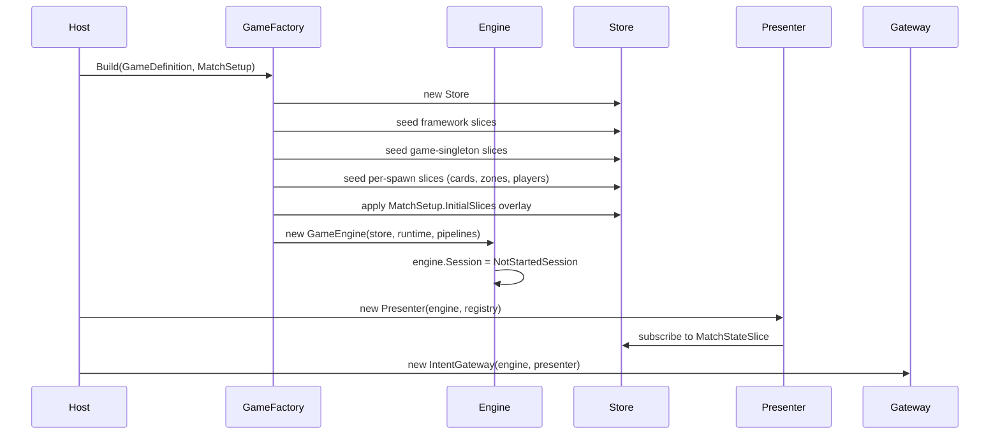
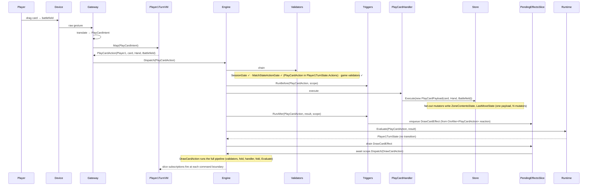
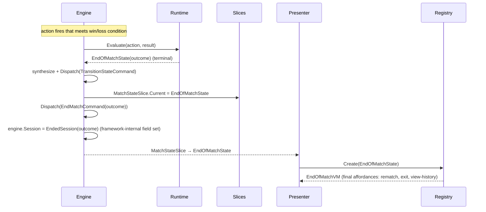

# Runtime Walkthrough — End-to-End Game Lifecycle

> **Status: draft / exploratory.** A temporal walk through a generic card-game session, from `GameFactory.Build` to `EndedSession`. Uses a concrete "play a card, draw a card, sometimes target" running example. Captures the locked runtime behavior inline; remaining open questions surface as `⚠ Q1`–`Q8` callouts.

## Why this exists

Each feature is settled in isolation. This spike walks a full match end-to-end against the locked design to confirm the *interactions between features* compose, and to surface what's still underspecified before sample / vertical-slice work bakes in implementation choices that paper over gaps.

## Cast

The systems involved, named as they appear in diagrams:

| Symbol | What it is |
|---|---|
| **Player** | Human at a device |
| **Device** | Raw input source (mouse / touch / keyboard) |
| **Gateway** | `IntentGateway` — raw gesture → `PlayerIntent` → `engine.Dispatch` |
| **VM** | Active `MatchStateViewModel<TState>` |
| **Registry** | `ViewModelRegistry` |
| **Presenter** | Subscribes to `MatchStateSlice`; manages active VM |
| **Engine** | `GameEngine` — orchestrator: drain loop, FSM evaluation, session field, holds the three pipelines |
| **Validators** | Registered `ICommandValidator<T>` chain |
| **Store** | `Scaffold.Store` |
| **Slices** | `BaseState` subtypes (named when relevant) |
| **Handler** | `GameCommandHandler<TCommand, TResult>` |
| **Triggers** | `ITriggerPipeline` — engine invokes `RunBefore` / `RunAfter` during drain |
| **Effects** | `IEffect.Run(scope)` coroutines, queued in `PendingEffectsSlice` |
| **Runtime** | `GameRulesRuntime<T>` — owns `Evaluate(action, result) → MatchState` |

## Running example

A generic 2-player card game:

- **Players:** `Player1`, `Player2`.
- **Zones per player:** `Deck`, `Hand`, `Battlefield`.
- **Match states:** `Player1TurnState` ⇄ `Player2TurnState` → `EndOfMatchState`.
- **Sample action:** `PlayCardAction(actor, card, fromZone, toZone)` — moves a card from hand to battlefield.
- **Sample triggered effect:** "on play, draw a card" — pushes `DrawCardEffect` to `PendingEffectsSlice`.
- **Sample request flow:** a card with "on play, target a card on the opponent's battlefield" — uses `Request<Card>` / `Response`.

---

## Phase 1: Boot

The host wires the engine. No match running yet.



**State after boot:**

- `engine.Session`: `NotStartedSession` (typed field on `GameEngine`, not a Store slice).
- Framework slices: seeded at initial values (empty queues, no history, no requests, no answers).
- Game-author slices: seeded structure but no gameplay state.
- `MatchStateSlice`: **not seeded yet** — `StartMatchHandler` seeds it via `TransitionStateCommand` on first dispatch. `MatchStateActionGate` is session-aware: it's skipped in `NotStartedSession`, so the absence is fine.

**System touches:** *State* (Store seeded) → *Engine* (constructed, session field set) → *Presentation* (presenter subscribes; no active VM yet).

---

## Phase 2: Start match

Host issues `StartMatchCommand`. Session flips, the initial `MatchState` lands, setup effects (if any) drain.

```mermaid
sequenceDiagram
  participant Host
  participant Engine
  participant Validators
  participant Handler as StartMatchHandler
  participant Store
  participant Triggers
  participant Effects as PendingEffectsSlice
  participant Runtime
  participant Presenter
  participant Registry

  Host->>Engine: Dispatch(StartMatchCommand)
  Engine->>Validators: chain
  Note over Validators: SessionGate ✓ (NotStartedSession admits Start) · MatchStateActionGate bypassed (lifecycle command)
  Engine->>Handler: execute
  Handler->>Engine: engine.Session = InMatchSession (framework-internal field set)
  Handler->>Store: scope.Dispatch(MatchStartedSignal)
  Engine->>Runtime: Evaluate(StartMatchCommand, result)
  Runtime-->>Engine: ITurnFlow.Initial (e.g. Player1TurnState)
  Engine->>Engine: synthesize + Dispatch(TransitionStateCommand)
  Note over Engine: TransitionStateHandler writes MatchStateSlice; Player1TurnState.EnterCommands fire
  Triggers->>Effects: OnAfter<MatchStartedSignal> reactions may push SetupEffect
  Engine->>Effects: drain pending effects (setup effects, then EnterCommands)
  Engine-->>Presenter: MatchStateSlice → Player1TurnState
  Presenter->>Registry: Create(Player1TurnState)
  Registry-->>Presenter: Player1TurnVM (bound)
```

**Slice + field updates:**

- `engine.Session`: `NotStartedSession` → `InMatchSession`.
- `MatchStateSlice.Current`: not seeded → `Player1TurnState` (via `TransitionStateCommand` cascade).
- `HistoryState`: `StartMatchCommand` · `MatchStartedSignal` · `TransitionStateCommand` envelopes + whatever setup effects/`EnterCommands` add.
- `PendingEffectsSlice`: temporarily holds setup effects; drains.

**Setup origin.** Two natural channels:

- **`MatchState.EnterCommands`** on the initial state — emitted when the state is entered. Use for deterministic per-state setup commands.
- **`OnAfter<MatchStartedSignal>` triggers** — react to the signal `StartMatchHandler` emits. Use for effect-flavored setup (deal + shuffle + initial mulligan etc.) by pushing a `SetupEffect` to `PendingEffectsSlice`.

**Rebind timing.** Slice subscribers fire on **command boundaries** — one command = one observable snapshot. Setup commands each tick their own notification. The presenter sees `MatchStateSlice` updated as soon as `TransitionStateHandler` runs and rebinds to `Player1TurnVM` immediately; setup effects drain afterward and the VM's observables react per command. Pacing (cinematic mid-deal UI vs hold-until-settled) lives in the VM, not the framework.

**System touches:** *Actions* (validator chain, handler) → *Engine* (field set; emits signal; FSM Evaluate; synthesizes TransitionStateCommand) → *Triggers* (`OnAfter<MatchStartedSignal>` reactions push effects) → *Effects* (setup drain) → *State* (slices mutated via fan-out mutators) → *Presentation* (VM rebind).

---

## Phase 3: Simple action (play a card)

Player1's turn. They drag a card from hand to the battlefield. The card has "on play, draw a card."



**Locked behavior:**

- **Engine invokes the trigger fold.** Engine holds `ITriggerPipeline` and calls `RunBefore` / `RunAfter` around the handler. Trigger feature filters its own registry via per-trigger `Trigger<T>.Validate`; no upstream filter call.
- **Single payload, multiple mutators.** Handler dispatches one semantic payload (`PlayCardPayload`); N mutators register against it (one per slice that reacts). `Store.Execute(payload)` fans out — each mutator writes its slice. Adding a slice that reacts = register one more mutator; handler unchanged.
- **`CompositeMutation`** is the alternative when a reusable cluster of mutations needs to expand inline (e.g., a shared "move card + record last-moved" cluster). It is **not** a `GameCommand` — lives outside the family. Reached via `scope.Execute(CompositeMutation)` rather than `scope.Dispatch(...)`. The composite's `Apply(scope)` invokes its sub-mutations directly in the current scope; no queue, no envelope, no fold.
- **Effects fire through the engine drain only.** Trigger reactions push to `PendingEffectsSlice`; engine drains. Effects use `scope.Dispatch(GameCommand)` for commands and `scope.Execute(CompositeMutation)` for inline mutation clusters — two semantically distinct surfaces.

**Slice updates:**

- `ZoneContentsState`: `Hand[Player1]` -= card; `Battlefield[Player1]` += card; then `Deck[Player1]` -= top, `Hand[Player1]` += top.
- `LastMoveState`: records both moves.
- `HistoryState`: 2 envelopes (`PlayCardAction`, `DrawCardAction`).
- `MatchStateSlice.Current`: unchanged.

**System touches:** *Presentation* (gesture → intent → command) → *Actions* (validators, handler, history) → *Triggers* (engine invokes fold; reactions push effects) → *Effects* (engine drains; effects dispatch their own commands through scope) → *Engine FSM* (Evaluate confirms no transition) → *State* (slices updated via fan-out; subscribers react at command boundaries via `scope.Subscribe<T>(handler) → IDisposable`; VM owns disposal through its host MVVM toolkit's lifecycle).

---

## Phase 4: Action with a request (play a card that targets)

Player1 plays a card whose effect is "on play, target a card on the opponent's battlefield; damage it."

```mermaid
sequenceDiagram
  participant Player
  participant Gateway
  participant VM as Player1TurnVM
  participant Engine
  participant Effects as PendingEffectsSlice
  participant Effect as TargetingEffect
  participant Slices as Requests/Answers

  Player->>Gateway: play targeting card
  Gateway->>Engine: Dispatch(PlayCardAction)
  Note over Engine: same as Phase 3 — validators, fold, handler, fold, fan-out mutators
  Engine->>Effects: enqueue TargetingEffect (OnAfter trigger reaction)
  Engine->>Effect: Run(scope)
  Effect->>Engine: await scope.Dispatch(new TargetRequest(predicate, options))
  Engine->>Triggers: RunBefore(TargetRequest, scope)
  Note over Triggers: OnBefore<TargetRequest> may redirect (replace target) or cancel (shroud / hexproof)
  Engine->>Handler: execute (writes RequestsSlice.Open = TargetRequest)
  Engine->>Triggers: RunAfter(TargetRequest, result, scope)
  Note over Triggers: OnAfter<TargetRequest> may push "when-targeted" reactions
  Note over Engine: drain pauses (RequestsSlice non-empty)
  Engine-->>VM: RequestsSlice updated
  VM->>VM: enter request-mode; expose target affordances
  Player->>Gateway: click target card
  Gateway->>VM: Map(TargetSelectedIntent)
  VM-->>Gateway: Response(requestId, targetCard)
  Gateway->>Engine: Dispatch(Response)
  Engine->>Triggers: RunBefore(Response, scope)
  Engine->>Handler: execute (writes AnswersSlice += answer · clears RequestsSlice.Open)
  Engine->>Triggers: RunAfter(Response, result, scope)
  Engine-->>Effect: await returns with typed Response
  Effect->>Engine: scope.Dispatch(DamageCardAction(target))
  Note over Engine: DamageCardAction runs full pipeline (validators, fold, handler, fold)
  Effect-->>Engine: complete
  Engine->>Effects: dequeue TargetingEffect
```

**Locked behavior:**

- `Request<TResponse>` and `Response` are **siblings** of `GameAction` (not subtypes). All four `GameCommand` siblings flow through `engine.Dispatch` uniformly.
- **Trigger fold runs for Request and Response.** `OnBefore<TargetRequest>` enables redirect / shroud / hexproof patterns; `OnAfter<TargetRequest>` enables "when-targeted" reactions; `OnBefore<Response>` can constrain the answer; `OnAfter<Response>` enables reactions on an answered request. Engine invokes the fold via `ITriggerPipeline.RunBefore` / `RunAfter` at the same step as for `GameAction`.
- Validator chain applies (`SessionGate` always; `MatchStateActionGate` and game-shipped validators per the chain). Because Request/Response are siblings (not subtypes), `ICommandValidator<GameAction>` and `OnBefore<GameAction>` registrations do NOT accidentally match Requests.

**Slice updates across the request flow:**

- `RequestsSlice.Open`: null → `TargetRequest` → null.
- `AnswersSlice`: += answer entry.
- `HistoryState`: `PlayCardAction` · `TargetRequest` · `Response` · `DamageCardAction` envelopes.
- Plus whatever `DamageCardAction` mutates.

**System touches:** *Effects* (orchestrates the multi-step flow via `await`) → *Triggers* (engine invokes fold on Request and Response) → *State* (`RequestsSlice` + `AnswersSlice` are the rendezvous) → *Presentation* (VM enters request-mode; affordances change shape mid-turn) → *Actions* (`Response` is a `GameCommand` sibling through the same `Dispatch`).

> ⚠ **Open Q1.** Request cancellation semantics. Player decides not to target — clicks elsewhere or hits Escape. Does the VM dispatch a `CancelResponse`? Does that unwind the `TargetingEffect`? Does it also unwind the original `PlayCardAction` whose cost is already paid? Real game-design question that the framework needs an answer for.

> ⚠ **Open Q2.** Request timeout. Networked or async games might want "if the player doesn't respond in N seconds, auto-pick / cancel." The effect awaits forever today. No timeout primitive in the request system.

> ⚠ **Open Q3.** Concurrent requests. Can two effects each open a request at once (e.g., simultaneous prompts to both players)? `RequestsSlice.Open` is singular. Implies serialization through the queue. Confirm or address — multi-player simultaneous decisions are a real card-game pattern (mulligans, response windows).

---

## Phase 5: Turn transition

Player1 clicks "end turn." The FSM transitions to `Player2TurnState`.

```mermaid
sequenceDiagram
  participant Player
  participant Gateway
  participant VM as Player1TurnVM
  participant Engine
  participant Runtime
  participant Slices
  participant Presenter
  participant Registry

  Player->>Gateway: click "end turn"
  Gateway->>VM: Map(EndTurnIntent)
  VM-->>Gateway: EndTurnAction(Player1)
  Gateway->>Engine: Dispatch(EndTurnAction)
  Engine->>Engine: validate, fold, drain handler (cleanup)
  Engine->>Runtime: Evaluate(EndTurnAction, result)
  Runtime-->>Engine: Player2TurnState (new state-type)
  Engine->>Engine: synthesize + Dispatch(TransitionStateCommand)
  Note over Engine: TransitionStateHandler writes MatchStateSlice; Player2TurnState.EnterCommands fire
  Engine->>Slices: MatchStateSlice.Current = Player2TurnState
  Engine-->>Presenter: MatchStateSlice updated (different state-type)
  Presenter->>Registry: Create(Player2TurnState)
  Registry-->>Presenter: Player2TurnVM (bound)
```

**Locked behavior:**

- **`Evaluate` returns a `MatchState`.** Engine compares to the current state-type. If the type differs, engine synthesizes `TransitionStateCommand(newState)` and dispatches it through the same pipeline.
- **Transitions are commands.** `TransitionStateCommand`'s handler writes `MatchStateSlice` via `SetMatchStatePayload`. The new state's `EnterCommands` fire (existing entry-side hook).

**Slice updates:**

- `TurnState`: rotates active player.
- `MatchStateSlice.Current`: `Player1TurnState` → `Player2TurnState`.
- `HistoryState`: `EndTurnAction` + `TransitionStateCommand` envelopes.

**System touches:** *Actions* (`EndTurnAction` handler) → *Engine FSM* (`Evaluate` returns new state-type) → *Engine* (`TransitionStateCommand` synthesis) → *State* (`MatchStateSlice` updated; `EnterCommands` fire) → *Presentation* (VM rebind via Registry).

> ⚠ **Open Q4.** ISBA (state-based action) cadence. When do ISBAs run — on *entry* into a new state, *every drain tick* while in that state, or *both*? Card games often need "after every action, check if any creature has 0 HP and destroy it" — that's "every drain tick." Lean: every drain tick, before `Evaluate` returns.

> ⚠ **Open Q5.** Transition-loop prevention. The engine dispatches `TransitionStateCommand`, which is itself a command — does *its* execution also call `Evaluate`? If yes, could we recurse? Implicit answer: `Evaluate(TransitionStateCommand, _)` must return the same state-type (no further transition). Should be an architectural invariant, stated.

> ⚠ **Open Q6.** OnExit hook on `MatchState`. Entry side is already covered by `EnterCommands` (fires when state is entered). The mirror — `OnExit(oldState)` for cleanup signals / cancellation of pending effects when leaving a state — is not in the locked design. Lean: yes, add `ExitCommands` (or equivalent) so authors don't re-implement the pattern.

---

## Phase 6: End match

Some action triggers a terminal condition (life total 0, deck empty, victory rule, etc.).



**Final state:**

- `engine.Session`: `EndedSession(MatchOutcome)`.
- `MatchStateSlice.Current`: `EndOfMatchState` (`ActionsOpen = false`, empty `Actions` → locked).
- `SessionGate` now rejects all gameplay commands.

**System touches:** *Engine FSM* (Evaluate returns terminal) → *Engine* (self-emits `EndMatchCommand`; flips session field) → *Presentation* (terminal VM).

> ⚠ **Open Q7.** Match-end initiator. Two paths: (a) `runtime.Evaluate` returns a terminal `MatchState` and the *host* listens and issues `EndMatchCommand`. (b) The engine itself issues `EndMatchCommand` after `Evaluate` returns terminal. (a) is host-driven; (b) is self-contained. Lean: (b) — the framework needs to work without a host orchestrator.

> ⚠ **Open Q8.** Rematch model. Is `EndedSession` terminal-only (engine instance is single-use) or can a `RestartMatchCommand` flip `EndedSession` back to `NotStartedSession`? Either is defensible. Lean: terminal — match instance is single-use; host disposes and recreates for rematch.

---

## Open questions summary

Eight unresolved Qs after the walk so far. Grouped by surface:

| Group | Q | Topic | Status |
|---|---|---|---|
| Request flow | **Q1** | Cancellation semantics | Open. |
| Request flow | **Q2** | Timeout primitive | Open. Likely deferred post-v1. |
| Request flow | **Q3** | Concurrent requests | Open. `RequestsSlice.Open` is singular. |
| Transitions | **Q4** | ISBA cadence | Lean: every drain tick before `Evaluate`. |
| Transitions | **Q5** | Transition-loop prevention invariant | Lean: `Evaluate(TransitionStateCommand, _)` returns same state-type. |
| Transitions | **Q6** | OnExit hook on `MatchState` | Lean: add `ExitCommands` or equivalent. |
| End match | **Q7** | Match-end initiator | Lean: engine self-emits `EndMatchCommand`. |
| End match | **Q8** | Rematch model | Lean: terminal; dispose. |

## What this spike confirms

The locked architecture handles every phase end-to-end **at a system-boundary level**. Engine orchestration (single drain, per-type routing on 4 `GameCommand` siblings, `scope.Dispatch` for commands + `scope.Execute` for inline mutation clusters), validator chain authority, three-layer command execution (Effect → Handler → Mutator with fan-out), engine-invoked trigger fold across all four siblings, request system rendezvous through state, FSM evaluation, and per-state VM rebind via `scope.Subscribe<T>` all compose without contradiction.

The eight remaining gaps are localized. Each is one of:

- **Boundary cases** — cancellation (Q1), timeout (Q2), concurrent requests (Q3).
- **Timing / cadence** — ISBA cadence (Q4).
- **Missing invariants** — transition-loop prevention (Q5).
- **Missing hooks** — `OnExit` (Q6).
- **Ownership** — match-end initiator (Q7), rematch model (Q8).

None of the remaining gaps invalidate the architecture. Most have a defensible lean. The two that want explicit decisions before vertical-slice work are **Q1 (cancellation)** and **Q3 (concurrent requests)** — both shape the request system's authoring story.

## Next moves

1. Walk Q1–Q8. Lock answers or punt with explicit deferrals.
2. Cascade settled answers into the relevant Models:
   - Q1 / Q2 / Q3 → effects Models (`effects/06-request-system.md`) + actions Models if cancellation rides a new sibling.
   - Q4 → engine Models (`engine/09-state-based-actions.md` — cadence).
   - Q5 / Q6 → engine Models (`engine/07-match-state.md` — invariants + exit hook).
   - Q7 / Q8 → engine Models (`engine/01-game-engine.md` — session lifecycle).
3. Re-do `support/samples/pile-counter.md` against the gap-filled architecture.
4. Refresh `PLANS/pile-counter-vertical-slice.md` vocabulary.
5. Execute the vertical slice.
