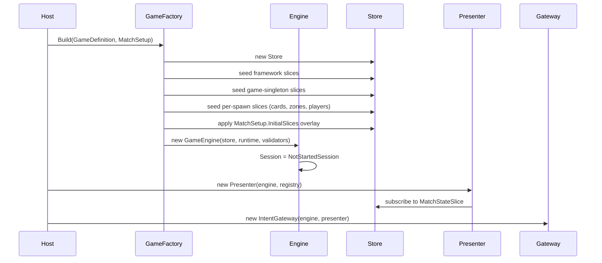
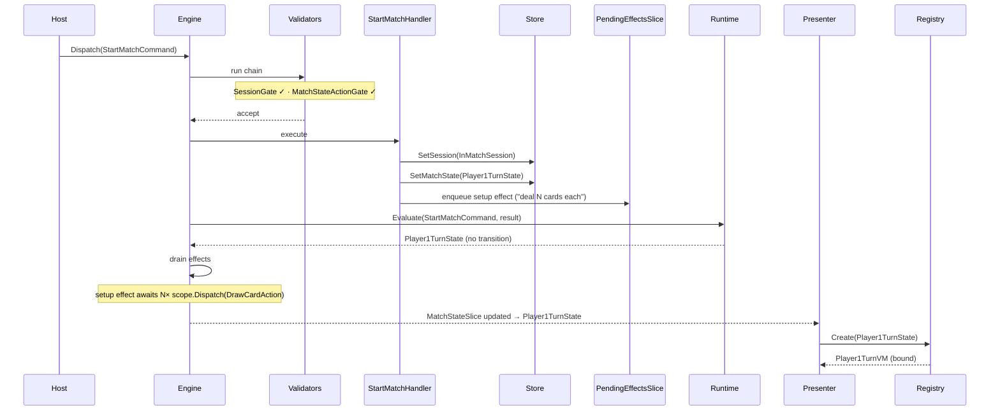
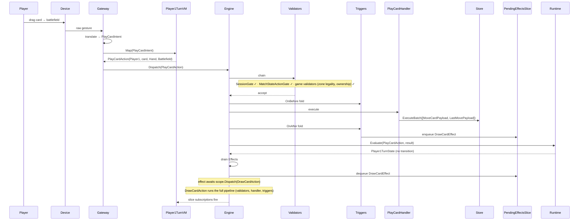
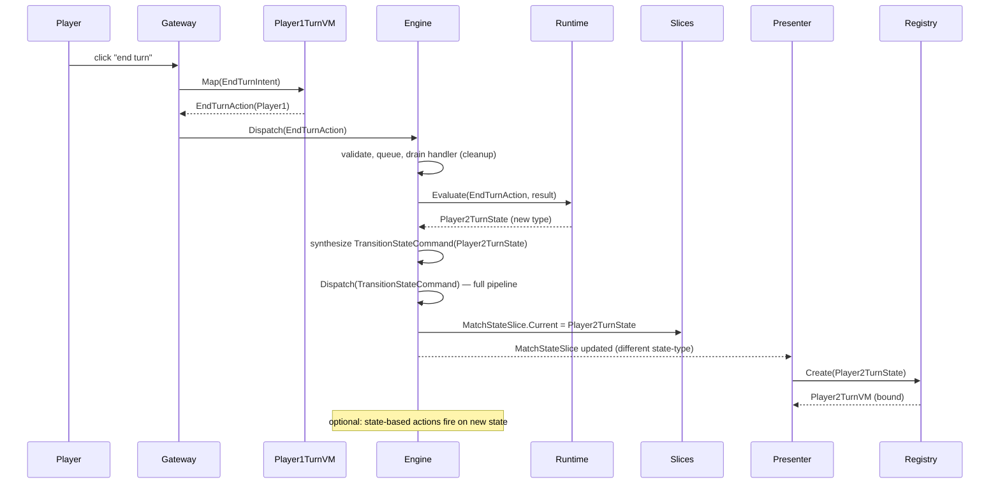
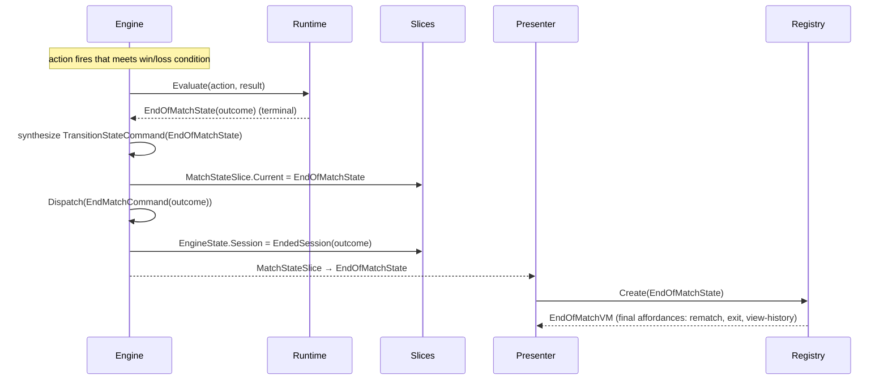

# Runtime Walkthrough — End-to-End Game Lifecycle Spike

> **Status: draft / exploratory · mid Q-walk (Q1–Q6 resolved 2026-05-11).** A temporal walk through a generic card-game session, from `GameFactory.Build` to `EndedSession`, designed to surface gaps in the locked architecture. Uses a concrete "play a card, draw a card, sometimes target" running example. Not an official spec.

## Resolutions log (Q1–Q6 walked 2026-05-11)

Six of sixteen Qs walked and locked in conversation. Inline body below retains pre-resolution narrative; this log carries the authoritative answers and points at the cascade artifacts where each lands.

| Q | Resolution | Landed in |
|---|---|---|
| **Q1** — pre-match `MatchStateSlice` shape | Slice not seeded until `StartMatchHandler` runs (`Store.Has<MatchStateSlice>()` false pre-match). `MatchStateActionGate` is session-aware — skips in `NotStartedSession`, so absence is fine. Also locked: **action-gate triad** on `MatchState` — `Actions: IReadOnlyList<Type>` (whitelist) + `ActionsOpen: bool` (default `true`, "anything passes"). Authoring patterns: default open; `ActionsOpen = false` + populated `Actions` for whitelist; `ActionsOpen = false` + empty `Actions` for locked (resolving / animating). Also clarified: `SessionState` lives on `engine.Session` (a typed field on `GameEngine`), **not** a Store slice — spike's `EngineState.Session` references are doc errors. | Cascade target: `engine/07-match-state.md` (Actions+ActionsOpen), `engine/01-game-engine.md:218-234` (gates table refresh), `actions/06-command-validator.md` (`MatchStateActionGate` body), ADR-0010 amendment. |
| **Q2** — does `StartMatchCommand` go through validator chain | **Yes.** Locked option (a). Already in `engine/01-game-engine.md:227-228` rejection table — `SessionGate` accepts it in `NotStartedSession`; `MatchStateActionGate` bypassed for lifecycle commands; game-shipped validators still apply. No new patch. | Already locked. |
| **Q3** — setup-effect origin | Phantom gap. Locked design already covers it through **two existing mechanisms**: (a) `MatchState.EnterCommands` on the initial state fires when entered (per `engine/01-game-engine.md:268`); (b) `OnAfter<MatchStartedSignal>` triggers fire on the signal that `StartMatchHandler` emits. Deterministic setup actions → `EnterCommands`. Effect-flavored setup → `OnAfter<MatchStartedSignal>` trigger pushes a `SetupEffect` to `PendingEffectsSlice`. No new primitive needed. | Already covered. |
| **Q4** — VM rebind timing during setup drain | Locked: **command-boundary batching.** Multiple mutations within a single command coalesce into one observable snapshot to subscribers — one command = one notification cycle. No engine quiescence — framework publishes at every command boundary; **presentation owns its own pacing** (VM-side transitions / awaits / animations). Per `Player1TurnVM` author: decide whether to show cinematic in-progress UI or hide affordances until expected state arrives. | Cascade target: `state/state.md` (command-boundary batching contract); `presentation/presentation.md` (pacing-is-VM-responsibility note). |
| **Q5** — handler mutation granularity | Locked: **single semantic payload + fan-out mutators.** One payload per command (e.g. `PlayCardPayload`), N mutators register against it — each targeting a different slice (`ZoneContentsState`, `LastMoveState`, `OwnershipState`, …). `Store.Execute(payload)` fans out. Reactive-flavored, adding a slice that reacts = register one more mutator; handler unchanged. **`CompositeAction`** is the explicit alternative — for reusable, distinct mutation clusters; runs **inline** within parent scope. Per-slice payload lists via `ExecuteBatch` is **not** the canonical pattern. Spike Phase 3's `ExecuteBatch([MoveCardPayload, LastMovePayload])` framing is wrong-flavored; correct is `Execute(new PlayCardPayload(...))` with fan-out mutators. | Cascade target: `state/state.md` worked example; `actions/03-command-handler.md` authoring-pattern callout; spike Phase 3 narrative fix. |
| **Q6** — trigger registration source + the broader orchestration question | **Locked as ADR-0013** (engine-driven pipeline orchestration; single `Dispatch` surface; `runtime.FilterTriggers` retires). Engine becomes the explicit orchestrator; the three pipelines (`actions`, `triggers`, `effects`) become single-concern services consumed by engine. `scope.Emit` / `scope.Execute` retire — `scope.Dispatch(GameCommand)` is the sole inside-scope entry. Trigger eligibility lives on `Trigger<T>.Validate`. One registration mechanism (`ITriggerSystem.OnBefore<T>` / `.OnAfter<T>`) used at game install and per-instance. Registry in-memory in `TriggerSystem` for v1. Full per-type routing table in ADR-0013. | **[ADR-0013](Product/decisions/0013-engine-pipeline-orchestration.md)** + cascade across 14 docs. |

### Out of scope (deferred to implementation time)

Three sub-questions tracked from the Q-walk for implementation:

- Request / Response inheritance from `GameAction` (validators-by-default vs separate wiring) — decide at concrete-handler-author time.
- Game-wide trigger eligibility predicates beyond `Trigger.Validate` — v1 is per-trigger only; centralize if scale forces it.
- Trigger registry slice-resident — defer until slice-linked-services pattern formalizes.

### Inline body notes

Six callouts below (`⚠ Open Q1`–`Q6`) reflect the pre-resolution framing. Their resolutions live in this log. Q7–Q16 are unresolved and stand. Walk resumes from Q7 once ADR-0013 lands.

Inline terminology / framing errors in the body (to be cleaned up after Q-walk completes):

- Phase 1 + Phase 6 references to `EngineState.Session` — should read `engine.Session` (a typed field on `GameEngine`, not a Store slice).
- Phase 3 handler line `ExecuteBatch([MoveCardPayload, LastMovePayload])` — should read `Execute(new PlayCardPayload(...))` with fan-out mutators.
- Phase 3 + 4 sequence diagrams show `Triggers` participating as a peer of `Engine` and `Handler`; post-ADR-0013, the trigger fold is **invoked by Engine** (engine holds `ITriggerPipeline`). Diagrams stand as a conceptual depiction; the orchestrator is Engine.

## Why this exists

Each feature is settled in isolation (ADRs 0005–0012, feature roots in `features/`). But we haven't walked a full match end-to-end against the locked design to confirm the *interactions between features* compose. This spike does that walk.

**Goal:** find what's underspecified before sample/vertical-slice work bakes in implementation choices that paper over gaps.

**Output:** sixteen named open questions, surfaced inline as they appear in the flow, then collected at the end.

## Cast

The systems involved, named as they appear in diagrams:

| Symbol | What it is |
|---|---|
| **Player** | Human at a device |
| **Device** | Raw input source (mouse / touch / keyboard) |
| **Gateway** | `IntentGateway` — raw gesture → `PlayerIntent` → `engine.Dispatch` |
| **VM** | Active `MatchStateViewModel<TState>` |
| **Registry** | `ViewModelRegistry` |
| **Presenter** | Subscribes to `MatchStateSlice`; manages active VM |
| **Engine** | `GameEngine` — drain loop + FSM evaluation + session field |
| **Validators** | Registered `ICommandValidator<T>` chain |
| **Store** | `Scaffold.Store` |
| **Slices** | `BaseState` subtypes (named when relevant) |
| **Handler** | `GameCommandHandler<TCommand, TResult>` |
| **Triggers** | OnBefore / OnAfter fold per command |
| **Effects** | `IEffect.Run(scope)` coroutines, queued in `PendingEffectsSlice` |
| **Runtime** | `GameRulesRuntime<T>` — owns `Evaluate(action, result) → MatchState` |

## Running example

A generic 2-player card game:

- **Players:** `Player1`, `Player2`.
- **Zones per player:** `Deck`, `Hand`, `Battlefield`.
- **Match states:** `Player1TurnState` ⇄ `Player2TurnState` → `EndOfMatchState`.
- **Sample action:** `PlayCardAction(actor, card, fromZone, toZone)` — moves a card from hand to battlefield.
- **Sample triggered effect:** "on play, draw a card" — pushes `DrawCardEffect` to `PendingEffectsSlice`.
- **Sample request flow:** a card with "on play, target a card on the opponent's battlefield" — uses `Request<Card>` / `Response`.

---

## Phase 1: Boot

The host wires the engine. No match running yet.



**Slice state after boot:**

- Framework slices: initial values (empty queues, no history, no requests).
- Game-author slices: seeded structure but no gameplay state.
- `EngineState.Session`: `NotStartedSession`.
- `MatchStateSlice.Current`: ⚠ see Q1.

**System touches:** *State* (Store seeded) → *Engine* (constructed, session field set) → *Presentation* (presenter subscribes; no active VM yet).

> ⚠ **Open Q1.** What's `MatchStateSlice.Current` before `StartMatchCommand` runs? Options: (a) null, (b) a sentinel `PreMatchState : MatchState` with `Actions = { StartMatchCommand }`, (c) the slice doesn't exist until match start. `MatchStateActionGate` reads `MatchStateSlice.Current.Actions` — option (a) would NRE. Lean: (b) sentinel, so the same validator chain works pre-match.

> ⚠ **Open Q2.** Does `StartMatchCommand` go through the same validator chain as gameplay commands? If yes, `MatchStateActionGate` must admit it (resolved by Q1.b). If no, what's the bypass? ADR-0010 doesn't address the pre-match case.

---

## Phase 2: Start match

Host issues `StartMatchCommand`. Session flips, initial state lands, setup effects drain.



**Slice updates during this phase:**

- `EngineState.Session`: `NotStartedSession` → `InMatchSession`.
- `MatchStateSlice.Current`: `PreMatchState` → `Player1TurnState`.
- `ZoneContentsState`: Deck → Hand (per `DrawCardAction` mutators, N times).
- `HistoryState`: `StartMatchCommand` envelope + N× `DrawCardAction` envelopes.
- `PendingEffectsSlice`: holds setup effect mid-drain, empty after.

**System touches:** *Actions* (validator chain, handler) → *State* (slices mutated) → *Engine* (FSM Evaluate, drain) → *Effects* (setup effect dispatches its own commands) → *Presentation* (VM rebind).

> ⚠ **Open Q3.** Where do setup effects originate? (a) `StartMatchHandler` enqueues them directly. (b) `GameDefinition.GetSetupEffects()` returns them; the handler reads. (c) The initial `MatchState`'s `OnEntry` produces them. ADR-0011 says only the engine fires effects via `PendingEffectsSlice` but doesn't say who enqueues setup. Lean: (b) — keeps the handler generic, lets the game describe its own setup.

> ⚠ **Open Q4.** VM rebind timing during setup drain. `MatchStateSlice.Current` is `Player1TurnState` before the setup effect completes. Does the presenter rebind immediately (player sees a mid-deal UI), or does the engine hold rebind until the setup effect settles? Implies either: a "Setup" pseudo-state for the VM to live in, or a "presenter quiesces on a drain-busy signal" mechanism. Neither is in the locked design.

---

## Phase 3: Simple action (play a card)

Player1's turn. They drag a card from hand to the battlefield. The card has "on play, draw a card."



**Slice updates:**

- `ZoneContentsState`: `Hand[Player1]` -= card; `Battlefield[Player1]` += card; then `Deck[Player1]` -= top, `Hand[Player1]` += top.
- `LastMoveState`: records both moves.
- `HistoryState`: 2 envelopes (`PlayCardAction`, `DrawCardAction`).
- `MatchStateSlice.Current`: unchanged.

**System touches:** *Presentation* (gesture → intent → command) → *Actions* (validators, handler, history) → *Triggers* (fold around handler; pushes effect) → *Effects* (drained effect dispatches its own commands) → *Engine FSM* (Evaluate confirms no transition) → *State* (slices updated; subscribers react).

> ⚠ **Open Q5.** Handler granularity. The Phase 3 handler runs `ExecuteBatch([MoveCard, LastMove])` — two payloads, one batch. Is this the intended pattern (per-slice mutators composed by handlers), or do we want aggregate payloads (one "MoveCard" payload that touches multiple slices via one cross-slice mutator)? ADR-state implies one mutator per `(state, payload)` pair, which means per-slice. Lean: per-slice mutators in batches; aggregate handlers.

> ⚠ **Open Q6.** Trigger registration source. Where does the engine find `OnPlayCard` watchers? (a) `GameDefinition.GetTriggers()` — static, definition-time. (b) `TriggersSlice` — dynamic, runtime-mutable (a summoned card could install its own watcher). Triggers feature root post-cascade doesn't fully nail this. Card games realistically need (b) for ability-granting effects.

> ⚠ **Open Q7.** VM slice subscriptions. How does the VM know to refresh on `ZoneContentsState` change? `Bind(state, scope)` is the entry point but the contract for "which slices does this VM observe" is informal. Lean: the VM declares its dependencies in `Bind` by calling `scope.Get<T>()` per slice; framework auto-subscribes via the scope.

---

## Phase 4: Action with a request (play a card that targets)

Player1 plays a card whose effect is "on play, target a card on the opponent's battlefield; damage it."

```mermaid
sequenceDiagram
  participant Player
  participant Gateway
  participant VM as Player1TurnVM
  participant Engine
  participant Effects as PendingEffectsSlice
  participant Effect as TargetingEffect
  participant Slices as Requests/Answers

  Player->>Gateway: play targeting card
  Gateway->>Engine: Dispatch(PlayCardAction)
  Note over Engine: same as Phase 3 — validators, handler, move card, triggers
  Engine->>Effects: enqueue TargetingEffect
  Engine->>Effect: Run(scope)
  Effect->>Engine: await scope.Dispatch(new TargetRequest(predicate, options))
  Engine->>Slices: RequestsSlice.Open = TargetRequest
  Note over Engine: drain pauses (RequestsSlice non-empty)
  Engine-->>VM: RequestsSlice updated
  VM->>VM: enter request-mode; expose target affordances
  Player->>Gateway: click target card
  Gateway->>VM: Map(TargetSelectedIntent)
  VM-->>Gateway: Response(requestId, targetCard)
  Gateway->>Engine: Dispatch(Response)
  Engine->>Slices: AnswersSlice += answer · RequestsSlice.Open = null
  Engine-->>Effect: await returns with typed Response
  Effect->>Engine: scope.Dispatch(DamageCardAction(target))
  Note over Engine: DamageCardAction runs full pipeline
  Effect-->>Engine: complete
  Engine->>Effects: dequeue TargetingEffect
```

**Slice updates across the request flow:**

- `RequestsSlice.Open`: null → `TargetRequest` → null.
- `AnswersSlice`: += answer entry.
- `HistoryState`: `PlayCardAction` · `TargetRequest` · `Response` · `DamageCardAction` envelopes.
- Plus whatever `DamageCardAction` mutates (card-state slice, life-total slice, etc.).

**System touches:** *Effects* (orchestrates the multi-step flow via `await`) → *State* (`RequestsSlice` + `AnswersSlice` are the rendezvous) → *Presentation* (VM enters request-mode; affordances change shape mid-turn) → *Actions* (`Response` is a `GameCommand` sibling routed through the same `Dispatch`).

> ⚠ **Open Q8.** Validator chain applicability to `Request<T>` and `Response`. ADR-0011 says all five `GameCommand` siblings go through `Dispatch`. But `MatchStateActionGate` reads `MatchStateSlice.Current.Actions` — does that list include `Request<TResponse>` types (which originate from effects, not from player gestures)? Lean: requests are exempt from `MatchStateActionGate` because they're effect-driven, but `SessionGate` still applies. Needs explicit decision.

> ⚠ **Open Q9.** Request cancellation. Player decides not to target — clicks elsewhere or hits Escape. Does the VM dispatch a `CancelResponse`? Does that unwind the `TargetingEffect`? Does it also unwind the `PlayCardAction` (the cost is already paid)? Real game-design question that the framework needs an answer for.

> ⚠ **Open Q10.** Request timeout. Networked or async games might want "if the player doesn't respond in N seconds, auto-pick / cancel." The effect awaits forever today. No timeout primitive in the request system per ADR-0011.

> ⚠ **Open Q11.** Concurrent requests. Can two effects each open a request at once (e.g., simultaneous prompts to both players)? `RequestsSlice.Open` is singular. Implies serialization through the queue. Confirm or address — multi-player simultaneous decisions are a real card-game pattern (mulligans, response windows).

---

## Phase 5: Turn transition

Player1 clicks "end turn." The FSM transitions to `Player2TurnState`.



**Slice updates:**

- `TurnState`: rotates active player.
- `MatchStateSlice.Current`: `Player1TurnState` → `Player2TurnState`.
- `HistoryState`: `EndTurnAction` + `TransitionStateCommand` envelopes.

**System touches:** *Actions* → *Engine FSM* (Evaluate returns new state-type) → *Engine* (TransitionStateCommand synthesis) → *State* (MatchStateSlice updated) → *Presentation* (VM rebind via Registry).

> ⚠ **Open Q12.** ISBA (state-based action) cadence. ADR-0009 mentions `MatchState` + `ITurnFlow` + `ISBA`. When do ISBAs run — on *entry* into a new state, *every drain tick* while in that state, or *both*? Card games often need "after every action, check if any creature has 0 HP and destroy it" — that's "every drain tick." Lean: every drain tick, before `Evaluate`.

> ⚠ **Open Q13.** `Evaluate` for `TransitionStateCommand` itself. The engine dispatches `TransitionStateCommand`, which is a command — does *its* execution also call `Evaluate`? If yes, could we get stuck in a transition loop? Implicit answer: `Evaluate(TransitionStateCommand, _)` must return the same state-type (no further transition). Should be an architectural invariant, stated.

> ⚠ **Open Q14.** Lifecycle hooks on `MatchState`. Does `TransitionStateCommand`'s handler call `OnExit(oldState)` + `OnEntry(newState)`? Many FSM patterns use entry/exit hooks for cleanup + setup. ADR-0009 doesn't specify them. Lean: yes — entry hooks emit setup effects, exit hooks emit cleanup signals. Without them, every `MatchState` author re-implements the pattern.

---

## Phase 6: End match

Some action triggers a terminal condition (life total 0, deck empty, victory rule, etc.).



**Final state:**

- `EngineState.Session`: `EndedSession(MatchOutcome)`.
- `MatchStateSlice.Current`: `EndOfMatchState` (`Actions` is empty or limited to post-match commands).
- `SessionGate` now rejects all gameplay commands.

**System touches:** *Engine FSM* (Evaluate returns terminal) → *Engine* (self-emits `EndMatchCommand`) → *State* (session field flipped) → *Presentation* (terminal VM).

> ⚠ **Open Q15.** Match-end initiator. Two paths: (a) `runtime.Evaluate` returns a terminal `MatchState` and the *host* listens and issues `EndMatchCommand`. (b) The engine itself issues `EndMatchCommand` after `Evaluate` returns terminal. (a) is host-driven; (b) is self-contained. Lean: (b) — the framework needs to work without a host orchestrator.

> ⚠ **Open Q16.** Rematch. Is `EndedSession` terminal-only (engine instance is single-use) or can a `RestartMatchCommand` flip `EndedSession` back to `NotStartedSession`? Either is defensible. Lean: terminal — match instance is single-use; host disposes and recreates for rematch. Matches ADR-0009's framing.

---

## Collected gaps

Sixteen open questions surfaced during the walkthrough.

### Boot / setup (Q1–Q4)

1. **Q1.** Pre-match `MatchStateSlice.Current` shape (null vs sentinel `PreMatchState`). **Lean:** sentinel.
2. **Q2.** Does `StartMatchCommand` go through the full validator chain? **Lean:** yes, with sentinel state.
3. **Q3.** Setup-effect origin (handler-enqueued vs definition-exposed vs state-entry-emitted). **Lean:** `GameDefinition.GetSetupEffects()`.
4. **Q4.** VM rebind timing during setup drain. **Open:** drain-busy signal vs setup pseudo-state.

### Pipeline mechanics (Q5–Q7)

5. **Q5.** Per-handler batch granularity. **Lean:** per-slice mutators composed in batches.
6. **Q6.** Trigger registration source (static `GameDefinition` vs dynamic `TriggersSlice`). **Lean:** `TriggersSlice` (dynamic).
7. **Q7.** VM slice subscription contract. **Lean:** declared by `Bind`-time `scope.Get<T>()` calls.

### Request flow (Q8–Q11)

8. **Q8.** Validator chain applicability to `Request` and `Response`. **Lean:** `SessionGate` applies; `MatchStateActionGate` exempts.
9. **Q9.** Request cancellation semantics. **Open:** unwind effect vs fizzle vs disallowed.
10. **Q10.** Request timeout primitive. **Open:** not in design today; possibly defer to post-v1.
11. **Q11.** Concurrent requests. **Open:** singular `RequestsSlice.Open` is restrictive for simultaneous mulligan / response patterns.

### Transitions (Q12–Q14)

12. **Q12.** ISBA cadence. **Lean:** every drain tick before `Evaluate`.
13. **Q13.** `Evaluate` for `TransitionStateCommand` (loop-prevention invariant). **Lean:** must return the same state-type; state as architectural invariant.
14. **Q14.** Lifecycle hooks (`OnEntry` / `OnExit`) on `MatchState`. **Lean:** yes — hooks emit setup / cleanup effects.

### End match (Q15–Q16)

15. **Q15.** Match-end initiator (host vs engine self-emit). **Lean:** engine self-emit.
16. **Q16.** Rematch in-place vs dispose-and-recreate. **Lean:** terminal; dispose.

## What this spike confirms

The locked architecture handles every phase end-to-end **at a system-boundary level**. The drain loop, FSM evaluation, validator chain, three-layer command execution, request system, and presentation rebind all compose without contradiction.

The gaps are real but **localized**. Each one is either:

- **A boundary case** — cancellation (Q9), timeout (Q10), concurrent requests (Q11).
- **A timing question** — VM rebind moment (Q4), ISBA cadence (Q12).
- **A "who owns this" question** — setup effects (Q3), triggers (Q6), match-end initiator (Q15), pre-match slice shape (Q1).
- **A missing invariant** — transition-loop prevention (Q13), state lifecycle hooks (Q14).

None of the gaps invalidate the architecture. Most have a defensible lean. A handful — Q4 (rebind timing), Q9 (cancellation), Q11 (concurrent requests) — want explicit decisions, not just defaults, before vertical-slice work.

## Suggested next moves

1. Walk the sixteen Qs with the user; lock answers (or punt with explicit decisions).
2. Patch settled answers into the relevant Models / ADRs:
   - Q1, Q2, Q13, Q14, Q15, Q16 → engine Models + ADR-0009.
   - Q3, Q9, Q10, Q11 → effects Models + ADR-0011.
   - Q4, Q7 → presentation Models + ADR-0012.
   - Q5 → state Models.
   - Q6 → triggers Models.
   - Q8 → actions Models + ADR-0010.
   - Q12 → engine Models (ISBA design).
3. Re-do `support/samples/pile-counter.md` against the gap-filled architecture.
4. Refresh `PLANS/pile-counter-vertical-slice.md` vocabulary.
5. Execute the vertical slice.
