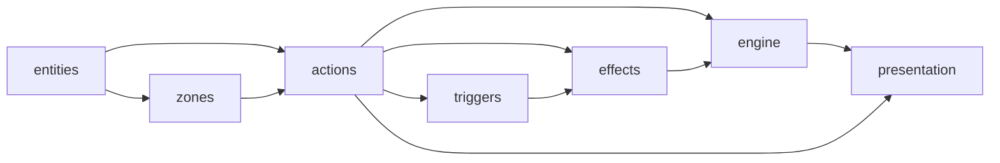

# Workflow Gaps — Pressure-Testing the Hard Parts

> **Status: concluded 2026-04-29.** All 13 questions resolved. Resolutions folded into [`PRODUCT-BUILDER-PROPOSAL.md`](PRODUCT-BUILDER-PROPOSAL.md) (§3, §4.3, §4.4, §5.7–§5.10, §6, §8) and [`MIGRATION-GUIDE.md`](MIGRATION-GUIDE.md) (§1 structure, §5 phases 1–2). Doc kept as the trail of *why* each direction was chosen — the sketch is the provenance. See §8 of PRODUCT-BUILDER-PROPOSAL for the canonical resolved list.

**Premise.** Two areas in the workflow proposal need pressure-testing before they get folded in: the **debt flow mechanics** (§5.7–§5.10 candidates) and the **feature map** (a bird's-eye view artifact). Both are clearly needed, but the *shape* of each isn't obvious. This doc sketches each, lists open design questions, and recommends a default direction.

The Feature doc type and §5.0 Bootstrapping have already landed in the proposal — those were obvious. What's here is the part that needs more thinking.

---

## 1. Debt flow mechanics

The proposal has `general/ALIGNMENT-DEBT.md` as a ledger and §5.5 as an alignment-pass session shape. But the *flow* — who notifies whom, when, with what enforcement — is implicit. This section sketches four candidate sub-sections.

### 1.1 §5.7 — Debt notification (the hard step)

**The rule.** Every Model edit that changes contracts, invariants, or examples *must* fill in `## Implications for prior docs (§7)` before commit. Each item in §7 produces a corresponding entry in `general/ALIGNMENT-DEBT.md`.

**Proposed wording.**

> When you edit a Model in a way that affects downstream docs:
> 1. List affected docs in the Model's `## Implications for prior docs (§7)` section.
> 2. For each, append an entry to `general/ALIGNMENT-DEBT.md`: date, source doc, target doc, one-line reason, status `open`.
> 3. Patch each affected doc's front matter with `has-pending-debt: true`.
>
> If the edit has no implications, the §7 section gets an explicit `_(no implications)_` line. Empty is not allowed — empty is forgetting.

**Why "explicit no" instead of "skip if none."** The cost is one line. The benefit is that absence-of-implications becomes a decision, not an oversight. Alignment debt is a recurring failure mode (FLOW-SIMULATION sessions 5, 6, 8, 11 all touched it); making the §7 step mandatory is cheap insurance.

**Open questions.**

- **Granularity.** One ledger entry per affected doc, or one per cascading Model edit? *Recommend: per affected doc.* Coarser entries are easier to write but harder to close — you'd need a checkbox per affected doc anyway.
- **Who writes it — human or AI?** Either. The skill `/builder:open-debt` (AI-FIRST §2) automates the mechanical part. Human still picks the affected-paths list because that's a judgment call.
- **What about cross-feature cascades (Model in features/effects affects features/actions)?** Same flow — the §7 list crosses feature boundaries freely. The ledger is project-global.
- **Does the front-matter `has-pending-debt: true` flag actually pull weight?** Suggested but optional. Lets a linter find docs whose state lags. If we don't build the linter, the flag is noise — ledger alone suffices.

### 1.2 §5.8 — Consistency pass (recognized session shape)

**The rule.** Periodically — every N sessions, or when the ledger crosses a threshold — run a session whose entry context is "review all open debt + verify references." Mechanical. No new design.

**Proposed cadence options.**

- **Trigger-based.** Open ledger entries > 5 → next session must be a consistency pass.
- **Cadence-based.** Every 3 sessions, regardless of ledger size.
- **Opportunistic.** Whenever a session's primary thread blocks, fall back to consistency-pass mode.

**Recommend: trigger-based with threshold of 5.** Forced cadence creates friction when the ledger is empty; opportunistic relies on judgment we already failed at when we let debt accumulate.

**What a consistency-pass session looks like (mechanical, but worth spelling out).**

1. Read `general/ALIGNMENT-DEBT.md`. Group entries by target doc.
2. For each target doc: read it, read the source, propose minimal patch.
3. Apply approved patches. Strike through the ledger entry, add resolution date.
4. Where references are broken (paths moved, terms renamed): record as new debt items if you can't fix in-session.
5. Session note records: count of entries closed, count newly opened.

**Open questions.**

- **Can a consistency pass open *new* debt?** Yes — discovering rot is itself information. But flag clearly so the next pass knows.
- **What's the abort condition?** If a pass can't close any entries because each requires real design re-think, *stop*. The pass has revealed that the entries are not mechanical — promote them to active questions instead.

### 1.3 §5.9 — Backtracking (when an ADR is reopened)

**The rule.** When an ADR is superseded, walk the dependency graph (via `builds-on:` front matter) and explicitly mark every dependent doc as `needs-review`. The supersession is itself a debt-generating event.

**Proposed wording.**

> When you supersede an ADR:
> 1. Write the new ADR (`NNNN supersedes MMMM`).
> 2. Set the old ADR status to `superseded by NNNN`.
> 3. Find every doc with `builds-on:` containing the old ADR or its host Model. Add a debt entry per doc.
> 4. The new ADR's `## Consequences > Reverts/replaces` field names the cascade scope.
> 5. Decide in-session: discharge debt now, or schedule a consistency pass next.

**Why this is its own subsection.** Supersession cascades are the highest-stakes source of drift. The historical run had ~zero supersessions because nobody had ADRs to supersede; under the new workflow they'll happen. Shape the flow before they do.

**Open questions.**

- **`builds-on:` is optional in front matter today (§3 says "optional, paths"). Should it become mandatory for Models?** Probably yes — it's the input to backtracking. Cheap to fill in at write time, expensive to reconstruct later.
- **What about transitive dependencies?** If A builds on B and B builds on C, and C supersedes — does A know? Only if `builds-on:` chains explicitly. Recommend: keep direct edges only, walk transitively at debt-time.
- **Auto-walking the graph is a tooling job.** Pure manual dependency-walk is error-prone. This pushes us toward a `/builder:supersede-cascade` skill (AI-FIRST tier 2 candidate).

### 1.4 §5.10 — Reference staleness (automation, not workflow)

**Not a session shape.** This is a linter pass: check that every path reference in `PRODUCT/` resolves; check that every term used appears in glossary; check that no Model references a `superseded` ADR without acknowledging.

**Proposed shape.**

- Runs as a CI hook or a `/builder:lint` skill.
- Output: a list of stale references. Doesn't auto-fix.
- Findings go into `general/ALIGNMENT-DEBT.md` as new entries (one per stale ref).

**Why this isn't workflow.** Workflow steps run in human/AI heads. This runs in a script. Surface it via the debt ledger so it threads into §5.7–§5.9, but don't pretend it's a session shape.

**Open questions.**

- **Block commits or just report?** *Recommend: report.* Blocking creates pressure to bypass; reporting creates pressure to fix.
- **What's "stale"?** A path that doesn't resolve, a path that resolves but to a `superseded` doc, a glossary term used in a doc with no glossary entry, a Model referencing an ADR with mismatched status. Four distinct rules; a v1 implements path-resolution only.
- **Idempotent re-runs.** A linter that opens 30 debt entries on first run and another 30 on second run is broken. Linter must check before opening: "is there already an open entry for this stale ref?"

### 1.5 Recommended landing for §5.7–§5.10

After this sketch is reviewed:

- **§5.7 Debt notification** — fold into proposal as written. The "explicit `_(no implications)_`" rule is the load-bearing part.
- **§5.8 Consistency pass** — fold in with trigger-based cadence (threshold of 5). Make threshold tunable.
- **§5.9 Backtracking** — fold in. Promote `builds-on:` from optional to mandatory in §3 front matter for Models.
- **§5.10 Reference staleness** — fold in as a half-page subsection that explicitly punts implementation to AI-FIRST. Don't pretend to define the linter here.

---

## 2. Feature map

The user surfaced this: a top-level doc that gives a bird's-eye view of all features, their composition, and how they connect. The proposal currently has `general/ARCHITECTURE.md` (architectural direction) and that may be conflating two things.

### 2.1 The split

Two distinct artifacts:

- **`general/ARCHITECTURE.md`** — *direction*: redux-like state, mutator pattern, services-injected, sync-vs-async story. Prose. Stable.
- **`general/FEATURE-MAP.md`** — *graph*: which features exist, which Models live in each, which features depend on which. Mostly structural. Updates whenever a Model lands or a Feature changes.

Today they'd be one doc. Splitting makes the second auto-derivable, which the first can't be.

### 2.2 What `general/FEATURE-MAP.md` contains

Three layers, each shorter:

**Layer 1 — Feature index.** One row per feature.

```
| Feature | Purpose (one line) | Models (count) | Status | Depends on |
|---------|--------------------|----------------|--------|------------|
| entities | runtime/identity model | 1 | settled | — |
| zones | container abstraction | 1 | settled | entities |
| actions | command pipeline | 2 | settled | entities, zones |
| triggers | trigger fold | 1 | settled | actions |
| effects | effect orchestration | 3 | draft | actions, triggers |
| engine | evaluator + rules + snapshot | 3 | draft | actions, effects |
| presentation | UI loop + snapshot consumer | 1 | draft | engine, actions |
```

**Layer 2 — Dependency graph.** Mermaid (or plain text if Mermaid is overkill):



**Layer 3 — Model-level breakdown** (collapsible, one feature per heading).

```
### features/engine
- engine.md (feature root, draft)
- notes/01-evaluation-loop.md (Model, settled)
- notes/02-gamerules-contract.md (Model, settled)
- notes/03-snapshot-pipeline.md (Model, settled)
- decisions/0001-evaluator-pull-loop.md (ADR, accepted)
- decisions/0002-gamerules-as-class-with-services.md (ADR, accepted)
- ...
```

### 2.3 Auto-derivable vs. hand-maintained

Almost all of FEATURE-MAP can be auto-derived:

- **Layer 1** — feature folders + Feature root status + count of Models + dependency listing.
- **Layer 2** — `builds-on:` front matter across all Models, projected up to feature level.
- **Layer 3** — directory listing + each doc's front-matter status.

Hand-maintained parts: the one-line purpose in Layer 1 (lives in Feature root, copied here).

**Recommend: hand-maintained at first, auto-generated by skill once the project has > ~15 Models.** Below that threshold, manual update is faster than building the generator. Above it, drift becomes the failure mode.

### 2.4 Open questions

- **Mermaid in markdown — do we render it?** GitHub renders Mermaid in `.md` natively. Local Markdown viewers vary. *Recommend: yes to Mermaid; the GitHub view is the canonical view.*
- **Update cadence — every session or every PR?** Either is too frequent; the map drifts a few entries between updates and it doesn't matter. *Recommend: refreshed at end of every session that adds/removes a Model or changes a Feature root.* Steady state: updated 1–2x per session.
- **Where does the dependency edge get authored — in the Feature root or in the Models?** Two places to edit, two places to drift. *Recommend: Models declare `builds-on:` (already in §3). Feature root's `Dependencies` section is derived from union-of-Models. FEATURE-MAP is derived from Feature roots.* Single source of truth: each Model knows its own deps.
- **Cycles.** Can features cyclically depend? Conceptually no — it's a sign of bad factoring. *Recommend: linter flags cycles, doesn't block.* When a cycle appears, it's a real design question to surface, not an automation problem.
- **Does FEATURE-MAP graduate to DOCS/?** Probably not — it's an index, not a contract. Stays in `general/`. The DOCS/ side gets its own index when DOCS/ matures.

### 2.5 Recommended landing for FEATURE-MAP

After this sketch is reviewed:

- Fold a one-paragraph mention into proposal §1 (folder layout) noting `general/FEATURE-MAP.md`.
- Add a §6 row in the cross-cutting infrastructure table.
- Defer the auto-generation skill to AI-FIRST tier 2 (`/builder:rebuild-feature-map`).
- Hand-maintain v1; auto-generate v2.

---

## 3. Other gaps surfaced (lighter, won't pressure-test here)

- **No `general/decisions/` for project-wide decisions.** Surfaced in MIGRATION-GUIDE §4. The workflow ADR for "we adopt this workflow" has no obvious home today. *Recommend: add `general/decisions/` to the proposal as a sibling of feature decisions/. One ADR series, project-scoped.*
- **No explicit "draft Model abandon" path.** What happens if you start a Model, get 30% in, realize it's wrong? Today: silent delete. *Recommend: status `draft` → `abandoned` (new status value); doc stays in place with a one-line "abandoned because X" header.*
- **Sample lock-bar's "stable ≥ 1 session" is fuzzy.** What counts as "stable"? Any edits at all, or only contract edits? *Recommend: contract edits only — Examples/typo edits don't reset the cooldown.*

These are smaller. Park them in a follow-up sweep once §5.7–§5.10 and FEATURE-MAP land.

---

## 4. Decision points for the next session

Before folding any of this into the proposal, decide:

1. **Adopt §5.7's "explicit `_(no implications)_` rule"?** Yes / no.
2. **Cadence model for §5.8** — trigger-based (threshold of 5)? Or different?
3. **Promote `builds-on:` to mandatory** for Models in §3 front matter?
4. **Mermaid in FEATURE-MAP** — yes?
5. **Hand-maintain FEATURE-MAP v1** — yes?
6. **Add `general/decisions/`** for project-wide ADRs?

Each is a small decision but landing them as a batch keeps the proposal's revision coherent.
