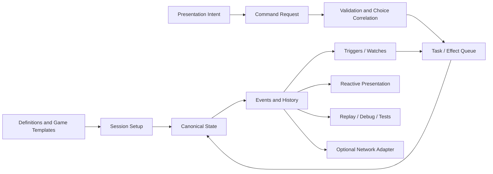

# Architecture Directions

This note sketches candidate architecture boundaries. It is not an implementation spec.

## Core Direction

The strongest direction is a deterministic simulation core with reactive edges:



## Layer Responsibilities

| Layer | Owns | Must Not Own |
| --- | --- | --- |
| Core Simulation | state, entities, zones, commands, validation, effects, triggers, choices, history | Unity scene objects, input devices, transport APIs |
| Authoring | definitions, schemas, catalogs, validation reports, editor-friendly assets | runtime-only state mutation |
| Presentation | card views, zone views, layout, animation, feedback, view models | final gameplay legality |
| Interaction | pointer/drag/drop/selection to intent translation | direct state mutation |
| Networking | command/history/snapshot transport adapters | card rules, effect resolution |
| Tooling | inspectors, replay viewers, trace/debug utilities | hidden production-only behavior |

## Data Model Direction

The framework likely needs both a definition/instance model and a flexible value model.

### Definitions

Definitions are stable authored data:

- Card definitions.
- Zone definitions.
- Effect definitions.
- Keyword definitions.
- Visual definitions.
- Game template definitions.
- Pack/reward/encounter definitions.

Definitions should be easy to author and reference by stable IDs.

### Instances

Instances are runtime entities:

- A specific copy of a card in a deck.
- A temporary token.
- A zone created for an encounter.
- A relic owned by a player.
- A Stacklands-style resource card on a board.
- A pending stack item or task source.

Instances need identity, current values, relationships, ownership, visibility, and zone membership.

### Values

Values should probably support two layers:

- **Common typed concepts** for frequently used things like cost, attack, health, owner, zone, controller, visibility, and card type.
- **Flexible variables/tags** for game-specific extensions.

This avoids hardcoding every game into the framework while still making common tasks ergonomic.

## Zone Model Direction

Zones need to be more general than deck/hand/discard.

Useful zone traits:

- Ordered vs unordered.
- Public vs hidden vs partially visible.
- Shared vs actor-owned.
- Spatial vs list/pile.
- Capacity-limited vs unbounded.
- Allows duplicates or unique occupancy.
- Allows stacking.
- Creates new rules identity on entry or preserves identity.
- Has enter/leave restrictions.
- Has presentation layout hints.

Example zone families:

- TCG: library, hand, battlefield, graveyard, exile, stack.
- Deckbuilder: draw pile, hand, discard, exhaust, reward offer, shop, relic inventory.
- Spatial sim: world board, physical stack, card pack, production slot, combat group, storage area.

## Effect Resolution Direction

A single "effect resolves immediately" model will not be enough. The framework should distinguish:

- **Commands**: external or system intent, such as play card or drag card onto another.
- **Tasks/actions**: deterministic work items queued by commands, effects, or triggers.
- **Events**: facts emitted by tasks or state changes.
- **Triggers**: reactions to events that enqueue more work.
- **Replacement/prevention hooks**: reactions that modify an event before it commits.
- **State checks**: automatic stabilization after relevant moments.

Open direction: support multiple schedulers behind a common interface.

| Scheduler Style | Good For | Notes |
| --- | --- | --- |
| Immediate queue drain | Hearthstone-like effects and simple deckbuilders | Straightforward, deterministic, easy to test. |
| Stack + priority | Magic-like response windows | Requires choice windows, pass handling, pending triggers, state-based checks. |
| Turn/phase machine | Traditional turn games | Can host queue/stack inside each phase. |
| Real-time/tick scheduler | Stacklands-like production and timers | Needs elapsed time, pause, deterministic tick rules. |

## Decision Flow Direction

All player or actor decisions should follow this shape:

```mermaid
sequenceDiagram
  participant Rules as Rules Engine
  participant State as State
  participant Presenter as Presentation
  participant Actor as Player/AI

  Rules->>State: compute legal options
  Rules->>Presenter: publish decision request
  Presenter->>Actor: show possible actions
  Actor->>Presenter: choose gesture/action
  Presenter->>Rules: submit option id + payload
  Rules->>Rules: validate correlation and legality
  Rules->>State: resolve through queue
```

This supports local play, AI, replays, and multiplayer because the decision surface is explicit.

## Presentation Direction

Presentation should subscribe to state/history and expose multiple render modes:

- UI cards for menus, hand, deckbuilder screens, shops, and mobile-friendly interfaces.
- 2D world cards for board games and tabletop-like play.
- 3D cards for physical simulation, stacks, and world-space interactions.

The same simulation card instance should be presentable by different adapters. Visual state may lag behind simulation state through an animation queue, but it should remain tied to authoritative history.

## Multiplayer Direction

Multiplayer should be an adapter over the command/history boundary, not a dependency inside core rules.

Initial multiplayer assumptions:

- Server or host owns authoritative simulation.
- Clients receive filtered history and snapshots.
- Clients send decision responses or command requests.
- Hidden information is filtered before transport.
- Randomness is seeded and logged.
- Definitions are versioned or hashed.

This can wait until after local deterministic simulation exists, but the shape of commands, history, IDs, and snapshots should be chosen with networking in mind.

## Preset Direction

The framework may be most usable if it ships with presets:

- **TCG preset**: turn phases, zones, stack/priority option, targeting, combat helpers.
- **Deckbuilder preset**: draw/discard/exhaust piles, energy, reward offers, encounter state, relic triggers.
- **Spatial preset**: freeform board zones, stack interactions, timers, recipes, automatic workers/combat.

The presets should be compositions of framework primitives, not separate engines.

## Recommended First Architectural Bet

Start with a minimal deterministic core that can run a Hearthstone/Slay-style command queue:

- It is simpler than Magic's full priority/stack model.
- It still exercises definitions, instances, zones, commands, validation, effects, triggers, choices, and history.
- It gives enough foundation for reactive presentation.
- It does not block later stack/priority or real-time scheduler work if scheduling is isolated.

Then add richer schedulers as explicit extensions, not hidden complexity in the first pass.
