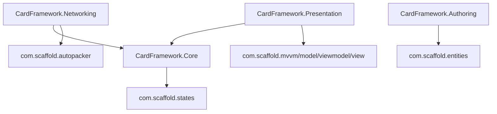

# Scaffold Package Fit

This note maps existing Scaffold packages to possible Card Framework responsibilities. It is based on local Scaffold package docs and the reference `Gear-Engine` manifest.

## Current Project State

`Packages/manifest.json` in this project currently contains Unity packages only. The reference `Gear-Engine` project consumes Scaffold packages through Git URL + path entries such as:

```text
https://github.com/MgCohen/Scaffold.git?path=/Assets/Packages/com.scaffold.<name>#main
```

No package wiring should happen during this research pass, but this is the likely integration pattern later.

## High-Fit Packages

| Package | Why It Matters |
| --- | --- |
| `com.scaffold.entities` | Strong match for card definitions, runtime instances, variable bags, modifiers, and flyweight-style shared definitions. |
| `com.scaffold.states` | Strong match for canonical simulation state, immutable-ish slices, mutators, subscriptions, snapshots, and rollback/replay foundations. |
| `com.scaffold.events` | Useful for in-process domain event publication when a full history stream is not needed or for tooling/presentation decoupling. |
| `com.scaffold.mvvm` | Useful for reactive binding contracts and deferred binding updates across presentation. |
| `com.scaffold.model` | Useful for Unity-free observable model state for presentation-facing card/zone models. |
| `com.scaffold.viewmodel` | Useful for binding orchestration and lifecycle in card/zone/screen view models. |
| `com.scaffold.view` | Useful for Unity-facing typed views, UI binding, and local view-event routing. |
| `com.scaffold.autopacker` | Later fit for snapshots, wire payloads, save buffers, and unmanaged-friendly transport contracts. |

## Package Notes

### Entities

`com.scaffold.entities` already has a definition/instance model:

- `EntityDefinition` for shared authored data.
- `EntityInstance<TDefinition>` and `EntityComponent<TDefinition>` for runtime instances.
- Variable bags with parent chaining.
- Runtime modifiers.
- Instance IDs.
- Read and subscription boundaries.

Potential fit:

- Card definitions and instances.
- Zone definitions and instances.
- Relic/resource/worker/enemy definitions for card-based games.
- Modifier layering for buffs, equipment, auras, curses, temporary costs, and other dynamic values.

Concern:

- It references UnityEngine and uses ScriptableObject identity. That may be fine for authoring, but we should decide whether the pure simulation core depends on it directly or maps from authored Scaffold entities into a Unity-free runtime model.

### States

`com.scaffold.states` provides:

- Store with slices.
- Mutators.
- State event handling.
- Snapshots.
- Deferred event dispatch.
- Created/Updated/Removed subscription events.

Potential fit:

- Canonical state for entities, zones, players, sessions, turns, choices, and history cursors.
- Snapshot/rollback testing.
- Reactive presentation state.
- Batch mutation and deferred notifications for large effect resolution.

Concern:

- We should decide whether every card instance is represented as Store slices, or whether a lower-level entity model owns values and Store holds indexed session state. Simplicity favors one canonical path.

### MVVM / Model / ViewModel / View

The MVVM packages separate:

- Shared binding contracts and deferred bind updates in `com.scaffold.mvvm`.
- Unity-free observable models in `com.scaffold.model`.
- Bind lifecycle and navigation-aware orchestration in `com.scaffold.viewmodel`.
- Unity-facing typed views in `com.scaffold.view`.

Potential fit:

- Card view models that expose rendered state from simulation/history.
- Zone view models for hand, deck, board, stack, shop, rewards, and spatial areas.
- UI card views and world card views that bind to the same model.
- Deferred UI updates after a large history batch.

Concern:

- Presentation models should not become the simulation model. They are projections of simulation state/history.

### Events

`com.scaffold.events` is a typed in-process event bus.

Potential fit:

- Tooling events.
- Presentation events.
- Application-level notifications.
- Domain event distribution where ordering is not the authoritative history.

Concern:

- The core rules engine should not rely on an ambient event bus for critical deterministic order unless its ordering and lifetime are tightly controlled. A match-local history/event queue may be safer for core simulation.

### AutoPacker

`com.scaffold.autopacker` emits unmanaged packed structs for annotated partial types.

Potential fit:

- Command envelopes.
- History chunks.
- Snapshots.
- Save buffers.
- Network payloads.

Concern:

- It is a later concern. We should first define stable domain envelopes, then decide what should be packed.

## Suggested Dependency Direction

Potential early direction:



Open issue: if `CardFramework.Core` must be Unity-free, it may not reference `com.scaffold.entities` directly because Entities is Unity-coupled. A clean option is:

- Use `com.scaffold.entities` in Authoring and Unity runtime adapters.
- Convert authored definitions into pure runtime definitions for simulation.
- Keep IDs stable so the conversion is lossless and debuggable.

## Candidate Roles By Framework Area

| Framework Area | Scaffold Package Candidate |
| --- | --- |
| Card definition authoring | `com.scaffold.entities` |
| Runtime simulation state | `com.scaffold.states` |
| Mutable values/modifiers | `com.scaffold.entities`, or custom pure model inspired by it |
| Card presentation models | `com.scaffold.model`, `com.scaffold.mvvm` |
| Card presentation controllers | `com.scaffold.viewmodel` |
| Unity card/zone views | `com.scaffold.view` |
| Local app notifications | `com.scaffold.events` |
| Snapshots and payload packing | `com.scaffold.autopacker` |

## Recommendation

Use Scaffold as a toolbox, not as a constraint.

The likely best fit is:

1. Adopt `com.scaffold.states` early for state/mutator/snapshot exploration.
2. Explore `com.scaffold.entities` for authoring and definition/instance ergonomics.
3. Use MVVM packages for presentation once the state/history shape exists.
4. Defer AutoPacker until command/history payloads are stable.
5. Keep the rules core free of Unity scene/presentation concerns regardless of package choices.
