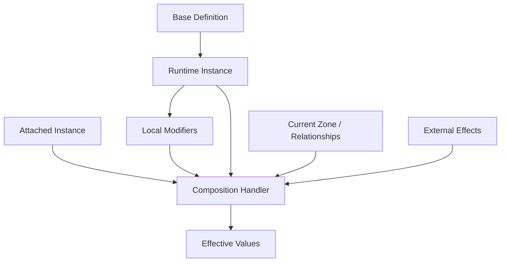

# Core Model Decisions

This document answers the Core Model questions from [Open Questions](06-open-questions.md). These are early research decisions, not final implementation contracts.

## Status

The direction for the core model is now:

- Do not enforce a hard Scaffold boundary yet.
- Start with key-value variables; do not hardcode variable names into the framework.
- Per-entity variables are canonical Store slices accessed through Entities-shaped handles, via the `com.scaffold.entities.states` bridge package. (See "Canonical State" below.)
- Card instances are independent from zone membership.
- Every entity should have a base definition.
- Instances are definitions plus modifiers, with attachments and equipment modeled as their own instances.

## Dependency Boundary

Question: should the simulation core depend directly on Scaffold packages, or should Scaffold be used only in Unity-facing adapters?

Decision: no enforced boundary yet.

Scaffold should be allowed wherever it genuinely fits:

- In simulation, if the package model supports deterministic rules cleanly.
- In Unity-facing authoring or presentation, if runtime simulation benefits from a separate model.
- In both, if conversion and shared IDs stay simple.
- In neither, if the framework needs a custom model.

Reasoning:

At this stage, the important rule is not "pure core at all costs." The important rule is to avoid forcing an architecture before we know whether Scaffold Entities and Scaffold States help or fight each other.

Implication:

Early docs should describe boundaries by responsibility, not by package dependency. We can still keep presentation, rules, authoring, and networking conceptually separated without deciding package references yet.

Confidence: medium.

Follow-up:

Resolved by `com.scaffold.entities.states`: per-entity variables are canonical `EntityVariableState` slices in the Store, exposed through `StateEntity<TDef>` handles that implement both `IReadOnlyEntity` and `IMutableEntity`. Store wraps; Entities is the ergonomic surface. (See "Canonical State" below and doc 10.)

## Value Model

Question: should card/entity values be stored primarily as flexible variables/tags, typed state records, or a hybrid?

Decision: start with simple key-value variables, regardless of whether the implementation uses Scaffold Entities, Store, or a custom model.

The starting model should assume entities can carry variable entries shaped conceptually like:

```text
VariableKey -> VariableValue
```

Examples of possible keys a game or preset might define:

- `cost`.
- `attack`.
- `health`.
- `energy`.
- `zone`.
- `owner`.
- `controller`.
- `visibility`.
- `stack_count`.
- `recipe_progress`.
- `exhausted`.

These are examples, not required built-in fields.

Reasoning:

Key-value variables are flexible enough for the early framework and align with Scaffold Entities' definition/instance/modifier model without requiring the framework to know every possible game value ahead of time. This keeps the model data-driven whether we adopt Scaffold Entities directly, wrap it, or create a custom representation.

Implication:

Typed concepts can exist as optional convenience wrappers, validators, schemas, or preset conventions over key-value variables. They should not become required hardcoded fields in the base framework.

Confidence: medium.

Follow-up:

Define how variable keys are registered, typed, validated, displayed, and versioned without making the base framework depend on a fixed variable list.

## Canonical State

Question: what is the canonical source of truth: entity instances, Store slices, or a composed model where each owns different concerns?

Decision: **Store is canonical; Entities is the API.** Per-entity variables live as `EntityVariableState` slices in the Store. `StateEntity<TDefinition>` is a thin handle implementing `IReadOnlyEntity<TDef>` and `IMutableEntity<TDef>` over `StoreVariableStorage`. Mutations route through `Store.Execute` / `Store.ExecuteBatch`; reads use a per-rebuild effective-value cache. Game-level state (turn, phase, available actions, decisions, zones-as-records) lives in plain Store slices alongside the entity slices.

This is implemented by **`com.scaffold.entities.states`** (the bridge package). See doc 10 §"Store And Entities Relationship" for the integration shape.

Reasoning:

- One source of truth — no duplication, no two-way sync.
- Snapshot/rollback comes from the Store for free, including per-entity variables.
- Polymorphic substitution: any code holding `IReadOnlyEntity` / `IMutableEntity` works against either plain Entities or the state-backed handle.
- Modifier ordering, source attribution, atomic batches, and coalesced subscriber notifications all come from the Store + bridge.

Implication:

Three engine-side responsibilities follow from the bridge boundary (none require further Scaffold work):

- **Handle re-hydration after `LoadSnapshot`.** Snapshots contain canonical `EntityVariableState` slices, not handles. The engine maintains an `InstanceId → (definition, store)` registry and re-creates `StateEntity<TDef>` references after load.
- **Disposal on entity death.** The engine calls `StateEntity.Dispose()` on the entity-removal path so the Store listener is released; short-lived tokens otherwise leak handlers.
- **Structural-change subscriptions are diff-based.** A single `ExecuteBatch` that removes and re-adds the same variable produces no net `Added`/`Removed` event. For per-mutation granularity, subscribe to the `EntityVariableState` slice directly and diff. (Coalesced view is the right default for continuous-effects cleanup — doc 24.)

Confidence: high.

Follow-up:

The small scenario sketch (definition + base values, runtime instance, cost modifier from aura, zone movement, history) is now an implementation exercise, not a design exercise.

## Instances And Zones

Question: how should an instance behave when a card changes zones?

Decision: do not model "identity" as a separate concept. The instance is the durable runtime object; its instance ID is only a lookup/reference value.

A card instance remains the same instance when it moves between zones unless a game-specific rule or effect explicitly replaces it, transforms it, destroys it, or recreates it.

Reasoning:

The framework should not bake Magic's zone-change replacement behavior into all games. Some games need that behavior, but many do not. Zone changes should be observable facts, not instance replacement by default.

Implication:

Zone movement can trigger effects, modifiers, visibility changes, or game-specific replacement rules. The base system should preserve the same instance by default.

Confidence: high.

Follow-up:

The Zone Model doc should include optional replacement policies for games that need zone movement to create or replace instances.

## Entity Definitions

Question: do all entities have definitions, or can runtime-only entities exist without definitions?

Decision: all entities should have a base definition.

This applies broadly:

- Cards.
- Tokens.
- Zones.
- Players or actors, if represented as entities.
- Relics.
- Equipment.
- Resources.
- Villagers.
- Enemies.
- Card packs.
- Temporary helper objects, if they need to be referenced as instances.

Reasoning:

Definitions make authoring, debugging, save/load, replay, networking, and tool inspection easier. Even generated runtime objects can point to a generated or system definition.

Implication:

The framework should support lightweight system definitions for tokens and temporary entities instead of allowing definitionless entities.

Confidence: high.

Follow-up:

Define the minimum fields required for a base definition.

## Instances, Modifiers, Attachments, And Composition

Question: how do attachments, equipment, stacked cards, tokens, and transformed cards relate to a base card instance?

Decision: an instance is a base definition plus modifiers. Attachments and equipment are usually separate instances from their own definitions.

A card instance should not absorb every attached thing into itself. Instead:

- A sword attached to a villager is an equipment instance attached to a villager instance.
- An aura modifier may be an effect or relationship from another instance.
- A token is an instance created from a token definition.
- A transformed card may be the same instance with a transformation modifier, or a game-specific replacement with a new definition and new instance.
- A stack may be a relationship between instances, a zone-like container, or a game-specific composed object.

Reasoning:

Composition keeps instances explicit. It also supports Stacklands-like physical composition, RPG equipment, TCG auras, attached cards, and relic/passive systems without making the base card object enormous.

Implication:

The framework needs composition handlers that can calculate effective values from:

- The base definition.
- Local instance modifiers.
- Attached instances.
- External effects.
- Zone or context modifiers.
- Game-specific systems.

Confidence: medium-high.

Follow-up:

The Entity Model doc should distinguish base values, local modifiers, external modifiers, attachments, and effective values.

## Revised Working Model

The current working model is:




The exact storage for this model is still open. The conceptual model is accepted enough to inform the next documents.

## Decisions To Carry Forward

- Do not require a pure non-Scaffold simulation boundary yet.
- Use key-value variable-based entities as the first mental model.
- Per-entity variables are canonical Store slices; the entity handle is the API. (`com.scaffold.entities.states` bridge.)
- Preserve the same instance across zone changes by default.
- Require every entity to have a definition.
- Model attachments/equipment/composition as relationships between instances, not as hidden fields on one card.

