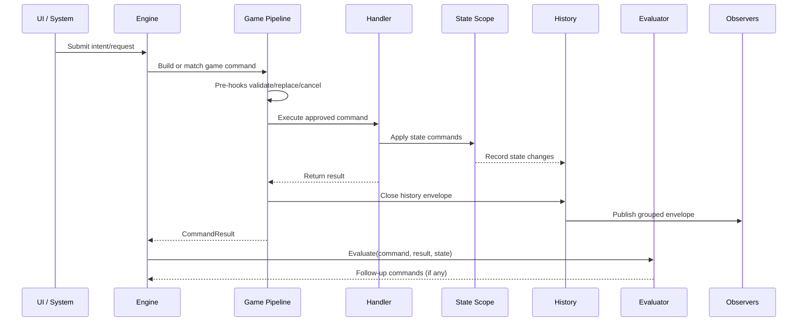

# Action, Request, Command, And History Model

This document proposes the first action-flow vocabulary for the Card Framework.

Related docs:

- [DeckMech Command Pipeline Reference](13-deckmech-command-pipeline-reference.md)
- [Action Flow Decisions](14-action-flow-decisions.md)
- [Zone Model](12-zone-model.md)

## Model Summary

The working model is:

```text
Interaction/System
  -> Intent / Request
  -> Pipeline approval
  -> Game command resolution
  -> State mutation commands
  -> State changes
  -> History envelope
  -> Presentation / network / debug observers
```

The framework should provide the shape. Games and presets provide the rules.

## Quick Vocabulary


| Term             | Meaning                                                          | Example                                                           |
| ---------------- | ---------------------------------------------------------------- | ----------------------------------------------------------------- |
| Intent           | Something an actor or system is trying to do.                    | "Drag this card onto that zone."                                  |
| Request          | A structured intent submitted to the engine.                     | `MoveInstanceRequest(card, fromZone, toZone)`.                    |
| AvailableAction  | A precomputed legal or suggested action the engine exposes.      | "Play this card targeting that enemy."                            |
| Game Command     | Approved or approvable high-level command that needs game logic. | Play card, draw card, deal damage, move instance.                 |
| StateMutation    | Low-level already-approved state mutation.                       | Set variable, insert into zone, remove from zone, apply modifier. |
| CommandHandler   | Resolves a game command into results and state mutations.        | Damage handler splits shield/health changes.                      |
| CommandPreHook   | Runs before a handler; can validate, cancel, replace, or modify. | Cost increase, prevention, redirect target.                       |
| CommandReaction  | Runs after a handler result.                                     | "After damage, draw a card."                                      |
| CommandResult    | Structured outcome of a game command.                            | Move rejected, actual destination, damage amount, card drawn.     |
| State Change     | Concrete change to canonical state.                              | Instance moved, variable changed, modifier added.                 |
| History Entry    | Ordered fact emitted during resolution.                          | `ZoneChanged`, `VariableChanged`, `DecisionOpened`.               |
| History Envelope | Group of entries with cause metadata.                            | "Player A played Fireball; these changes happened."               |


Names are still proposals. See [Action Definition Proposal](17-action-definition-proposal.md). The important distinction is between attempted request, high-level game command, low-level state mutation, result, and history.

## Pipeline Shape




## Intent And Request

An intent begins outside the rules engine.

Sources:

- Player input.
- AI choice.
- Network message.
- Scripted enemy behavior.
- Triggered system.
- Tutorial automation.
- Replay playback.

Examples:

- Drag instance A from zone X to zone Y.
- Play card A.
- Activate ability on instance A.
- Choose option 3.
- Pass priority.
- Buy item from shop.

The request should carry what the actor attempted, not the final state mutation.

Example:

```text
MoveAttempt
  actor: Player1
  sourceInstance: CardA
  fromZone: Hand
  toZone: Battlefield
  pointerContext: optional
```

The engine may reject it, match it to a possible action, or convert it into another command.

## Possible Actions And Options

Possible actions are optional.

Games may use them to:

- Highlight legal cards.
- Show valid targets.
- Restrict network clients to server-approved choices.
- Support AI search.
- Display action menus.

But the base framework should still allow a request that is not from a precomputed list.

Possible action flow:

```text
Engine computes possible actions
  -> UI may display/highlight them
  -> Actor submits request
  -> Engine checks whether request matches active possible action
  -> If required by game, reject unmatched request
```

Permissive flow:

```text
Actor submits request
  -> Engine validates directly
  -> Approve or reject
```

## Game Commands

A game command is a high-level command that needs rules logic.

Examples:

- Play card.
- Move instance.
- Draw card.
- Deal damage.
- Heal.
- Attach equipment.
- Open pack.
- Resolve stack item.
- Choose option.

Game commands may:

- Be rejected.
- Be cancelled.
- Be replaced.
- Create decisions.
- Apply many state commands.
- Emit many history entries.
- Return a result.

Game commands should have one enforced entry point so they cannot bypass validation, hooks, logging, or history.

## StateMutation

A `StateMutation` is a lower-level mutation that has already been approved by the game command pipeline.

Examples:

- Insert instance into zone at index.
- Remove instance from zone.
- Set variable key to value.
- Add modifier.
- Remove modifier.
- Create instance.
- Destroy instance.
- Set visibility data.

State mutations should not ask broad legality questions. They are the "apply this fact" layer.

In a Store-based implementation, state mutations likely map to mutators. In a different implementation, they may map to entity/zone operations.

## CommandPreHooks

Command pre-hooks run before the handler.

They may:

- Validate a condition.
- Cancel the command.
- Replace the command.
- Modify values.
- Redirect targets.
- Add metadata.
- Force approval.

Examples:

- "This actor is frozen, cancel movement."
- "Spell costs 1 more this turn."
- "Redirect damage to another target."
- "This effect ignores hand size."
- "Network authority rejected this request."

Command pre-hooks are where many replacement/prevention effects can live.

## Handler

The handler owns the main resolution of a game command.

It should:

- Read current state.
- Decide the outcome.
- Apply state commands through a state scope.
- Return a typed result.
- Emit or allow emission of history entries.

Example:

```text
Handle DealDamageCommand
  -> read shield, armor, health, prevention modifiers
  -> calculate result
  -> apply ReduceShield state command
  -> apply ReduceHealth state command
  -> maybe apply DestroyInstance state command
  -> return DamageResult
```

## CommandReactions

> **Note:** The inline `CommandReaction` pipeline step has been superseded by the evaluator pattern (see [Engine — Orchestrator And Evaluation Loop](20-engine-evaluation-loop.md)). Follow-up commands are no longer dispatched as post-hooks inside the pipeline — they are returned by `IEngineEvaluator.Evaluate` after the pipeline finishes and the envelope is published. The pre-hook concept (`CommandPreHook`) remains valid.

The evaluator reads current game state after each command and returns any follow-up commands. This replaces the need for a post-reaction pipeline step. The pre-hook layer still handles cancellation, replacement, and redirection before the handler runs.

## CommandResult

A `CommandResult` is a structured outcome from a game command.

Examples:

- Approved/rejected/cancelled.
- Actual destination.
- Was redirected.
- Damage amount.
- Shield damage vs health damage.
- Drawn instance ID.
- Created instance IDs.
- Opened decision ID.

Results are useful for:

- Branching inside effects.
- Trigger/reaction conditions.
- UI feedback.
- History envelopes.
- Tests.

## History Envelope

A history envelope groups everything caused by one action-flow boundary.

Conceptual shape:

```text
HistoryEnvelope
  envelopeId
  originCommandId       // shared across all commands in a chain
  originRequest         // non-null only on the first command in a chain
  actor
  sourceInstance
  rootCommand
  result
  entries[]
  // Note: child commands dispatched inline via scope.DispatchChild fold their
  // entries into this envelope. Evaluator follow-ups each produce their own
  // separate envelope sharing the same originCommandId.
```

Entries might include:

- Instance created.
- Instance destroyed.
- Zone content changed.
- Variable changed.
- Modifier added/removed.
- Decision opened.
- Command cancelled.
- Command replaced.
- Visibility changed.

The envelope lets observers understand cause:

```text
Player1 used Fireball
  -> Card moved hand -> stack
  -> Cost spent
  -> Damage dealt to Enemy2
  -> Enemy2 health changed
  -> Card moved stack -> discard
```

Without an envelope, UI sees unrelated state changes. With an envelope, UI can animate and explain the whole sequence.

## UI Reaction

Presentation should consume state and history, not mutate simulation directly.

It can use envelopes to:

- Animate a coherent sequence.
- Display source/target lines.
- Show damage numbers with source context.
- Snap a rejected drag back.
- Reveal hidden information only when the envelope says it is visible.
- Batch UI refresh after a command resolves.

The UI may also subscribe to state directly for simple reactive rendering. But the envelope is the richer channel for animation and explanation.

## Networking Fit

Networking can attach at the same boundaries:

- Client sends request or selected option.
- Server pipeline validates and resolves.
- Server sends filtered history envelope.
- Client applies or displays envelope.

For local games, the same pipeline runs without transport.

For permissive games, the pipeline may approve most requests immediately.

For strict games, the pipeline may require active options, priority, or network authority.

## Zone Movement Fit

Zone movement fits the model:

```text
Interaction: drag card to zone
  -> Request: move/use/drop/play this instance at this destination
  -> Pipeline: validate or auto-approve
  -> Handler: resolve exact meaning
  -> State commands:
      remove from old zone
      insert into new zone using zone organization behavior
      update variables/visibility if needed
  -> History envelope:
      source request
      zone changes
      any resulting triggers
```

The zone does not decide broad legality. It organizes approved content changes.

## Open Questions

- Final names: Intent, Request, Action, Command, GameCommand? — still unsettled; see [Action Terminology Discussion](16-action-terminology-discussion.md)
- Should possible actions be called `Option`, `ActionOption`, or `AvailableAction`? — still open
- How are active option lists represented and matched? — partially answered: `IAvailableActionsSnapshot` (doc 20 section 10); shape detail still open
- ~~How do nested commands produce nested envelopes?~~ — resolved: child commands via `scope.DispatchChild` fold into the current envelope; evaluator follow-ups each get their own envelope sharing `OriginCommandId` (doc 18)
- ~~When does an envelope close?~~ — resolved: after the handler returns and history is published, before the evaluator is called (doc 18, doc 20)
- Can pre-hooks mutate state, or only replace/cancel commands? — still open
- ~~Are post-reactions allowed to dispatch immediately or queued?~~ — resolved: there are no inline post-reactions; follow-up commands are returned by the evaluator and enqueued by the engine (doc 20)
- How do scheduler models affect action flow? — still open; see [06-open-questions.md](06-open-questions.md)
- How does rollback/rejection communicate to presentation? — still open
- What metadata must be mandatory in an envelope? — partially settled: `OriginCommandId`, `OriginIntent` (first command only), `actor`, `sourceInstance`, `result`, `entries` (doc 18)

## Useful Invariants

- UI creates intents/requests, not state changes.
- Game/action rules own approval.
- State commands apply approved facts.
- Handlers return typed results.
- Pre-hooks can cancel or replace before state changes.
- Post-reactions observe result and can trigger follow-up work.
- History envelopes group state changes by cause.
- Zones organize approved contents; they do not own broad legality.

