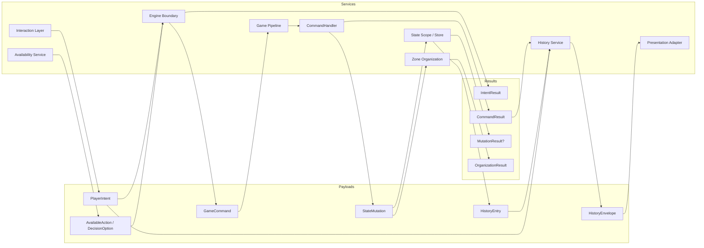
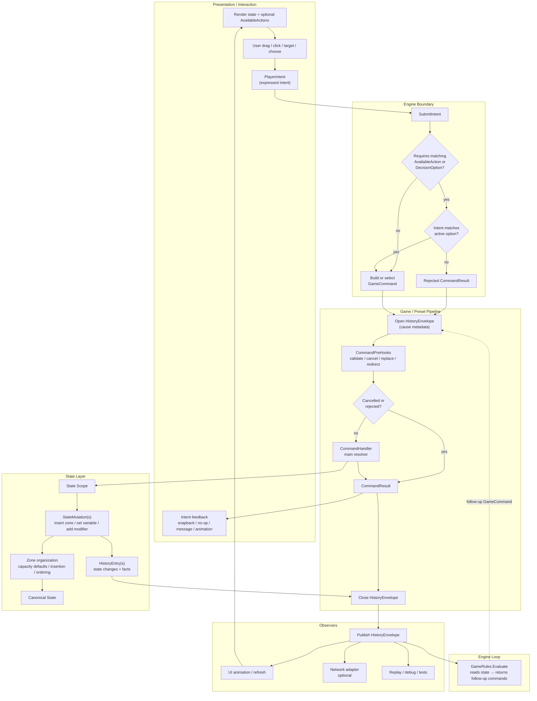
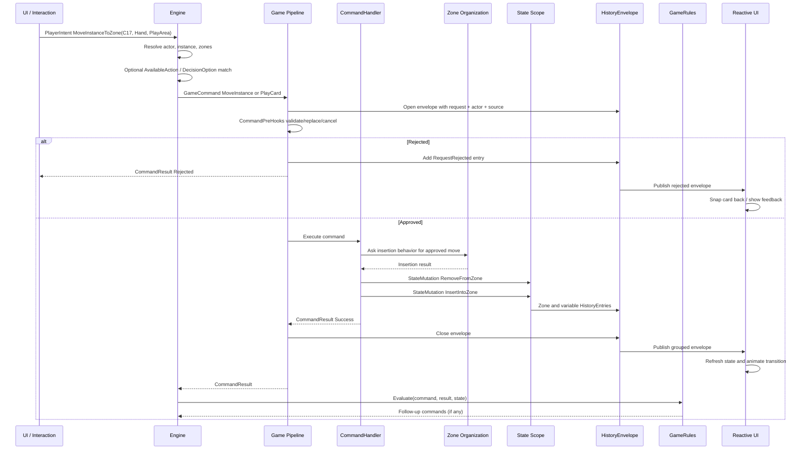

# Action Definition Proposal

This document proposes concrete definitions for the action-related shapes in the Card Framework.

It builds on:

- [Action Flow Decisions](14-action-flow-decisions.md)
- [Action, Request, Command, And History Model](15-action-request-command-history-model.md)
- [Action Terminology Discussion](16-action-terminology-discussion.md)
- [DeckMech Command Pipeline Reference](13-deckmech-command-pipeline-reference.md)

## Proposal Summary

Use this core flow:

```text
Interaction
  -> PlayerIntent
  -> GameCommand
  -> StateMutation(s)
  -> StateChange(s)
  -> HistoryEnvelope
```

Use "Action" carefully:

- `AvailableAction` for things the engine exposes as possible choices.
- Avoid bare `Action` as a core runtime type.
- Avoid `GameAction` as a generic framework term unless a preset specifically means scheduled/timeline action.

Recommended working vocabulary:


| Shape                    | Proposed Name                         | Role                                                        |
| ------------------------ | ------------------------------------- | ----------------------------------------------------------- |
| External attempt         | `PlayerIntent`                        | Expressed player intent submitted to the engine.            |
| Possible choice          | `AvailableAction` or `DecisionOption` | Something the engine exposes as available or selectable.    |
| High-level rules command | `GameCommand`                         | Command that enters the game pipeline and returns a result. |
| Low-level mutation       | `StateMutation`                       | Already-approved state change applied to canonical state.   |
| Command outcome          | `CommandResult`                       | Structured result, even for failure or no-op.               |
| Pre-handler hook         | `CommandPreHook`                      | Can validate, cancel, replace, redirect, or modify.         |
| Main resolver            | `CommandHandler`                      | Resolves a game command into state mutations and result.    |
| Post-result follow-up    | `GameRules`                           | Reads state after command; returns follow-up commands. Replaces inline CommandReaction. |
| Ordered fact             | `HistoryEntry`                        | One meaningful state or simulation fact.                    |
| Batched output           | `HistoryEnvelope`                     | Group of entries with cause metadata.                       |
| Authored card behavior   | `Effect`                              | Simple content entry point, deeper design deferred.         |


## Core Term Categories

The action flow has three kinds of terms that should not be mixed:

1. **Payloads**: data objects passed between systems.
2. **Results**: outcome objects returned after work resolves.
3. **Services**: systems that receive payloads, execute logic, mutate state, or publish output.

### Payloads

Payloads are data. They should be serializable or at least easy to inspect in logs/debug views.


| Payload           | Created By                      | Consumed By                | Purpose                                         |
| ----------------- | ------------------------------- | -------------------------- | ----------------------------------------------- |
| `PlayerIntent`    | UI, AI, network, replay, script | Engine boundary            | Describes what an actor/system expressed intent to do. |
| `AvailableAction` | Engine/preset rules             | UI, AI, validation layer   | Optional affordance the actor may attempt.      |
| `DecisionOption`  | Decision system                 | UI, AI, network client     | One selectable option inside a decision window. |
| `GameCommand`     | Engine boundary or effect logic | Game pipeline              | High-level rules command to resolve.            |
| `StateMutation`   | Command handler or state system | State scope/store          | Already-approved state change.                  |
| `HistoryEntry`    | State scope, handler, pipeline  | History envelope           | Ordered fact about what happened.               |
| `HistoryEnvelope` | Pipeline/history service        | UI, network, debug, replay | Cause-aware group of history entries.           |


Payload rules:

- Payloads should not own long-lived behavior.
- Payloads may carry IDs, actor references, source references, target hints, and metadata.
- `PlayerIntent` is not a mutation.
- `GameCommand` is not a low-level state write.
- `StateMutation` is not a legality check.
- `HistoryEnvelope` is output, not an input command.

### Results

Results are returned by services after a payload has been processed.


| Result               | Returned By                     | Returned To                | Purpose                                                                 |
| -------------------- | ------------------------------- | -------------------------- | ----------------------------------------------------------------------- |
| `IntentResult`      | Engine boundary                 | UI / caller                | Says whether the request was accepted, rejected, converted, or matched. |
| `CommandResult`      | Game pipeline / command handler | Caller, reactions, history | Structured outcome of a `GameCommand`.                                  |
| `MutationResult`     | State scope/store, if needed    | Handler/history            | Optional low-level outcome of applying a `StateMutation`.               |
| `OrganizationResult` | Zone organization model         | Handler/state layer        | Says where/how an approved instance was inserted or removed.            |


Result rules:

- Results should be structured, even when empty/default.
- Rejection should be a result, not only an exception.
- Results may include reason codes for UX.
- Results should be included in the `HistoryEnvelope` when useful.
- Results are not the same as history; they summarize outcome, while history records facts.

### Services

Services perform work. They receive payloads, return results, and may coordinate other services.


| Service                 | Input                              | Output                                   | Responsibility                                                     |
| ----------------------- | ---------------------------------- | ---------------------------------------- | ------------------------------------------------------------------ |
| Interaction Layer       | Pointer/UI events                  | `PlayerIntent`                           | Converts UI gestures into expressed intents.                       |
| Engine Boundary         | `PlayerIntent`                     | `IntentResult`, `GameCommand`            | Resolves session/actor/instance, matches options, builds commands. |
| Availability Service    | State, actor context               | `AvailableAction`s / decisions           | Computes optional affordances or choice windows.                   |
| Game Pipeline           | `GameCommand`                      | `CommandResult`, `HistoryEnvelope`       | Runs pre-hooks, handler, reactions, and envelope boundary.         |
| CommandPreHook          | `GameCommand`                      | Continue/replace/cancel/reject signal    | Validates or modifies command before handler.                      |
| CommandHandler          | `GameCommand`                      | `CommandResult`, `StateMutation`s        | Resolves command into state changes.                               |
| State Scope / Store     | `StateMutation`                    | State changes, optional `MutationResult` | Applies canonical state changes.                                   |
| Zone Organization Model | Approved insertion/removal request | `OrganizationResult`                     | Organizes zone contents after legality is decided elsewhere.       |
| GameRules               | `GameCommand` + `CommandResult` + `GameState`  | Follow-up `GameCommand`s | Reads state after command; returns any follow-up commands. Replaces inline CommandReaction. |
| History Service         | `HistoryEntry`s + metadata         | `HistoryEnvelope`                        | Groups cause-aware history output.                                 |
| Presentation Adapter    | State + `HistoryEnvelope`          | Visual update / animation                | Updates UI without owning gameplay truth.                          |
| Network Adapter         | `PlayerIntent`/envelope            | Wire payloads                            | Optional multiplayer transport boundary.                           |


Service rules:

- Services own behavior.
- Services should expose clear input/output payloads.
- A service may be game-specific or preset-specific.
- The base framework should define the communication shape, not every game's rules.

### How They Connect

```text
Interaction Layer
  input: pointer events
  output payload: PlayerIntent

Engine Boundary
  input payload: PlayerIntent
  output result: IntentResult
  output payload: GameCommand

Game Pipeline
  input payload: GameCommand
  output result: CommandResult
  output payload: HistoryEnvelope

CommandHandler
  input payload: GameCommand
  output payload: StateMutation(s)
  output result: CommandResult

State Scope / Store
  input payload: StateMutation
  output payload: HistoryEntry
  optional result: MutationResult

History Service
  input payload: HistoryEntry(s)
  output payload: HistoryEnvelope

Presentation Adapter
  input payload: HistoryEnvelope
  input state: Canonical State
  output: UI update / animation
```

## Payload / Result / Service Graph




## Proposed Action Flow Graph

This graph shows the proposed data flow, system communication, payload movement, and decision points.




## Flow Graph Notes

### What Happens

1. Presentation renders current state and may render optional `AvailableAction`s.
2. User or system input creates a `PlayerIntent`.
3. The engine checks whether the game requires matching against active options.
4. If matching is required and fails, the engine creates a rejected `CommandResult`.
5. If accepted, the request becomes or selects a `GameCommand` (stamped with `OriginCommandId`).
6. The pipeline opens a `HistoryEnvelope`.
7. `CommandPreHook`s may validate, reject, cancel, replace, or redirect the command.
8. The `CommandHandler` resolves the command.
9. The handler applies `StateMutation`s through a state scope.
10. Zones organize approved content changes but do not decide broad legality.
11. State changes produce `HistoryEntry` facts.
12. The envelope closes and is published to observers.
13. The engine calls `GameRules.Evaluate(command, result, state)`.
14. The evaluator reads current state and returns any follow-up commands; the engine enqueues them.
15. UI updates from state/history and can animate grouped envelopes using `OriginCommandId` to correlate sequences.

### Where Systems Communicate


| Boundary                  | Payload                          | Notes                                                   |
| ------------------------- | -------------------------------- | ------------------------------------------------------- |
| UI -> Engine              | `PlayerIntent`                   | Expressed intent, not a mutation.                       |
| Engine -> Pipeline        | `GameCommand` or rejected result | Game-specific approval and option matching happen here. |
| Pipeline -> State         | `StateMutation`                  | Already-approved facts.                                 |
| State -> Pipeline/History | `HistoryEntry`                   | Ordered facts produced by mutations.                    |
| Pipeline -> Observers     | `HistoryEnvelope`                | Grouped cause-aware output.                             |
| Pipeline -> UI            | `CommandResult` and/or envelope  | Used for snapback, no-op, feedback, animation.          |


### Decision Points


| Decision                                | Owner                         | Outcome                                     |
| --------------------------------------- | ----------------------------- | ------------------------------------------- |
| Does this game require active options?  | Game/preset pipeline          | Match request or validate directly.         |
| Does request match an option?           | Engine/pipeline               | Reject or build command.                    |
| Do pre-hooks cancel or replace command? | Pipeline hooks                | Continue, reject, cancel, or modify.        |
| What state changes happen?              | Command handler               | Emits state mutations and result.           |
| How is zone content arranged?           | Zone organization model       | Inserts/removes/reorders approved contents. |
| Do reactions dispatch follow-up work?   | Command reactions / scheduler | May create child command flow.              |
| When are observers notified?            | Envelope boundary             | Usually after grouped envelope closes.      |


### Payload Movement

```text
PlayerIntent
  -> GameCommand
  -> StateMutation(s)
  -> StateChange(s)
  -> HistoryEntry(s)
  -> HistoryEnvelope
  -> UI/network/debug observers
```

Important distinction:

- `PlayerIntent` says what was intended.
- `GameCommand` says what the rules pipeline is resolving.
- `StateMutation` says what approved state fact is applied.
- `HistoryEntry` says what happened.
- `HistoryEnvelope` says why those things happened together.

## Example Flow: Player Drags Card Into Zone

This example uses a generic card drag. The game may interpret the drag as "move this instance" or as something richer like "play this card." The framework flow stays the same.

### Scenario

Initial state:

- Player actor `P1` views their hand.
- Card instance `C17` is in zone `P1.Hand`.
- Destination zone is `P1.PlayArea`.
- The UI lets the player drag `C17` over `P1.PlayArea`.

Player action:

```text
Player drags C17 from P1.Hand and drops it on P1.PlayArea.
```

### Step-By-Step Flow

```text
1. UI detects drop
   payload: pointer/drop data

2. Interaction layer builds PlayerIntent
   PlayerIntent:
     type: MoveInstanceToZone
     actor: P1
     sourceInstance: C17
     fromZone: P1.Hand
     toZone: P1.PlayArea
     inputContext: drag/drop metadata

3. Engine receives PlayerIntent
   - Finds game session.
   - Finds actor P1.
   - Finds instance C17.
   - Optionally checks active AvailableAction / DecisionOption list.

4. Engine decides interpretation
   Option A: this is a raw movement request.
     -> Build GameCommand: MoveInstance(C17, P1.Hand, P1.PlayArea)

   Option B: this game treats dragging hand card to play area as playing a card.
     -> Build GameCommand: PlayCard(C17, targetZone: P1.PlayArea)

5. Pipeline opens HistoryEnvelope
   HistoryEnvelope:
     actor: P1
     sourceIntent: original drag intent
     rootGameCommand: MoveInstance or PlayCard

6. CommandPreHooks run
   Examples:
     - Check actor has permission to act.
     - Check active option match if game requires one.
     - Check cost/resource if this is PlayCard.
     - Check card is not locked/stunned/exhausted.
     - Check network authority if multiplayer.
     - Redirect or replace command if a rule modifies destination.

7. Decision point: rejected?
   If rejected:
     CommandResult:
       status: Rejected
       reasonCode: NotEnoughEnergy / InvalidDestination / NotYourTurn / etc.

     HistoryEntry:
       RequestRejected(P1, C17, reason)

     HistoryEnvelope closes.
     UI receives result/envelope and snaps card back or shows feedback.
     Flow ends.

8. If approved, CommandHandler runs
   For MoveInstance:
     - Reads current zone membership.
     - Asks destination zone how to organize approved insertion.
     - Applies StateMutation RemoveFromZone(P1.Hand, C17).
     - Applies StateMutation InsertIntoZone(P1.PlayArea, C17, insertionResult).
     - Applies visibility or variable changes if needed.

   For PlayCard:
     - Pays cost through StateMutation(s).
     - Removes card from hand.
     - Inserts card into stack/play area depending on game rules.
     - May invoke effect placeholder.
     - May later move source to discard/resolved zone.

9. State layer applies StateMutations
   State changes:
     - P1.Hand contents changed.
     - P1.PlayArea contents changed.
     - C17 zone relationship changed.
     - Optional variables changed.

10. History entries are recorded
   HistoryEntry examples:
     - ZoneContentRemoved(P1.Hand, C17)
     - ZoneContentInserted(P1.PlayArea, C17, index)
     - InstanceVariableChanged(C17, "zone", P1.PlayArea)
     - CostPaid(P1, amount) if PlayCard

11. CommandHandler returns CommandResult
   MoveResult:
     status: Success
     movedInstance: C17
     fromZone: P1.Hand
     toZone: P1.PlayArea
     insertionIndex: 2

12. CommandReactions run
   Examples:
     - "Whenever a card enters play area..." reaction.
     - Animation/audio observer registers interest.
     - Debug trace records command result.
     - A game-specific trigger dispatches a child GameCommand.

13. HistoryEnvelope closes
   Envelope now contains:
     - Original request.
     - Actor/source metadata.
     - Root command.
     - Result.
     - Ordered state/history entries.
     - Optional child envelopes.

14. Observers receive grouped output
   UI:
     - Updates hand view.
     - Updates destination zone view.
     - Plays drag-drop settle animation or card-play animation.
     - Shows rejection feedback if rejected.

   Network:
     - Sends filtered envelope if multiplayer.

   Debug/replay:
     - Stores envelope for inspection/replay.
```

### Flow Diagram




### Notes

- The zone does not decide whether `C17` is allowed to enter `P1.PlayArea`.
- The zone does decide how an approved insertion is organized.
- A strict game can reject unless the request matches an active `AvailableAction`.
- A permissive game can auto-approve most movement requests.
- A networked game can insert server authority into the pre-hook or engine validation phase.
- UI can optimistically display the drag, but canonical state changes only after the engine approves and applies state mutations.
- State can update immediately inside the pipeline, while external notification waits for the envelope boundary.

## Why Avoid Bare "Action"

The word "action" can mean too many things:

- A player action.
- A UI action.
- A possible action.
- A scheduled timeline action.
- A card action.
- A command.
- An effect.
- A task in a queue.

DeckMech showed that this creates confusion fast. The framework should reserve "action" for user-facing language and use more precise runtime terms.

## Shape 1: PlayerIntent

Definition:

> A `PlayerIntent` is an expression of intent submitted to the engine by UI, AI, network, script, replay, or another system.

Examples:

- Move instance to zone.
- Play card.
- Activate ability.
- Choose option.
- Pass priority.
- Buy shop item.
- Stack one card onto another.

Important properties:

- It represents what was attempted, not what happened.
- It may be rejected.
- It may be matched against `AvailableAction`s or `DecisionOption`s.
- It may be converted into one or more `GameCommand`s.
- It should carry enough metadata for UX and history: actor, source instance, target hints, pointer context if relevant.

Example shape:

```text
PlayerIntent
  intentId
  actor
  sourceInstance
  intentType
  targetHints
  inputContext
```

Notes:

- `PlayerIntent` is the structured type name for any actor-originated input.
- A rejected intent should still produce a structured `IntentResult`.

## Shape 2: AvailableAction And DecisionOption

Definition:

> An `AvailableAction` is an action-like possibility exposed by the engine. A `DecisionOption` is a selectable option inside an explicit decision window.

Use `AvailableAction` for broad UI affordances:

- This card can be played.
- This card can move to this zone.
- This ability can be activated.

Use `DecisionOption` for explicit choice windows:

- Choose one of three cards.
- Select a target.
- Pass or respond.
- Choose one mode.

Important properties:

- Optional system. Not every game needs precomputed options.
- Can be local or server-authored.
- UI may use it for highlights, menus, or disabled states.
- The engine may require requests to match an active available action, or it may accept freeform requests.

Recommendation:

- Use `Decision -> DecisionOption` for formal choice windows.
- Use `AvailableAction` for general affordance discovery.
- Do not require all requests to originate from either.

## Shape 3: GameCommand

Definition:

> A `GameCommand` is a high-level rules command that enters the game pipeline, runs through hooks and a handler, and returns a `CommandResult`.

Examples:

- `PlayCard`.
- `MoveInstance`.
- `DealDamage`.
- `DrawCard`.
- `AttachInstance`.
- `ResolveStackItem`.
- `OpenPack`.

Important properties:

- Must have one enforced entry point.
- Must not silently no-op if sent through the wrong path.
- Can be cancelled or replaced by pre-hooks.
- Has exactly one main handler.
- Produces a structured result.
- Produces or causes `StateMutation`s.
- Opens/closes or contributes to a `HistoryEnvelope`.

Example flow:

```text
GameCommand
  -> CommandPreHook(s)
  -> CommandHandler
  -> CommandReaction(s)
  -> CommandResult
```

Why keep this name, for now:

- It is understandable from DeckMech.
- It clearly distinguishes from low-level state changes.
- It can be renamed later if `RulesCommand` or `EngineCommand` feels better.

## Shape 4: StateMutation

Definition:

> A `StateMutation` is an already-approved low-level state change.

This is the proposed replacement term for `StateCommand` in framework-level docs.

Examples:

- Insert instance into zone.
- Remove instance from zone.
- Set variable key/value.
- Add modifier.
- Remove modifier.
- Create instance.
- Destroy instance.
- Set visibility.

Important properties:

- It should not ask broad legality questions.
- It should not run the whole game pipeline again.
- It applies through a state scope or store/mutator layer.
- It records state changes for the current history envelope.
- It is implementation-adjacent and may map to Scaffold `Store` mutators.

Reasoning:

`StateMutation` is clearer than `StateCommand` for framework docs because it avoids making every layer a "command." If the implementation later uses command records for mutations, the conceptual term can still remain `StateMutation`.

## Shape 5: CommandResult

Definition:

> A `CommandResult` is the structured outcome of a `GameCommand`.

Examples:

- Success.
- Rejected.
- Cancelled.
- No-op.
- Actual destination.
- Damage split.
- Created instance IDs.
- Drawn card ID.
- Opened decision ID.
- Reason code.

Important properties:

- Always structured.
- Can be empty/default for simple cases.
- Should support UX feedback.
- Should support tests.
- Should be included in the history envelope.

Recommendation:

Use a base result shape with common fields:

```text
CommandResult
  status
  reasonCode optional
  message optional
```

Specific commands can extend with payload:

```text
MoveResult
  status
  actualZone
  actualIndex
  wasRejected
  wasRedirected
```

## Shape 6: CommandPreHook

Definition:

> A `CommandPreHook` runs before the command handler and can validate, cancel, replace, redirect, or modify a `GameCommand`.

Examples:

- Frozen actor cancels movement.
- Cost modifier changes play command.
- Replacement effect redirects damage.
- Network authority rejects request.
- Stack/priority rules transform an action into a stack entry.
- "Ignore hand size" effect modifies capacity handling.

Important properties:

- Runs before state mutations from the command.
- Should be deterministic.
- Should be ordered by registration or explicit priority.
- May return unchanged command, modified command, cancellation, or rejection.

Open question:

Can a pre-hook mutate state? My recommendation: not initially. It should return a signal. State mutation should remain in handlers or explicit follow-up commands unless a concrete need appears.

## Shape 7: CommandHandler

Definition:

> A `CommandHandler` is the main resolver for one `GameCommand` type.

Responsibilities:

- Read state.
- Interpret the command.
- Decide actual outcome.
- Apply `StateMutation`s.
- Return `CommandResult`.
- Emit history entries through the current envelope.

Example:

```text
Handle MoveInstance
  -> inspect current zone and destination zone organization
  -> apply remove-from-zone mutation
  -> ask destination zone how to insert
  -> apply insert-into-zone mutation
  -> return MoveResult
```

Important properties:

- Required for every concrete game command.
- Missing handler should be a loud error.
- Should receive a scope, not necessarily raw global Store.
- Can dispatch child game commands only if the pipeline explicitly supports nesting.

## Shape 8: CommandReaction

> **Note:** The inline `CommandReaction` pipeline step has been superseded by the evaluator pattern (see [Engine — Orchestrator And Evaluation Loop](20-engine-evaluation-loop.md)). Follow-up commands are no longer dispatched as post-hooks inside the pipeline. Instead, `GameRules.Evaluate` is called after the pipeline finishes and returns follow-up commands based on current game state. This keeps the pipeline lean and gives the evaluator full visibility before deciding what runs next.

The `CommandPreHook` concept (before the handler) remains valid. A proper trigger and reaction system that sits above the pipeline — including triggered abilities, replacement effects, and post-result reactions — is a known open design area.

## Shape 9: HistoryEntry

Definition:

> A `HistoryEntry` is one ordered fact emitted by simulation.

Examples:

- Instance created.
- Zone contents changed.
- Variable changed.
- Modifier added.
- Command rejected.
- Decision opened.
- Visibility changed.

Important properties:

- Ordered.
- Cause-aware through containing envelope.
- Can be filtered per viewer.
- Can drive UI animation.
- Can support replay/debug/networking.

## Shape 10: HistoryEnvelope

Definition:

> A `HistoryEnvelope` is a batch of related history entries plus metadata about why they happened.

Conceptual shape:

```text
HistoryEnvelope
  envelopeId
  originCommandId       // shared across all commands in a chain
  originRequest         // non-null only on the first command in a chain
  actor
  sourceInstance optional
  rootGameCommand
  commandResult
  entries
  // No childEnvelopes — child commands via scope.DispatchChild fold their
  // entries into the current envelope. Evaluator follow-ups each produce
  // their own separate envelope sharing originCommandId.
```

Important properties:

- Groups state changes at meaningful action boundaries.
- Lets UI know cause and sequence.
- Lets network send coherent updates.
- Lets debug tools explain "why did this happen?"
- `originCommandId` links all envelopes in a chain so UI can correlate a sequence of envelopes back to one player action.

## Shape 11: Effect

Definition:

> An `Effect` is authored behavior attached to a card, ability, relic, rule, or other definition.

For now:

```text
Effect.Trigger(context)
```

or:

```text
Effect.Execute(context)
```

It can simply log or dispatch a placeholder command in early simulations.

Important properties:

- Authoring/content concept.
- Not the same as `GameCommand`.
- Not the same as `StateMutation`.
- Deeper design deferred.

Recommendation:

Keep `Effect` simple until action pipeline vocabulary is stable.

## Full Proposed Flow

```text
1. UI / AI / system creates PlayerIntent.
2. Engine optionally matches PlayerIntent to AvailableAction or DecisionOption.
3. Engine creates or selects GameCommand (stamped with OriginCommandId and OriginIntent).
4. Pipeline opens HistoryEnvelope.
5. CommandPreHooks run.
6. If rejected/cancelled:
     -> create CommandResult
     -> write rejection entry
     -> close and publish envelope
     -> notify observers
7. If approved:
     -> CommandHandler resolves.
     -> Handler applies StateMutations.
     -> State changes are recorded as HistoryEntries.
     -> Handler returns CommandResult.
8. Envelope closes and is published to observers.
9. Engine calls GameRules.Evaluate(command, result, state).
10. Evaluator returns follow-up commands (if any); engine enqueues them with same OriginCommandId.
11. Loop continues until queue is empty, then OnQueueDrained fires.
```

## Proposal For Core Terms

Use these terms in future docs unless we revise them:


| Term            | Use It For                                        | Avoid Using It For                     |
| --------------- | ------------------------------------------------- | -------------------------------------- |
| PlayerIntent    | Expressed actor/system intent entering the engine.| Low-level state mutation.              |
| AvailableAction | Optional engine-exposed affordance.               | A required command pipeline concept.   |
| DecisionOption  | Choice inside explicit decision.                  | Freeform drag attempts.                |
| GameCommand     | High-level command resolved by rules.             | Direct state mutation.                 |
| StateMutation   | Approved state change.                            | Game logic command.                    |
| CommandResult   | Structured outcome.                               | Raw state diff.                        |
| IntentResult    | Gateway outcome for a PlayerIntent.               | CommandResult or pipeline result.      |
| CommandPreHook  | Before-handler command modification/cancellation. | Post-result triggers.                  |
| CommandHandler  | Main command resolver.                            | UI event handler.                      |
| GameRules       | Post-pipeline follow-up command dispatch.         | Inline post-result pipeline hooks.     |
| HistoryEntry    | Ordered fact.                                     | Whole batch.                           |
| HistoryEnvelope | Cause-aware batch.                                | Single state change.                   |
| Effect          | Authored behavior entry point.                    | Runtime mutation primitive.            |


## Main Recommendation

Do not build the framework around a type named just `Action`.

Use:

- `PlayerIntent` for what enters from UI/network/AI.
- `AvailableAction` for optional affordances.
- `GameCommand` for rules pipeline input.
- `StateMutation` for approved state writes.
- `HistoryEnvelope` for grouped output.
- `Effect` for authored card behavior.

This gives us enough precision to discuss Slay-like local play, Magic-like stack play, and Stacklands-like permissive movement without collapsing every concept into "action."