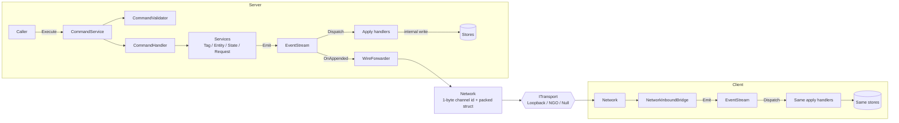
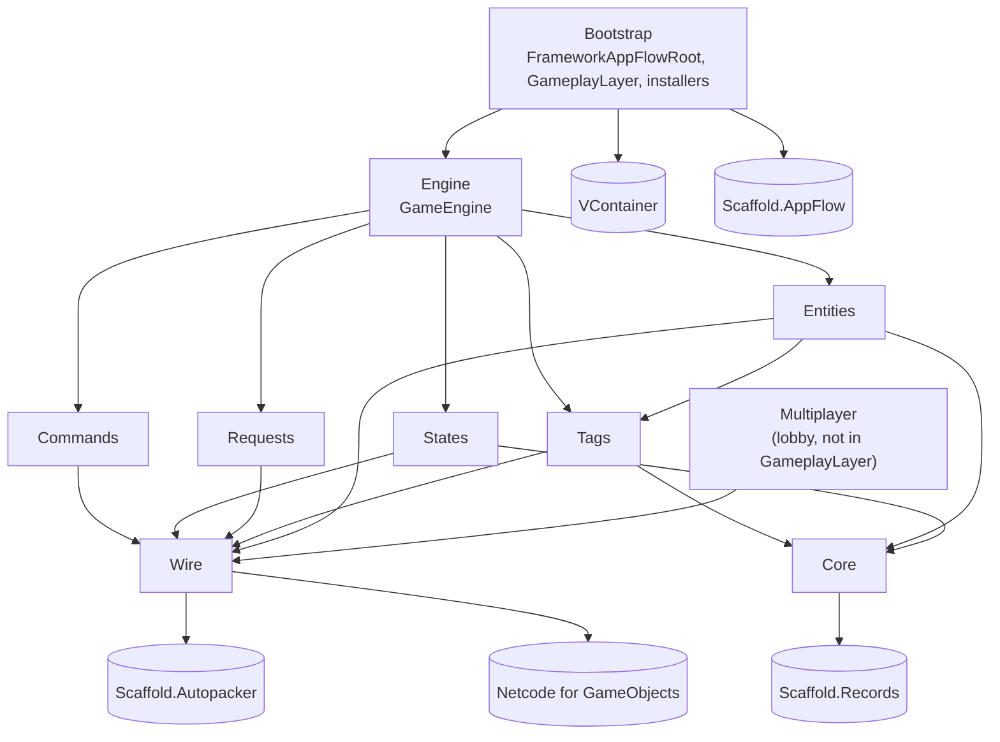

# Architecture

> **Status: current as of `main` @ `8a99696` (2026-06-05).** This doc describes the code in `Assets/Framework/` as it is. For what comes next, see [`Product/spikes/framework-roadmap.md`](../Product/spikes/framework-roadmap.md). When code and this doc disagree, the code is correct — fix this doc in the same PR.

Structure follows [matklad's ARCHITECTURE.md pattern](https://matklad.github.io/2021/02/06/ARCHITECTURE.md.html): bird's-eye view, codemap, cross-cutting invariants.

## Bird's-eye view

The framework is a server-authoritative, event-sourced card-game engine.

- The **server** runs commands. A command calls **services**. Services do not write state. They **emit events** into an `EventStream`.
- Each event goes to **apply handlers**. Apply handlers are the only code that writes to **stores**.
- The same events go over the **wire** to each client. The client has the same stores and the same apply handlers, so it builds the same state. The client has no services and no `GameEngine`.

Each feature has the same four parts:

| Part | Job | Server | Client |
|---|---|---|---|
| **Store** | Holds the state. Public read view, `internal` writers. | yes | yes |
| **Service** | Authoring API. Emits events. Never writes a store. | yes | no |
| **Apply handler** | Applies one event type to a store. The only writer. | yes | yes |
| **Installer** | Registers the parts in VContainer, gated by role. | yes | yes |

## Codemap

All paths are under `Assets/Framework/`. Assembly names are `Framework.<Feature>` (Runtime) and `Framework.<Feature>.Tests`.

| Feature | What it does | Key types |
|---|---|---|
| `Core/` | Typed slot ids and a registry that rejects slot clashes. | `TypeKey`, `SlotRegistry<TKey>` |
| `Wire/` | Event stream, apply-handler dispatch, block brackets, network channels, transports. Holds no domain events. | `WireEvent`, `EventStream`, `HandlerRegistry`, `WireEventHandler<T>`, `BlockScope`, `Network`, `NetworkChannel<T,TPacked>`, `Dispatcher`, `ITransport`, `LoopbackTransport`, `NgoTransport`, `NullTransport`, `WireRegistrar` |
| `Tags/` | Unmanaged values per (entity, tag slot). | `Tag<T>`, `TagService`, `TagStore`, `TagRegistry`; events `TagSetEvent<T>`, `TagChangeEvent<T>`, `TagRemovedEvent` |
| `Entities/` | Entity ids, entity types, optional definition id. | `Entity`, `EntityType` (`Player`, `Zone`, `Card`, `Modifier`), `EntityService`, `EntityStore`, `EntityTypeRegistry`, `Catalog<TDef>`, `IEntityDefinition`; event `EntityCreatedEvent` |
| `Requests/` | Server asks a player for a decision and awaits a `Task<TResponse>`. | `Request<TResponse>`, `Response`, `RequestService`, `RequestStore` |
| `States/` | The current match state (one value, replaced on push). | `GameState` (`MatchNotStartedState`, `PlayingState`, `MatchEndedState`), `StateService`, `StateStore`, `GameStateRegistry`; event `StatePushEvent` |
| `Commands/` | Validate, then handle, inside a `Command` block. Server only. | `Command`, `CommandValidator<T>`, `CommandHandler<T>`, `CommandService`, `CommandResult` |
| `Engine/` | Server-only handle: services plus read-only store views. | `GameEngine` |
| `Bootstrap/` | VContainer composition root. | `FrameworkAppFlowRoot`, `GameplayLayer`, `EngineInstaller`, `TagInstaller`, `EntityInstaller`, `RequestInstaller`, `StateInstaller`, `CommandInstaller` |
| `Multiplayer/` | Lobby, peers, ready-up over NGO. Not connected to `GameplayLayer` yet. | `Session`, `PeerRoster`, `Peer`, `PlayerData`, `PlayerContext`, `NetworkManagerSetup` |
| `Testing/` | Global test tiers. `Support/` holds `MatchHarness` and shared fixtures. `Acceptance/` has picture-bound scenarios: each test has a `[Picture("x.md")]` that links to a scenario in `Scenarios/`. `Integration/` has cross-feature test spines. See [`testing.md`](testing.md). | `MatchHarness`, `FullFlowIntegrationTests`, `BootstrapWiringIntegrationTests`, `RealAppFlowRootCompositionTests` |

Outside `Assets/Framework/`:

- `Assets/Spike/ECS/` — prototypes. `VerticalSlice` is the older complete game loop (effects, hooks, triggers, zones). It is the reference for the gameplay layer that the framework does not have yet.
- `Packages/com.scaffold.graphflow/` — graph package on Unity Graph Toolkit. The framework does not use it yet.

## How it works

### Composition

1. `FrameworkAppFlowRoot` (an AppFlow root with an `_isServer` field) yields one `GameplayLayer`.
2. `GameplayLayer` installs into one VContainer scope, in this order: Engine → Tag → Entity → Request → State → Command.
3. `EngineInstaller` registers `EventStream`, `HandlerRegistry`, `Network` and a `NullTransport` on both roles. On the server it adds `GameEngine` and `WireForwarder`. On the client it adds `NetworkInboundBridge`. A build callback calls `WireRegistrar.RegisterAll` to create the network channels.
4. Each feature installer registers its store, registry and apply handlers on both roles, and its service on the server only. `CommandInstaller` registers on the server only.

### One command, end to end (server)

1. A caller calls `CommandService.Execute(command)`.
2. If a `CommandValidator<T>` exists, it runs. A rejection returns `CommandResult.Reject(reason)`. No event is emitted.
3. `BlockScope.Open(BlockKind.Command)` emits `BlockStartEvent`.
4. The one `CommandHandler<T>` for the command runs. It calls services, for example `TagService.Set`. The service emits `TagSetEvent<T>` (or emits nothing if the value does not change).
5. `EventStream.Emit` appends the event. `HandlerRegistry` calls each apply handler for that event type. The apply handler writes the store.
6. `BlockScope.Close` emits `BlockEndEvent` with `Completed`, or `Errored` and rethrows.

All of this is synchronous. A service can read the store right after it emits.

### Server to client

- `WireForwarder` sends each appended event through `Network.Send`. The channel writes a 1-byte id and the packed struct (AutoPacker). `Dispatcher` gives the bytes to the `ITransport`.
- On the client, `Dispatcher` reads the id, the channel unpacks the event, and `NetworkInboundBridge` emits it into the client `EventStream`. The same apply handlers write the client stores.
- Channel ids come from reflection in `WireRegistrar`, sorted by type name. This class is marked temporary.

### Requests

`RequestService.Open<TResponse>(request)` stores a pending request, emits the request, and returns a `Task<TResponse>`. `RequestService.Complete(response)` resolves it. The framework ships no apply handlers for requests — the game (or test) supplies them. There is no client-to-server path yet: a response does not travel back over the wire.

### States

`StateService.Push<TState>()` emits `StatePushEvent`. `StatePushHandler` sets `StateStore.Current`. There is no stack, no pop and no OnEnter/OnExit yet.

### Role gating

The client does not get services, `GameEngine` or commands because the installers do not register them. Resolving a service on the client throws. Store writers are `internal` with `InternalsVisibleTo` for the apply handlers. There is no runtime authority check.

## Not built yet

These parts do not exist in `Assets/Framework/`. The [roadmap](../Product/spikes/framework-roadmap.md) puts them in order.

| Missing | What exists now |
|---|---|
| Effects, hooks, triggers, the stack | Only the unused values `BlockKind.Effect` and `BlockKind.Trigger`. Blocks do not nest (`ParentId` is always 0). |
| Engine loop, command queue, async commands | `Execute` is synchronous. No queue. |
| Client command submission (`Submit`), response round trip | Server drives everything. |
| Zones, players, modifiers | Only as `EntityType` values. No zone store, no ordering, no modifier logic. Players are not linked to Multiplayer peers. |
| Card definitions and authoring | `IEntityDefinition` and `Catalog<TDef>` only. |
| Presentation (views, view-models) | None (only sample MonoBehaviours). |
| GraphFlow integration | None. |
| Multiplayer ↔ gameplay | `GameplayLayer` always uses `NullTransport`. No installer wires `NgoTransport`. |
| Rollback | `WireEventHandler.Unapply` throws `NotImplementedException`. |

## Cross-cutting invariants

System-wide rules that span features. Edit with care — these are the load-bearing decisions.

**Pipeline entry is `Enqueue`, not `Execute` / `Submit`.** External callers enqueue intents, actions, requests, or events into a single pipeline. The naming reflects the future shape — a multi-type pipeline routed by kind — not the current command-only state. Don't rename this even if "Execute" reads more naturally for command-only usage today. *Current code: the only entry is `CommandService.Execute`, which is synchronous. The engine loop step of the roadmap brings in the pipeline and this name.*

**Keyed lookups follow four named patterns.** Every registry, store, cursor, and dispatch table in `Assets/Framework/` is one of four shapes across two families — Registry and Router (frozen at composition) or Store and Cell (live, handler-written). See [lookup-patterns.md](lookup-patterns.md).

**Wire carries no domain types.** Domain events live with their owning feature; `Framework.Wire` is a pure transport substrate (event stream + network + dispatch) holding no domain event types. Events travel by `int` id/slot, not C# type, wherever a slot suffices. (`Block*` is a recognized exception — it stays in Wire as a concept until the command-pipeline feature graduates and gives it structure.)

**Author through services, read through views.** The server engine handle (`GameEngine`) exposes authoring *services* and *read-only* store views — never writable stores. Store mutators are `internal` (apply-handlers only, via `InternalsVisibleTo`); readers are `public`. This makes "the handler is the sole writer" a compile-time guarantee. See [lookup-patterns.md](lookup-patterns.md).

**Services emit, handlers apply.** A service never writes a store. It emits an event, and the apply handler writes. The same apply handlers run on server and client, so both build the same state from the same events.

**Role gating is by registration.** Server-only parts (services, `GameEngine`, commands) are not registered on the client. Do not add runtime `isServer` checks inside services.

## Where the design lives

- Current design decisions: the spikes linked from the [roadmap](../Product/spikes/framework-roadmap.md) — `framework-architecture.md`, `definition-service-pattern.md`, `request-service.md`, `state-service.md`, `command-service.md`, `acceptance-test-suite.md`.
- The state model is recorded in [ADR-0014](../Product/decisions/0014-service-first-state-model.md). Vocabulary is in [`Product/ledgers/GLOSSARY.md`](../Product/ledgers/GLOSSARY.md).
- The old slice-based docs (`MatchStateSlice`, `GameRulesRuntime`, Scaffold.State slices) are archived: `Product/features/*/archive/` and `Product/_archive/ledgers/GLOSSARY-old-model.md`. ADR-0009 is superseded and ADR-0005, 0007 and 0010 to 0013 are superseded in part. Read them only for history or for the open questions behind unbuilt features.
